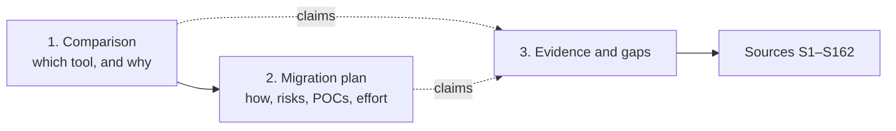
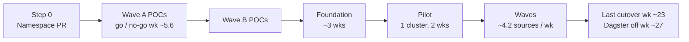

# Temporal vs Dagster for data ingestion

| Part | Question it answers | Doc |
|---|---|---|
| 1. Comparison | Open source, self-hosted **Temporal** or **Dagster** for ingestion pipelines? | [docs/1-comparison.md](docs/1-comparison.md) |
| 2. Migration plan | How do we move ~50 Dagster jobs (Meltano/dlt → Snowflake → dbt) to the shared company Temporal cluster, and how long will it take? | [docs/2-migration-plan.md](docs/2-migration-plan.md) |
| Evidence | What could not be verified, where sources conflict, what was re-checked | [docs/3-evidence-and-gaps.md](docs/3-evidence-and-gaps.md) |
| Sources | All 162 numbered sources behind the `[S#]` citations | [docs/sources.md](docs/sources.md) |

## Comparison in one table

Details and citations: [comparison §1](docs/1-comparison.md#1-summary).

| | Temporal OSS | Dagster OSS |
|---|---|---|
| What it is | Durable-execution engine: Workflows replayed from an Event History | Data orchestrator built on software-defined assets |
| Strong at | Long-running, high fan-out, rate-limited, resumable work; 8 SDK languages; OSS auth | Connectors (dlt, Sling, Airbyte, Fivetran, dbt), lineage, partitions, backfills |
| You build | Connectors, data tracking, partitions, alerting | Auth/RBAC (none in OSS), alerting (Dagster+ only) |
| Watch out | 2 MB payloads, 51,200-event histories; determinism and versioning | Single daemon; recovery only at step/run level; Prefect acquisition |
| Pick it for (*judgement*) | Custom, API-heavy, long-running ingestion | Batch ELT into a warehouse feeding dbt |

## Migration in one table

Details: [migration plan](docs/2-migration-plan.md). One person does the migration; all numbers are **estimates** (aggressive target, LLM-assisted).

| | |
|---|---|
| Status (2026-11-13) | Plan ready; all team questions answered. **Next:** platform PR for our non-prod Namespace |
| Top risk | Partitions and backfills: > 75 % of jobs, down to 5-minute, ~2-year backfills ([POC-07](docs/2-migration-plan.md#poc-07--partitions-and-backfills-u11-u18)) |
| Other High risks | Per-job isolation, shared API token limits, duplicates and state under retries, dbt overlap, shared-cluster readiness, worker network reach |
| Missing in Temporal | Partitions, partition status, lineage, asset catalog, freshness, alerts (re-verified 2026-11-12) |
| Picks for the gaps | Partition library + Snowflake status table + `BackfillWorkflow`; dbt docs + Snowflake lineage; `dbt source freshness`; failure Activity + Grafana alerts ([plan §4.2](docs/2-migration-plan.md#42-options-to-get-each-missing-feature)) |
| Cutover unit | Dependency cluster: all sources feeding the same dbt models move together; each cutover is reversible; a too-big cluster is split with a shared dbt job and exclusions ([plan §7.2](docs/2-migration-plan.md#72-cutover-unit-dependency-cluster)) |
| Effort | ~115 engineer-days; risk band 27–32 weeks to last cutover ([POC view](docs/2-migration-plan.md#61-poc-phase-at-a-glance), [estimates](docs/2-migration-plan.md#8-effort-and-timeline-estimates)) |

## Conventions

| Label | Meaning |
|---|---|
| `[S#]` | Citation; links to [docs/sources.md](docs/sources.md) |
| *Inference* | Reasoned from cited facts; not stated by the vendor |
| *Judgement* | Author's opinion (ratings, recommendations, risk levels) |
| **Not verified** | Missing from sources; listed in [docs/3-evidence-and-gaps.md](docs/3-evidence-and-gaps.md) |

| Versions | |
|---|---|
| Comparison (2026-11-11) | Temporal Server v1.32.1, Dagster 1.13.29 |
| Shared cluster (migration) | Temporal Server 1.32.2 |

This repo is public: internal repo, team and tenant names are kept out.
