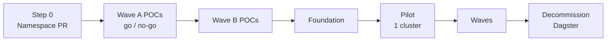

# Temporal vs Dagster for data ingestion

Two pieces of work, one repo:

1. **Comparison** of open source, self-hosted **Temporal** and **Dagster** for data engineering pipelines, focused on ingestion.
2. **Migration plan** for moving our ~50 Dagster ingestion jobs (Meltano/dlt → Snowflake → dbt) to a shared company Temporal cluster.

Every fact is cited to an official page; judgements and inferences are labelled.

## Read this

| Doc | What it answers | Read it if |
|---|---|---|
| [docs/1-comparison.md](docs/1-comparison.md) | How Temporal and Dagster differ, with exact limits, per-scenario patterns, a matrix and a decision flowchart | You are choosing an orchestrator |
| [docs/2-migration-plan.md](docs/2-migration-plan.md) | Current state, feature mapping, unknowns register, POC plan, cutover and rollback runbook | You are working on the migration |
| [docs/3-evidence-and-gaps.md](docs/3-evidence-and-gaps.md) | What could not be verified, source conflicts, verification log | You want to check a claim |
| [docs/sources.md](docs/sources.md) | All 141 numbered sources (`[S#]`) | You follow a citation |

## TL;DR

**Comparison** (details and citations in [§1 of the comparison](docs/1-comparison.md#1-summary))

| | Temporal OSS | Dagster OSS |
|---|---|---|
| What it is | Durable-execution engine: Workflows replayed from an Event History | Data orchestrator built on software-defined assets |
| Strong at | Long-running, high fan-out, rate-limited, resumable work; 8 SDK languages; OSS auth | Connectors (dlt, Sling, Airbyte, Fivetran, dbt), lineage, partitions, backfills |
| You build | Connectors, data tracking, partitions, alerting | Auth/RBAC (none in OSS), alerting (Dagster+ only) |
| Watch out | 2 MB payloads, 51,200-event histories; determinism and versioning | Single daemon; recovery only at step/run level; Prefect acquisition |
| Pick it for (*judgement*) | Custom, API-heavy, long-running ingestion | Batch ELT into a warehouse feeding dbt |

**Migration** (details in [the plan](docs/2-migration-plan.md))

| | |
|---|---|
| Status | Plan ready; all team questions answered (2026-11-12) |
| Next step | Platform PR to register our non-prod Namespace |
| Top risk | Partitions and backfills: > 75 % of jobs, down to 5-minute, ~2-year backfills (POC-07) |
| Other High risks | Per-job isolation, shared API token limits, duplicates and state under retries, dbt overlap, shared-cluster readiness |
| Cutover unit | Dependency cluster (all sources feeding the same dbt models move together), each reversible |

## Conventions

| Label | Meaning |
|---|---|
| `[S#]` | Citation; links to [docs/sources.md](docs/sources.md) |
| *Inference* | Reasoned from cited facts; not stated by the vendor |
| *Judgement* | Author's opinion (ratings, recommendations, risk levels) |
| **Not verified** | Missing from sources; listed in [docs/3-evidence-and-gaps.md](docs/3-evidence-and-gaps.md) |

Versions: Temporal Server v1.32.1, Dagster 1.13.29 (comparison, 2026-11-11); shared cluster runs Temporal Server 1.32.2 (migration). This repo is public: internal repo, team and tenant names are kept out.
