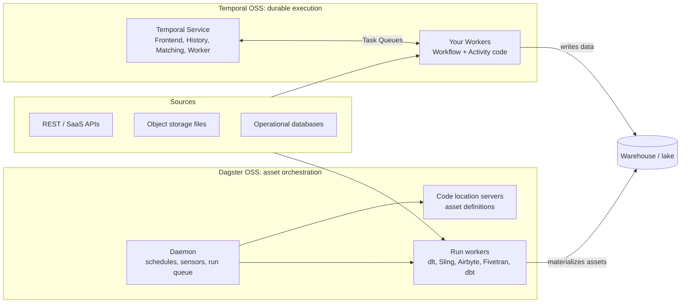

# Temporal vs Dagster for data ingestion

**Purpose.** This repository compares **open source, self-hosted Temporal** and **open source, self-hosted Dagster** for data engineering pipelines, with a focus on data ingestion (API polling, file arrival, incremental database loads, SaaS connector syncs and large backfills). It is written for engineers choosing an orchestrator. Every factual claim links to an official page; judgements are labelled as such, and anything the research could not confirm is listed in [docs/13](docs/13-unverified-and-open-questions.md). Temporal Cloud and Dagster+ appear only where they help draw the line around what the open source editions include.

## TL;DR verdict

Facts (cited in the linked docs):

- **Different categories.** Temporal is a general durable-execution engine: Workflows are deterministic code rebuilt by replaying an Event History, and side effects live in retried Activities ([Understanding Temporal](https://docs.temporal.io/evaluate/understanding-temporal), [Workflow Definition](https://docs.temporal.io/workflow-definition.md)). Dagster is "an orchestration platform for the development, production, and observation of data assets" ([dagster-io/dagster (GitHub)](https://github.com/dagster-io/dagster)).
- **Connectors.** Dagster has first-party integrations for dlt, Sling, Airbyte, Fivetran and dbt, which turn tables or streams into assets ([Dagster integrations index](https://dagster.io/docs/integrations/libraries)). No official Temporal data connectors were found; every source and sink is your own Activity code (see [doc 06](docs/06-data-ingestion.md)).
- **Data awareness.** Dagster tracks materializations, lineage, partitions and partition backfills ([Backfilling data](https://dagster.io/docs/guides/build/partitions-and-backfills/backfilling-data)). Temporal Schedules backfill *action times*, not data partitions ([Schedule](https://docs.temporal.io/schedule)).
- **Durability.** Temporal resumes a crashed Workflow where it stopped and lets an Activity resume from its last heartbeat checkpoint ([Understanding Temporal](https://docs.temporal.io/evaluate/understanding-temporal), [Long-Running Activity pattern](https://docs.temporal.io/design-patterns/long-running-activity)). Dagster recovers at step or asset boundaries through step retries, run retries and re-execution from failure ([Op retries](https://dagster.io/docs/guides/build/ops/op-retries), [Run retries](https://dagster.io/docs/deployment/execution/run-retries)).
- **Hard limits shape Temporal designs.** Payloads error at 2 MB and Event History terminates at 51,200 events or 50 MB by default, so data must travel by reference ([Self-hosted defaults](https://docs.temporal.io/self-hosted-guide/defaults), [Workflow Execution limits](https://docs.temporal.io/workflow-execution/limits)).
- **Security in OSS.** Temporal ships opt-in mTLS, a pluggable Authorizer/JWT ClaimMapper, UI SSO and payload codecs ([Temporal Platform security features](https://docs.temporal.io/self-hosted-guide/security)). Dagster OSS has no built-in auth or RBAC; a maintainer says these are Dagster+ only ([GitHub Discussion #23851 (maintainer answer)](https://github.com/dagster-io/dagster/discussions/23851)).
- **Stewardship.** Temporal Server is MIT ([temporalio/temporal (GitHub)](https://github.com/temporalio/temporal)). Dagster is Apache-2.0 and Prefect announced it is acquiring Dagster Labs on 2026-07-13 ([PyPI dagster JSON](https://pypi.org/pypi/dagster/json), [Prefect is acquiring Dagster](https://dagster.io/blog/prefect-is-acquiring-dagster)).

Judgement (the author's reading of the facts above):

- For **batch/ELT ingestion into a warehouse** where lineage, partitions and connectors matter, Dagster OSS is the better default.
- For **long-running, high fan-out or API-heavy ingestion** that needs per-item durability, resumable checkpoints and fine-grained retries, Temporal OSS is the better default, at the cost of building connectors and data tracking yourself.

## High-level picture

## When to pick which

*Judgement, based on the cited facts in [doc 12](docs/12-decision-guide.md).*

| Situation | Lean towards | Main reason |
|---|---|---|
| ELT from SaaS apps into a warehouse, then dbt | Dagster | First-party Fivetran, Airbyte, dlt, Sling and dbt asset integrations with table-level lineage |
| Daily/hourly partitioned loads with frequent backfills | Dagster | Partition-aware backfills, one run per partition or single-run ranges |
| New files landing in a bucket, one load per file | Either | Dagster sensors + dynamic partitions; Temporal Schedules + Child Workflows |
| Millions of documents/API calls, each needing retries and rate limits | Temporal | Per-Activity retries, heartbeat checkpoints, queue-global rate limits, sliding-window batch patterns |
| Ingestion steps that run hours and must resume mid-way | Temporal | Heartbeat details persist and are given to the next attempt |
| Mixed-language team (Go/Java/TypeScript/.NET) | Temporal | 8 SDK languages; Dagster definitions are Python only |
| Small team, minimal ops, needs a data catalog in the UI | Dagster | Fewer services; asset catalog and lineage built in |
| Strict multi-user access control on OSS | Temporal | Built-in opt-in auth hooks; Dagster OSS has no RBAC |

## Navigation

| # | Document | What it answers |
|---|---|---|
| 00 | [Plan](docs/00-plan.md) | Goals, scope, dimensions, ingestion scenarios, rubric, method |
| 01 | [Overview and philosophy](docs/01-overview-and-philosophy.md) | Workflow engine vs data/asset orchestrator |
| 02 | [Architecture](docs/02-architecture.md) | Components, storage, who runs user code |
| 03 | [Execution model and durability](docs/03-execution-model-and-durability.md) | Replay vs runs/assets; retries, timeouts, heartbeats |
| 04 | [Scheduling and triggers](docs/04-scheduling-and-triggers.md) | Schedules, sensors, automation, overlap |
| 05 | [Data awareness, lineage, partitions](docs/05-data-awareness-lineage-partitions.md) | Assets, materializations, partitions, backfills |
| 06 | [Data ingestion](docs/06-data-ingestion.md) | **Core doc**: connectors, scenario patterns, payloads, idempotency, rate limits |
| 07 | [Observability and UI](docs/07-observability-and-ui.md) | UI, metrics, tracing, logs, search |
| 08 | [Testing and developer experience](docs/08-testing-and-developer-experience.md) | Test tools, local dev, deploying changes |
| 09 | [Deployment, scaling and limits](docs/09-deployment-scaling-and-limits.md) | Install paths, scaling knobs, exact limits |
| 10 | [Security](docs/10-security.md) | Auth, RBAC, encryption in OSS |
| 11 | [Licensing and community](docs/11-licensing-and-community.md) | Licence, releases, stars, ownership |
| 12 | [Decision guide](docs/12-decision-guide.md) | Flowchart, per-scenario picks, using both |
| 13 | [Unverified and open questions](docs/13-unverified-and-open-questions.md) | Gaps, conflicts, third-party claims |
| — | [Comparison matrix](comparison-matrix.md) | One table, every dimension, cited per cell |
| — | [Sources](references/sources.md) | All URLs, numbered, grouped by tool and topic |

## How claims are verified

- **As-of date:** 2026-11-11.
- **Versions covered:** Temporal Server v1.32.1, marked "Latest" on GitHub, released October 8 ([temporalio/temporal releases](https://github.com/temporalio/temporal/releases); the year 2026 is inferred). Dagster 1.13.29 on PyPI, uploaded 2026-11-05 ([PyPI dagster JSON](https://pypi.org/pypi/dagster/json)). The Dagster docs site version picker still showed 1.12.8 at research time ([OSS deployment architecture](https://dagster.io/docs/deployment/oss/oss-deployment-architecture)); see [doc 13](docs/13-unverified-and-open-questions.md).
- **Source policy:** official docs and GitHub first. Vendor blogs are labelled *vendor blog*; third-party pages are labelled *third-party*. Pages found by search but not read are labelled *not fetched* and are never the only support for a fact.
- **Method:** facts come from four research note files built from fetched pages. Page text was extracted with a summarisation fetch tool, so quote wording should be spot-checked before reuse. The GitHub API was blocked, so GitHub numbers come from rendered HTML.
- **Labels used in the docs:** *Inference* = a reasoned conclusion from cited facts, not stated by the vendor. *Judgement* = the author's opinion. **Not verified** = missing from the sources; listed in doc 13.
- Full method, rubric and scenarios: [the plan](docs/00-plan.md).

## Sources

- [S1] [Understanding Temporal](https://docs.temporal.io/evaluate/understanding-temporal)
- [S5] [Workflow Definition](https://docs.temporal.io/workflow-definition.md)
- [S10] [Schedule](https://docs.temporal.io/schedule)
- [S11] [Self-hosted defaults](https://docs.temporal.io/self-hosted-guide/defaults)
- [S12] [Workflow Execution limits](https://docs.temporal.io/workflow-execution/limits)
- [S20] [Long-Running Activity pattern](https://docs.temporal.io/design-patterns/long-running-activity)
- [S45] [Temporal Platform security features](https://docs.temporal.io/self-hosted-guide/security)
- [S48] [temporalio/temporal (GitHub)](https://github.com/temporalio/temporal) — *GitHub HTML scraped*
- [S49] [temporalio/temporal releases](https://github.com/temporalio/temporal/releases) — *GitHub HTML scraped*
- [S52] [OSS deployment architecture](https://dagster.io/docs/deployment/oss/oss-deployment-architecture)
- [S58] [Op retries](https://dagster.io/docs/guides/build/ops/op-retries)
- [S59] [Run retries](https://dagster.io/docs/deployment/execution/run-retries)
- [S64] [Backfilling data](https://dagster.io/docs/guides/build/partitions-and-backfills/backfilling-data)
- [S68] [Dagster integrations index](https://dagster.io/docs/integrations/libraries)
- [S89] [GitHub Discussion #23851 (maintainer answer)](https://github.com/dagster-io/dagster/discussions/23851)
- [S93] [dagster-io/dagster (GitHub)](https://github.com/dagster-io/dagster) — *GitHub HTML scraped*
- [S95] [PyPI dagster JSON](https://pypi.org/pypi/dagster/json)
- [S96] [Prefect is acquiring Dagster](https://dagster.io/blog/prefect-is-acquiring-dagster) — *vendor blog*

Full numbered list: [references/sources.md](references/sources.md)
