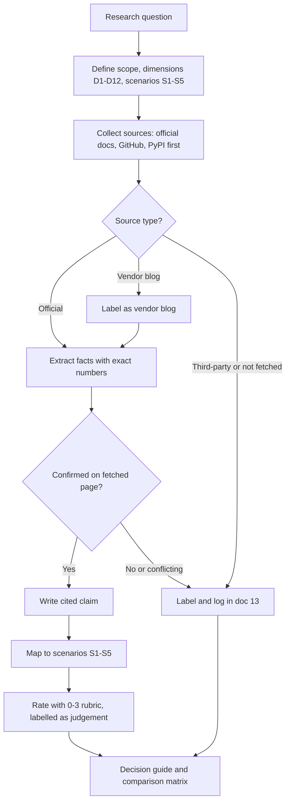

# 00 — Comparison plan

> **Key takeaways**
> - Question: how do **open source** Temporal and **open source** Dagster compare for data engineering pipelines, especially ingestion?
> - Scope is self-hosted OSS. Temporal Cloud and Dagster+ appear only to mark what OSS lacks.
> - 12 evaluation dimensions and 5 ingestion scenarios drive every other document.
> - Official docs and GitHub come first; vendor blogs and third-party pages are labelled; gaps go to [doc 13](13-unverified-and-open-questions.md).
> - Ratings use a 0–3 rubric and are **judgements**, kept separate from cited facts.

## 1. Goals

- Explain the core difference in philosophy and execution model.
- Show, per ingestion scenario, how each tool would be used and what you must build yourself.
- Give exact, cited limits and defaults that affect ingestion design.
- Produce a decision guide that a team can apply in under 10 minutes.
- Make every gap and unverified claim visible.

## 2. Scope

| In scope | Out of scope / contrast only |
|---|---|
| Temporal Server (OSS, MIT) and its SDKs, self-hosted | Temporal Cloud (used only to contrast limits) |
| Dagster OSS (Apache-2.0), self-hosted | Dagster+ Serverless / Hybrid (used only to show which features are not in OSS) |
| Batch, micro-batch and event-triggered ingestion | Stream processing engines, CDC tools themselves |
| Integration libraries maintained by Dagster | Prefect product roadmap after the acquisition |

## 3. Audience

- Data and platform engineers choosing an orchestrator for ingestion.
- Engineering graduates who want precise, short answers with diagrams.
- Assumed knowledge: Python, SQL, basic cloud storage and containers.

## 4. Evaluation dimensions

| # | Dimension | What is measured | Main doc |
|---|---|---|---|
| D1 | Philosophy and core abstraction | Unit of work (Workflow/Activity vs asset/op/run); stated positioning | [01](01-overview-and-philosophy.md) |
| D2 | Architecture and footprint | Services, databases, where user code runs, replicas | [02](02-architecture.md) |
| D3 | Execution model and durability | Recovery granularity, retry defaults, timeouts, heartbeats, versioning cost | [03](03-execution-model-and-durability.md) |
| D4 | Scheduling and triggers | Cron/interval, event triggers, overlap control, catch-up, backfill of schedule times | [04](04-scheduling-and-triggers.md) |
| D5 | Data awareness | Lineage, materialization records, partitions, partition backfills, data-quality checks | [05](05-data-awareness-lineage-partitions.md) |
| D6 | Ingestion fit | Connectors, scenario patterns, large payloads, idempotency, rate limiting, backfills | [06](06-data-ingestion.md) |
| D7 | Observability | UI focus, metrics, tracing, logs, search, alerting in OSS | [07](07-observability-and-ui.md) |
| D8 | Testing and DX | Test tooling, local dev, deploy-change safety, languages | [08](08-testing-and-developer-experience.md) |
| D9 | Deployment, scaling, limits | Install paths, scaling knobs, numeric limits | [09](09-deployment-scaling-and-limits.md) |
| D10 | Security | AuthN, AuthZ/RBAC, transport and payload encryption in OSS | [10](10-security.md) |
| D11 | Licensing and community | Licence, release cadence, GitHub signals, ownership risk | [11](11-licensing-and-community.md) |
| D12 | Interoperability | Official integration between the two; pattern for using both | [12](12-decision-guide.md) |

## 5. Ingestion scenarios used for evaluation

| ID | Scenario | What "good" looks like |
|---|---|---|
| S1 | **API polling** of a REST/SaaS API on a schedule | Pagination, cursor state, retries with backoff, respect for API rate limits, no overlapping runs |
| S2 | **File arrival in S3** (or any object store) | Detect new objects, process each file once, track per-file status, reprocess on demand |
| S3 | **Database incremental / CDC-style batch** | High-watermark cursor, idempotent upserts, safe re-runs of a window |
| S4 | **SaaS connector sync** (Fivetran, Airbyte, dlt, Sling, Meltano) | Trigger or observe syncs, model tables as tracked outputs, link to downstream dbt |
| S5 | **Large backfill** over months or millions of items | Bounded concurrency, resumability, fault isolation, history/payload limits respected |

## 6. Source policy

1. **Primary:** docs.temporal.io, temporal.io changelog, dagster.io/docs, official GitHub repos, PyPI.
2. **Vendor-hosted non-normative:** blogs and guest posts on temporal.io or dagster.io, labelled *vendor blog*.
3. **Third-party:** press, community projects, forum answers, labelled *third-party*; never used as sole support for a fact.
4. **Not fetched:** URLs found by search whose content was not read; cited only as pointers.
5. Facts not in the notes are written as **Not verified** and logged in [doc 13](13-unverified-and-open-questions.md).

## 7. Verification method

- Research notes were built from fetched pages on 2026-11-11 ([Understanding Temporal](https://docs.temporal.io/evaluate/understanding-temporal) and [OSS deployment architecture](https://dagster.io/docs/deployment/oss/oss-deployment-architecture) are typical primary pages).
- Each claim in these docs maps to a cited URL in [references/sources.md](../references/sources.md).
- Numbers (limits, defaults, versions) are copied exactly from the notes; no rounding.
- Where two sources disagree, both are shown and the conflict is logged in doc 13.
- Code sketches use only API names checked against official docs or package source (cited under each sketch); they are marked illustrative.

## 8. Rating rubric

Used in [comparison-matrix.md](../comparison-matrix.md) and [doc 12](12-decision-guide.md). **Ratings are judgements.**

| Score | Meaning |
|---|---|
| 3 | Built in, first-party, documented for this need |
| 2 | Documented pattern or configuration; modest custom code |
| 1 | Possible with significant custom code or third-party add-ons |
| 0 | Not supported in OSS, or **Not verified** |

## 9. Deliverables

| File | Content |
|---|---|
| `README.md` | Purpose, TL;DR, diagram, when-to-pick table, navigation |
| `docs/00`–`docs/12` | One document per dimension plus decision guide |
| `docs/13-unverified-and-open-questions.md` | Every unverified, conflicting or third-party claim |
| `comparison-matrix.md` | All dimensions, one citation per cell |
| `references/sources.md` | Numbered sources grouped by tool and topic |

## 10. Methodology flow

## Sources

- [S1] [Understanding Temporal](https://docs.temporal.io/evaluate/understanding-temporal)
- [S52] [OSS deployment architecture](https://dagster.io/docs/deployment/oss/oss-deployment-architecture)

Full numbered list: [references/sources.md](../references/sources.md)
