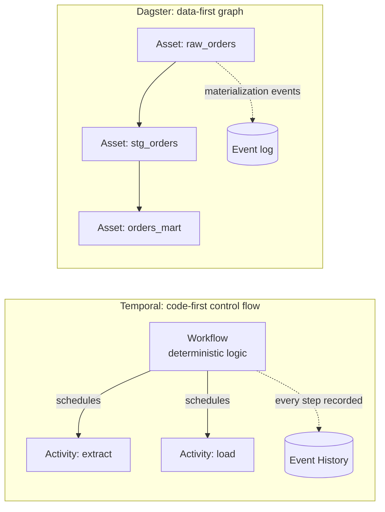

# 01 — Overview and philosophy

> **Key takeaways**
> - **Temporal** is a general **durable-execution engine**: your code runs to completion "whether that takes a second or a year", even across crashes ([Understanding Temporal](https://docs.temporal.io/evaluate/understanding-temporal)).
> - **Dagster** is a **data orchestrator** built around **software-defined assets** ("development, production, and observation of data assets") ([dagster-io/dagster (GitHub)](https://github.com/dagster-io/dagster)).
> - Temporal knows about Workflows, Activities and events, not datasets. Dagster knows about assets, partitions and lineage, but recovers only at step/asset boundaries.
> - Neither vendor publishes an official comparison with the other ([How does Dagster compare to Flyte and Temporal (community forum)](https://discuss.dagster.io/t/22772686/how-does-dagster-compare-to-flyte-and-temporal) is a third-party AI answer, not authoritative).

## 1. One-line definitions

| | Temporal (OSS) | Dagster (OSS) |
|---|---|---|
| Self-description | Durable Execution: a started Workflow keeps running until it completes; after a crash another process rebuilds state and resumes ([Understanding Temporal](https://docs.temporal.io/evaluate/understanding-temporal)) | "An orchestration platform for the development, production, and observation of data assets" ([dagster-io/dagster (GitHub)](https://github.com/dagster-io/dagster)) |
| Core unit | Workflow (deterministic orchestration code) + Activity (side effects) ([Workflow Definition](https://docs.temporal.io/workflow-definition.md)) | Asset (central abstraction); ops, jobs and graphs as the lower task layer ([Components](https://dagster.io/docs/guides/build/components), [Run executors](https://dagster.io/docs/guides/operate/run-executors)) |
| Who it competes with, per vendor | Not stated against Dagster | "orchestrators and workflow engines" that "focused exclusively on operational concerns" ([Why We Built Dagster](https://dagster.io/blog/dagster-the-data-orchestrator), *vendor blog*) |
| Languages | .NET, Go, Java, PHP, Python, Ruby, Rust, TypeScript ([Understanding Temporal](https://docs.temporal.io/evaluate/understanding-temporal)) | Python for definitions; other languages via Dagster Pipes ([Dagster Pipes (guide)](https://dagster.io/docs/guides/build/external-pipelines)) |

## 2. Mental models

- **Temporal:** you write a program. The engine records each step in an Event History and can replay the program to rebuild state ([Workflow Definition](https://docs.temporal.io/workflow-definition.md)).
- **Dagster:** you declare data assets and their dependencies. The engine records materializations and shows them in a lineage graph ([Backfilling data](https://dagster.io/docs/guides/build/partitions-and-backfills/backfilling-data), [Dagster Pipes (guide)](https://dagster.io/docs/guides/build/external-pipelines)).

## 3. What each tool explicitly is not

- Temporal **does not run your code** on its servers; your Workers do. The docs call the opposite belief a "common misconception" ([Understanding Temporal](https://docs.temporal.io/evaluate/understanding-temporal)).
- Temporal has no built-in concept of datasets, assets, lineage, partitions or data quality. *Inference from the notes*: these must be built in application code.
- A Temporal guest post states Temporal does not provide row-level auditing ([The foundation: Why Temporal for a data pipeline?](https://temporal.io/blog/the-foundation-why-temporal-for-a-data-pipeline), *vendor blog, guest post*).
- No fetched official Dagster page claims Temporal-style durable execution (event-sourced replay). Dagster recovery is per step or asset, using persisted outputs ([Run retries](https://dagster.io/docs/deployment/execution/run-retries)).

## 4. Positioning as of 2026-11-11

- Temporal publishes data-pipeline content mainly as guest posts and customer stories, not normative ETL docs ([The foundation: Why Temporal for a data pipeline?](https://temporal.io/blog/the-foundation-why-temporal-for-a-data-pipeline), [How Rapidflare built a million+ document ingestion pipeline](https://temporal.io/blog/how-rapidflare-built-a-million-document-ingestion-pipeline-for-agents-on-temporal)).
- Dagster positions itself against task-centric engines: "Since Dagster is data-asset aware, it can provide context around those assets that no other system can" ([Why We Built Dagster](https://dagster.io/blog/dagster-the-data-orchestrator), *vendor blog*).
- Prefect announced it is acquiring Dagster Labs (2026-07-13); Dagster says the OSS project "will be actively developed" and there are "no plans to merge Dagster into Prefect" ([Prefect is acquiring Dagster](https://dagster.io/blog/prefect-is-acquiring-dagster), [Dagster Customer FAQ](https://dagster.io/dagster-customer-faq)). See [doc 11](11-licensing-and-community.md).

## 5. Implications for ingestion

*Judgement:*

- If your problem is "**move many things reliably**" (API pages, documents, files) with complex retry and state logic, Temporal's model fits the shape of the work.
- If your problem is "**keep these tables fresh and know where they came from**", Dagster's asset model fits the shape of the data.
- Many teams have both problems; [doc 12](12-decision-guide.md) covers a combined pattern (no official integration exists).

## Sources

- [S1] [Understanding Temporal](https://docs.temporal.io/evaluate/understanding-temporal)
- [S5] [Workflow Definition](https://docs.temporal.io/workflow-definition.md)
- [S27] [The foundation: Why Temporal for a data pipeline?](https://temporal.io/blog/the-foundation-why-temporal-for-a-data-pipeline) — *vendor blog, guest post*
- [S28] [How Rapidflare built a million+ document ingestion pipeline](https://temporal.io/blog/how-rapidflare-built-a-million-document-ingestion-pipeline-for-agents-on-temporal) — *vendor blog, customer guest post*
- [S56] [Run executors](https://dagster.io/docs/guides/operate/run-executors)
- [S57] [Components](https://dagster.io/docs/guides/build/components)
- [S59] [Run retries](https://dagster.io/docs/deployment/execution/run-retries)
- [S64] [Backfilling data](https://dagster.io/docs/guides/build/partitions-and-backfills/backfilling-data)
- [S66] [Dagster Pipes (guide)](https://dagster.io/docs/guides/build/external-pipelines)
- [S93] [dagster-io/dagster (GitHub)](https://github.com/dagster-io/dagster) — *GitHub HTML scraped*
- [S96] [Prefect is acquiring Dagster](https://dagster.io/blog/prefect-is-acquiring-dagster) — *vendor blog*
- [S97] [Dagster Customer FAQ](https://dagster.io/dagster-customer-faq) — *vendor FAQ*
- [S100] [Why We Built Dagster](https://dagster.io/blog/dagster-the-data-orchestrator) — *vendor blog*
- [S102] [How does Dagster compare to Flyte and Temporal (community forum)](https://discuss.dagster.io/t/22772686/how-does-dagster-compare-to-flyte-and-temporal) — *third-party, AI-generated answer, not authoritative*

Full numbered list: [references/sources.md](../references/sources.md)
