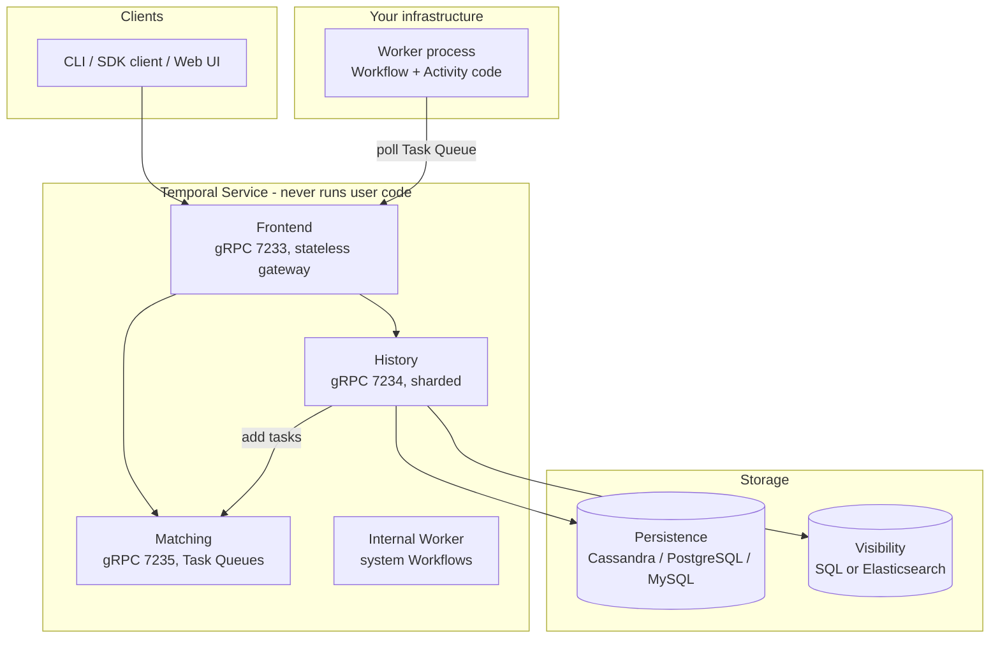
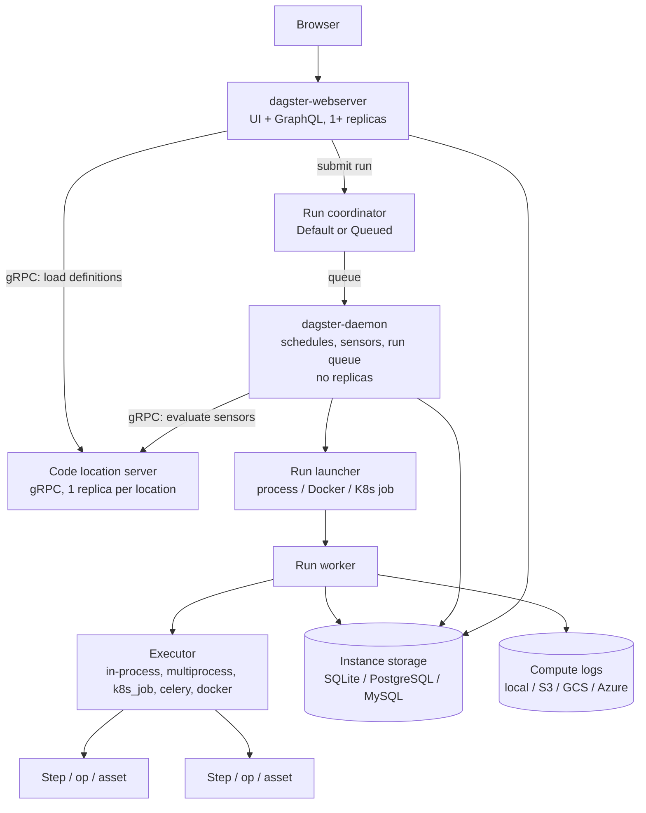
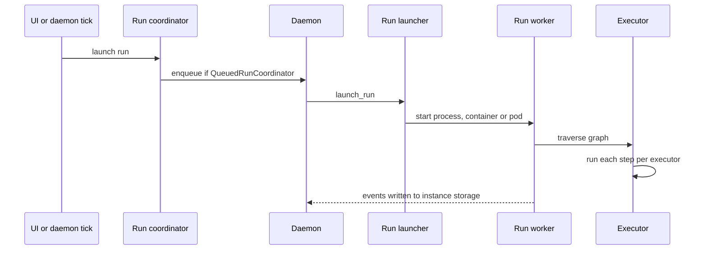

# 02 — Architecture

> **Key takeaways**
> - **Temporal Server** = 4 Go services (Frontend, History, Matching, internal Worker) + a database (Cassandra, PostgreSQL or MySQL) + a visibility store (SQL or Elasticsearch) ([Temporal Server](https://docs.temporal.io/temporal-service/temporal-server), [Persistence](https://docs.temporal.io/temporal-service/persistence)).
> - **Dagster OSS** = 3 long-running services (webserver, one daemon, code-location gRPC servers) + a run launcher that starts a run worker per run ([OSS deployment architecture](https://dagster.io/docs/deployment/oss/oss-deployment-architecture)).
> - In both, **user code runs outside the control plane**: Temporal Workers; Dagster code servers, run workers and step processes.
> - Dagster's daemon **does not support replicas** ([OSS deployment architecture](https://dagster.io/docs/deployment/oss/oss-deployment-architecture)). Temporal services scale independently; History Shard count is fixed at creation ([Temporal Server](https://docs.temporal.io/temporal-service/temporal-server)).

## 1. Temporal OSS components

| Component | Role | Facts |
|---|---|---|
| Frontend | Stateless gateway: rate limiting, authorization, validation, routing; routes by hashing Workflow Id | gRPC 7233, membership 6933; not sharded ([Temporal Server](https://docs.temporal.io/temporal-service/temporal-server)) |
| History | Persists Workflow state and Event History; adds Tasks to Task Queues | gRPC 7234; 1 to N processes, start ~1 per 500 shards ([Temporal Server](https://docs.temporal.io/temporal-service/temporal-server)) |
| Matching | Hosts Task Queues; matches Workers to Tasks | gRPC 7235; multiple instances ([Temporal Server](https://docs.temporal.io/temporal-service/temporal-server)) |
| Internal Worker | Replication queue, system Workflows | Membership 6939; not where user code runs ([Temporal Server](https://docs.temporal.io/temporal-service/temporal-server)) |
| Persistence DB | Cassandra 3.11, 4.0, 5.0.4+; PostgreSQL 13.18, 14.15, 15.10, 16.6; MySQL 5.7, 8.0 (8.0.19+); SQLite dev only | Vitess and CockroachDB not tested ([Persistence](https://docs.temporal.io/temporal-service/persistence)) |
| Visibility | Elasticsearch recommended for production; SQL advanced visibility from Server 1.20 (MySQL 8.0.17+, PostgreSQL 12+) | ([Persistence](https://docs.temporal.io/temporal-service/persistence)); setup guide ([Self-hosted Visibility](https://docs.temporal.io/self-hosted-guide/visibility)) |
| Workers | Run Workflow and Activity code; built with an SDK and deployed by you | ([Understanding Temporal](https://docs.temporal.io/evaluate/understanding-temporal)) |

## 2. Dagster OSS components

| Component | Role | Facts |
|---|---|---|
| Webserver | Serves UI and answers GraphQL | One or more replicas ([OSS deployment architecture](https://dagster.io/docs/deployment/oss/oss-deployment-architecture)) |
| Daemon | Operates schedules, sensors, run queuing | Replicas not supported ([OSS deployment architecture](https://dagster.io/docs/deployment/oss/oss-deployment-architecture)) |
| Code location server | Serves definitions metadata over gRPC | One replica per code location ([OSS deployment architecture](https://dagster.io/docs/deployment/oss/oss-deployment-architecture)); OSS daemon calls it directly for sensors ([Troubleshooting sensor timeouts](https://dagster.io/docs/deployment/troubleshooting/sensor-timeouts)) |
| Run coordinator | `DefaultRunCoordinator` launches immediately; `QueuedRunCoordinator` queues via the daemon with concurrency limits and priorities | ([Run coordinators](https://dagster.io/docs/deployment/execution/run-coordinators)) |
| Run launcher | `DefaultRunLauncher` (process on code-location node), `DockerRunLauncher`, `K8sRunLauncher` | ([dagster.yaml reference](https://dagster.io/docs/deployment/oss/dagster-yaml)) |
| Executor | Default `multi_or_in_process_executor` runs each step in its own process; others: `in_process`, `multiprocess`, `k8s_job`, `celery`, `docker`, `celery_docker` | ([Run executors](https://dagster.io/docs/guides/operate/run-executors)) |
| Storage | `sqlite`, `postgres` (`dagster-postgres`), `mysql` (`dagster-mysql`); separate run, event log and schedule storage | ([dagster.yaml reference](https://dagster.io/docs/deployment/oss/dagster-yaml)) |
| Compute logs | `LocalComputeLogManager` (default), S3, GCS, Azure Blob, NoOp | ([Instance configuration](https://dagster.io/docs/deployment/oss/oss-instance-configuration), [dagster.yaml reference](https://dagster.io/docs/deployment/oss/dagster-yaml)) |
| Config levels | `dagster.yaml` (instance), `workspace.yaml` (code access), run config (executor, ops, resources) | ([OSS deployment architecture](https://dagster.io/docs/deployment/oss/oss-deployment-architecture)) |

## 3. Run flow in Dagster

Source for the flow: [OSS deployment architecture](https://dagster.io/docs/deployment/oss/oss-deployment-architecture), [Run coordinators](https://dagster.io/docs/deployment/execution/run-coordinators).

## 4. Side-by-side

| Aspect | Temporal OSS | Dagster OSS |
|---|---|---|
| Control-plane services | Frontend, History, Matching, internal Worker ([Temporal Server](https://docs.temporal.io/temporal-service/temporal-server)) | Webserver, daemon, code-location servers ([OSS deployment architecture](https://dagster.io/docs/deployment/oss/oss-deployment-architecture)) |
| Where user code runs | Your Worker processes only ([Understanding Temporal](https://docs.temporal.io/evaluate/understanding-temporal)) | Code-location servers (load definitions, evaluate sensors/schedules), run workers, step processes ([OSS deployment architecture](https://dagster.io/docs/deployment/oss/oss-deployment-architecture)) |
| Required database | Cassandra / PostgreSQL / MySQL ([Persistence](https://docs.temporal.io/temporal-service/persistence)) | SQLite (default) / PostgreSQL / MySQL ([dagster.yaml reference](https://dagster.io/docs/deployment/oss/dagster-yaml)) |
| Optional extra store | Elasticsearch for visibility ([Persistence](https://docs.temporal.io/temporal-service/persistence)) | Object storage for compute logs ([dagster.yaml reference](https://dagster.io/docs/deployment/oss/dagster-yaml)) |
| HA of scheduler | Services can run as multiple instances ([Temporal Server](https://docs.temporal.io/temporal-service/temporal-server)) | Single daemon, no replicas ([OSS deployment architecture](https://dagster.io/docs/deployment/oss/oss-deployment-architecture)) |
| Fixed-at-creation setting | Number of History Shards ([Temporal Server](https://docs.temporal.io/temporal-service/temporal-server)) | None found in the notes |
| Reference packaged deployment | Docker Compose: PostgreSQL + Elasticsearch, gRPC 7233, UI 8080 ([Deploying a Temporal Service](https://docs.temporal.io/self-hosted-guide/deployment)) | Helm chart: daemon, webserver (8080), user-code gRPC servers, in-cluster PostgreSQL ([Deploying to Kubernetes](https://dagster.io/docs/deployment/oss/deployment-options/kubernetes/deploying-to-kubernetes)) |

*Inference (from notes):* Temporal's self-hosted footprint is heavier to operate (4 service roles, DB schema migrations, optional Elasticsearch). Dagster's single daemon is a single point of failure for schedules and sensors that relies on the platform (for example Kubernetes) to restart it.

## Sources

- [S1] [Understanding Temporal](https://docs.temporal.io/evaluate/understanding-temporal)
- [S2] [Temporal Server](https://docs.temporal.io/temporal-service/temporal-server)
- [S3] [Persistence](https://docs.temporal.io/temporal-service/persistence)
- [S4] [Self-hosted Visibility](https://docs.temporal.io/self-hosted-guide/visibility) — *not fetched*
- [S14] [Deploying a Temporal Service](https://docs.temporal.io/self-hosted-guide/deployment)
- [S52] [OSS deployment architecture](https://dagster.io/docs/deployment/oss/oss-deployment-architecture)
- [S53] [dagster.yaml reference](https://dagster.io/docs/deployment/oss/dagster-yaml)
- [S54] [Instance configuration](https://dagster.io/docs/deployment/oss/oss-instance-configuration)
- [S55] [Run coordinators](https://dagster.io/docs/deployment/execution/run-coordinators)
- [S56] [Run executors](https://dagster.io/docs/guides/operate/run-executors)
- [S62] [Troubleshooting sensor timeouts](https://dagster.io/docs/deployment/troubleshooting/sensor-timeouts)
- [S88] [Deploying to Kubernetes](https://dagster.io/docs/deployment/oss/deployment-options/kubernetes/deploying-to-kubernetes)

Full numbered list: [references/sources.md](../references/sources.md)
