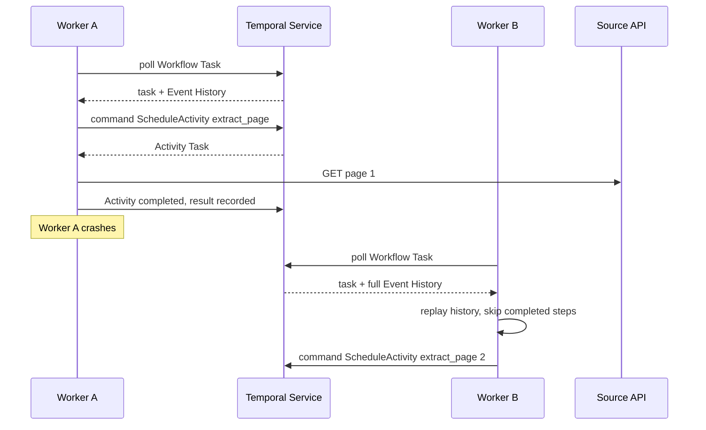
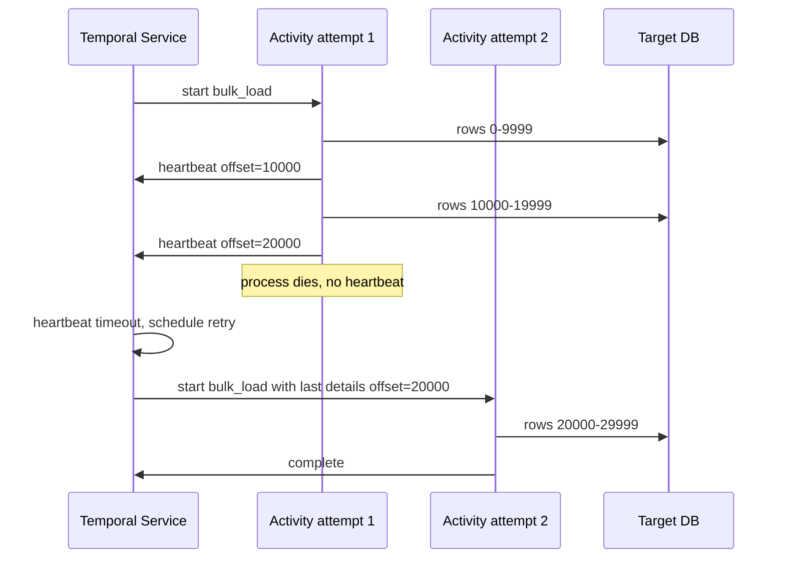
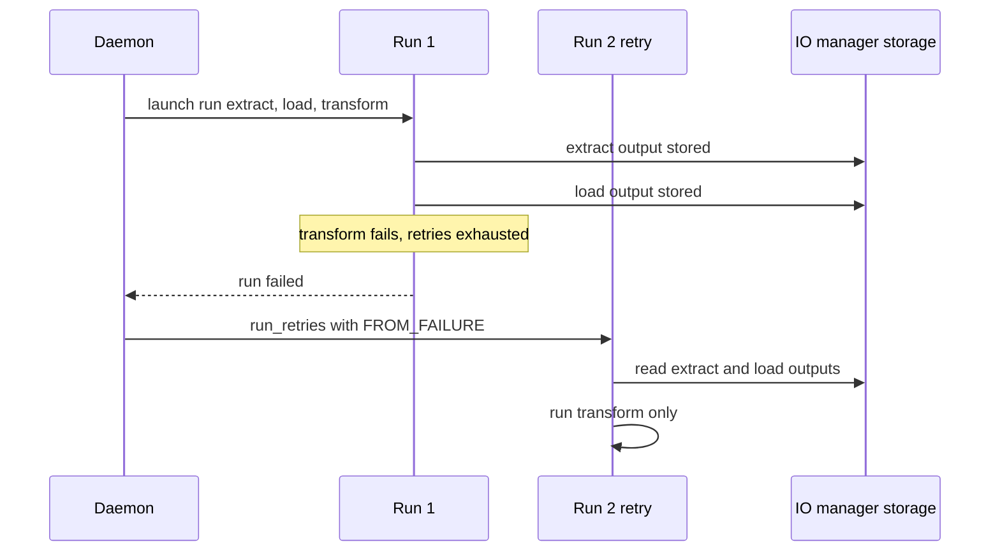

# 03 — Execution model and durability

> **Key takeaways**
> - **Temporal** records every Workflow step in an **Event History** and rebuilds state by **replay**; Workflow code must be deterministic, and all I/O goes in **Activities** ([Workflow Definition](https://docs.temporal.io/workflow-definition.md)).
> - Temporal **Activities retry forever by default** (1 s initial, ×2.0, max 100 s); **Workflows do not retry by default** ([Retry Policies](https://docs.temporal.io/encyclopedia/retry-policies)).
> - **Dagster** recovers at **step/asset** level: `RetryPolicy` per op/asset, `run_retries` per run, and `FROM_FAILURE` re-execution that reuses persisted outputs ([Op retries](https://dagster.io/docs/guides/build/ops/op-retries), [Run retries](https://dagster.io/docs/deployment/execution/run-retries)).
> - Temporal can resume **inside** a long Activity via heartbeat checkpoints ([Long-Running Activity pattern](https://docs.temporal.io/design-patterns/long-running-activity)); Dagster re-runs a failed step from its start (*inference from notes*).
> - Temporal's price: determinism rules and versioning discipline for every Workflow change ([Safely deploying changes to Workflow code](https://docs.temporal.io/develop/safe-deployments)).

## 1. Temporal: Workflows, Activities, replay

| Concept | Fact |
|---|---|
| Durable Execution | A started Workflow runs until complete; on a crash, another process rebuilds state and resumes ([Understanding Temporal](https://docs.temporal.io/evaluate/understanding-temporal)) |
| Determinism | Same input must yield the same Workflow API calls in the same order; no branching on local time or random numbers ([Workflow Definition](https://docs.temporal.io/workflow-definition.md)) |
| Where I/O goes | API calls, database queries and other external interactions belong in Activities ([Workflow Definition](https://docs.temporal.io/workflow-definition.md)) |
| Replay | Emitted Commands are compared with Event History; a mismatch raises a non-deterministic error ([Workflow Definition](https://docs.temporal.io/workflow-definition.md)) |
| Versioning | Worker Versioning recommended; patching (`Patched` / `GetVersion`) is the alternative ([Workflow Definition](https://docs.temporal.io/workflow-definition.md), [Safely deploying changes to Workflow code](https://docs.temporal.io/develop/safe-deployments)) |
| Failure of a Workflow | Only if Workflow code throws, not because a Worker failed ([Workflow Definition](https://docs.temporal.io/workflow-definition.md)) |

## 2. Temporal retries, timeouts and heartbeats

### Default Activity Retry Policy ([Retry Policies](https://docs.temporal.io/encyclopedia/retry-policies))

| Field | Default |
|---|---|
| InitialInterval | 1 s |
| BackoffCoefficient | 2.0 |
| MaximumInterval | 100 × InitialInterval = 100 s |
| MaximumAttempts | unlimited (0 = unlimited) |
| NonRetryableErrorTypes | none |

- Workflow Executions have **no default Retry Policy**; Workflow *Task* Executions retry with backoff up to a 10-minute interval until the Workflow Execution Timeout (unlimited by default) ([Retry Policies](https://docs.temporal.io/encyclopedia/retry-policies)).
- Workflow retries are "generally discouraged"; exceptions include cron-like and file-processing Workflows ([Retry Policies](https://docs.temporal.io/encyclopedia/retry-policies)).
- Activities should be idempotent because they can re-execute ([Retry Policies](https://docs.temporal.io/encyclopedia/retry-policies), [Activity Definition](https://docs.temporal.io/activity-definition)).

### Activity timeouts ([Detecting Activity failures](https://docs.temporal.io/encyclopedia/detecting-activity-failures.md))

| Timeout | Meaning | Default / rule |
|---|---|---|
| Schedule-To-Start | Max wait in the Task Queue | ∞; non-retryable; monitor `temporal_activity_schedule_to_start_latency` instead |
| Start-To-Close | Max time for one attempt | This or Schedule-To-Close **must** be set; strongly recommended |
| Schedule-To-Close | Max time for the whole execution incl. retries | ∞ |
| Heartbeat | Max gap between heartbeats | Optional; 0 s disables; capped at Start-To-Close |

- Heartbeat throttle interval = min(0.8 × heartbeat timeout, or 30 s if no timeout; 60 s); the final heartbeat on failure is not throttled ([Detecting Activity failures](https://docs.temporal.io/encyclopedia/detecting-activity-failures.md)).
- Heartbeat details "are persisted and available to retry attempts, enabling resumption from the last checkpoint"; recommended heartbeat timeout is 2–3× the heartbeat interval ([Long-Running Activity pattern](https://docs.temporal.io/design-patterns/long-running-activity)).

*Inference (from notes):* with unlimited default attempts, a permanent error (for example an HTTP 4xx from a source API) retries forever unless you set `MaximumAttempts`, Schedule-To-Close, or non-retryable error types.

## 3. Dagster: runs, steps, assets

| Mechanism | Scope | Facts |
|---|---|---|
| `RetryPolicy(max_retries, delay, backoff=Backoff.EXPONENTIAL, jitter=Jitter.PLUS_MINUS)` | Op or asset | Set per op/asset, per invocation (`with_retry_policy`) or per job (`op_retry_policy`); every exception triggers a retry by default; `RetryRequested` forces one; `Failure(allow_retries=False)` skips it ([Op retries](https://dagster.io/docs/guides/build/ops/op-retries)) |
| `run_retries` in `dagster.yaml` | Whole run | New run "whenever a run fails for any reason", including crashes; per-job tag `dagster/max_retries` ([Run retries](https://dagster.io/docs/deployment/execution/run-retries)) |
| `dagster/retry_strategy` | Run retry | `FROM_FAILURE` (default; skips successful ops and reuses outputs) or `ALL_STEPS` ([Run retries](https://dagster.io/docs/deployment/execution/run-retries)) |
| IO manager requirement | Run retry | `FROM_FAILURE` needs an IO manager that reads other runs' outputs; filesystem IO manager does not work on Kubernetes ([Run retries](https://dagster.io/docs/deployment/execution/run-retries)) |
| `FROM_ASSET_FAILURE` | Infra interruptions | Uses persisted materialization records to skip already-materialized assets ([Run retries](https://dagster.io/docs/deployment/execution/run-retries)) |
| `retry_on_asset_or_op_failure` | Run retry | Defaults `true`; effective from 1.6.7 ([Run retries](https://dagster.io/docs/deployment/execution/run-retries)) |
| `run_monitoring` | Hung/crashed run workers | Opt-in; `start_timeout_seconds: 180`, `max_resume_run_attempts: 3`, `poll_interval_seconds: 120` ([Instance configuration](https://dagster.io/docs/deployment/oss/oss-instance-configuration)) |
| Resumable run workers | ECS run launcher | Added in 1.13.25 ([dagster-io/dagster releases](https://github.com/dagster-io/dagster/releases)) |

## 4. Side-by-side durability

| Question | Temporal OSS | Dagster OSS |
|---|---|---|
| Unit of recovery | Workflow step (each recorded event); Activity attempt with heartbeat checkpoint ([Workflow Definition](https://docs.temporal.io/workflow-definition.md), [Long-Running Activity pattern](https://docs.temporal.io/design-patterns/long-running-activity)) | Op/asset step; run ([Op retries](https://dagster.io/docs/guides/build/ops/op-retries), [Run retries](https://dagster.io/docs/deployment/execution/run-retries)) |
| State persisted | Event History + heartbeat details ([Temporal Server](https://docs.temporal.io/temporal-service/temporal-server), [Long-Running Activity pattern](https://docs.temporal.io/design-patterns/long-running-activity)) | Event log of materializations + IO-manager outputs ([Run retries](https://dagster.io/docs/deployment/execution/run-retries)) |
| Default step retries | Activities: unlimited, exponential ([Retry Policies](https://docs.temporal.io/encyclopedia/retry-policies)) | None unless a `RetryPolicy` is attached (*inference*: the docs say retries apply "when a RetryPolicy is attached") ([Op retries](https://dagster.io/docs/guides/build/ops/op-retries)) |
| Default whole-unit retries | Workflow: none ([Retry Policies](https://docs.temporal.io/encyclopedia/retry-policies)) | Run retries: opt-in in OSS; on by default in Dagster+ ([Run retries](https://dagster.io/docs/deployment/execution/run-retries)) |
| Resume mid-step | Yes, via heartbeat details ([Long-Running Activity pattern](https://docs.temporal.io/design-patterns/long-running-activity)) | Not documented in the notes; step re-executes (*inference*) |
| Code-change constraint | Deterministic Workflow code; versioning/patching ([Safely deploying changes to Workflow code](https://docs.temporal.io/develop/safe-deployments)) | None documented; reload code location ([Dagster webserver and UI](https://dagster.io/docs/guides/operate/webserver)) |
| Official "durable execution" claim | Yes ([Understanding Temporal](https://docs.temporal.io/evaluate/understanding-temporal)) | No fetched page claims it |

*Judgement:* Temporal's durability is finer-grained and more general; Dagster's is coarser but tied to data outputs, which is often what an ingestion team actually wants to re-run.

## Sources

- [S1] [Understanding Temporal](https://docs.temporal.io/evaluate/understanding-temporal)
- [S2] [Temporal Server](https://docs.temporal.io/temporal-service/temporal-server)
- [S5] [Workflow Definition](https://docs.temporal.io/workflow-definition.md)
- [S6] [Activity Definition](https://docs.temporal.io/activity-definition)
- [S7] [Retry Policies](https://docs.temporal.io/encyclopedia/retry-policies)
- [S8] [Detecting Activity failures](https://docs.temporal.io/encyclopedia/detecting-activity-failures.md)
- [S20] [Long-Running Activity pattern](https://docs.temporal.io/design-patterns/long-running-activity)
- [S44] [Safely deploying changes to Workflow code](https://docs.temporal.io/develop/safe-deployments)
- [S54] [Instance configuration](https://dagster.io/docs/deployment/oss/oss-instance-configuration)
- [S58] [Op retries](https://dagster.io/docs/guides/build/ops/op-retries)
- [S59] [Run retries](https://dagster.io/docs/deployment/execution/run-retries)
- [S78] [Dagster webserver and UI](https://dagster.io/docs/guides/operate/webserver)
- [S94] [dagster-io/dagster releases](https://github.com/dagster-io/dagster/releases) — *GitHub HTML scraped*

Full numbered list: [references/sources.md](../references/sources.md)
