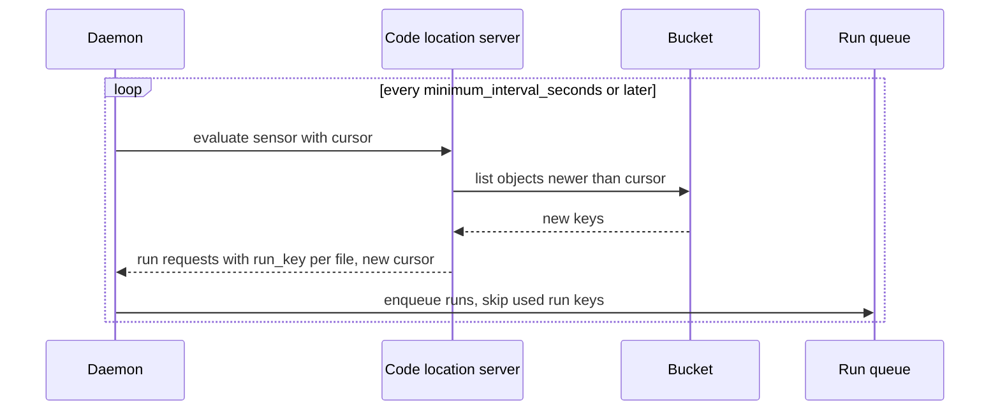

# 04 — Scheduling and triggers

> **Key takeaways**
> - **Temporal Schedules** are first-class objects: interval, calendar or cron specs, 6 overlap policies (default **Skip**), a 1-year catch-up window, backfill, pause and jitter ([Schedule](https://docs.temporal.io/schedule)).
> - **Dagster** evaluates schedules, sensors and **Declarative Automation** in its single daemon ([OSS deployment architecture](https://dagster.io/docs/deployment/oss/oss-deployment-architecture), [Declarative Automation](https://dagster.io/docs/guides/automate/declarative-automation)).
> - Dagster **sensors** poll on a minimum interval, keep a **cursor**, and dedupe runs by **run key**; default sensor timeout is **60 s** ([Sensors](https://dagster.io/docs/guides/automate/sensors), [Troubleshooting sensor timeouts](https://dagster.io/docs/deployment/troubleshooting/sensor-timeouts)).
> - Temporal's event-style triggers are **Signals and Updates** sent to running Workflows; their semantics pages were **not verified** (limits only).
> - Temporal backfills replay **schedule times**; Dagster backfills target **data partitions** ([Schedule](https://docs.temporal.io/schedule), [Backfilling data](https://dagster.io/docs/guides/build/partitions-and-backfills/backfilling-data)).

## 1. Temporal Schedules

| Feature | Fact ([Schedule](https://docs.temporal.io/schedule)) |
|---|---|
| Identity | Separate from any Workflow Execution (unlike legacy Cron Jobs); "more flexible and user-friendly" than Cron Jobs |
| Spec | Interval (e.g. 45m, epoch-aligned, optional phase), calendar fields, or cron string with 5–7 fields; multiple specs; start/end; exclusions; time zones (UTC recommended); jitter |
| Start accuracy | Actions generally start within 1 s of scheduled time |
| Overlap policies | `Skip` (default), `BufferOne`, `BufferAll`, `CancelOther`, `TerminateOther`, `AllowAll` (only one allowing concurrency) |
| Catch-up window | Default 1 year, minimum 10 s |
| Backfill | Runs all actions over a past period immediately: parallel with `AllowAll`, sequential with `BufferAll` |
| Other | Pause, pause-on-failure, limited action count, access to last completion result or failure |
| Caveats | Each Schedule keeps a backing Workflow open; List/CountSchedules are eventually consistent; last completion result up to 2 MiB but not passed on if within 1 KiB of the limit; lost after Continue-As-New |
| One-off future run | Use Start Delay instead |

## 2. Temporal messages to running Workflows

| Trigger | Limit (self-hosted default) |
|---|---|
| Signals | 2,000 pending external Signals per execution ([Workflow Execution limits](https://docs.temporal.io/workflow-execution/limits)) |
| Updates | 10 in-flight, 2,000 total in History per execution ([Self-hosted defaults](https://docs.temporal.io/self-hosted-guide/defaults)) |
| Child Workflows | 2,000 pending per execution ([Workflow Execution limits](https://docs.temporal.io/workflow-execution/limits)) |
| Signals on Temporal Cloud (contrast) | 10,000 per execution; ≤5/s sustained recommended ([Temporal Cloud limits](https://docs.temporal.io/cloud/limits)) |

- Signal, Query, Update and Continue-As-New **semantics: Not verified** (pages not fetched).

## 3. Dagster schedules, sensors and automation

| Trigger | Facts |
|---|---|
| Schedules | Operated by the daemon ([OSS deployment architecture](https://dagster.io/docs/deployment/oss/oss-deployment-architecture)); schedule-specific pages **not fetched** |
| Sensors | `minimum_interval_seconds` is a minimum gap, "not the exact frequency"; cursors persist state; run keys dedupe ("Dagster will skip processing requests with previously used run keys") ([Sensors](https://dagster.io/docs/guides/automate/sensors)) |
| Asset sensors | `@sensor(asset_key=...)` ([Sensors](https://dagster.io/docs/guides/automate/sensors)) |
| Sensor execution | OSS daemon calls the code server over gRPC; default timeout 60 s; raise with `DAGSTER_SENSOR_GRPC_TIMEOUT_SECONDS` "as a last resort"; >3 min means "a sensor may not be the correct tool" ([Troubleshooting sensor timeouts](https://dagster.io/docs/deployment/troubleshooting/sensor-timeouts)) |
| Sensor scaling | `DAGSTER_GRPC_MAX_WORKERS` (code server threads); `sensors.use_threads` and `num_workers` (daemon) ([Troubleshooting sensor timeouts](https://dagster.io/docs/deployment/troubleshooting/sensor-timeouts)) |
| Declarative Automation | `AutomationCondition` on assets/checks: `on_cron` (after upstreams update; latest partition only), `eager` (on upstream update), `on_missing` (missing partitions once upstreams exist) ([Declarative Automation](https://dagster.io/docs/guides/automate/declarative-automation)) |
| Automation evaluation | `default_automation_condition_sensor` must be enabled in the UI; `evaluate_automation_conditions` tests without the daemon ([Declarative Automation](https://dagster.io/docs/guides/automate/declarative-automation)) |
| Default sensor interval | 30 s is widely cited — **Not verified** |

## 4. Side-by-side

| Need | Temporal OSS | Dagster OSS |
|---|---|---|
| Cron/interval | Schedule spec, cron 5–7 fields ([Schedule](https://docs.temporal.io/schedule)) | Schedules in daemon ([OSS deployment architecture](https://dagster.io/docs/deployment/oss/oss-deployment-architecture)); `on_cron` condition ([Declarative Automation](https://dagster.io/docs/guides/automate/declarative-automation)) |
| Prevent overlapping runs | Overlap policy, default `Skip` ([Schedule](https://docs.temporal.io/schedule)) | Run queue and concurrency pools ([Managing concurrency](https://dagster.io/docs/guides/operate/managing-concurrency)); no schedule-level overlap policy found in notes |
| React to new data | Workflow/Activity code polls; Signals from external systems ([Workflow Execution limits](https://docs.temporal.io/workflow-execution/limits)) | Sensors with cursors and run keys ([Sensors](https://dagster.io/docs/guides/automate/sensors)); `eager` automation ([Declarative Automation](https://dagster.io/docs/guides/automate/declarative-automation)) |
| Upstream-aware scheduling | Not built in (*inference*) | Declarative Automation ([Declarative Automation](https://dagster.io/docs/guides/automate/declarative-automation)) |
| Catch-up after downtime | Catch-up window, default 1 year ([Schedule](https://docs.temporal.io/schedule)) | **Not verified** |
| Backfill | Over past schedule times ([Schedule](https://docs.temporal.io/schedule)) | Over partitions ([Backfilling data](https://dagster.io/docs/guides/build/partitions-and-backfills/backfilling-data)) |
| Scheduler HA | Server services scale out ([Temporal Server](https://docs.temporal.io/temporal-service/temporal-server)) | Single daemon, no replicas ([OSS deployment architecture](https://dagster.io/docs/deployment/oss/oss-deployment-architecture)) |

*Judgement:* Temporal's Schedule object is the more complete *time* scheduler (overlap, catch-up, jitter). Dagster's triggers are more *data*-aware (cursors, run keys, upstream-driven automation).

## Sources

- [S2] [Temporal Server](https://docs.temporal.io/temporal-service/temporal-server)
- [S10] [Schedule](https://docs.temporal.io/schedule)
- [S11] [Self-hosted defaults](https://docs.temporal.io/self-hosted-guide/defaults)
- [S12] [Workflow Execution limits](https://docs.temporal.io/workflow-execution/limits)
- [S13] [Temporal Cloud limits](https://docs.temporal.io/cloud/limits)
- [S52] [OSS deployment architecture](https://dagster.io/docs/deployment/oss/oss-deployment-architecture)
- [S60] [Declarative Automation](https://dagster.io/docs/guides/automate/declarative-automation)
- [S61] [Sensors](https://dagster.io/docs/guides/automate/sensors)
- [S62] [Troubleshooting sensor timeouts](https://dagster.io/docs/deployment/troubleshooting/sensor-timeouts)
- [S63] [Managing concurrency](https://dagster.io/docs/guides/operate/managing-concurrency)
- [S64] [Backfilling data](https://dagster.io/docs/guides/build/partitions-and-backfills/backfilling-data)

Full numbered list: [references/sources.md](../references/sources.md)
