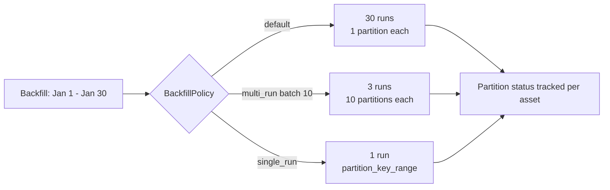
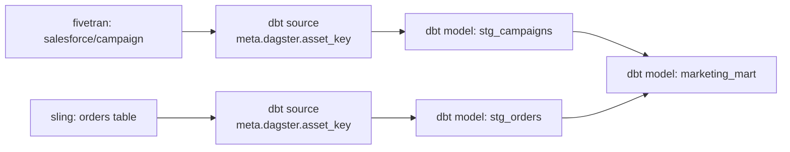

# 05 — Data awareness, lineage and partitions

> **Key takeaways**
> - **Dagster** stores asset **materializations and metadata** in its event log and shows them in a **lineage graph** ([Backfilling data](https://dagster.io/docs/guides/build/partitions-and-backfills/backfilling-data), [Dagster Pipes (guide)](https://dagster.io/docs/guides/build/external-pipelines)).
> - Dagster **partitioned assets** support backfills: one run per partition (default), batched `multi_run`, or `single_run` over a range ([Backfilling data](https://dagster.io/docs/guides/build/partitions-and-backfills/backfilling-data), [Partition backfill strategies](https://dagster.io/docs/examples/best-practices/partition-backfill-strategies)).
> - Ingestion integrations (dlt, Sling, Airbyte, Fivetran) produce **one asset per table/stream**, and dbt sources can link to them for end-to-end lineage ([dbt integration](https://dagster.io/docs/integrations/libraries/dbt)).
> - **Temporal** has no built-in datasets, lineage, partitions or data-quality checks (*inference from notes*); Search Attributes can tag executions with business keys ([Observability - Python SDK](https://docs.temporal.io/develop/python/platform/observability)).

## 1. Capability table

| Capability | Temporal OSS | Dagster OSS |
|---|---|---|
| Data asset model | None found; Workflows and Activities only ([Workflow Definition](https://docs.temporal.io/workflow-definition.md)) | Software-defined assets ([dagster-io/dagster (GitHub)](https://github.com/dagster-io/dagster)) |
| Lineage graph | None found | Global asset lineage page ([Dagster webserver and UI](https://dagster.io/docs/guides/operate/webserver)) |
| Materialization history + metadata | None; Event History records execution steps, not datasets ([Temporal Server](https://docs.temporal.io/temporal-service/temporal-server)) | Event log of materializations; Pipes can report metadata such as `total_orders` ([Dagster Pipes (guide)](https://dagster.io/docs/guides/build/external-pipelines)) |
| Partitions | None; *inference*: model as Workflow IDs or Child Workflows | Partitioned assets, e.g. `DailyPartitionsDefinition` ([Backfilling data](https://dagster.io/docs/guides/build/partitions-and-backfills/backfilling-data)); dynamic partitions shown in a vendor blog ([Dynamic partitioning](https://dagster.io/blog/dynamic-partitioning)) |
| Partition backfill | No; Schedule backfill replays action times ([Schedule](https://docs.temporal.io/schedule)) | Yes; launched from asset page or global lineage ([Backfilling data](https://dagster.io/docs/guides/build/partitions-and-backfills/backfilling-data)) |
| Data-quality tests | None built in | Asset checks; non-blocking unless `blocking=True` ([Testing assets with asset checks](https://dagster.io/docs/guides/test/asset-checks)) |
| Upstream-driven runs | Not built in | Declarative Automation `eager`, `on_missing`, `on_cron` ([Declarative Automation](https://dagster.io/docs/guides/automate/declarative-automation)) |
| Find work by business key | Custom Search Attributes + List Filter ([Observability - Python SDK](https://docs.temporal.io/develop/python/platform/observability)) | Asset catalog filters: key, compute kind, group, code location, tags ([Dagster webserver and UI](https://dagster.io/docs/guides/operate/webserver)) |
| Row-level auditing | Not provided ([The foundation: Why Temporal for a data pipeline?](https://temporal.io/blog/the-foundation-why-temporal-for-a-data-pipeline), *vendor blog, guest post*) | Not covered in notes |

## 2. Dagster partitions and backfills

| Strategy | How | Trade-off |
|---|---|---|
| Default | "By default, Dagster launches one run per partition" | Best fault isolation ([Partition backfill strategies](https://dagster.io/docs/examples/best-practices/partition-backfill-strategies)) |
| `BackfillPolicy.multi_run` | Batches partitions per run | "Batch size of 10 reduces runs by 90%" ([Partition backfill strategies](https://dagster.io/docs/examples/best-practices/partition-backfill-strategies)) |
| `BackfillPolicy.single_run()` | One run over a partition range; code must use `partition_time_window`, `partition_key_range` or `partition_keys` | No per-run overhead; failure retries everything; aimed at Spark/Snowflake ([Backfilling data](https://dagster.io/docs/guides/build/partitions-and-backfills/backfilling-data), [Partition backfill strategies](https://dagster.io/docs/examples/best-practices/partition-backfill-strategies)) |

- Single-run backfills "only work if they are launched from the asset graph or asset page" (or an asset job sharing the policy) ([Backfilling data](https://dagster.io/docs/guides/build/partitions-and-backfills/backfilling-data)).
- After a single-run backfill, "Dagster will track that all the partitions have been filled" ([Backfilling data](https://dagster.io/docs/guides/build/partitions-and-backfills/backfilling-data)).
- Partition definition types beyond `DailyPartitionsDefinition` (static, multi) and `max_partitions_per_run`: **Not verified**.

## 3. Lineage from ingestion to dbt in Dagster

- dlt: each dlt resource becomes an asset via a multi-asset ([dlt integration (Pythonic)](https://dagster.io/docs/integrations/libraries/dlt/dlt-pythonic)).
- Sling: the component "will produce an asset for each replicated file"; the target table asset depends on an upstream source asset ([Sling integration](https://dagster.io/docs/integrations/libraries/sling)).
- Airbyte: one asset per stream ([Airbyte component](https://dagster.io/docs/integrations/libraries/airbyte/airbyte-component)). Fivetran: assets keyed by schema/table, e.g. `salesforce/campaign` ([Fivetran integration](https://dagster.io/docs/integrations/libraries/fivetran)).
- dbt: set `meta.dagster.asset_key` on dbt sources; when a model calls `source()`, "Dagster links the corresponding upstream asset to that model" ([dbt integration](https://dagster.io/docs/integrations/libraries/dbt)).

## 4. What Temporal users would build

*Inference (from notes), not vendor guidance:*

- Record dataset state (watermarks, file lists, row counts) in your own tables or object store; pass only references through Temporal ([Troubleshoot payload size limit](https://docs.temporal.io/troubleshooting/blob-size-limit-error)).
- Use deterministic Workflow IDs per partition or per file to get "one execution per data unit" semantics (pattern used in the Rapidflare post: deterministic child IDs) ([How Rapidflare built a million+ document ingestion pipeline](https://temporal.io/blog/how-rapidflare-built-a-million-document-ingestion-pipeline-for-agents-on-temporal), *vendor blog*).
- Use custom Search Attributes (for example a `partition_date` keyword) to find executions per data unit ([Observability - Python SDK](https://docs.temporal.io/develop/python/platform/observability)).
- Lineage and data-quality checks would need another tool; none is documented by Temporal.

*Judgement:* data awareness is Dagster's clearest advantage for ingestion that feeds analytics.

## Sources

- [S2] [Temporal Server](https://docs.temporal.io/temporal-service/temporal-server)
- [S5] [Workflow Definition](https://docs.temporal.io/workflow-definition.md)
- [S10] [Schedule](https://docs.temporal.io/schedule)
- [S17] [Troubleshoot payload size limit](https://docs.temporal.io/troubleshooting/blob-size-limit-error)
- [S27] [The foundation: Why Temporal for a data pipeline?](https://temporal.io/blog/the-foundation-why-temporal-for-a-data-pipeline) — *vendor blog, guest post*
- [S28] [How Rapidflare built a million+ document ingestion pipeline](https://temporal.io/blog/how-rapidflare-built-a-million-document-ingestion-pipeline-for-agents-on-temporal) — *vendor blog, customer guest post*
- [S32] [Observability - Python SDK](https://docs.temporal.io/develop/python/platform/observability)
- [S60] [Declarative Automation](https://dagster.io/docs/guides/automate/declarative-automation)
- [S64] [Backfilling data](https://dagster.io/docs/guides/build/partitions-and-backfills/backfilling-data)
- [S65] [Partition backfill strategies](https://dagster.io/docs/examples/best-practices/partition-backfill-strategies)
- [S66] [Dagster Pipes (guide)](https://dagster.io/docs/guides/build/external-pipelines)
- [S70] [dlt integration (Pythonic)](https://dagster.io/docs/integrations/libraries/dlt/dlt-pythonic)
- [S71] [Sling integration](https://dagster.io/docs/integrations/libraries/sling)
- [S74] [Airbyte component](https://dagster.io/docs/integrations/libraries/airbyte/airbyte-component)
- [S75] [Fivetran integration](https://dagster.io/docs/integrations/libraries/fivetran)
- [S77] [dbt integration](https://dagster.io/docs/integrations/libraries/dbt)
- [S78] [Dagster webserver and UI](https://dagster.io/docs/guides/operate/webserver)
- [S83] [Testing assets with asset checks](https://dagster.io/docs/guides/test/asset-checks)
- [S93] [dagster-io/dagster (GitHub)](https://github.com/dagster-io/dagster) — *GitHub HTML scraped*
- [S101] [Dynamic partitioning](https://dagster.io/blog/dynamic-partitioning) — *vendor blog*

Full numbered list: [references/sources.md](../references/sources.md)
