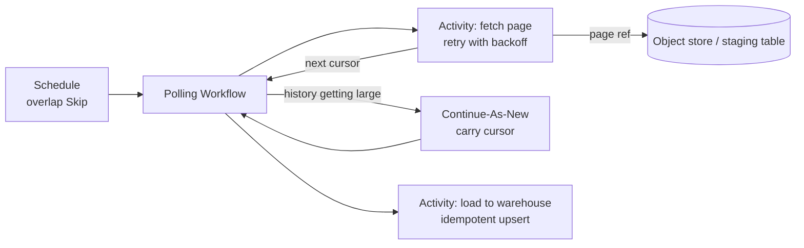
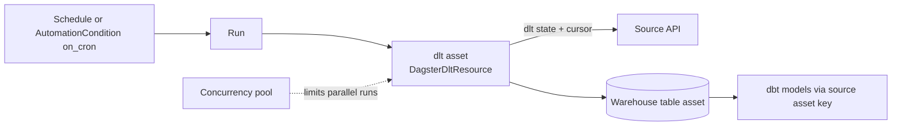
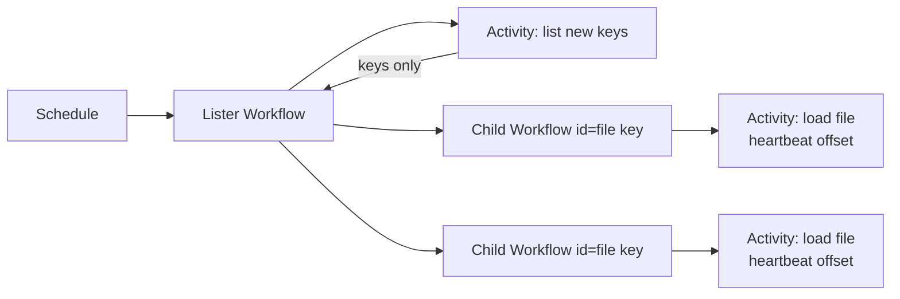
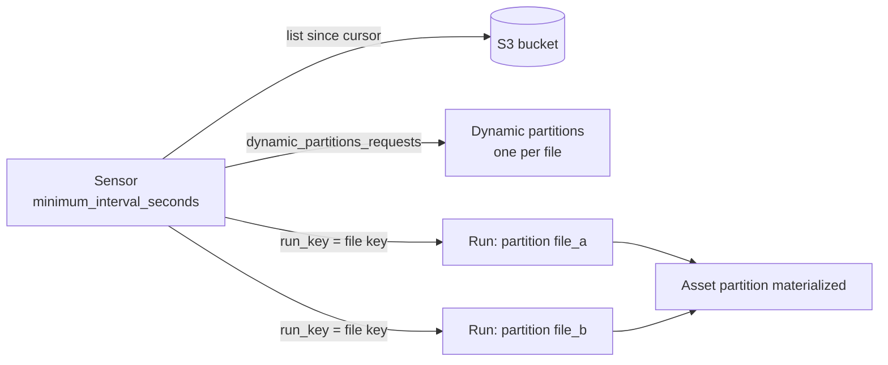
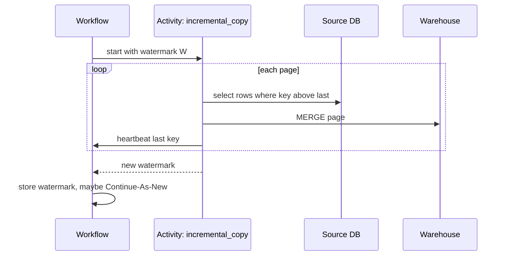
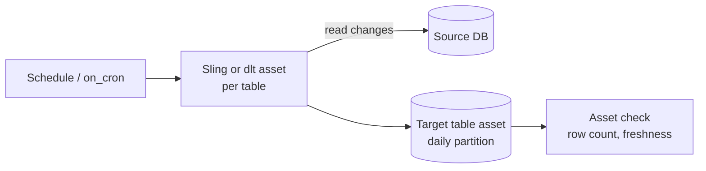
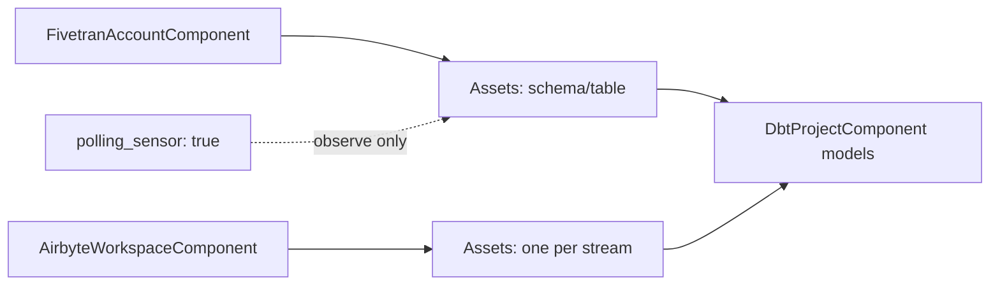
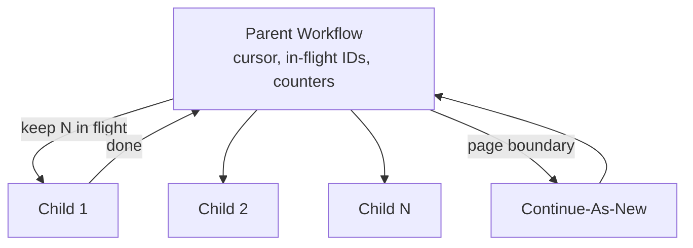
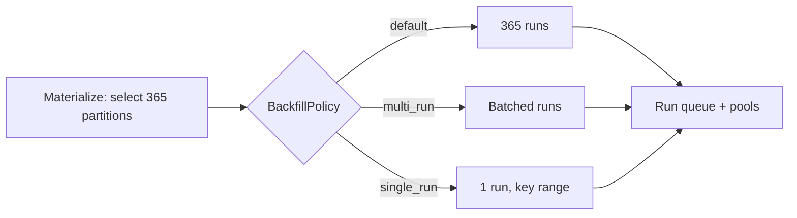

# 06 — Data ingestion (core document)

> **Key takeaways**
> - **Dagster** ships first-party integrations for **dlt, Sling, Airbyte, Fivetran** (and dbt downstream) that model each table/stream as an asset; Meltano is community-maintained; `dagster-embedded-elt` is deprecated ([Dagster integrations index](https://dagster.io/docs/integrations/libraries), [Embedded ELT (deprecated)](https://dagster.io/docs/integrations/libraries/embedded-elt)).
> - **Temporal** ships **no data connectors** (none found); it gives durable primitives: retries, heartbeat checkpoints, batch patterns, queue-wide rate limits ([Long-Running Activity pattern](https://docs.temporal.io/design-patterns/long-running-activity), [Batch Processing Patterns](https://docs.temporal.io/design-patterns/batch-processing-patterns), [Downstream Rate Limiting](https://docs.temporal.io/design-patterns/downstream-rate-limiting)).
> - **Large data never goes through Temporal payloads**: 2 MB default limit; pass references or use **External Storage** (Public Preview) ([Troubleshoot payload size limit](https://docs.temporal.io/troubleshooting/blob-size-limit-error), [External Storage](https://docs.temporal.io/external-storage)).
> - Both are **at-least-once** at the work-unit level: Temporal Activities "may be executed multiple times" ([Activity Definition](https://docs.temporal.io/activity-definition)); Dagster dedupes *runs* with sensor run keys ([Sensors](https://dagster.io/docs/guides/automate/sensors)). Writes must be idempotent in both.
> - *Judgement:* Dagster wins on connector-based ELT and partition backfills; Temporal wins on custom, high-fan-out, rate-limited or long-running extraction.

## 1. Integrations

| Tool | Dagster OSS | Temporal OSS |
|---|---|---|
| **dlt** | "Dagster supported", Component (`DltLoadCollectionComponent` in `defs.yaml`); Pythonic: multi-asset, each dlt resource → asset, `DagsterDltResource` ([dlt integration](https://dagster.io/docs/integrations/libraries/dlt), [dlt integration (Pythonic)](https://dagster.io/docs/integrations/libraries/dlt/dlt-pythonic)) | No official integration found; call dlt inside an Activity (*inference*) |
| **Sling** | "Dagster supported", Component (`SlingReplicationCollectionComponent`, `connections` + `replications`); example uses `mode: full-refresh`; incremental modes not documented on that page ([Sling integration](https://dagster.io/docs/integrations/libraries/sling)) | None found |
| **Airbyte** | "Dagster supported"; `AirbyteWorkspaceComponent` for Cloud and OSS/Self-Managed; one asset per stream; caches workspace metadata ([Airbyte integration](https://dagster.io/docs/integrations/libraries/airbyte), [Airbyte component](https://dagster.io/docs/integrations/libraries/airbyte/airbyte-component)) | None found. Airbyte has a case study on temporal.io (*vendor case study, not fetched*) ([Airbyte case study](https://web.temporal.io/case-studies/airbyte-case-study)) |
| **Fivetran** | "Dagster supported"; `FivetranAccountComponent`; triggering mode (sets connector schedule to "manual" unless `disable_schedule_on_trigger: false`) or observe-only (`polling_sensor: true`); `retry_on_reschedule` ([Fivetran integration](https://dagster.io/docs/integrations/libraries/fivetran)) | None found |
| **Meltano** | "Community supported" ([Meltano integration](https://dagster.io/docs/integrations/libraries/meltano)) | None found |
| **Embedded ELT** | Deprecated → `dagster-sling` and `dagster-dlt` ([Embedded ELT (deprecated)](https://dagster.io/docs/integrations/libraries/embedded-elt)) | — |
| **dbt** (downstream) | "Dagster supported"; `DbtProjectComponent`; each model is an asset; link via `meta.dagster.asset_key` ([dbt integration](https://dagster.io/docs/integrations/libraries/dbt)) | None found |
| **External compute** | Pipes: AWS, Azure ML, GCP Dataproc, Spark/Databricks Connect, Kubernetes, PySpark, Scala/Spark, JavaScript ([External pipelines (Pipes) integrations](https://dagster.io/docs/integrations/external-pipelines)) | Any SDK language in Workers: 8 SDKs ([Understanding Temporal](https://docs.temporal.io/evaluate/understanding-temporal)) |
| **Object-store offload** | IO managers (details **Not verified**) | External Storage: S3 drivers (Go, Java, Python, TypeScript), GCS (Go, TypeScript), Azure Blob listed, custom drivers ([External Storage](https://docs.temporal.io/external-storage)) |

- No official Temporal–Dagster integration exists ([Dagster integrations index](https://dagster.io/docs/integrations/libraries)); see [doc 12](12-decision-guide.md).
- No official CDC/streaming positioning was found for either. Temporal's "Workflow Streams" targets live interactivity for agents, content **not verified** ([Workflow Streams](https://docs.temporal.io/workflow-streams)).

## 2. Patterns per scenario

Scenario IDs come from [the plan](00-plan.md). Each pattern below is *the author's synthesis of documented primitives*, not a vendor-published reference architecture unless cited.

### S1 — API polling (REST/SaaS)

**Temporal**

- Schedule with overlap `Skip` starts a Workflow each interval ([Schedule](https://docs.temporal.io/schedule)).
- One Activity per page (or a long Activity that heartbeats the page cursor) ([Long-Running Activity pattern](https://docs.temporal.io/design-patterns/long-running-activity)).
- Batch Iterator: "Processes one page of records per Workflow run and continues as new with the next page offset" ([Batch Processing Patterns](https://docs.temporal.io/design-patterns/batch-processing-patterns)).
- Queue-wide rate limit protects the API ([Downstream Rate Limiting](https://docs.temporal.io/design-patterns/downstream-rate-limiting)).



**Dagster**

- dlt asset (each dlt resource → asset) on a schedule or `on_cron` automation ([dlt integration (Pythonic)](https://dagster.io/docs/integrations/libraries/dlt/dlt-pythonic), [Declarative Automation](https://dagster.io/docs/guides/automate/declarative-automation)).
- dlt manages its own state; with partitions, use concurrency limits ([dlt integration (Pythonic)](https://dagster.io/docs/integrations/libraries/dlt/dlt-pythonic)).
- Concurrency pools protect the shared API across runs ([Managing concurrency](https://dagster.io/docs/guides/operate/managing-concurrency)).



### S2 — File arrival in S3

**Temporal**

- No built-in bucket trigger found. Options (*inference*): a Schedule-driven listing Workflow, or an external notifier that starts a Workflow or sends a Signal.
- One Child Workflow per file with a deterministic ID gives per-file tracking (Rapidflare used deterministic child IDs) ([How Rapidflare built a million+ document ingestion pipeline](https://temporal.io/blog/how-rapidflare-built-a-million-document-ingestion-pipeline-for-agents-on-temporal), *vendor blog*).
- Retry policy on file-processing Workflows is one of the few documented reasons to retry Workflows ([Retry Policies](https://docs.temporal.io/encyclopedia/retry-policies)).



**Dagster**

- Sensor lists the bucket, stores the last-seen modification time in a **cursor**, and emits one run per file with a **run key** ([Sensors](https://dagster.io/docs/guides/automate/sensors)).
- Dynamic partitions: the sensor returns `SensorResult` with `dynamic_partitions_requests` plus one run per new file, to "incrementally load new partitions instead of reading the entire bucket" ([Dynamic partitioning](https://dagster.io/blog/dynamic-partitioning), *vendor blog*).
- Dedicated S3 sensor helper: **Not verified**.



### S3 — Database incremental / CDC-style batch

**Temporal**

- Long-running Activity pages through rows by high-watermark and heartbeats the last key; a retry resumes from it ([Long-Running Activity pattern](https://docs.temporal.io/design-patterns/long-running-activity)).
- Writes use an idempotency key, for example Workflow Run ID + Activity ID ([Activity Definition](https://docs.temporal.io/activity-definition)).



**Dagster**

- Sling replication (Component) or dlt SQL source as assets ([Sling integration](https://dagster.io/docs/integrations/libraries/sling), [dlt integration (Pythonic)](https://dagster.io/docs/integrations/libraries/dlt/dlt-pythonic)).
- For dlt SQL sources set `defer_table_reflect=True`, else the daemon queries the DB about every minute to refresh definitions ([dlt integration (Pythonic)](https://dagster.io/docs/integrations/libraries/dlt/dlt-pythonic)).
- Sling incremental modes: **Not verified** on the fetched page ([Sling integration](https://dagster.io/docs/integrations/libraries/sling)).
- Time-partitioned asset per day/hour lets a window be re-run by re-materializing the partition ([Backfilling data](https://dagster.io/docs/guides/build/partitions-and-backfills/backfilling-data)).



### S4 — SaaS connector sync (Fivetran, Airbyte)

**Temporal**

- No connector integration. *Inference:* an Activity calls the vendor's API to trigger a sync and polls for completion, with heartbeats; Temporal tracks nothing about the resulting tables.


**Dagster**

- `FivetranAccountComponent`: trigger syncs, or observe with `polling_sensor: true` to see sync history and freshness without triggering ([Fivetran integration](https://dagster.io/docs/integrations/libraries/fivetran)).
- `AirbyteWorkspaceComponent`: one asset per stream; whether it triggers or only observes is **Not verified** ([Airbyte component](https://dagster.io/docs/integrations/libraries/airbyte/airbyte-component)).
- dbt models link to these assets through `meta.dagster.asset_key` ([dbt integration](https://dagster.io/docs/integrations/libraries/dbt)).



### S5 — Large backfill

**Temporal**

- Patterns: Fan-Out with Child Workflows, Batch Iterator, Sliding Window ("fixed-size window of concurrent child Workflows"), MapReduce Tree ([Batch Processing Patterns](https://docs.temporal.io/design-patterns/batch-processing-patterns)).
- Stay well under history limits: "51,200 events max (aim for a few thousand)" ([Batch Processing Patterns](https://docs.temporal.io/design-patterns/batch-processing-patterns)); ≤2,000 pending Activities/Children, ≤500 recommended ([Self-hosted defaults](https://docs.temporal.io/self-hosted-guide/defaults)).
- Rapidflare: sliding window of N children, parent keeps cursor + in-flight IDs + counters, Continue-As-New at page boundaries, `ParentClosePolicy.ABANDON`; tested on 1,000,000 documents ([How Rapidflare built a million+ document ingestion pipeline](https://temporal.io/blog/how-rapidflare-built-a-million-document-ingestion-pipeline-for-agents-on-temporal), *vendor blog*).
- Schedule backfill re-runs past *schedule times*, in parallel (`AllowAll`) or sequence (`BufferAll`) ([Schedule](https://docs.temporal.io/schedule)).



**Dagster**

- Backfill partitions from the asset page or lineage graph; default one run per partition, or `multi_run` / `single_run` ([Backfilling data](https://dagster.io/docs/guides/build/partitions-and-backfills/backfilling-data), [Partition backfill strategies](https://dagster.io/docs/examples/best-practices/partition-backfill-strategies)).
- Run queue (`max_concurrent_runs`) and pools limit pressure on sources ([Managing concurrency](https://dagster.io/docs/guides/operate/managing-concurrency)).



## 3. Large payload handling

| Topic | Temporal OSS | Dagster OSS |
|---|---|---|
| Hard limit | Blob warn 512 KB, error 2 MB; gRPC 4 MB; history 50 MB ([Self-hosted defaults](https://docs.temporal.io/self-hosted-guide/defaults)) | No payload limit found in notes; data moves through IO managers or external systems |
| Configurable | Payload limit configurable on self-hosted, default 2 MB ([Troubleshoot payload size limit](https://docs.temporal.io/troubleshooting/blob-size-limit-error)) | — |
| Recommended fix | Pass references; External Storage (claim check, offloads ≥256 KiB by default, Public Preview, may change before GA); codecs for compression only delay the problem ([Troubleshoot payload size limit](https://docs.temporal.io/troubleshooting/blob-size-limit-error), [External Storage](https://docs.temporal.io/external-storage)) | Write data to the warehouse/object store inside the asset; Pipes streams only logs and metadata back ([Dagster Pipes (guide)](https://dagster.io/docs/guides/build/external-pipelines)) |
| Self-hosted External Storage | **Not verified** that it works with self-hosted servers | — |
| Sensor tick size | — | Ticks requesting runs over the size limit fail explicitly (1.13.26) ([dagster-io/dagster releases](https://github.com/dagster-io/dagster/releases)) |

## 4. Idempotency and delivery semantics

| Topic | Temporal | Dagster |
|---|---|---|
| Execution semantics | "Activity may be executed multiple times and may even partially complete more than once"; observed as completed exactly once ([Activity Definition](https://docs.temporal.io/activity-definition)) | Steps re-run on retry; run retries create new runs ([Op retries](https://dagster.io/docs/guides/build/ops/op-retries), [Run retries](https://dagster.io/docs/deployment/execution/run-retries)); official delivery semantics **Not verified** |
| Dedupe of triggers | Overlap policy on Schedules ([Schedule](https://docs.temporal.io/schedule)); *inference*: deterministic Workflow IDs | Sensor run keys skip duplicates ([Sensors](https://dagster.io/docs/guides/automate/sensors)) |
| Idempotency keys | Enforced by the called service; Workflow Run ID + Activity ID suggested ([Activity Definition](https://docs.temporal.io/activity-definition)) | Partition-scoped overwrite is the usual approach (*inference*; not stated in fetched docs) |
| Guidance | "Activities that perform writes should be idempotent" ([Activity Definition](https://docs.temporal.io/activity-definition)) | No official "partitioned writes must be idempotent" statement found |

*Judgement:* in both tools use MERGE/upsert or deterministic object keys. Temporal makes the at-least-once nature explicit; Dagster hides it behind run-level dedupe, which is easy to over-trust.

## 5. Rate limiting and concurrency

| Mechanism | Temporal | Dagster |
|---|---|---|
| Global throughput cap | Task-queue rate limit (`max_task_queue_activities_per_second` in Python) enforced by Matching "for the entire queue regardless of how many Workers"; 2 Workers × 5 = 5 ([Downstream Rate Limiting](https://docs.temporal.io/design-patterns/downstream-rate-limiting)) | Concurrency pools across runs protect "shared databases and APIs" ([Managing concurrency](https://dagster.io/docs/guides/operate/managing-concurrency)) |
| Per-process cap | `MaxWorkerActivitiesPerSecond` (multiplies with Workers) ([Downstream Rate Limiting](https://docs.temporal.io/design-patterns/downstream-rate-limiting)) | Run executor limits within a run ([Managing concurrency](https://dagster.io/docs/guides/operate/managing-concurrency)) |
| Concurrency slots | `MaxConcurrentActivityExecutionSize`; "not throughput limits" ([Downstream Rate Limiting](https://docs.temporal.io/design-patterns/downstream-rate-limiting)) | `max_concurrent_runs` in run queue; `default_op_concurrency_limit` ([Managing concurrency](https://dagster.io/docs/guides/operate/managing-concurrency), [dagster.yaml reference](https://dagster.io/docs/deployment/oss/dagster-yaml)) |
| Ordering | Task Queue Priority & Fairness GA 2026-05-05 ([Temporal changelog](https://temporal.io/changelog)) | Pool queue not strict FIFO; use QueuedRunCoordinator priority rules ([Run coordinators](https://dagster.io/docs/deployment/execution/run-coordinators)) |
| Gotcha | Different Worker values: last poller wins ([Downstream Rate Limiting](https://docs.temporal.io/design-patterns/downstream-rate-limiting)) | Partitioned dlt assets need concurrency limits because dlt manages state ([dlt integration (Pythonic)](https://dagster.io/docs/integrations/libraries/dlt/dlt-pythonic)) |

## 6. Backfills compared

| | Temporal | Dagster |
|---|---|---|
| Unit | Schedule action time or your own work items | Asset partition |
| Built-in UI action | Schedule backfill ([Schedule](https://docs.temporal.io/schedule)) | Materialize partitions from asset page/lineage ([Backfilling data](https://dagster.io/docs/guides/build/partitions-and-backfills/backfilling-data)) |
| Fault isolation | Per Child Workflow / Activity (*inference*) | Per run; `single_run` retries all ([Partition backfill strategies](https://dagster.io/docs/examples/best-practices/partition-backfill-strategies)) |
| Status tracking | Your own (Search Attributes help) ([Observability - Python SDK](https://docs.temporal.io/develop/python/platform/observability)) | Partition fill status tracked ([Backfilling data](https://dagster.io/docs/guides/build/partitions-and-backfills/backfilling-data)) |

## 7. Illustrative code sketches

> **Illustrative only.** These are not runnable. Names in `code` that appear below are confirmed in the research notes; anything in `<angle brackets>` is a placeholder for an SDK call the notes did not confirm. Check the official SDK docs before use.

### Temporal (Python-flavoured pseudocode): resumable page loader

```python
# ILLUSTRATIVE PSEUDOCODE - not a runnable Temporal program.
# Confirmed in notes: heartbeat details reach the retry attempt (Long-Running
# Activity pattern), max_task_queue_activities_per_second, ParentClosePolicy.ABANDON,
# workflow.logger. Everything in <...> is a placeholder.

<activity definition>
def copy_table(table: str, start_key: str) -> str:
    last_key = <last heartbeat details> or start_key   # resume point
    while page := read_page(table, after=last_key):     # your code
        merge_into_warehouse(page)                       # idempotent MERGE
        last_key = page.last_key
        <heartbeat>(last_key)                            # checkpoint
    return last_key                                      # small value, not data

<workflow definition>
def ingest_tables(tables: list[str], watermarks: dict) -> None:
    for t in tables:
        watermarks[t] = <execute activity>(copy_table, t, watermarks[t],
            start_to_close_timeout=<duration>,           # required (this or schedule-to-close)
            heartbeat_timeout=<2-3x heartbeat interval>,
            retry_policy=<max attempts, non-retryable 4xx types>)
        workflow.logger.info("loaded %s", t)

# Worker option capping calls to the source across ALL workers on the queue:
# max_task_queue_activities_per_second = 5
```

### Dagster: file-arrival sensor with dynamic partitions

```python
# ILLUSTRATIVE PSEUDOCODE - not runnable as written.
# Confirmed in notes: minimum_interval_seconds, cursor, run_key, SensorResult,
# dynamic_partitions_requests (from a vendor blog). Everything in <...> is a placeholder.

<sensor decorator>(minimum_interval_seconds=30)
def new_files_sensor(context):
    since = float(<current cursor> or 0)        # cursor persists between ticks
    new = [o for o in <list bucket objects> if o.modified > since]
    return SensorResult(
        dynamic_partitions_requests=[<add partitions>([o.key for o in new])],
        <run requests>=[<run request>(run_key=o.key, partition=o.key) for o in new],
        <new cursor>=str(max([o.modified for o in new], default=since)),
    )   # Dagster skips any run whose run_key was used before
```

### Dagster: connector components (YAML fragments)

```yaml
# ILLUSTRATIVE FRAGMENTS of defs.yaml - surrounding schema keys are placeholders.
# Sling (confirmed keys: connections, replications, mode: full-refresh)
<component type>: dagster_sling.SlingReplicationCollectionComponent
<attributes>:
  connections: <source and target connections>
  replications: <replication config with mode: full-refresh>
---
# Fivetran (confirmed options: polling_sensor, disable_schedule_on_trigger, retry_on_reschedule)
<component type>: dagster_fivetran.FivetranAccountComponent
<attributes>:
  polling_sensor: true                 # observe syncs without triggering
  disable_schedule_on_trigger: false   # keep Fivetran's own schedule
  retry_on_reschedule: <true/false>
```

## 8. Scenario scorecard

*Judgement, using the 0–3 rubric in [the plan](00-plan.md#8-rating-rubric).*

| Scenario | Temporal OSS | Dagster OSS | Why |
|---|---|---|---|
| S1 API polling | 3 | 2 | Temporal: per-page retries, heartbeats, queue-wide rate limit. Dagster: dlt asset + pools, coarser retries |
| S2 File arrival | 2 | 3 | Dagster: sensor cursor + run key + dynamic partitions. Temporal: no bucket trigger; build lister |
| S3 DB incremental | 2 | 2 | Temporal: resumable checkpoints. Dagster: Sling/dlt assets + partitions; Sling incremental not verified |
| S4 SaaS connectors | 1 | 3 | Dagster first-party Fivetran/Airbyte/dlt/Sling. Temporal: custom API calls |
| S5 Large backfill | 2 | 3 | Dagster: partition backfills with policies. Temporal: strong batch patterns but you build data tracking and respect history limits |

## Sources

- [S1] [Understanding Temporal](https://docs.temporal.io/evaluate/understanding-temporal)
- [S6] [Activity Definition](https://docs.temporal.io/activity-definition)
- [S7] [Retry Policies](https://docs.temporal.io/encyclopedia/retry-policies)
- [S10] [Schedule](https://docs.temporal.io/schedule)
- [S11] [Self-hosted defaults](https://docs.temporal.io/self-hosted-guide/defaults)
- [S17] [Troubleshoot payload size limit](https://docs.temporal.io/troubleshooting/blob-size-limit-error)
- [S18] [External Storage](https://docs.temporal.io/external-storage)
- [S20] [Long-Running Activity pattern](https://docs.temporal.io/design-patterns/long-running-activity)
- [S21] [Batch Processing Patterns](https://docs.temporal.io/design-patterns/batch-processing-patterns)
- [S24] [Downstream Rate Limiting](https://docs.temporal.io/design-patterns/downstream-rate-limiting)
- [S26] [Workflow Streams](https://docs.temporal.io/workflow-streams) — *not fetched*
- [S28] [How Rapidflare built a million+ document ingestion pipeline](https://temporal.io/blog/how-rapidflare-built-a-million-document-ingestion-pipeline-for-agents-on-temporal) — *vendor blog, customer guest post*
- [S29] [Airbyte case study](https://web.temporal.io/case-studies/airbyte-case-study) — *vendor case study, not fetched*
- [S32] [Observability - Python SDK](https://docs.temporal.io/develop/python/platform/observability)
- [S50] [Temporal changelog](https://temporal.io/changelog)
- [S53] [dagster.yaml reference](https://dagster.io/docs/deployment/oss/dagster-yaml)
- [S55] [Run coordinators](https://dagster.io/docs/deployment/execution/run-coordinators)
- [S58] [Op retries](https://dagster.io/docs/guides/build/ops/op-retries)
- [S59] [Run retries](https://dagster.io/docs/deployment/execution/run-retries)
- [S60] [Declarative Automation](https://dagster.io/docs/guides/automate/declarative-automation)
- [S61] [Sensors](https://dagster.io/docs/guides/automate/sensors)
- [S63] [Managing concurrency](https://dagster.io/docs/guides/operate/managing-concurrency)
- [S64] [Backfilling data](https://dagster.io/docs/guides/build/partitions-and-backfills/backfilling-data)
- [S65] [Partition backfill strategies](https://dagster.io/docs/examples/best-practices/partition-backfill-strategies)
- [S66] [Dagster Pipes (guide)](https://dagster.io/docs/guides/build/external-pipelines)
- [S67] [External pipelines (Pipes) integrations](https://dagster.io/docs/integrations/external-pipelines)
- [S68] [Dagster integrations index](https://dagster.io/docs/integrations/libraries)
- [S69] [dlt integration](https://dagster.io/docs/integrations/libraries/dlt)
- [S70] [dlt integration (Pythonic)](https://dagster.io/docs/integrations/libraries/dlt/dlt-pythonic)
- [S71] [Sling integration](https://dagster.io/docs/integrations/libraries/sling)
- [S72] [Embedded ELT (deprecated)](https://dagster.io/docs/integrations/libraries/embedded-elt)
- [S73] [Airbyte integration](https://dagster.io/docs/integrations/libraries/airbyte)
- [S74] [Airbyte component](https://dagster.io/docs/integrations/libraries/airbyte/airbyte-component)
- [S75] [Fivetran integration](https://dagster.io/docs/integrations/libraries/fivetran)
- [S76] [Meltano integration](https://dagster.io/docs/integrations/libraries/meltano)
- [S77] [dbt integration](https://dagster.io/docs/integrations/libraries/dbt)
- [S94] [dagster-io/dagster releases](https://github.com/dagster-io/dagster/releases) — *GitHub HTML scraped*
- [S101] [Dynamic partitioning](https://dagster.io/blog/dynamic-partitioning) — *vendor blog*

Full numbered list: [references/sources.md](../references/sources.md)
