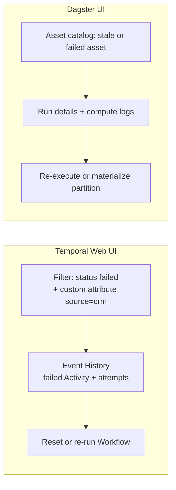

# 07 — Observability and UI

> **Key takeaways**
> - **Temporal Web UI** is execution-centric: filterable Workflow list, Event History views (Timeline, Compact, All, JSON), live call stack, and Query/Signal/Update/reset/terminate actions ([Temporal Web UI](https://docs.temporal.io/web-ui)).
> - **Dagster UI** is asset- and run-centric: asset catalog and lineage, runs, schedules, sensors, backfills, code-location reload ([Dagster webserver and UI](https://dagster.io/docs/guides/operate/webserver)).
> - Temporal SDKs emit **Prometheus metrics** and **OpenTelemetry** traces ([Observability - Python SDK](https://docs.temporal.io/develop/python/platform/observability)). Dagster OSS gives structured event logs plus pluggable compute logs ([Instance configuration](https://dagster.io/docs/deployment/oss/oss-instance-configuration)).
> - **Alerts, Insights and asset health are Dagster+** features ([Observe](https://dagster.io/docs/guides/observe)). Neither OSS product bundles alerting (*inference*).

## 1. UI comparison

| Area | Temporal Web UI | Dagster UI (OSS) |
|---|---|---|
| Home | Table of all Workflow Executions in retention ([Temporal Web UI](https://docs.temporal.io/web-ui)) | Overview "factory floor": runs, jobs, schedules, sensors, resources, backfills ([Dagster webserver and UI](https://dagster.io/docs/guides/operate/webserver)) |
| Filtering | Status, Workflow ID/Type, start/end time, Search Attributes; up to 20 Saved Views ([Temporal Web UI](https://docs.temporal.io/web-ui)) | Runs by job, run ID, status, tag; assets by key, compute kind, group, code location, tags ([Dagster webserver and UI](https://dagster.io/docs/guides/operate/webserver)) |
| Drill-down | Event History: Timeline, Compact, All, JSON; download JSON ([Temporal Web UI](https://docs.temporal.io/web-ui)) | Run details and run logs; asset pages ([Dagster webserver and UI](https://dagster.io/docs/guides/operate/webserver)) |
| Live debugging | Call stack of where Workflow code waits (needs a running Worker) ([Temporal Web UI](https://docs.temporal.io/web-ui)) | Not covered in notes |
| Actions | Query, Signal, Update, cancel, reset, terminate ([Temporal Web UI](https://docs.temporal.io/web-ui)) | Materialize assets, launch backfills, reload code locations ([Dagster webserver and UI](https://dagster.io/docs/guides/operate/webserver)) |
| Problem flagging | `TemporalReportedProblems` search attribute for repeated Workflow Task failures ([Temporal Web UI](https://docs.temporal.io/web-ui)) | Deployment page: code-location status, daemon health ([Dagster webserver and UI](https://dagster.io/docs/guides/operate/webserver)) |
| Lineage | None | Global asset lineage ([Dagster webserver and UI](https://dagster.io/docs/guides/operate/webserver)) |
| Encrypted payloads | Codec Server decodes inputs/results for display ([Temporal Web UI](https://docs.temporal.io/web-ui)) | Not applicable |
| Dagster+ only | — | Saved selections, owners, column-level filters (Pro); asset health; alerts; Insights ([Dagster webserver and UI](https://dagster.io/docs/guides/operate/webserver), [Observe](https://dagster.io/docs/guides/observe)) |

*Conflict:* the Observe page labels "Asset catalog" as Dagster+, while the webserver page describes an OSS asset catalog. Likely reading: basic catalog in OSS, enhanced in Dagster+ (logged in [doc 13](13-unverified-and-open-questions.md)).

## 2. Metrics, tracing, logging

| Signal | Temporal OSS | Dagster OSS |
|---|---|---|
| Metrics | Python: `Runtime` + `TelemetryConfig(metrics=PrometheusConfig(...))`, configured globally, `global_tags` ([Observability - Python SDK](https://docs.temporal.io/develop/python/platform/observability)); dev server `--metrics-port` for `/metrics` ([Temporal CLI server command reference](https://docs.temporal.io/cli/server)) | Prometheus endpoint: **Not verified** |
| Tracing | `OpenTelemetryPlugin` (real-duration Workflow spans); older `TracingInterceptor` makes zero-duration Workflow spans ([Observability - Python SDK](https://docs.temporal.io/develop/python/platform/observability)) | OpenTelemetry: **Not verified** |
| Logs | `workflow.logger` via Python `logging` ([Observability - Python SDK](https://docs.temporal.io/develop/python/platform/observability)) | Structured event log + stdout/stderr via compute log manager (Local default; S3, Azure, GCS, NoOp) ([Instance configuration](https://dagster.io/docs/deployment/oss/oss-instance-configuration)) |
| Health of runs | Schedule-to-start latency metric; backlog count; poll success rate ([Detecting Activity failures](https://docs.temporal.io/encyclopedia/detecting-activity-failures.md), [Task Queue performance](https://docs.temporal.io/develop/worker-performance/task-queues)) | `run_monitoring` (opt-in) for hung/crashed run workers ([Instance configuration](https://dagster.io/docs/deployment/oss/oss-instance-configuration)) |
| Alerting | Bring your own (Prometheus/Grafana) (*inference*) | Native alerts are Dagster+ ([Observe](https://dagster.io/docs/guides/observe)); OSS needs custom sensors or external tooling (*inference*) |
| Telemetry to vendor | Not covered | Anonymized usage telemetry on by default, can be disabled ([Instance configuration](https://dagster.io/docs/deployment/oss/oss-instance-configuration)) |

- Per-SDK observability guides exist for Go, Java, TypeScript, .NET and Ruby (*not fetched*) ([Observability - Go SDK](https://docs.temporal.io/develop/go/observability), [Observability - Java SDK](https://docs.temporal.io/develop/java/observability), [Observability - TypeScript SDK](https://docs.temporal.io/develop/typescript/platform/observability), [Observability - .NET SDK](https://docs.temporal.io/develop/dotnet/platform/observability), [Observability - Ruby SDK](https://docs.temporal.io/develop/ruby/platform/observability)).

## 3. Search and visibility

| | Temporal | Dagster |
|---|---|---|
| Query language | List Filter over default + custom Search Attributes, e.g. `WorkflowType="GreetingWorkflow"` via `client.list_workflows()` ([Observability - Python SDK](https://docs.temporal.io/develop/python/platform/observability)) | UI filters only (in notes) ([Dagster webserver and UI](https://dagster.io/docs/guides/operate/webserver)) |
| Custom fields | Set at start, `upsert_search_attributes()`, remove with `value_unset()` ([Observability - Python SDK](https://docs.temporal.io/develop/python/platform/observability)) | Tags, groups, owners (owners are Dagster+ Pro) ([Dagster webserver and UI](https://dagster.io/docs/guides/operate/webserver)) |
| Attribute types | Text, Keyword, Int, Double, Bool, Datetime, KeywordList ([Temporal CLI server command reference](https://docs.temporal.io/cli/server)) | — |
| Backing store | Elasticsearch or SQL (1.20+) ([Persistence](https://docs.temporal.io/temporal-service/persistence)) | Instance DB ([dagster.yaml reference](https://dagster.io/docs/deployment/oss/dagster-yaml)) |

## 4. What an on-call engineer sees for a failed ingestion

*Judgement:* Temporal answers "what happened inside this execution?" better; Dagster answers "which data is stale and why?" better. For ingestion teams reporting data freshness to stakeholders, Dagster's view is closer to the question; note that freshness *alerting* is Dagster+.

## Sources

- [S3] [Persistence](https://docs.temporal.io/temporal-service/persistence)
- [S8] [Detecting Activity failures](https://docs.temporal.io/encyclopedia/detecting-activity-failures.md)
- [S15] [Task Queue performance](https://docs.temporal.io/develop/worker-performance/task-queues)
- [S31] [Temporal Web UI](https://docs.temporal.io/web-ui)
- [S32] [Observability - Python SDK](https://docs.temporal.io/develop/python/platform/observability)
- [S33] [Observability - Go SDK](https://docs.temporal.io/develop/go/observability) — *not fetched*
- [S34] [Observability - Java SDK](https://docs.temporal.io/develop/java/observability) — *not fetched*
- [S35] [Observability - TypeScript SDK](https://docs.temporal.io/develop/typescript/platform/observability) — *not fetched*
- [S36] [Observability - .NET SDK](https://docs.temporal.io/develop/dotnet/platform/observability) — *not fetched*
- [S37] [Observability - Ruby SDK](https://docs.temporal.io/develop/ruby/platform/observability) — *not fetched*
- [S39] [Temporal CLI server command reference](https://docs.temporal.io/cli/server)
- [S53] [dagster.yaml reference](https://dagster.io/docs/deployment/oss/dagster-yaml)
- [S54] [Instance configuration](https://dagster.io/docs/deployment/oss/oss-instance-configuration)
- [S78] [Dagster webserver and UI](https://dagster.io/docs/guides/operate/webserver)
- [S79] [Observe](https://dagster.io/docs/guides/observe)

Full numbered list: [references/sources.md](../references/sources.md)
