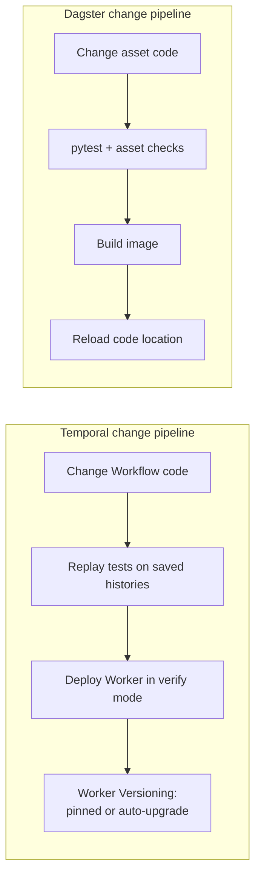

# 08 — Testing and developer experience

> **Key takeaways**
> - **Temporal** testing tools: time-skipping environment, full local server, `ActivityEnvironment`, mocked Activities, and **replay tests in CI** ([Testing - Python SDK](https://docs.temporal.io/develop/python/testing-suite)).
> - **Dagster** tests are plain pytest: call assets directly, `build_asset_context()`, mock resources, `execute_in_process`; **asset checks** test data at runtime ([Unit testing assets and ops](https://dagster.io/docs/guides/test/unit-testing-assets-and-ops), [Testing assets with asset checks](https://dagster.io/docs/guides/test/asset-checks)).
> - Local dev is one command in both: `temporal server start-dev` and `dg dev`; neither is for production ([Temporal CLI server command reference](https://docs.temporal.io/cli/server), [Running Dagster locally](https://dagster.io/docs/deployment/oss/deployment-options/running-dagster-locally)).
> - Temporal adds **determinism and versioning** to every code change ([Safely deploying changes to Workflow code](https://docs.temporal.io/develop/safe-deployments)); Dagster deploys by **reloading code locations** ([Dagster webserver and UI](https://dagster.io/docs/guides/operate/webserver)).
> - Languages: Temporal 8 SDKs; Dagster definitions in Python, other languages via Pipes ([Understanding Temporal](https://docs.temporal.io/evaluate/understanding-temporal), [Dagster Pipes (guide)](https://dagster.io/docs/guides/build/external-pipelines)).

## 1. Testing tools

| Need | Temporal (Python SDK) | Dagster |
|---|---|---|
| Unit-test a step | `ActivityEnvironment`: call Activity directly, mock context, capture heartbeats, cancel ([Testing - Python SDK](https://docs.temporal.io/develop/python/testing-suite)) | Invoke asset as a function with inputs and mocked resources ([Unit testing assets and ops](https://dagster.io/docs/guides/test/unit-testing-assets-and-ops)) |
| Mock dependencies | Mocked Activity with same name and signature ([Testing - Python SDK](https://docs.temporal.io/develop/python/testing-suite)) | `mock.Mock(spec=S3FileManager)` style resource mocks ([Unit testing assets and ops](https://dagster.io/docs/guides/test/unit-testing-assets-and-ops)) |
| Context | — | `build_asset_context()`, can set `partition_key` ([Unit testing assets and ops](https://dagster.io/docs/guides/test/unit-testing-assets-and-ops)) |
| Multi-step test | Time-skipping env: timers fast-forwarded except while Activities run; `env.sleep()` ([Testing - Python SDK](https://docs.temporal.io/develop/python/testing-suite)) | `SourceAsset`s + mock IO manager + `execute_in_process` ([Unit testing assets and ops](https://dagster.io/docs/guides/test/unit-testing-assets-and-ops)) |
| Real server test | `WorkflowEnvironment.start_local()`, no time skipping ([Testing - Python SDK](https://docs.temporal.io/develop/python/testing-suite)) | `dg dev` with `DAGSTER_HOME` ([Running Dagster locally](https://dagster.io/docs/deployment/oss/deployment-options/running-dagster-locally)) |
| Code-change safety | Replayer: "Fail CI if any error is encountered during replay" ([Testing - Python SDK](https://docs.temporal.io/develop/python/testing-suite)) | Not needed (no determinism constraint) |
| Data quality | — | Asset checks; `blocking=True` to stop downstream; per-partition status in preview ([Testing assets with asset checks](https://dagster.io/docs/guides/test/asset-checks)) |
| Automation logic | — | `evaluate_automation_conditions` ([Declarative Automation](https://dagster.io/docs/guides/automate/declarative-automation)) |

- `materialize()` / `build_op_context()` examples: **Not verified** on fetched pages ([Execution API reference](https://docs.dagster.io/api/dagster/execution), [Ops API reference](https://docs.dagster.io/api/dagster/ops)).
- Dagster docs advise against unit tests when most logic lives in an external system ([Unit testing assets and ops](https://dagster.io/docs/guides/test/unit-testing-assets-and-ops)).

## 2. Local development

| | Temporal | Dagster |
|---|---|---|
| Command | `temporal server start-dev` ([Temporal CLI server command reference](https://docs.temporal.io/cli/server)) | `dg dev` ([Running Dagster locally](https://dagster.io/docs/deployment/oss/deployment-options/running-dagster-locally)) |
| Starts | In-memory server + Web UI | Dagster UI + daemon |
| Ports | gRPC 7233, UI 8233 (gRPC + 1000) ([Temporal CLI server command reference](https://docs.temporal.io/cli/server)) | Default port **Not verified** |
| Persistence | Lost on exit unless `--db-filename` ([Temporal CLI server command reference](https://docs.temporal.io/cli/server)) | Temp dir unless `DAGSTER_HOME` set ([Running Dagster locally](https://dagster.io/docs/deployment/oss/deployment-options/running-dagster-locally)) |
| You also run | Your Worker process(es) (*inference*) | Nothing else; code locations load into UI/daemon |
| Production? | "not intended for production use" ([Temporal CLI server command reference](https://docs.temporal.io/cli/server)) | "intended for local development *only*"; no auth, no replicas, daemon not auto-restarted ([Running Dagster locally](https://dagster.io/docs/deployment/oss/deployment-options/running-dagster-locally)) |

## 3. Deploying changes (CI/CD)

| Topic | Temporal | Dagster |
|---|---|---|
| Constraint | Workflow Definition must be deterministic; Activity code need not be ([Safely deploying changes to Workflow code](https://docs.temporal.io/develop/safe-deployments)) | None documented |
| Strategy | Worker Versioning "strongly recommend[ed]"; patching alternative; eager start ignores versioning ([Safely deploying changes to Workflow code](https://docs.temporal.io/develop/safe-deployments)) | Reload all or per location in UI ([Dagster webserver and UI](https://dagster.io/docs/guides/operate/webserver)) |
| Replay stages | Dev (checked-in histories), pre-deploy (fetched; encrypted payloads may block), deploy-time verify Worker; scrub PII ([Safely deploying changes to Workflow code](https://docs.temporal.io/develop/safe-deployments)) | — |
| Zero-downtime | Not covered | Not in `dg dev`; production behaviour **Not verified** ([Running Dagster locally](https://dagster.io/docs/deployment/oss/deployment-options/running-dagster-locally)) |

## 4. Learning curve signals

*No quantitative data exists in either doc set.* Signals from the docs:

- Temporal docs repeatedly stress determinism, versioning and replay ([Safely deploying changes to Workflow code](https://docs.temporal.io/develop/safe-deployments)); even tracing has replay quirks (zero-duration spans with the older interceptor) ([Observability - Python SDK](https://docs.temporal.io/develop/python/platform/observability)).
- Dagster presents testing as "directly invoke definitions" with pytest ([Unit testing assets and ops](https://dagster.io/docs/guides/test/unit-testing-assets-and-ops)); its own concepts are assets, resources and IO managers.
- Dagster Components and the `dg` CLI scaffold projects and YAML-based definitions ([Components](https://dagster.io/docs/guides/build/components)).

*Judgement:* for a Python data team, Dagster's ramp-up is shorter. Temporal's concepts pay off when pipelines are long-running and stateful, and are overhead when they are simple batch loads.

## Sources

- [S1] [Understanding Temporal](https://docs.temporal.io/evaluate/understanding-temporal)
- [S32] [Observability - Python SDK](https://docs.temporal.io/develop/python/platform/observability)
- [S39] [Temporal CLI server command reference](https://docs.temporal.io/cli/server)
- [S41] [Testing - Python SDK](https://docs.temporal.io/develop/python/testing-suite)
- [S44] [Safely deploying changes to Workflow code](https://docs.temporal.io/develop/safe-deployments)
- [S57] [Components](https://dagster.io/docs/guides/build/components)
- [S60] [Declarative Automation](https://dagster.io/docs/guides/automate/declarative-automation)
- [S66] [Dagster Pipes (guide)](https://dagster.io/docs/guides/build/external-pipelines)
- [S78] [Dagster webserver and UI](https://dagster.io/docs/guides/operate/webserver)
- [S82] [Unit testing assets and ops](https://dagster.io/docs/guides/test/unit-testing-assets-and-ops)
- [S83] [Testing assets with asset checks](https://dagster.io/docs/guides/test/asset-checks)
- [S84] [Execution API reference](https://docs.dagster.io/api/dagster/execution) — *not fetched*
- [S85] [Ops API reference](https://docs.dagster.io/api/dagster/ops) — *not fetched*
- [S86] [Running Dagster locally](https://dagster.io/docs/deployment/oss/deployment-options/running-dagster-locally)

Full numbered list: [references/sources.md](../references/sources.md)
