# Temporal vs Dagster for data ingestion

Open source, self-hosted **Temporal** vs open source, self-hosted **Dagster**, for data engineering pipelines with a focus on ingestion.

| | |
|---|---|
| As of | 2026-11-11 |
| Versions | Temporal Server v1.32.1, "Latest" on GitHub, released Oct 8 (year 2026 inferred) [S49](sources.md#s49). Dagster 1.13.29 on PyPI, uploaded 2026-11-05 [S95](sources.md#s95) (GitHub and the docs site lag, see [gaps C1](3-evidence-and-gaps.md#2-conflicts-between-sources)) |
| Out of scope | Temporal Cloud and Dagster+ appear only to show what OSS lacks |
| Citations | `[S#]` links to [sources.md](sources.md). Every fact has one |
| Labels | *Inference* = reasoned from cited facts, not stated by the vendor. *Judgement* = the author's opinion. **Not verified** = missing from sources, listed in [3-evidence-and-gaps.md](3-evidence-and-gaps.md) |

## Contents

1. [Summary](#1-summary): verdict, at-a-glance matrix, when to pick which, decision flowchart
2. [Philosophy and core model](#2-philosophy-and-core-model)
3. [Architecture](#3-architecture)
4. [Execution model and durability](#4-execution-model-and-durability)
5. [Scheduling and triggers](#5-scheduling-and-triggers)
6. [Data awareness, lineage and partitions](#6-data-awareness-lineage-and-partitions)
7. [Data ingestion](#7-data-ingestion) (core section)
8. [Observability and UI](#8-observability-and-ui)
9. [Testing and developer experience](#9-testing-and-developer-experience)
10. [Deployment, scaling and limits](#10-deployment-scaling-and-limits)
11. [Security](#11-security)
12. [Licensing and community](#12-licensing-and-community)
13. [Using both together](#13-using-both-together)
14. [Method](#14-method): scope, dimensions, scenarios, rubric, source policy

Sections 2–13 share one layout: **In short** box → details (Temporal, Dagster, side by side) → **Verdict**.

---

## 1. Summary

### 1.1 Verdict

**Facts**

| Topic | Temporal OSS | Dagster OSS |
|---|---|---|
| Category | General durable-execution engine: deterministic Workflows rebuilt by replaying an Event History; side effects in retried Activities [S1](sources.md#s1) [S5](sources.md#s5) | "An orchestration platform for the development, production, and observation of data assets" [S93](sources.md#s93) |
| Connectors | None official found; every source and sink is your own Activity code (*inference from absence*) | First-party dlt, Sling, Airbyte, Fivetran, dbt; tables/streams become assets [S68](sources.md#s68) |
| Data awareness | Schedules backfill *action times*, not data partitions [S10](sources.md#s10) | Materializations, lineage, partitions, partition backfills [S64](sources.md#s64) |
| Durability | Crashed Workflow resumes where it stopped; a retried Activity resumes from its last heartbeat checkpoint if its code reads the heartbeat details [S1](sources.md#s1) [S20](sources.md#s20) | Recovers at step/asset boundaries: step retries, run retries, re-execute from failure [S58](sources.md#s58) [S59](sources.md#s59) |
| Hard limits | Payload errors at 2 MB; history terminates at 51,200 events or 50 MB, so data travels by reference [S11](sources.md#s11) [S12](sources.md#s12) | Mostly control-plane limits (sensor 60 s timeout, single daemon) [S62](sources.md#s62) [S52](sources.md#s52) |
| Security in OSS | Opt-in mTLS, Authorizer/JWT ClaimMapper, UI SSO, payload codecs [S45](sources.md#s45) | No built-in auth or RBAC; Dagster+ only, per a maintainer [S89](sources.md#s89) |
| Stewardship | MIT, Temporal Technologies [S48](sources.md#s48) | Apache-2.0; Prefect announced it is acquiring Dagster Labs (2026-07-13) [S95](sources.md#s95) [S96](sources.md#s96) |

**Judgement**

- **Batch/ELT into a warehouse**, where lineage, partitions and connectors matter: **Dagster OSS** is the better default.
- **Long-running, high fan-out or API-heavy ingestion** that needs per-item durability, resumable checkpoints and fine-grained retries: **Temporal OSS** is the better default, at the cost of building connectors and data tracking yourself.

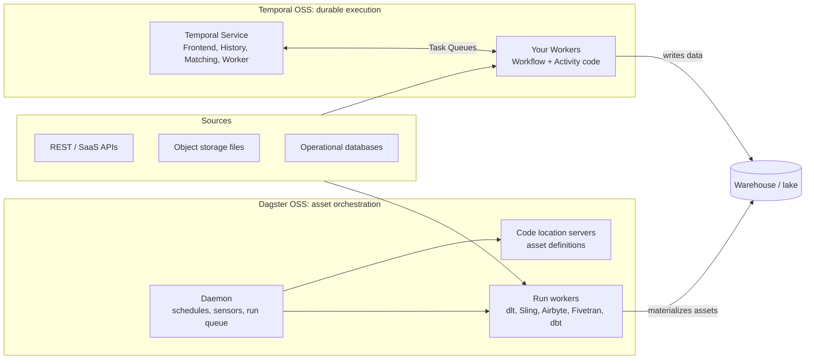

### 1.2 At-a-glance matrix

Ratings use the 0–3 rubric in [§14](#14-method) and are **judgements**. Facts are cited; details in the linked section.

| Dimension | Temporal OSS | Dagster OSS | T | D | Why the rating (*judgement*) | Section |
|---|---|---|:-:|:-:|---|---|
| D1 Core abstraction | Deterministic Workflows + Activities [S5](sources.md#s5) | Software-defined assets; ops/jobs below [S93](sources.md#s93) | 2 | 3 | Assets match "tables to keep fresh" | [§2](#2-philosophy-and-core-model) |
| D2 Operations | 4 services + DB (+ optional Elasticsearch); shard count fixed at creation [S2](sources.md#s2) [S3](sources.md#s3) | 3 services + DB; single daemon, no replicas [S52](sources.md#s52) | 1 | 2 | 4 services + DB + shards vs 3 services + DB, but single daemon | [§3](#3-architecture) |
| D3 Durability | Replay + Activity heartbeat checkpoints [S5](sources.md#s5) [S20](sources.md#s20) | Step retry, run retry, re-execute from failure [S58](sources.md#s58) [S59](sources.md#s59) | 3 | 2 | Mid-step resume vs step-level recovery | [§4](#4-execution-model-and-durability) |
| D4 Scheduling and triggers | Schedules: 6 overlap policies, 1-year catch-up, jitter [S10](sources.md#s10) | Sensors (cursor, run key) + Declarative Automation [S61](sources.md#s61) [S60](sources.md#s60) | 3 | 3 | Time scheduling vs data-aware triggers | [§5](#5-scheduling-and-triggers) |
| D5 Data awareness | None built in (*inference*) | Lineage, partitions, partition backfills, asset checks [S78](sources.md#s78) [S64](sources.md#s64) [S83](sources.md#s83) | 0 | 3 | Lineage, partitions, checks | [§6](#6-data-awareness-lineage-and-partitions) |
| D6 Ingestion: connectors | Your own Activities (*inference*) | dlt, Sling, Airbyte, Fivetran supported; Meltano community [S68](sources.md#s68) | 1 | 3 | First-party ELT components | [§7](#7-data-ingestion) |
| D6 Ingestion: custom / high volume | Queue-wide rate limits, sliding window, heartbeats [S24](sources.md#s24) [S21](sources.md#s21) | Pools, backfill policies; coarser retries [S63](sources.md#s63) [S65](sources.md#s65) | 3 | 2 | Rate limits, sliding window, heartbeats | [§7](#7-data-ingestion) |
| D7 Observability in OSS | Prometheus + OpenTelemetry in SDKs; execution-centric UI [S32](sources.md#s32) [S31](sources.md#s31) | Lineage/catalog UI; alerts are Dagster+ [S78](sources.md#s78) [S79](sources.md#s79) | 2 | 2 | Metrics/tracing vs lineage/catalog; alerts missing in both | [§8](#8-observability-and-ui) |
| D8 Testing and DX | Time skipping, replay tests; determinism + versioning overhead [S41](sources.md#s41) [S44](sources.md#s44) | Plain pytest, asset checks; reload code location [S82](sources.md#s82) [S78](sources.md#s78) | 2 | 3 | Determinism and versioning overhead | [§9](#9-testing-and-developer-experience) |
| D9 Scale headroom | Sharded server; 1–128K shards run successfully [S2](sources.md#s2) | Run launchers/executors; single daemon [S56](sources.md#s56) [S52](sources.md#s52) | 3 | 2 | Sharded server vs single daemon | [§10](#10-deployment-scaling-and-limits) |
| D10 Security in OSS | mTLS, Authorizer, JWT, SSO, codecs [S45](sources.md#s45) | None built in [S89](sources.md#s89) | 2 | 0 | Opt-in controls vs none built in | [§11](#11-security) |
| D11 Licensing and stewardship | MIT [S48](sources.md#s48) | Apache-2.0; ownership change [S95](sources.md#s95) [S96](sources.md#s96) | 3 | 2 | Both permissive; ownership change for Dagster | [§12](#12-licensing-and-community) |
| D12 Interoperability | No official Dagster integration (*absence*) | No Temporal integration listed [S68](sources.md#s68) | 0 | 0 | No official integration | [§13](#13-using-both-together) |

**Overall** (*judgement*): Dagster leads on data awareness, connectors and ramp-up; Temporal leads on durability, language reach, rate limiting and OSS security.

### 1.3 When to pick which (per scenario)

Scenario IDs SC1–SC5 are defined in [§14](#14-method). Scores T/D are the 0–3 rubric (*judgement*).

| Scenario | T | D | Pick | Why (facts) | Watch out for |
|---|:-:|:-:|---|---|---|
| SC1 API polling, simple daily pull | 3 | 2 | Dagster | dlt asset with state, concurrency pools [S70](sources.md#s70) [S63](sources.md#s63) | Partitioned dlt assets: concurrency limits recommended [S70](sources.md#s70) |
| SC1 API polling, millions of calls, strict quota | | | Temporal | Queue-global rate limit, heartbeat checkpoints, sliding window [S24](sources.md#s24) [S20](sources.md#s20) [S21](sources.md#s21) | Unlimited default retries [S7](sources.md#s7); 2 MB payloads [S11](sources.md#s11) |
| SC2 File arrival in S3 | 2 | 3 | Dagster (slight) | Sensor cursor + run key + dynamic partitions [S61](sources.md#s61) [S101](sources.md#s101) | Sensor 60 s timeout; keep listing cheap [S62](sources.md#s62) |
| SC2 Very large files, multi-hour loads | | | Temporal | Resume from heartbeat offset [S20](sources.md#s20) | Build your own per-file tracking |
| SC3 DB incremental batch to warehouse | 2 | 2 | Dagster | Sling/dlt assets, time partitions [S71](sources.md#s71) [S64](sources.md#s64) | Sling has incremental/backfill/change-capture modes, but Dagster pages only show `full-refresh` [S105](sources.md#s105) [S71](sources.md#s71) |
| SC3 DB copy with custom merge + resumability | | | Temporal | Checkpointed Activities; idempotency keys [S20](sources.md#s20) [S6](sources.md#s6) | Write MERGE logic yourself |
| SC4 Fivetran/Airbyte orchestration | 1 | 3 | Dagster | First-party components; observe-only mode for Fivetran [S75](sources.md#s75) [S74](sources.md#s74) | Airbyte component triggers syncs; no observe-only mode documented [S103](sources.md#s103) |
| SC4 ELT from SaaS apps into a warehouse, then dbt | | | Dagster | First-party Fivetran, Airbyte, dlt, Sling and dbt asset integrations with table-level lineage [S68](sources.md#s68) [S77](sources.md#s77) | — |
| SC5 Daily/hourly partitioned loads with frequent backfills | | | Dagster | Partition-aware backfills: one run per partition, or single-run ranges [S64](sources.md#s64) [S65](sources.md#s65) | — |
| SC5 Partitioned backfill of a year | 2 | 3 | Dagster | Backfill policies [S65](sources.md#s65) | `single_run` failure retries everything [S65](sources.md#s65) |
| SC5 Backfill of 1M documents/items | | | Temporal | Child Workflows + sliding window + Continue-As-New; 1M-doc case [S21](sources.md#s21) [S28](sources.md#s28) | History limits 51,200 events / 50 MB [S12](sources.md#s12) |
| Mixed-language team (Go/Java/TS/.NET) | | | Temporal | 8 SDK languages; Dagster definitions are Python [S1](sources.md#s1) [S66](sources.md#s66) | |
| Small team, minimal ops, wants data catalog | | | Dagster | Fewer services; catalog and lineage built in [S52](sources.md#s52) [S78](sources.md#s78) | Single daemon, no replicas [S52](sources.md#s52) |
| Shared platform, many teams, OSS access control | | | Temporal | mTLS, Authorizer, SSO [S45](sources.md#s45); Dagster OSS has no RBAC [S89](sources.md#s89) | Shard count chosen up front [S2](sources.md#s2) |

### 1.4 Decision flowchart (*judgement*)

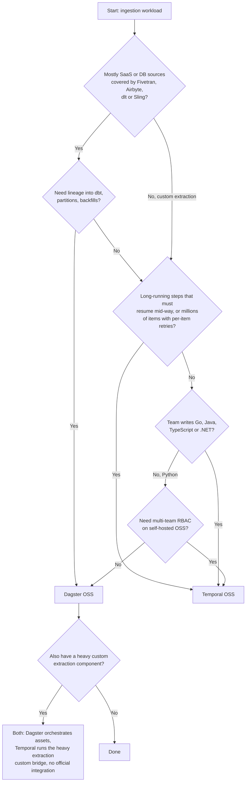

**Hard disqualifiers:** need for OSS RBAC rules out Dagster OSS [S89](sources.md#s89); need for built-in connectors or lineage rules out Temporal.

**Questions to ask before choosing**

| # | Question | Section |
|---|---|---|
| 1 | Are our sources covered by dlt, Sling, Airbyte or Fivetran? | [§7](#7-data-ingestion) |
| 2 | Do we need resume-inside-a-step, or is re-running a step acceptable? | [§4](#4-execution-model-and-durability) |
| 3 | Who needs lineage and freshness: engineers or data consumers? | [§6](#6-data-awareness-lineage-and-partitions), [§8](#8-observability-and-ui) |
| 4 | Do we need access control on self-hosted OSS? | [§11](#11-security) |
| 5 | Are we comfortable with the Dagster ownership change? | [§12](#12-licensing-and-community) |
| 6 | Can we run a 4-service cluster plus database, or do we want fewer moving parts? | [§3](#3-architecture) |

---

## 2. Philosophy and core model

> **In short**
> - **Temporal** is a general **durable-execution engine**: code runs to completion "whether that takes a second or a year", even across crashes [S1](sources.md#s1).
> - **Dagster** is a **data orchestrator** built around **software-defined assets** [S93](sources.md#s93).
> - Temporal knows Workflows, Activities and events, not datasets. Dagster knows assets, partitions and lineage, but recovers only at step/asset boundaries.
> - Neither vendor publishes an official comparison with the other [S102](sources.md#s102).

| | Temporal (OSS) | Dagster (OSS) |
|---|---|---|
| Self-description | Durable Execution: a started Workflow runs to completion "whether that takes a second or a year"; after a crash another process rebuilds state and resumes [S1](sources.md#s1) | "An orchestration platform for the development, production, and observation of data assets" [S93](sources.md#s93) |
| Core unit | Workflow (deterministic orchestration code) + Activity (side effects) [S5](sources.md#s5) | Asset (central abstraction); ops, jobs and graphs as the lower task layer [S57](sources.md#s57) [S56](sources.md#s56) |
| Positioning vs others | Not stated against Dagster | Against "orchestrators and workflow engines" that "focused exclusively on operational concerns"; "Since Dagster is data-asset aware, it can provide context around those assets that no other system can" [S100](sources.md#s100) (*vendor blog*) |
| Languages | .NET, Go, Java, PHP, Python, Ruby, Rust, TypeScript [S1](sources.md#s1) | Python for definitions; other languages via Dagster Pipes [S66](sources.md#s66) |
| Knows about | Workflows, Activities, events; not datasets | Assets, partitions, lineage; recovers only at step/asset boundaries |
| Data-pipeline content | Mainly guest posts and customer stories, not normative ETL docs [S27](sources.md#s27) [S28](sources.md#s28) | Docs and integrations centred on assets |

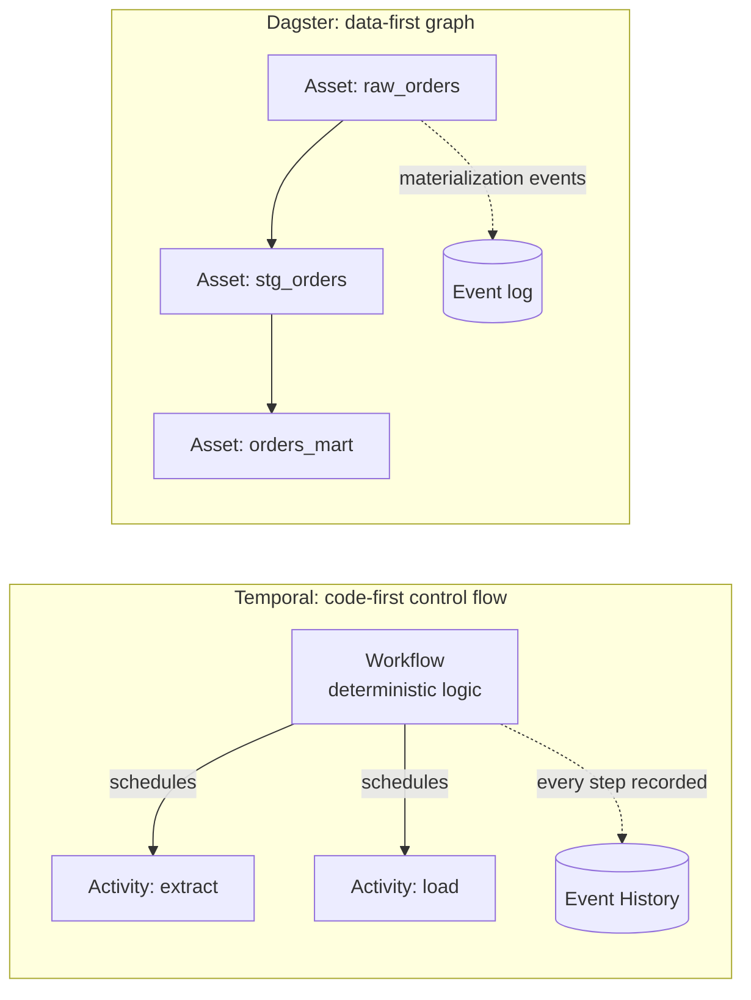

- **Temporal:** you write a program. The engine records each step in an Event History and can replay the program to rebuild state [S5](sources.md#s5).
- **Dagster:** you declare data assets and their dependencies. The engine records materializations and shows them in a lineage graph [S64](sources.md#s64) [S66](sources.md#s66).

**What each tool is not**

- Temporal **does not run your code** on its servers; your Workers do. The docs call the opposite belief a "common misconception" [S1](sources.md#s1).
- Temporal has no built-in datasets, assets, lineage, partitions or data quality (*inference*); a guest post says it does not provide row-level auditing [S27](sources.md#s27) (*vendor blog*).
- No fetched Dagster page claims Temporal-style durable execution (event-sourced replay); recovery is per step or asset using persisted outputs [S59](sources.md#s59).
- No official comparison exists from either vendor; the only one found is an AI-generated forum answer [S102](sources.md#s102) (*third-party, not authoritative*).

**Verdict** (*judgement*): "**move many things reliably**" (API pages, documents, files with complex retry/state) fits Temporal. "**Keep these tables fresh and know where they came from**" fits Dagster. Many teams have both ([§13](#13-using-both-together)).

---

## 3. Architecture

> **In short**
> - **Temporal Server** = 4 Go services (Frontend, History, Matching, internal Worker) + a database (Cassandra, PostgreSQL or MySQL) + a visibility store (SQL or Elasticsearch) [S2](sources.md#s2) [S3](sources.md#s3).
> - **Dagster OSS** = 3 long-running services (webserver, one daemon, code-location gRPC servers) + a run launcher that starts a run worker per run [S52](sources.md#s52).
> - In both, **user code runs outside the control plane**: Temporal Workers; Dagster code servers, run workers and step processes.
> - Dagster's daemon **does not support replicas** [S52](sources.md#s52). Temporal services scale independently; History Shard count is fixed at creation [S2](sources.md#s2).

### 3.1 Temporal OSS

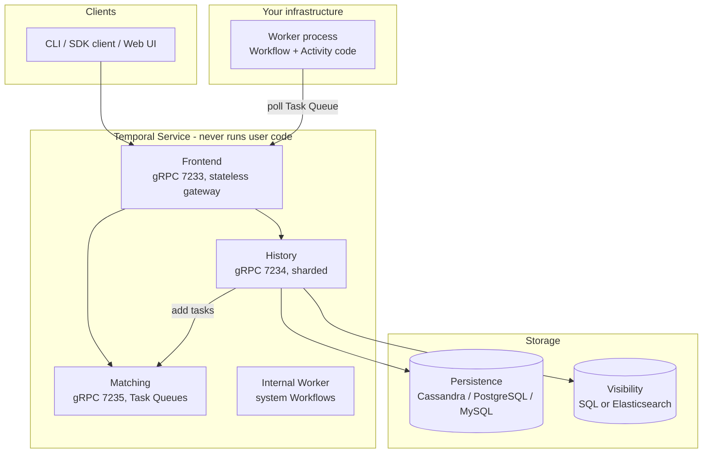

| Component | Role | Facts |
|---|---|---|
| Frontend | Stateless gateway: rate limiting, authorization, validation, routing by Workflow Id hash | gRPC 7233, membership 6933; not sharded [S2](sources.md#s2) |
| History | Persists Workflow state and Event History; adds Tasks to Task Queues | gRPC 7234; 1 to N processes, start ~1 per 500 shards [S2](sources.md#s2) |
| Matching | Hosts Task Queues; matches Workers to Tasks | gRPC 7235; multiple instances [S2](sources.md#s2) |
| Internal Worker | Replication queue, system Workflows | Membership 6939; not where user code runs [S2](sources.md#s2) |
| Persistence DB | Cassandra 3.11, 4.0, 5.0.4+; PostgreSQL 13.18, 14.15, 15.10, 16.6; MySQL 5.7, 8.0 (8.0.19+); SQLite "meant only for development and testing, not production usage" | Vitess and CockroachDB not tested [S3](sources.md#s3) |
| Visibility | Elasticsearch recommended for production; SQL advanced visibility from Server 1.20 (MySQL 8.0.17+, PostgreSQL 12+) | [S3](sources.md#s3); setup guide [S4](sources.md#s4) (*not fetched*) |
| Workers | Run Workflow and Activity code; built with an SDK and deployed by you | [S1](sources.md#s1) |

### 3.2 Dagster OSS

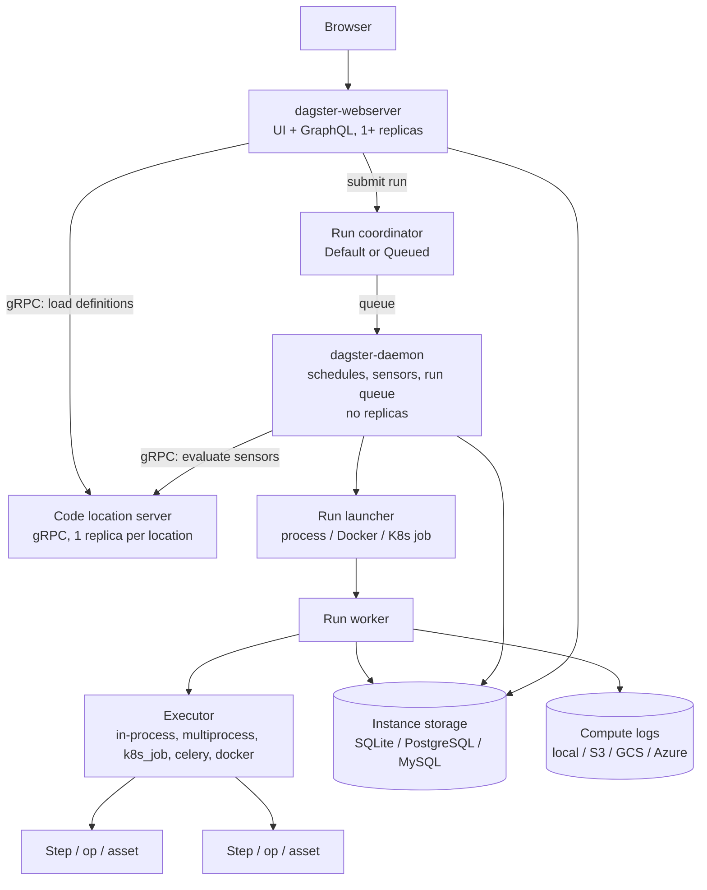

| Component | Role | Facts |
|---|---|---|
| Webserver | Serves UI, answers GraphQL | One or more replicas [S52](sources.md#s52) |
| Daemon | Operates schedules, sensors, run queuing | Replicas not supported [S52](sources.md#s52) |
| Code location server | Serves definitions over gRPC | One replica per code location [S52](sources.md#s52); OSS daemon calls it directly for sensors [S62](sources.md#s62) |
| Run coordinator | `DefaultRunCoordinator` launches immediately; `QueuedRunCoordinator` queues via the daemon with limits and priorities | [S55](sources.md#s55) |
| Run launcher | `DefaultRunLauncher` (process on code-location node), `DockerRunLauncher`, `K8sRunLauncher` | [S53](sources.md#s53) |
| Executor | Default `multi_or_in_process_executor` runs each step in its own process; also `in_process`, `multiprocess`, `k8s_job`, `celery`, `docker`, `celery_docker` | [S56](sources.md#s56) |
| Storage | `sqlite`, `postgres` (`dagster-postgres`), `mysql` (`dagster-mysql`); separate run, event log and schedule storage | [S53](sources.md#s53) |
| Compute logs | `LocalComputeLogManager` (default), S3, GCS, Azure Blob, NoOp | [S54](sources.md#s54) [S53](sources.md#s53) |
| Config levels | `dagster.yaml` (instance), `workspace.yaml` (code access), run config (executor, ops, resources) | [S52](sources.md#s52) |

**Run flow** [S52](sources.md#s52) [S55](sources.md#s55)

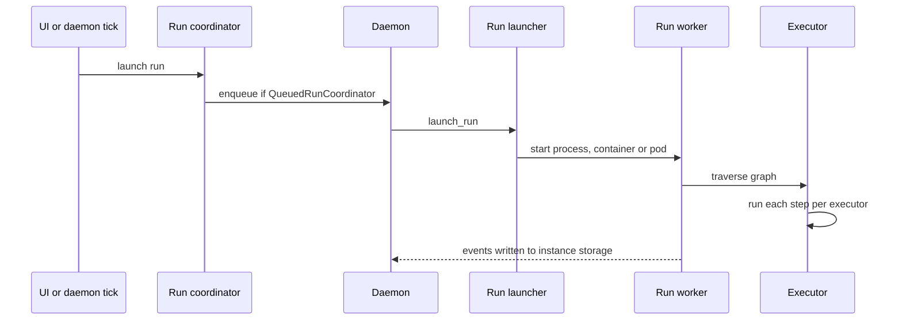

### 3.3 Side by side

| Aspect | Temporal OSS | Dagster OSS |
|---|---|---|
| Control plane | Frontend, History, Matching, internal Worker [S2](sources.md#s2) | Webserver, daemon, code-location servers [S52](sources.md#s52) |
| Where user code runs | Your Worker processes only [S1](sources.md#s1) | Code-location servers (definitions, sensors/schedules), run workers, step processes [S52](sources.md#s52) |
| Required DB | Cassandra / PostgreSQL / MySQL [S3](sources.md#s3) | SQLite (default) / PostgreSQL / MySQL [S53](sources.md#s53) |
| Optional extra store | Elasticsearch for visibility [S3](sources.md#s3) | Object storage for compute logs [S53](sources.md#s53) |
| Scheduler HA | Services run as multiple instances [S2](sources.md#s2) | Single daemon, no replicas [S52](sources.md#s52) |
| Fixed at creation | Number of History Shards [S2](sources.md#s2) | None found |
| Reference packaging | Docker Compose: PostgreSQL + Elasticsearch, gRPC 7233, UI 8080 [S14](sources.md#s14) | Helm chart: daemon, webserver (guide port-forwards local 8080 to pod port 80), user-code gRPC servers, in-cluster PostgreSQL [S88](sources.md#s88) |

**Verdict** (*inference*): Temporal is heavier to operate (4 service roles, DB schema migrations, optional Elasticsearch). Dagster's single daemon is a single point of failure for schedules and sensors that relies on the platform (e.g. Kubernetes) to restart it.

---

## 4. Execution model and durability

> **In short**
> - **Temporal** records every Workflow step in an **Event History** and rebuilds state by **replay**; Workflow code must be deterministic; all I/O goes in **Activities** [S5](sources.md#s5).
> - Temporal **Activities retry forever by default** (1 s, ×2.0, max 100 s); **Workflows do not retry by default** [S7](sources.md#s7).
> - **Dagster** recovers at **step/asset** level: `RetryPolicy`, `run_retries`, and `FROM_FAILURE` re-execution that reuses persisted outputs [S58](sources.md#s58) [S59](sources.md#s59).
> - Temporal can resume **inside** a long Activity via heartbeat checkpoints [S20](sources.md#s20); Dagster re-runs a failed step from its start (*inference*).
> - Temporal's price: determinism rules and versioning discipline for every Workflow change [S44](sources.md#s44).

### 4.1 Temporal: Workflows, Activities, replay

| Concept | Fact |
|---|---|
| Durable Execution | A started Workflow runs until complete; on a crash another process rebuilds state and resumes [S1](sources.md#s1) |
| Determinism | Same input must yield the same Workflow API calls in the same order; no branching on local time or random numbers [S5](sources.md#s5) |
| Where I/O goes | API calls, DB queries and other external interactions belong in Activities [S5](sources.md#s5) |
| Replay | Emitted Commands are compared with Event History; a mismatch raises a non-deterministic error [S5](sources.md#s5) |
| Versioning | Worker Versioning recommended; patching (`Patched` / `GetVersion`) is the alternative [S5](sources.md#s5) [S44](sources.md#s44) |
| Workflow failure | Only if Workflow code throws, not because a Worker failed [S5](sources.md#s5) |

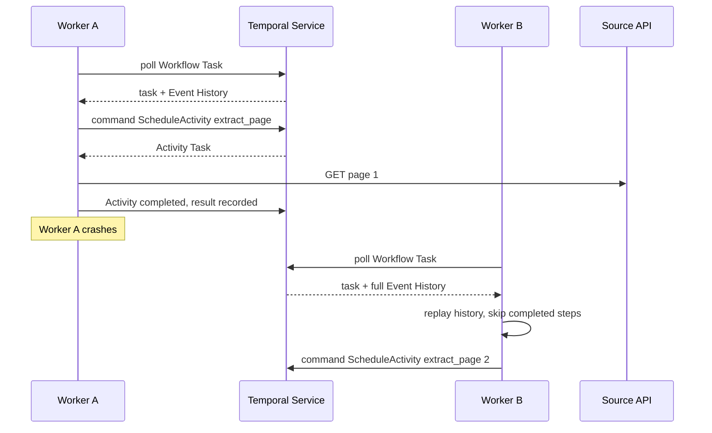

### 4.2 Temporal retries, timeouts, heartbeats

**Default Activity Retry Policy** [S7](sources.md#s7)

| Field | Default |
|---|---|
| InitialInterval | 1 s |
| BackoffCoefficient | 2.0 |
| MaximumInterval | 100 × InitialInterval = 100 s |
| MaximumAttempts | unlimited (0 = unlimited) |
| NonRetryableErrorTypes | none |

- Workflow Executions have **no default Retry Policy**; Workflow *Task* Executions retry with backoff up to a 10-minute interval until the Workflow Execution Timeout (unlimited by default) [S7](sources.md#s7).
- Retrying a whole Workflow "is not recommended"; "only certain scenarios" merit it, e.g. Cron-like and file-processing Workflows [S7](sources.md#s7).
- "Activities that perform writes should be idempotent" [S6](sources.md#s6); the Retry Policies page only points to idempotence guidance [S7](sources.md#s7).
- *Inference:* with unlimited attempts, a permanent error (e.g. HTTP 4xx) retries forever unless you set `MaximumAttempts`, Schedule-To-Close, or non-retryable error types.

**Activity timeouts** [S8](sources.md#s8)

| Timeout | Meaning | Default / rule |
|---|---|---|
| Schedule-To-Start | Max wait in the Task Queue | ∞; non-retryable; monitor `temporal_activity_schedule_to_start_latency` instead |
| Start-To-Close | Max time for one attempt | This or Schedule-To-Close **must** be set; strongly recommended |
| Schedule-To-Close | Max time for the whole execution incl. retries | ∞ |
| Heartbeat | Max gap between heartbeats | Optional; 0 s disables; capped at Start-To-Close |

- Heartbeat throttle interval = min(0.8 × heartbeat timeout, or 30 s if no timeout; 60 s); the final heartbeat on failure is not throttled [S8](sources.md#s8).
- Heartbeat details "are persisted and available to retry attempts, enabling resumption from the last checkpoint"; heartbeat timeout should be 2–3× the heartbeat interval [S20](sources.md#s20).

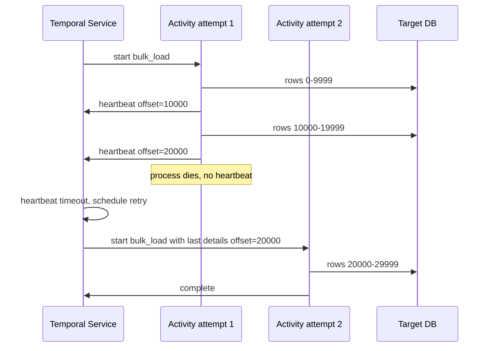

### 4.3 Dagster: runs, steps, assets

| Mechanism | Scope | Facts |
|---|---|---|
| `RetryPolicy(max_retries, delay, backoff=Backoff.EXPONENTIAL, jitter=Jitter.PLUS_MINUS)` | Op/asset | Per op/asset, per invocation (`with_retry_policy`) or per job (`op_retry_policy`); every exception triggers a retry by default; `RetryRequested` forces one; `Failure(allow_retries=False)` skips it [S58](sources.md#s58) |
| `run_retries` in `dagster.yaml` | Whole run | New run "whenever a run fails for any reason", including crashes; per-job tag `dagster/max_retries` [S59](sources.md#s59) |
| `dagster/retry_strategy` | Run retry | `FROM_FAILURE` (default; skips successful ops, reuses outputs) or `ALL_STEPS` [S59](sources.md#s59) |
| IO manager requirement | Run retry | `FROM_FAILURE` needs an IO manager that reads other runs' outputs; filesystem IO manager does not work on Kubernetes [S59](sources.md#s59) |
| `FROM_ASSET_FAILURE` | Infra interruptions | Uses persisted materialization records to skip materialized assets [S59](sources.md#s59) |
| `retry_on_asset_or_op_failure` | Run retry | Defaults `true`; effective from 1.6.7 [S59](sources.md#s59) |
| `run_monitoring` | Hung/crashed run workers | Opt-in; `start_timeout_seconds: 180`, `max_resume_run_attempts: 3`, `poll_interval_seconds: 120` [S54](sources.md#s54) |
| Resumable run workers | ECS run launcher | Added in 1.13.25 [S94](sources.md#s94) |

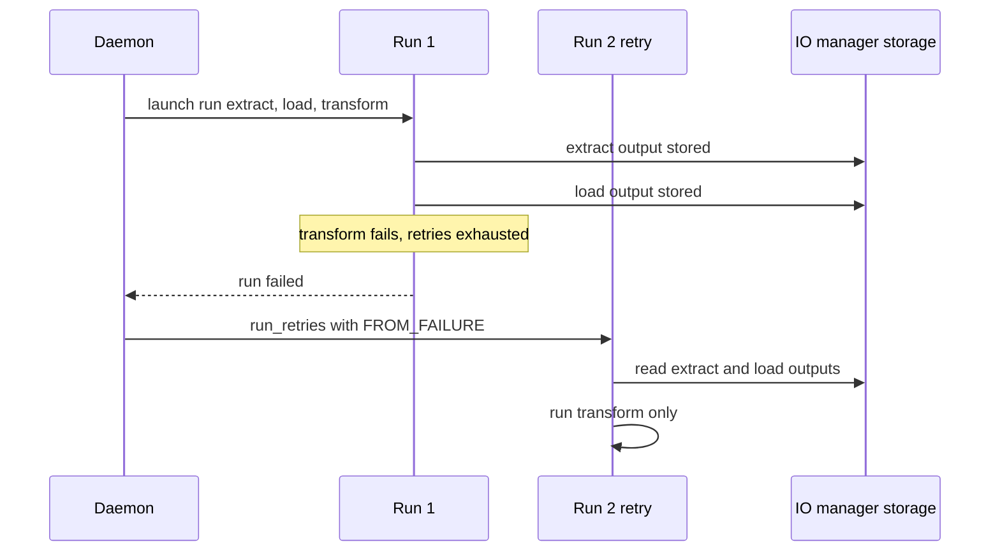

### 4.4 Side by side

| Question | Temporal OSS | Dagster OSS |
|---|---|---|
| Unit of recovery | Workflow step (each recorded event); Activity attempt with heartbeat checkpoint [S5](sources.md#s5) [S20](sources.md#s20) | Op/asset step; run [S58](sources.md#s58) [S59](sources.md#s59) |
| State persisted | Event History + heartbeat details [S2](sources.md#s2) [S20](sources.md#s20) | Event log of materializations + IO-manager outputs [S59](sources.md#s59) |
| Default step retries | Activities: unlimited, exponential [S7](sources.md#s7) | None unless a `RetryPolicy` is attached (*inference* from "when a RetryPolicy is attached") [S58](sources.md#s58) |
| Default whole-unit retries | Workflow: none [S7](sources.md#s7) | Run retries opt-in in OSS; on by default in Dagster+ [S59](sources.md#s59) |
| Resume mid-step | Yes, via heartbeat details [S20](sources.md#s20) | Not documented; step re-executes (*inference*) |
| Code-change constraint | Deterministic Workflow code; versioning/patching [S44](sources.md#s44) | None documented; reload code location [S78](sources.md#s78) |
| "Durable execution" claim | Yes [S1](sources.md#s1) | No fetched page claims it |

**Verdict** (*judgement*): Temporal's durability is finer-grained and more general; Dagster's is coarser but tied to data outputs, which is often what an ingestion team wants to re-run.

---

## 5. Scheduling and triggers

> **In short**
> - **Temporal Schedules** are first-class objects: interval, calendar or cron specs, 6 overlap policies (default **Skip**), 1-year catch-up, backfill, pause, jitter [S10](sources.md#s10).
> - **Dagster** evaluates schedules, sensors and **Declarative Automation** in its single daemon [S52](sources.md#s52) [S60](sources.md#s60).
> - Dagster **sensors** poll on a minimum interval, keep a **cursor**, dedupe runs by **run key**; default timeout **60 s** [S61](sources.md#s61) [S62](sources.md#s62).
> - Temporal's event-style triggers are **Signals and Updates** sent to running Workflows; their semantics were **not verified** (limits only).
> - Temporal backfills replay **schedule times**; Dagster backfills target **data partitions** [S10](sources.md#s10) [S64](sources.md#s64).

### 5.1 Temporal Schedules [S10](sources.md#s10)

| Feature | Fact |
|---|---|
| Identity | Separate from any Workflow Execution (unlike legacy Cron Jobs); "more flexible and user-friendly" than Cron Jobs |
| Spec | Interval (e.g. 45m, epoch-aligned, optional phase), calendar fields, or cron with 5–7 fields; multiple specs; start/end; exclusions; time zones (UTC recommended); jitter |
| Start accuracy | Actions generally start within 1 s of scheduled time |
| Overlap policies | `Skip` (default), `BufferOne`, `BufferAll`, `CancelOther`, `TerminateOther`, `AllowAll` (only one allowing concurrency) |
| Catch-up window | Default 1 year, minimum 10 s |
| Backfill | Runs all actions over a past period immediately: parallel with `AllowAll`, sequential with `BufferAll` |
| Other | Pause, pause-on-failure, limited action count, access to last completion result or failure |
| Caveats | Each Schedule keeps a backing Workflow open; List/CountSchedules are eventually consistent; last completion result up to 2 MiB but not passed on if within 1 KiB of the limit; lost after Continue-As-New |
| One-off future run | Use Start Delay instead |

**Messages to running Workflows (self-hosted limits)**

| Trigger | Limit |
|---|---|
| Signals | 2,000 pending external Signals per execution [S12](sources.md#s12) |
| Updates | 10 in-flight, 2,000 total in History per execution [S11](sources.md#s11) |
| Child Workflows | 2,000 pending per execution [S12](sources.md#s12) |
| Signals on Temporal Cloud (contrast) | 10,000 per execution; ≤5/s sustained recommended [S13](sources.md#s13) |

Signal, Query, Update and Continue-As-New **semantics: Not verified** (pages not fetched).

### 5.2 Dagster schedules, sensors, automation

| Trigger | Facts |
|---|---|
| Schedules | Operated by the daemon [S52](sources.md#s52); schedule-specific pages **not fetched** |
| Sensors | `minimum_interval_seconds` is a minimum gap, "not the exact frequency"; cursors persist state; run keys dedupe ("Dagster will skip processing requests with previously used run keys") [S61](sources.md#s61) |
| Default sensor interval | 30 s when `minimum_interval_seconds` is unset (`DEFAULT_SENSOR_DAEMON_INTERVAL = 30` in package source; API reference lists no default) [S112](sources.md#s112) [S108](sources.md#s108) |
| Asset sensors | `@sensor(asset_key=...)` [S61](sources.md#s61) |
| Sensor execution | OSS daemon calls the code server over gRPC; default timeout 60 s; raise with `DAGSTER_SENSOR_GRPC_TIMEOUT_SECONDS` "as a last resort"; >3 min means "a sensor may not be the correct tool" [S62](sources.md#s62) |
| Sensor scaling | `DAGSTER_GRPC_MAX_WORKERS` (code server threads); `sensors.use_threads`, `num_workers` (daemon) [S62](sources.md#s62) |
| Declarative Automation | `AutomationCondition` on assets/checks: `on_cron` (after upstreams update; latest partition only), `eager` (on upstream update), `on_missing` (missing partitions once upstreams exist) [S60](sources.md#s60) |
| Automation evaluation | `default_automation_condition_sensor` must be enabled in the UI; `evaluate_automation_conditions` tests without the daemon [S60](sources.md#s60) |

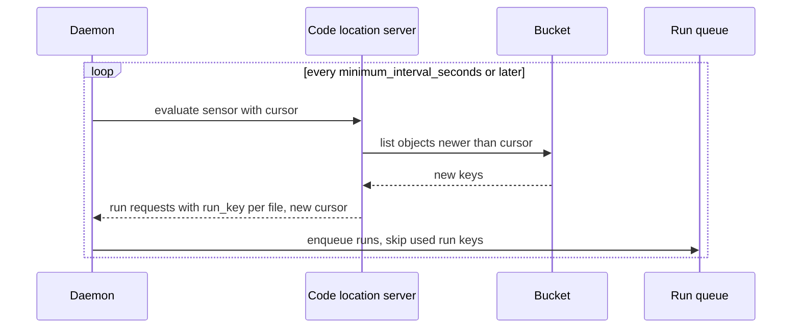

### 5.3 Side by side

| Need | Temporal OSS | Dagster OSS |
|---|---|---|
| Cron/interval | Schedule spec, cron 5–7 fields [S10](sources.md#s10) | Schedules in daemon [S52](sources.md#s52); `on_cron` [S60](sources.md#s60) |
| Prevent overlapping runs | Overlap policy, default `Skip` [S10](sources.md#s10) | Run queue and concurrency pools [S63](sources.md#s63); no schedule-level overlap policy found |
| React to new data | Workflow/Activity code polls; Signals from external systems [S12](sources.md#s12) | Sensors with cursors and run keys [S61](sources.md#s61); `eager` automation [S60](sources.md#s60) |
| Upstream-aware scheduling | Not built in (*inference*) | Declarative Automation [S60](sources.md#s60) |
| Catch-up after downtime | Catch-up window, default 1 year [S10](sources.md#s10) | **Not verified** |
| Backfill | Over past schedule times [S10](sources.md#s10) | Over partitions [S64](sources.md#s64) |
| Scheduler HA | Server services scale out [S2](sources.md#s2) | Single daemon, no replicas [S52](sources.md#s52) |

**Verdict** (*judgement*): Temporal's Schedule is the more complete *time* scheduler (overlap, catch-up, jitter). Dagster's triggers are more *data*-aware (cursors, run keys, upstream-driven automation).

---

## 6. Data awareness, lineage and partitions

> **In short**
> - **Dagster** stores asset **materializations and metadata** and shows them in a **lineage graph** [S64](sources.md#s64) [S66](sources.md#s66).
> - Dagster **partitioned assets** backfill one run per partition (default), batched `multi_run`, or `single_run` over a range [S64](sources.md#s64) [S65](sources.md#s65).
> - Ingestion integrations (dlt, Sling, Airbyte, Fivetran) produce **one asset per table/stream**; dbt sources link to them for end-to-end lineage [S77](sources.md#s77).
> - **Temporal** has no built-in datasets, lineage, partitions or data-quality checks (*inference*); Search Attributes can tag executions with business keys [S32](sources.md#s32).

| Capability | Temporal OSS | Dagster OSS |
|---|---|---|
| Data asset model | None found; Workflows and Activities only [S5](sources.md#s5) | Software-defined assets [S93](sources.md#s93) |
| Lineage graph | None found | Global asset lineage page [S78](sources.md#s78) |
| Materialization history + metadata | None; Event History records execution steps, not datasets [S2](sources.md#s2) | Event log of materializations; Pipes can report metadata such as `total_orders` [S66](sources.md#s66) |
| Partitions | None; *inference*: model as Workflow IDs or Child Workflows | Partitioned assets, e.g. `DailyPartitionsDefinition` [S64](sources.md#s64); dynamic partitions [S101](sources.md#s101) (*vendor blog*) [S109](sources.md#s109) |
| Partition backfill | No; Schedule backfill replays action times [S10](sources.md#s10) | Yes; from asset page or global lineage [S64](sources.md#s64) |
| Data-quality tests | None built in | Asset checks; non-blocking unless `blocking=True` [S83](sources.md#s83) |
| Upstream-driven runs | Not built in | `eager`, `on_missing`, `on_cron` [S60](sources.md#s60) |
| Find work by business key | Custom Search Attributes + List Filter [S32](sources.md#s32) | Catalog filters: key, compute kind, group, code location, tags [S78](sources.md#s78) |
| Row-level auditing | Not provided [S27](sources.md#s27) (*vendor blog*) | Not covered |

### 6.1 Dagster backfill strategies

| Strategy | How | Trade-off |
|---|---|---|
| Default | "By default, Dagster launches one run per partition" | Best fault isolation [S65](sources.md#s65) |
| `BackfillPolicy.multi_run` | Batches partitions per run | "Batch size of 10 reduces runs by 90%" [S65](sources.md#s65) |
| `BackfillPolicy.single_run()` | One run over a range; code uses `partition_time_window`, `partition_key_range` or `partition_keys` | No per-run overhead; failure retries everything; aimed at Spark/Snowflake [S64](sources.md#s64) [S65](sources.md#s65) |

- Single-run backfills "only work if they are launched from the asset graph or asset page" (or an asset job sharing the policy); afterwards "Dagster will track that all the partitions have been filled" [S64](sources.md#s64).
- Static/multi partition definitions and `max_partitions_per_run`: **Not verified**.

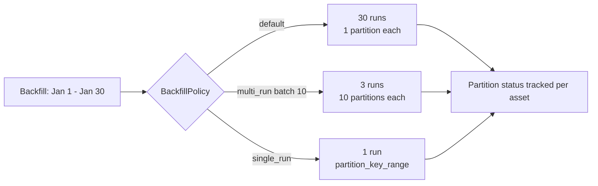

### 6.2 Lineage from ingestion to dbt (Dagster)

| Tool | How it becomes assets |
|---|---|
| dlt | Each dlt resource becomes an asset via a multi-asset [S70](sources.md#s70) |
| Sling | "will produce an asset for each replicated file"; target table depends on an upstream source asset [S71](sources.md#s71) |
| Airbyte | One asset per stream [S74](sources.md#s74) |
| Fivetran | Assets keyed by schema/table, e.g. `salesforce/campaign` [S75](sources.md#s75) |
| dbt | Set `meta.dagster.asset_key` on dbt sources; when a model calls `source()`, "Dagster links the corresponding upstream asset to that model" [S77](sources.md#s77) |

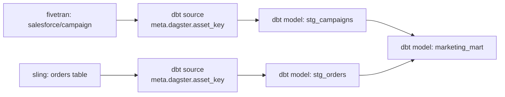

### 6.3 What Temporal users build themselves (*inference*)

- Record dataset state (watermarks, file lists, row counts) in your own tables or object store; pass only references through Temporal [S17](sources.md#s17).
- Deterministic Workflow IDs per partition or file for "one execution per data unit" (Rapidflare used deterministic child IDs) [S28](sources.md#s28) (*vendor blog*).
- Custom Search Attributes (e.g. `partition_date`) to find executions per data unit [S32](sources.md#s32).
- Lineage and data-quality checks need another tool; Temporal documents none.

**Verdict** (*judgement*): data awareness is Dagster's clearest advantage for ingestion that feeds analytics.

Re-verified 2026-11-12, with options to rebuild each missing feature on Temporal (partition library, Snowflake status table, OpenLineage, Snowflake lineage, dbt docs): [migration plan §4.1–4.2](2-migration-plan.md#41-native-support-check-re-verified-2026-11-12).

---

## 7. Data ingestion

> **In short**
> - **Dagster** ships first-party integrations for **dlt, Sling, Airbyte, Fivetran** (and dbt downstream), each table/stream an asset; Meltano is community-maintained; `dagster-embedded-elt` is deprecated [S68](sources.md#s68) [S72](sources.md#s72).
> - **Temporal** ships **no data connectors** (none found); it gives durable primitives: retries, heartbeat checkpoints, batch patterns, queue-wide rate limits [S20](sources.md#s20) [S21](sources.md#s21) [S24](sources.md#s24).
> - **Large data never goes through Temporal payloads**: 2 MB default; pass references or use **External Storage** (Public Preview; self-hosted support not explicitly stated) [S17](sources.md#s17) [S18](sources.md#s18).
> - Both are **at-least-once** per work unit: Activities "may be executed multiple times" [S6](sources.md#s6); Dagster dedupes *runs* with sensor run keys [S61](sources.md#s61). Writes must be idempotent in both.

### 7.1 Integrations

| Tool | Dagster OSS | Temporal OSS |
|---|---|---|
| **dlt** | "Dagster supported"; Component `DltLoadCollectionComponent` in `defs.yaml`; Pythonic multi-asset, each dlt resource → asset, `DagsterDltResource` [S69](sources.md#s69) [S70](sources.md#s70) | None official; call dlt in an Activity (*inference*) |
| **Sling** | "Dagster supported"; `SlingReplicationCollectionComponent` (`connections` + `replications`), example uses `mode: full-refresh` [S71](sources.md#s71). Pythonic guide lists "full-refresh, incremental, and snapshot" and passes config to the Sling CLI [S104](sources.md#s104). Sling modes: `full-refresh` (default), `incremental`, `truncate`, `snapshot`, `backfill`, `definition-only`, `change-capture` [S105](sources.md#s105) | None found |
| **Airbyte** | "Dagster supported"; `AirbyteWorkspaceComponent` for Cloud and OSS/self-managed; one asset per stream; caches workspace metadata [S73](sources.md#s73) [S74](sources.md#s74). "Materializing these assets will trigger a sync of the Airbyte connection"; `AirbyteCloudWorkspace` and `AirbyteWorkspace` both "launch syncs and monitor their progress"; no observe-only option [S103](sources.md#s103) | None found; Airbyte case study on temporal.io [S29](sources.md#s29) (*not fetched*) |
| **Fivetran** | "Dagster supported"; `FivetranAccountComponent`; triggering mode (sets connector schedule to "manual" unless `disable_schedule_on_trigger: false`) or observe-only (`polling_sensor: true`); `retry_on_reschedule` [S75](sources.md#s75) | None found |
| **Meltano** | "Community supported" [S76](sources.md#s76) | None found |
| **Embedded ELT** | Deprecated → `dagster-sling`, `dagster-dlt` [S72](sources.md#s72) | — |
| **dbt** (downstream) | "Dagster supported"; `DbtProjectComponent`; each model an asset; link via `meta.dagster.asset_key` [S77](sources.md#s77) | None found |
| **External compute** | Pipes: AWS, Azure ML, GCP Dataproc, Spark/Databricks Connect, Kubernetes, PySpark, Scala/Spark, JavaScript [S67](sources.md#s67) | Any of 8 SDK languages in Workers [S1](sources.md#s1) |
| **Object-store offload** | IO managers (details **Not verified**) | External Storage: S3 drivers (Go, Java, Python, TypeScript), GCS (Go, TypeScript), Azure Blob listed, custom drivers [S18](sources.md#s18) |

- No official Temporal–Dagster integration exists [S68](sources.md#s68) ([§13](#13-using-both-together)).
- No official CDC/streaming positioning for either. Temporal's "Workflow Streams" targets live interactivity for agents; content **not verified** [S26](sources.md#s26).

### 7.2 Patterns per scenario

Each pattern is *the author's synthesis of documented primitives*, not a vendor reference architecture unless cited.

#### SC1 — API polling (REST/SaaS)

| Temporal | Dagster |
|---|---|
| Schedule with overlap `Skip` starts a Workflow each interval [S10](sources.md#s10) | dlt asset on a schedule or `on_cron` [S70](sources.md#s70) [S60](sources.md#s60) |
| One Activity per page, or a long Activity heartbeating the cursor [S20](sources.md#s20) | dlt manages its own state; with partitions, use concurrency limits [S70](sources.md#s70) |
| Batch Iterator: "Processes one page of records per Workflow run and continues as new with the next page offset" [S21](sources.md#s21) | Concurrency pools protect the shared API across runs [S63](sources.md#s63) |
| Queue-wide rate limit caps Activities per second; it bounds API calls only if each Activity makes one request [S24](sources.md#s24) | |

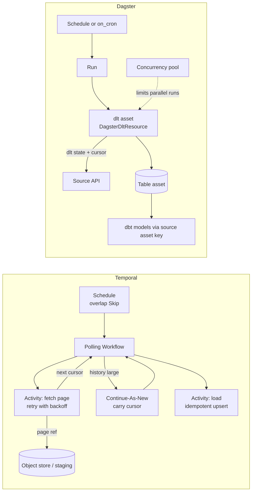

#### SC2 — File arrival in S3

| Temporal | Dagster |
|---|---|
| No built-in bucket trigger. Options (*inference*): Schedule-driven lister Workflow, or external notifier that starts a Workflow or sends a Signal | Sensor lists the bucket, keeps last-seen modification time in a **cursor**, emits one run per file with a **run key** [S61](sources.md#s61) |
| One Child Workflow per file with a deterministic ID gives per-file tracking [S28](sources.md#s28) (*vendor blog*) | Dynamic partitions: `SensorResult` with `dynamic_partitions_requests` plus one run per new file, to "incrementally load new partitions instead of reading the entire bucket" [S101](sources.md#s101) (*vendor blog*); same pattern (`RunRequest(partition_key=...)`, `build_add_request`) in [S109](sources.md#s109) |
| A Retry Policy on file-processing Workflows is one of the few documented reasons to retry Workflows [S7](sources.md#s7) | S3 helper `dagster_aws.s3.sensor.get_objects(bucket, prefix, since_key, since_last_modified)`; older `get_s3_keys` is deprecated ("Use get_objects instead"). In package source only, not in the API reference [S113](sources.md#s113) [S114](sources.md#s114). Treat as unstable |
| | Default sensor interval 30 s if unset (source only) [S112](sources.md#s112) |

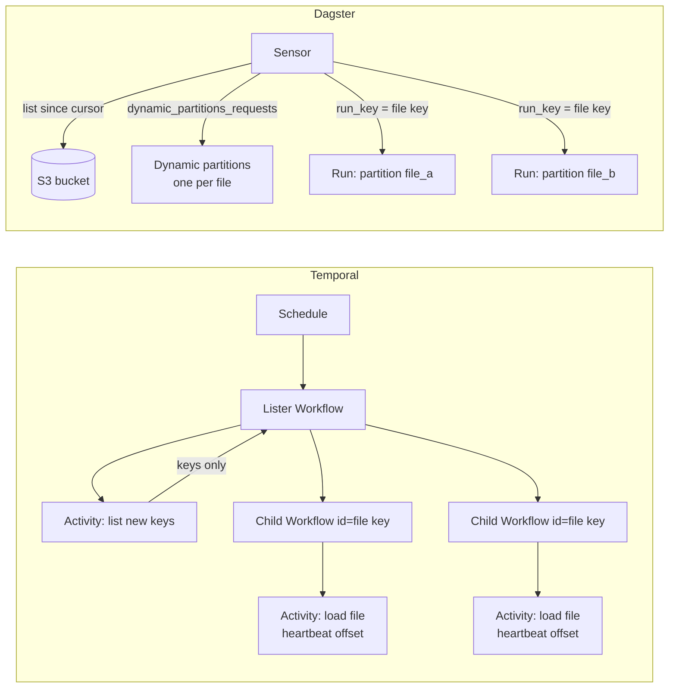

#### SC3 — Database incremental / CDC-style batch

| Temporal | Dagster |
|---|---|
| Long-running Activity pages by high-watermark and heartbeats the last key; a retry resumes from it [S20](sources.md#s20) | Sling replication or dlt SQL source as assets [S71](sources.md#s71) [S70](sources.md#s70) |
| Writes use an idempotency key, e.g. Workflow Run ID + Activity ID [S6](sources.md#s6) | dlt SQL sources: set `defer_table_reflect=True`, else the daemon queries the DB about every minute to refresh definitions [S70](sources.md#s70) |
| | Sling `incremental` (merge/append; new-data upsert needs `primary_key` + `update_key`, full-data upsert needs `primary_key`, append-only needs `update_key`), `backfill` (re-load an `update_key` range), `change-capture` (reads the transaction log) [S105](sources.md#s105). Dagster pages show only `full-refresh` examples [S104](sources.md#s104) |
| | Time-partitioned asset per day/hour lets a window re-run [S64](sources.md#s64) |

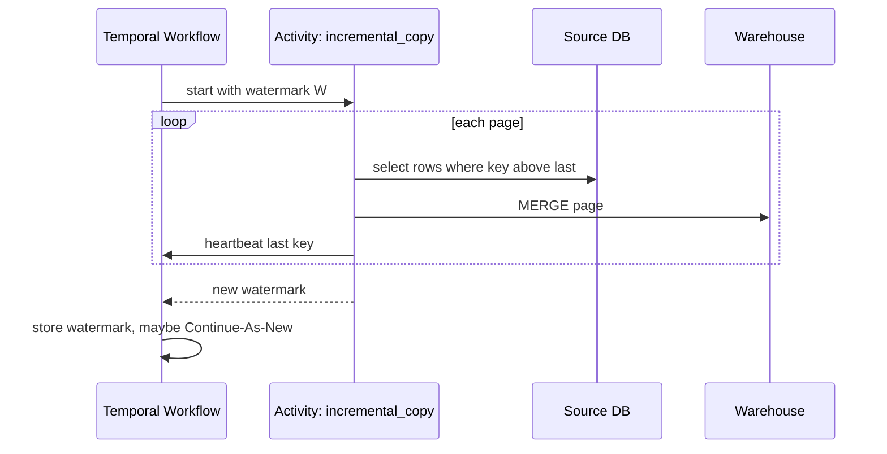

#### SC4 — SaaS connector sync (Fivetran, Airbyte)

| Temporal | Dagster |
|---|---|
| No connector integration. *Inference:* an Activity triggers the vendor sync via API and polls with heartbeats; Temporal tracks nothing about the tables | `FivetranAccountComponent`: trigger, or observe with `polling_sensor: true` [S75](sources.md#s75) |
| | `AirbyteWorkspaceComponent`: materializing **triggers** a sync for Cloud and OSS (OSS needs REST and Configuration API URLs); no observe-only mode [S103](sources.md#s103) [S74](sources.md#s74) |
| | dbt models link via `meta.dagster.asset_key` [S77](sources.md#s77) |

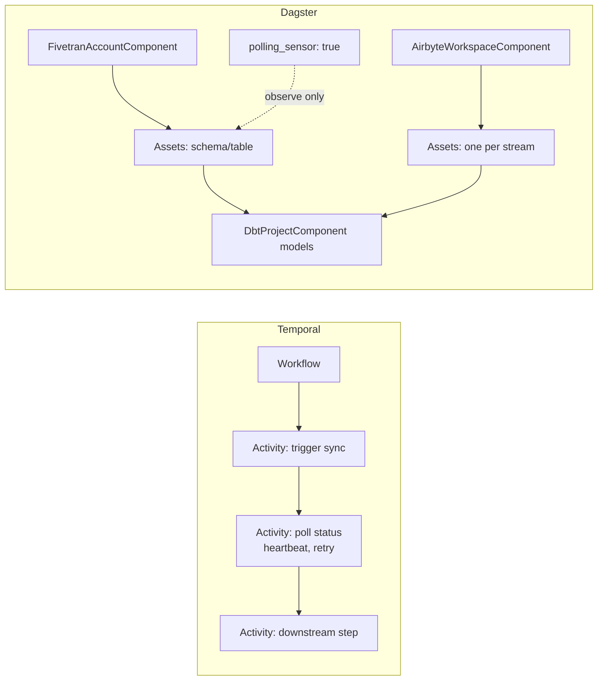

#### SC5 — Large backfill

| Temporal | Dagster |
|---|---|
| Fan-Out with Child Workflows, Batch Iterator, Sliding Window ("fixed-size window of concurrent child Workflows"), MapReduce Tree [S21](sources.md#s21) | Backfill from asset page or lineage graph; per-partition default, `multi_run` or `single_run` [S64](sources.md#s64) [S65](sources.md#s65) |
| "51,200 events max (aim for a few thousand)" [S21](sources.md#s21); ≤2,000 pending Activities/Children, ≤500 recommended [S11](sources.md#s11) | Run queue `max_concurrent_runs` (default 10, package source) and pools limit pressure [S63](sources.md#s63) [S112](sources.md#s112) |
| Rapidflare: sliding window of N children; parent keeps cursor, in-flight IDs, counters; Continue-As-New at page boundaries; `ParentClosePolicy.ABANDON`; tested on 1,000,000 documents [S28](sources.md#s28) (*vendor blog*) | |
| Schedule backfill re-runs past *schedule times* (`AllowAll` parallel, `BufferAll` sequential) [S10](sources.md#s10) | |

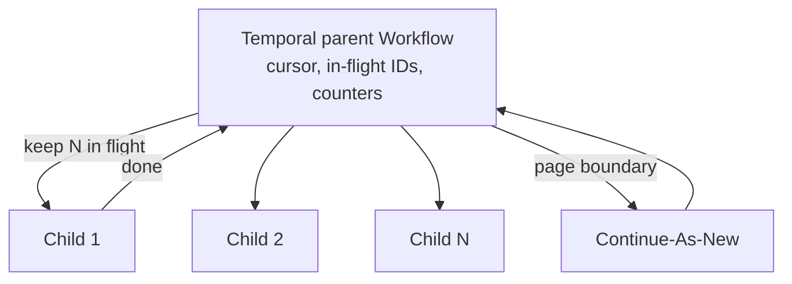

### 7.3 Large payloads

| Topic | Temporal OSS | Dagster OSS |
|---|---|---|
| Hard limit | Blob warn 512 KB, error 2 MB; gRPC 4 MB; history 50 MB [S11](sources.md#s11) | No payload limit found; data moves through IO managers or external systems |
| Configurable | Payload limit configurable on self-hosted, default 2 MB [S17](sources.md#s17) | — |
| Recommended fix | Pass references; External Storage (claim check, offloads ≥256 KiB by default, Public Preview, may change before GA); compression codecs only delay the problem [S17](sources.md#s17) [S18](sources.md#s18) | Write data to the warehouse/object store inside the asset; Pipes streams only logs and metadata [S66](sources.md#s66) |
| External Storage on self-hosted | SDK-side Data Converter: clients/Workers upload/download, history keeps a reference [S18](sources.md#s18) [S106](sources.md#s106). No page says Cloud-only or gives a minimum version. Self-hosted support *likely* (*inference*) but **not explicitly stated** | — |
| Sensor tick size | — | Ticks requesting runs over the size limit fail explicitly (1.13.26) [S94](sources.md#s94) |

### 7.4 Idempotency and delivery

| Topic | Temporal | Dagster |
|---|---|---|
| Semantics | "Activity may be executed multiple times and may even partially complete more than once"; observed as completed exactly once [S6](sources.md#s6) | Steps re-run on retry; run retries create new runs [S58](sources.md#s58) [S59](sources.md#s59); official delivery semantics **Not verified** |
| Dedupe of triggers | Schedule overlap policy [S10](sources.md#s10); deterministic Workflow IDs (*inference*) | Sensor run keys skip duplicates [S61](sources.md#s61) |
| Idempotency keys | Enforced by the called service; Run ID + Activity ID suggested [S6](sources.md#s6) | Partition-scoped overwrite (*inference*) |
| Guidance | "Activities that perform writes should be idempotent" [S6](sources.md#s6) | No official statement found |

*Judgement:* use MERGE/upsert or deterministic object keys in both. Temporal makes at-least-once explicit; Dagster hides it behind run-level dedupe, which is easy to over-trust.

### 7.5 Rate limiting and concurrency

| Mechanism | Temporal | Dagster |
|---|---|---|
| Global throughput cap | Task-queue rate limit (`max_task_queue_activities_per_second`), enforced by Matching "for the entire queue regardless of how many Workers"; 2 Workers × 5 = 5 [S24](sources.md#s24) | None built in. Concurrency pools protect "shared databases and APIs" by capping in-flight steps, not requests per second; per-second API quotas need your own rate limiter [S63](sources.md#s63) (*inference* for the last part) |
| Per-process cap | `MaxWorkerActivitiesPerSecond` (multiplies with Workers) [S24](sources.md#s24) | Run executor limits within a run [S63](sources.md#s63) |
| Concurrency slots | `MaxConcurrentActivityExecutionSize`; "not throughput limits" [S24](sources.md#s24) | `max_concurrent_runs`; `default_op_concurrency_limit` [S63](sources.md#s63) [S53](sources.md#s53) |
| Ordering | Task Queue Priority & Fairness GA 2026-05-05 [S50](sources.md#s50) | With pools, "Dagster+ does **not** guarantee strict FIFO" (stated for Dagster+; OSS not stated); QueuedRunCoordinator priority rules [S55](sources.md#s55) |
| Gotcha | Different Worker values: last poller wins [S24](sources.md#s24) | Concurrency limits "recommended" for partitioned dlt assets [S70](sources.md#s70) |

### 7.6 Backfills compared

| | Temporal | Dagster |
|---|---|---|
| Unit | Schedule action time, or your own work items | Asset partition |
| Built-in action | Schedule backfill [S10](sources.md#s10) | Materialize partitions from asset page/lineage [S64](sources.md#s64) |
| Fault isolation | Per Child Workflow / Activity (*inference*) | Per run; `single_run` retries all [S65](sources.md#s65) |
| Status tracking | Your own (Search Attributes help) [S32](sources.md#s32) | Partition fill status tracked [S64](sources.md#s64) |

### 7.7 Code sketches (illustrative, not tested)

API names were checked against the cited docs or package source. `read_page`, `merge_into_warehouse`, `list_new_objects`, `load_file` are your own code.

**Temporal (Python SDK): resumable page loader**

```python
# ILLUSTRATIVE SKETCH - simplified, not tested.
from datetime import timedelta
from temporalio import activity, workflow
from temporalio.common import RetryPolicy

@activity.defn
async def copy_table(table: str, start_key: str) -> str:
    details = activity.info().heartbeat_details      # last heartbeat, seen on retry
    last_key = details[0] if details else start_key
    while page := await read_page(table, after=last_key):   # your code
        await merge_into_warehouse(page)                     # idempotent MERGE
        last_key = page.last_key
        activity.heartbeat(last_key)                         # checkpoint
    return last_key                                          # small value, not data

@workflow.defn
class IngestTables:
    @workflow.run
    async def run(self, tables: list[str], marks: dict[str, str]) -> dict[str, str]:
        for t in tables:
            marks[t] = await workflow.execute_activity(
                copy_table, args=[t, marks[t]],
                start_to_close_timeout=timedelta(hours=2),
                heartbeat_timeout=timedelta(minutes=1),   # 2-3x heartbeat interval; one beat
                                                  # per page, so > slowest read + merge
                retry_policy=RetryPolicy(
                    maximum_attempts=10,
                    non_retryable_error_types=["SourceAuthError"],
                ),
            )
            workflow.logger.info("loaded %s", t)
        return marks

# Worker(client, task_queue="ingest", workflows=[IngestTables],
#        activities=[copy_table], max_task_queue_activities_per_second=5)
```

API sources: decorators, `execute_activity`, timeouts, `RetryPolicy` [S115](sources.md#s115); `activity.heartbeat`, `heartbeat_details`, 2–3× timeout [S20](sources.md#s20); `max_task_queue_activities_per_second` [S24](sources.md#s24); `args=`, `non_retryable_error_types`, `Worker(...)` keywords [S116](sources.md#s116).

**Dagster: file-arrival sensor with dynamic partitions**

```python
# ILLUSTRATIVE SKETCH - simplified, not tested.
import dagster as dg

files = dg.DynamicPartitionsDefinition(name="files")

@dg.asset(partitions_def=files)
def raw_file(context: dg.AssetExecutionContext) -> None:
    load_file(context.partition_key)              # your code; key = S3 object key

@dg.sensor(target=raw_file, minimum_interval_seconds=30)
def new_files_sensor(context: dg.SensorEvaluationContext):
    since = float(context.cursor or 0)            # cursor persists between ticks
    new = list_new_objects(since)                 # your code: objects with modified >= since
    return dg.SensorResult(
        dynamic_partitions_requests=[files.build_add_request([o.key for o in new])],
        run_requests=[dg.RunRequest(run_key=f"{o.key}@{o.modified}", partition_key=o.key)
                      for o in new],      # new version of a key = new run
        cursor=str(max([o.modified for o in new], default=since)),
    )   # Dagster skips any run whose run_key was used before, so `>=` re-lists are safe
```

API sources: `@sensor`, `SensorResult`, `RunRequest`, `context.cursor` [S108](sources.md#s108); `DynamicPartitionsDefinition`, `build_add_request` [S109](sources.md#s109); `@asset(partitions_def=...)` [S110](sources.md#s110); `AssetExecutionContext.partition_key` [S84](sources.md#s84); run-key dedupe [S61](sources.md#s61).

**Dagster: connector components (`defs.yaml` fragments)**

```yaml
# ILLUSTRATIVE FRAGMENTS - one component per defs.yaml.
# Sling
type: dagster_sling.SlingReplicationCollectionComponent
attributes:
  connections:
    DUCKDB:
      type: duckdb
      instance: /tmp/my_project.duckdb
  replications:
    - path: ./replication.yaml   # Sling config; set mode (e.g. incremental) here
---
# Fivetran
type: dagster_fivetran.FivetranAccountComponent
attributes:
  workspace:
    account_id: "{{ env.FIVETRAN_ACCOUNT_ID }}"
    api_key: "{{ env.FIVETRAN_API_KEY }}"
    api_secret: "{{ env.FIVETRAN_API_SECRET }}"
    disable_schedule_on_trigger: false   # keep Fivetran's own schedule
    retry_on_reschedule: false
  polling_sensor: true                   # observe syncs without triggering
```

API sources: Sling keys [S71](sources.md#s71); `mode` values [S105](sources.md#s105); Fivetran keys and placement [S75](sources.md#s75).

**Verdict** (*judgement*): Dagster wins on connector-based ELT and partition backfills; Temporal wins on custom, high-fan-out, rate-limited or long-running extraction. Per-scenario scores are in [§1.3](#13-when-to-pick-which-per-scenario).

---

## 8. Observability and UI

> **In short**
> - **Temporal Web UI** is execution-centric: Workflow list, Event History views, live call stack, Query/Signal/Update/reset/terminate [S31](sources.md#s31).
> - **Dagster UI** is asset- and run-centric: asset catalog and lineage, runs, schedules, sensors, backfills, code-location reload [S78](sources.md#s78).
> - Temporal SDKs emit **Prometheus metrics** and **OpenTelemetry** traces [S32](sources.md#s32). Dagster OSS gives structured event logs plus pluggable compute logs [S54](sources.md#s54).
> - **Alerts, Insights and asset health are Dagster+** [S79](sources.md#s79). Neither OSS product bundles alerting (*inference*).

| Area | Temporal Web UI [S31](sources.md#s31) | Dagster UI (OSS) [S78](sources.md#s78) |
|---|---|---|
| Home | Table of all Workflow Executions in retention | Overview "factory floor": runs, jobs, schedules, sensors, resources, backfills |
| Filtering | Status, Workflow ID/Type, start/end time, Search Attributes; up to 20 Saved Views | Runs by job, run ID, status, tag; assets by key, compute kind, group, code location, tags |
| Drill-down | Event History: Timeline, Compact, All, JSON; download JSON | Run details and logs; asset pages |
| Live debugging | Call stack of where Workflow code waits (needs a running Worker) | Not covered |
| Actions | Query, Signal, Update, cancel, reset, terminate | Materialize, launch backfills, reload code locations |
| Problem flagging | `TemporalReportedProblems` search attribute for repeated Workflow Task failures | Deployment page: code-location status, daemon health |
| Lineage | None | Global asset lineage |
| Encrypted payloads | Codec Server decodes for display | Not applicable |
| Dagster+ only | — | Saved selections, owners, column-level filters (Pro); asset health; alerts; Insights [S78](sources.md#s78) [S79](sources.md#s79) |

*Conflict:* the Observe page labels "Asset catalog" as Dagster+; the webserver page describes an OSS catalog. Likely: basic in OSS, enhanced in Dagster+ ([gaps C2](3-evidence-and-gaps.md#2-conflicts-between-sources)).

| Signal | Temporal OSS | Dagster OSS |
|---|---|---|
| Metrics | Python: `Runtime` + `TelemetryConfig(metrics=PrometheusConfig(...))`, global, `global_tags` [S32](sources.md#s32); dev server `--metrics-port` for `/metrics` [S39](sources.md#s39) | Prometheus endpoint **Not verified** |
| Tracing | `OpenTelemetryPlugin` (real-duration Workflow spans); older `TracingInterceptor` gives zero-duration Workflow spans [S32](sources.md#s32) | OpenTelemetry **Not verified** |
| Logs | `workflow.logger` via Python `logging` [S32](sources.md#s32) | Structured event log + stdout/stderr via compute log manager (Local default; S3, Azure, GCS, NoOp) [S54](sources.md#s54) |
| Run health | Schedule-to-start latency; backlog count; poll success rate [S8](sources.md#s8) [S15](sources.md#s15) | `run_monitoring` (opt-in) [S54](sources.md#s54) |
| Alerting | Bring your own, e.g. Prometheus/Grafana (*inference*) | Native alerts are Dagster+ [S79](sources.md#s79); OSS needs custom sensors or external tools (*inference*) |
| Vendor telemetry | Not covered | Anonymized usage telemetry on by default, can be disabled [S54](sources.md#s54) |
| Search | List Filter over default + custom Search Attributes, e.g. `WorkflowType="GreetingWorkflow"` via `client.list_workflows()`; set at start, `upsert_search_attributes()`, remove with `value_unset()` [S32](sources.md#s32); types Text, Keyword, Int, Double, Bool, Datetime, KeywordList [S39](sources.md#s39); backed by Elasticsearch or SQL (1.20+) [S3](sources.md#s3) | UI filters; tags, groups; owners are Dagster+ Pro [S78](sources.md#s78); backed by instance DB [S53](sources.md#s53) |

Other SDK observability guides (Go, Java, TypeScript, .NET, Ruby) exist but were not fetched [S33](sources.md#s33) [S34](sources.md#s34) [S35](sources.md#s35) [S36](sources.md#s36) [S37](sources.md#s37).

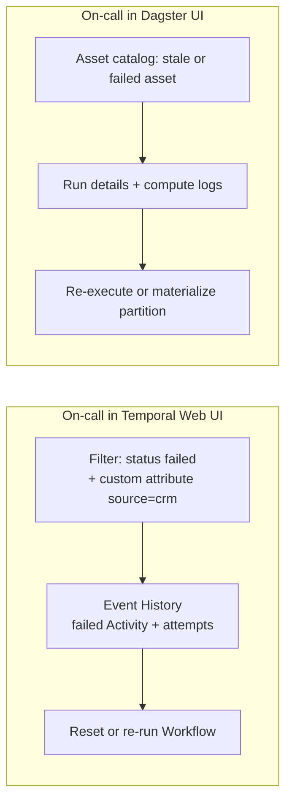

**Verdict** (*judgement*): Temporal answers "what happened inside this execution?"; Dagster answers "which data is stale and why?", which is closer to what ingestion stakeholders ask. Freshness *alerting* is Dagster+.

---

## 9. Testing and developer experience

> **In short**
> - **Temporal**: time-skipping environment, full local server, `ActivityEnvironment`, mocked Activities, **replay tests in CI** [S41](sources.md#s41).
> - **Dagster**: plain pytest (call assets directly, `build_asset_context()`, mock resources, `execute_in_process`); **asset checks** test data at runtime [S82](sources.md#s82) [S83](sources.md#s83).
> - Local dev is one command in both (`temporal server start-dev`, `dg dev`); neither is for production [S39](sources.md#s39) [S86](sources.md#s86).
> - Temporal adds **determinism and versioning** to every change [S44](sources.md#s44); Dagster deploys by **reloading code locations** [S78](sources.md#s78).
> - Languages: Temporal 8 SDKs; Dagster definitions in Python, others via Pipes [S1](sources.md#s1) [S66](sources.md#s66).

| Need | Temporal (Python SDK) [S41](sources.md#s41) | Dagster [S82](sources.md#s82) |
|---|---|---|
| Unit-test a step | `ActivityEnvironment`: call directly, mock context, capture heartbeats, cancel | Invoke asset as a function with inputs and mocked resources |
| Mock dependencies | Mocked Activity with same name and signature | `mock.Mock(spec=S3FileManager)` style resources |
| Context | — | `build_asset_context()`, can set `partition_key` |
| Multi-step test | Time-skipping env: timers fast-forwarded except while Activities run; `env.sleep()` | `SourceAsset`s + mock IO manager + `execute_in_process` |
| Real server test | `WorkflowEnvironment.start_local()`, no time skipping | `dg dev` with `DAGSTER_HOME` [S86](sources.md#s86) |
| Code-change safety | Replayer: "Fail CI if any error is encountered during replay" | Not needed (no determinism constraint) |
| Data quality | — | Asset checks; `blocking=True` stops downstream; per-partition status in preview [S83](sources.md#s83) |
| Automation logic | — | `evaluate_automation_conditions` [S60](sources.md#s60) |

- `materialize()` is confirmed in [S84](sources.md#s84); `build_op_context()` examples **not verified** [S85](sources.md#s85).
- Dagster advises against unit tests when most logic lives in an external system [S82](sources.md#s82).

**Local development**

| | Temporal | Dagster |
|---|---|---|
| Command | `temporal server start-dev` [S39](sources.md#s39) | `dg dev` [S86](sources.md#s86) |
| Starts | In-memory server + Web UI | Dagster UI + daemon |
| Ports | gRPC 7233, UI 8233 (gRPC + 1000) [S39](sources.md#s39) | Default port **Not verified** |
| Persistence | Lost on exit unless `--db-filename` [S39](sources.md#s39) | Temp dir unless `DAGSTER_HOME` set [S86](sources.md#s86) |
| You also run | Your Worker process(es) (*inference*) | Nothing else |
| Production? | "not intended for production use" [S39](sources.md#s39) | "intended for local development *only*"; no auth, no replicas, daemon not auto-restarted [S86](sources.md#s86) |

**Deploying changes**

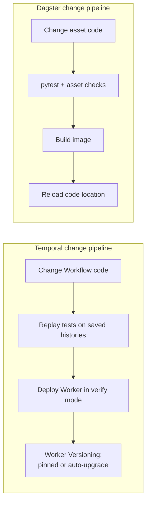

| Topic | Temporal [S44](sources.md#s44) | Dagster |
|---|---|---|
| Constraint | Workflow Definition must be deterministic; Activity code need not be | None documented |
| Strategy | Worker Versioning "strongly recommend[ed]"; patching alternative; eager start ignores versioning | Reload all or per location in UI [S78](sources.md#s78) |
| Replay stages | Dev (checked-in histories), pre-deploy (fetched; encrypted payloads may block), deploy-time verify Worker; scrub PII | — |
| Zero-downtime | Not covered | Not in `dg dev`; production **Not verified** [S86](sources.md#s86) |
| Scaffolding | — | Components and the `dg` CLI scaffold projects and YAML-based definitions [S57](sources.md#s57) |

**Verdict** (*judgement*): no quantitative learning-curve data exists. Temporal docs stress determinism, versioning and replay (even tracing has replay quirks) [S44](sources.md#s44) [S32](sources.md#s32); Dagster frames testing as "directly invoke definitions" with pytest; its own concepts are assets, resources and IO managers [S82](sources.md#s82). For a Python data team, Dagster's ramp-up is shorter; Temporal's concepts pay off for long-running, stateful pipelines.

---

## 10. Deployment, scaling and limits

> **In short**
> - **Temporal OSS** installs: CLI dev server, Docker Compose, release binaries + systemd, embedded Go package, Helm charts [S14](sources.md#s14).
> - **Dagster OSS** installs: local, Docker Compose, Kubernetes (`dagster/dagster` Helm chart), AWS (ECS), GCP [S88](sources.md#s88).
> - Temporal scales through History Shards (**fixed at creation**; 1–128K run successfully) and horizontally scaled Workers [S2](sources.md#s2) [S15](sources.md#s15).
> - Dagster scales through run launchers/executors and concurrency limits; the daemon is a **single replica** [S52](sources.md#s52) [S56](sources.md#s56).
> - Temporal's per-execution limits (2 MB payload, 51,200 events/50 MB history, 2,000 pending ops) shape ingestion design [S11](sources.md#s11).

### 10.1 Deployment options

| | Temporal OSS | Dagster OSS |
|---|---|---|
| Dev | `temporal server start-dev`, UI localhost:8233 [S48](sources.md#s48) | `dg dev` [S86](sources.md#s86) |
| Compose | `temporalio/samples-server` `compose/`: PostgreSQL + Elasticsearch, gRPC 7233, UI 8080 [S14](sources.md#s14) | Docker Compose listed [S88](sources.md#s88) |
| Kubernetes | `temporalio/helm-charts`; own DB/Elasticsearch; images 1.30+ need chart 0.73.1+; schema updates via `temporalio/admin-tools` are the operator's job [S14](sources.md#s14) | `dagster/dagster` chart, new chart per version; daemon, webserver, user-code gRPC servers, in-cluster PostgreSQL [S88](sources.md#s88) |
| Other | Release binaries + systemd; embed as Go package [S14](sources.md#s14) | AWS (ECS), GCP [S88](sources.md#s88) |
| Operator tooling | Temporal Worker Controller GA 2026-05-04 [S50](sources.md#s50) | ECS cross-account discovery (1.13.24), resumable run workers (1.13.25) [S94](sources.md#s94) |
| "Production-ready" Helm statement | None found | None found |
| Network | Must not be reachable from the public internet [S14](sources.md#s14) | See [§11](#11-security) |

### 10.2 Scaling knobs

| Temporal | Fact |
|---|---|
| History Shards | Unit of concurrency, one persistence partition each; set before DB integration, "cannot be changed"; "operated successfully using anywhere from 1 to 128K", no theoretical limit [S2](sources.md#s2) |
| History processes | 1 to number of shards; start ~1 per 500 [S2](sources.md#s2) |
| Workers | ≥2 per Task Queue; poll success >90% (>95% high-volume); raise slots (`maxConcurrentActivityExecutionSize`) or pollers; watch `ApproximateBacklogCount` [S15](sources.md#s15) |
| Rate limits | `maxTaskQueueActivitiesPerSecond` (server-enforced), `maxWorkerActivitiesPerSecond` [S15](sources.md#s15) |
| Concurrent executions | No limit apart from per-execution history [S12](sources.md#s12) |
| Task queue partitions | Default count and dynamic-config keys **Not verified** |

| Dagster | Fact |
|---|---|
| Run queue | `QueuedRunCoordinator` `max_concurrent_runs`: default **10** (`-1` = no limit, `0` = launch nothing) per package source; docs show examples only [S112](sources.md#s112) [S53](sources.md#s53) [S63](sources.md#s63) [S111](sources.md#s111) |
| Pools | Cross-run limits for shared DBs/APIs, e.g. `pools: default_limit: 3` [S63](sources.md#s63) |
| Op concurrency | `concurrency.default_op_concurrency_limit` (example 10) [S53](sources.md#s53) |
| Run isolation | `DockerRunLauncher` (container per run), `K8sRunLauncher` (K8s job per run) [S53](sources.md#s53) |
| Step isolation | `multiprocess_executor`, `k8s_job_executor` (pod per step), `celery_executor` [S56](sources.md#s56) |
| Sensor throughput | `DAGSTER_GRPC_MAX_WORKERS`, `sensors.use_threads`, `num_workers` [S62](sources.md#s62) |
| Daemon | One instance; replicas not supported [S52](sources.md#s52) |

### 10.3 Limits (exact numbers)

**Temporal OSS self-hosted defaults**

| Limit | Warn | Error / max | Source |
|---|---|---|---|
| Blob (each payload) | 512 KB | 2 MB (`ErrBlobSizeExceedsLimit`) | [S11](sources.md#s11) |
| gRPC received message | — | 4 MB | [S11](sources.md#s11) |
| Event batch transaction (`DefaultTransactionSizeLimit`) | — | 4 MB | [S11](sources.md#s11) |
| Event History events | 10,240 | 51,200 (execution terminated) | [S11](sources.md#s11) [S12](sources.md#s12) |
| Event History size | 10 MB | 50 MB (execution terminated) | [S11](sources.md#s11) [S12](sources.md#s12) |
| Pending Activities per execution | — | 2,000 (≤500 recommended) | [S11](sources.md#s11) |
| Pending Child Workflows per execution | — | 2,000 | [S11](sources.md#s11) [S12](sources.md#s12) |
| Pending external Signals per execution | — | 2,000 | [S11](sources.md#s11) [S12](sources.md#s12) |
| Pending cancel requests per execution | — | 2,000 | [S11](sources.md#s11) |
| Updates per execution | — | 10 in-flight; 2,000 total | [S11](sources.md#s11) |
| Incomplete Nexus Operations per execution | — | 30 | [S12](sources.md#s12) |
| Identifier length (Workflow Id, Type, Task Queue) | — | 1,000 chars (sample SQL config: 255) | [S11](sources.md#s11) |
| Batch jobs | — | 1 at a time | [S11](sources.md#s11) |
| Schedule last completion result | — | 2 MiB (not passed if within 1 KiB) | [S10](sources.md#s10) |
| Schedule catch-up window | — | default 1 year, min 10 s | [S10](sources.md#s10) |
| History Shards | — | Fixed at creation; 1–128K used in practice (not a hard cap) | [S2](sources.md#s2) |
| Workflow Task retry interval | — | up to 10 min | [S7](sources.md#s7) |
| Activity default max retry interval | — | 100 s | [S7](sources.md#s7) |

When a pending-operation limit is hit, the Commands fail [S11](sources.md#s11) and the Workflow Task fails and is retried [S12](sources.md#s12).

**Temporal Cloud (contrast only)** [S13](sources.md#s13)

| Limit | Value |
|---|---|
| Payload / gRPC / history transaction | 2 MB / 4 MB / 4 MB, not configurable |
| History | 51,200 events / 50 MB, not configurable |
| Actions per second | 500 APS default per namespace |
| Schedules / Visibility API | 10 req/s / 30 calls/s |
| Retention | 30 days default, 1–90 days |
| Signals per execution | 10,000 |

**Dagster OSS**

| Limit / default | Value | Source |
|---|---|---|
| Sensor evaluation timeout | 60 s (`DAGSTER_SENSOR_GRPC_TIMEOUT_SECONDS`) | [S62](sources.md#s62) |
| Sensor evaluation guideline | >3 min means a sensor "may not be the correct tool" | [S62](sources.md#s62) |
| Daemon replicas | 1 (replicas not supported) | [S52](sources.md#s52) |
| Code-location server replicas | 1 per code location | [S52](sources.md#s52) |
| Run monitoring start / cancel timeout | 180 s / 180 s | [S54](sources.md#s54) |
| Run monitoring resume attempts | 3 | [S54](sources.md#s54) |
| Run monitoring poll interval | 120 s | [S54](sources.md#s54) |
| Free slots after run end | 300 s | [S54](sources.md#s54) |
| Sensor tick request size | Over-limit ticks fail with explicit error (1.13.26); numeric limit **Not verified** | [S94](sources.md#s94) |
| Default `max_concurrent_runs` | 10; `-1` disables (config schema, not in docs) | [S112](sources.md#s112) |
| Default sensor interval | 30 s when unset (source; API docs give none) | [S112](sources.md#s112) [S108](sources.md#s108) |
| Run queue dequeue interval | 5 s fallback in `QueuedRunCoordinator` (source) | [S112](sources.md#s112) |

**Verdict** (*judgement*): Temporal's limits are per *execution*, so they push you to split work into many small executions. Dagster's limits are about *control-plane throughput* (sensor time, single daemon), so keep sensors light and heavy work in runs.

---

## 11. Security

> **In short**
> - Both are **insecure by default**.
> - **Temporal OSS** has opt-in, first-party controls: mTLS, a pluggable Authorizer and JWT ClaimMapper, Web UI SSO/OIDC, client-side payload encryption via codecs [S45](sources.md#s45).
> - **Dagster OSS** has no built-in user authentication or RBAC; a maintainer confirms these are Dagster+ only [S89](sources.md#s89).
> - Community auth add-ons for Dagster OSS exist but are third-party and unevaluated [S91](sources.md#s91) [S92](sources.md#s92).

Both are **insecure by default**. Temporal's default Authorizer "allows **every** API request, with no authentication or access control" [S45](sources.md#s45).

| Control | Temporal OSS | Dagster OSS |
|---|---|---|
| Transport encryption | mTLS, separate `internode` and `frontend` certs; `requireClientAuth` [S45](sources.md#s45) | **Not verified** |
| API authentication | JWT via ClaimMapper (default reads `permissions` claims) [S45](sources.md#s45) | None built in [S89](sources.md#s89) |
| Authorization | `Authorizer` plugin, `Authorize` per API call; roles read, write, worker, admin per namespace; `temporal-system` reserved [S45](sources.md#s45) | None; RBAC is Dagster+ [S89](sources.md#s89) [S90](sources.md#s90) |
| UI login | `TEMPORAL_AUTH_ENABLED=true` + OAuth; examples Google, Auth0, Okta [S45](sources.md#s45) | None built in; `dg dev` lacks auth [S86](sources.md#s86) |
| Payload encryption | Custom Payload Codec in Data Converter; covers payloads, not metadata [S45](sources.md#s45) | No equivalent found (*inference*) |
| Viewing encrypted data | Codec Server; "consider all security implications" [S45](sources.md#s45) [S47](sources.md#s47) | — |
| External Storage | Runs after the codec, so offloaded payloads are already encrypted [S18](sources.md#s18) | — |
| Network | Hosts must not be reachable from the public internet [S14](sources.md#s14) | *Inference:* webserver behind a reverse/OAuth2 proxy and network isolation; official guidance **Not verified** |
| Community add-ons | — | Auth add-ons exist, third-party and unevaluated [S91](sources.md#s91) [S92](sources.md#s92) |
| Vendor telemetry | Not covered | Anonymized usage telemetry on by default, can be disabled [S54](sources.md#s54) |

**Hardened layouts** (*inference*, not vendor reference architectures)

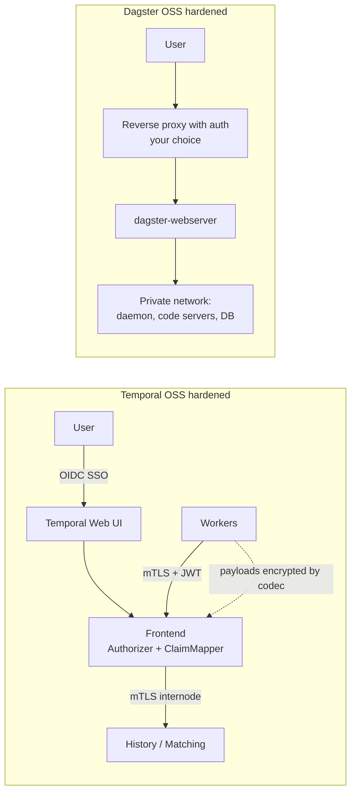

**Ingestion notes**

- Source credentials live in your Workers (Temporal) or code-location/run environment (Dagster). Secrets management was **not covered** for either.
- Payload codecs block replay tests on fetched histories unless you can decrypt them; scrub PII from histories used in replay tests [S44](sources.md#s44).

**Verdict** (*judgement*): for several teams sharing one OSS deployment with per-team access control, Temporal OSS is materially stronger. Dagster OSS suits a single trusted team behind a network boundary.

---

## 12. Licensing and community

> **In short**
> - **Temporal Server: MIT**, ~23.7k stars, ~2.0k forks; latest **v1.32.1** [S48](sources.md#s48) [S49](sources.md#s49).
> - **Dagster: Apache-2.0**, ~16.1k stars, ~2.3k forks; latest **1.13.29** on PyPI, roughly weekly-to-biweekly patches [S93](sources.md#s93) [S95](sources.md#s95).
> - **Prefect announced it is acquiring Dagster Labs** (2026-07-13); OSS to be "actively developed", "no plans to merge Dagster into Prefect" [S96](sources.md#s96) [S97](sources.md#s97).
> - Temporal began as a fork of Uber's Cadence by Cadence's creators [S48](sources.md#s48).

| | Temporal | Dagster |
|---|---|---|
| Licence | MIT (server) [S48](sources.md#s48) | Apache-2.0 [S93](sources.md#s93) [S95](sources.md#s95) |
| SDK / library licences | Python `temporalio` 1.36.0: MIT (PyPI, 2026-11-11) [S116](sources.md#s116); other SDKs **Not verified** | Libraries versioned as 0.29.x [S94](sources.md#s94); `dagster-aws`, `dagster-airbyte`, `dagster-sling` 0.29.29: Apache-2.0 [S113](sources.md#s113); others **Not verified** |
| Stars / forks (scraped 2026-11-11) | ~23.7k / ~2.0k [S48](sources.md#s48) | ~16.1k / ~2.3k [S93](sources.md#s93) |
| Contributors | **Not verified** | **Not verified** |
| Latest release | v1.32.1 (Oct 8; year inferred 2026); patches v1.31.4, v1.30.8 on Oct 12 [S49](sources.md#s49) | 1.13.29 (PyPI, 2026-11-05) [S95](sources.md#s95); GitHub "Latest" still 1.13.28 (30 Oct) [S94](sources.md#s94); docs picker "Latest (1.12.8)" [S52](sources.md#s52) |
| Cadence | Patch releases across 3 minor lines [S49](sources.md#s49) | 1.13.24 → 1.13.29 between 2026-09-21 and 2026-11-05 [S95](sources.md#s95) |
| Maintainer | Temporal Technologies [S48](sources.md#s48) | Dagster Labs, being acquired by Prefect [S96](sources.md#s96) |
| Origin | Fork of Uber's Cadence by Cadence's creators [S48](sources.md#s48) | — |
| Recent milestones | Rust SDK GA 2026-09-04; Standalone Activities GA 2026-09-15; Priority & Fairness GA 2026-05-05; External Storage preview 2026-05-14 [S50](sources.md#s50) | ECS resumable run workers (1.13.25) [S94](sources.md#s94) |

**Prefect acquisition** (vendor statements) [S96](sources.md#s96) [S97](sources.md#s97)

| Statement | Source |
|---|---|
| "Prefect is acquiring Dagster Labs"; "About 40 members of the Dagster team" join Prefect (2026-07-13) | Blog [S96](sources.md#s96) |
| Prefect acquires "Dagster's product, codebase, and customer relationships" | FAQ [S97](sources.md#s97) |
| "The open-source project will be actively developed, not just maintained." | [S96](sources.md#s96) [S97](sources.md#s97) |
| "We have no plans to merge Dagster into Prefect"; commercial offering "continues to operate as it does today"; closing expected "in the coming weeks" | FAQ [S97](sources.md#s97) |
| Founder Nick Schrock is "moving on from the project and company" | [S96](sources.md#s96) |
| dagster.io showed a "Dagster is now part of Prefect" banner; exact close date **Not verified** | [S100](sources.md#s100) |
| Third-party press exists, not fetched | [S98](sources.md#s98) [S99](sources.md#s99) |

**Verdict** (*judgement*): both licences are permissive and allow forking; neither is source-available or copyleft. Dagster carries **ownership-change risk** in 2026 (roadmap under Prefect not yet visible; Apache-2.0 limits the downside). Temporal carries typical **single-vendor risk**. Stars and cadence are weak signals.

---

## 13. Using both together

> **In short**
> - **No official Temporal–Dagster integration found**: Dagster's integrations index lists none [S68](sources.md#s68); combining them is custom code.
> - Three patterns (*inference*): Dagster outer / Temporal inner, Temporal outer / Dagster inner, or joined only by storage.

**No official integration found.** Dagster's integrations index lists no Temporal integration [S68](sources.md#s68), and the searches recorded in [evidence and gaps](3-evidence-and-gaps.md) found no first-party bridge. Building blocks (the pattern itself is *inference*):

- Dagster webserver "responds to GraphQL queries" [S52](sources.md#s52).
- Dagster Pipes runs external code that "can be triggered from Python" and reports logs and metadata back [S66](sources.md#s66).
- Temporal clients start Workflows through the SDK [S1](sources.md#s1); exact client call names not confirmed in the notes.

```mermaid
sequenceDiagram
    participant D as Dagster run - asset raw_documents
    participant TC as Temporal client in asset code
    participant T as Temporal Service
    participant W as Temporal Workers
    participant S as Object store
    D->>TC: start ingestion Workflow, id = asset + partition
    TC->>T: start Workflow
    T->>W: Activities: fetch, heartbeat, retry
    W->>S: write files for partition
    W-->>T: Workflow completed with manifest reference
    TC-->>D: result: manifest key, counts
    D->>D: record materialization metadata
    Note over D: downstream dbt assets run as usual
```

| Option | How | Trade-off (*judgement*) |
|---|---|---|
| A. Dagster outer, Temporal inner | Dagster asset starts a Temporal Workflow and waits; reports counts as metadata | Lineage stays in Dagster; Temporal does the hard extraction. Two systems to run |
| B. Temporal outer, Dagster inner | Temporal Activity calls Dagster GraphQL to launch a materialization | Temporal is the main control plane; Dagster lineage sees only the triggered part |
| C. Separate, joined by storage | Temporal writes to a bucket; Dagster sensor picks up new files | Loosest coupling; no cross-system status |

**Verdict** (*judgement*): adopt both only if one tool clearly fails a hard requirement; two control planes cost real operations effort ([§10](#10-deployment-scaling-and-limits)).

---

## 14. Method

**Goals:** explain the core difference; show per-scenario patterns and what you must build; give exact cited limits; a decision guide usable in under 10 minutes; make every gap visible.

| In scope | Out of scope / contrast only |
|---|---|
| Temporal Server (OSS, MIT) and SDKs, self-hosted | Temporal Cloud (limits contrast only) |
| Dagster OSS (Apache-2.0), self-hosted | Dagster+ Serverless / Hybrid (to show which features are not in OSS) |
| Batch, micro-batch, event-triggered ingestion | Stream engines, CDC tools themselves |
| Integration libraries maintained by Dagster | Prefect roadmap after the acquisition |

Audience: data and platform engineers choosing an orchestrator for ingestion, and engineering graduates who want precise, short answers with diagrams. Assumed knowledge: Python, SQL, cloud storage, containers.

**Evaluation dimensions** (each has its own section)

| # | Dimension | What is measured |
|---|---|---|
| D1 | Philosophy and core abstraction | Unit of work; stated positioning |
| D2 | Architecture and footprint | Services, databases, where user code runs, replicas |
| D3 | Execution model and durability | Recovery granularity, retry defaults, timeouts, heartbeats, versioning cost |
| D4 | Scheduling and triggers | Cron/interval, event triggers, overlap control, catch-up, backfill of schedule times |
| D5 | Data awareness | Lineage, materializations, partitions, partition backfills, data-quality checks |
| D6 | Ingestion fit | Connectors, scenario patterns, large payloads, idempotency, rate limiting, backfills |
| D7 | Observability | UI focus, metrics, tracing, logs, search, alerting in OSS |
| D8 | Testing and DX | Test tooling, local dev, deploy-change safety, languages |
| D9 | Deployment, scaling, limits | Install paths, scaling knobs, numeric limits |
| D10 | Security | AuthN, AuthZ/RBAC, transport and payload encryption in OSS |
| D11 | Licensing and community | Licence, release cadence, GitHub signals, ownership risk |
| D12 | Interoperability | Official integration; pattern for using both |

**Ingestion scenarios**

| ID | Scenario | What "good" looks like |
|---|---|---|
| SC1 | **API polling** of a REST/SaaS API on a schedule | Pagination, cursor state, retries with backoff, respect rate limits, no overlapping runs |
| SC2 | **File arrival in S3** (or any object store) | Detect new objects, process each file once, track per-file status, reprocess on demand |
| SC3 | **Database incremental / CDC-style batch** | High-watermark cursor, idempotent upserts, safe re-runs of a window |
| SC4 | **SaaS connector sync** (Fivetran, Airbyte, dlt, Sling, Meltano) | Trigger or observe syncs, model tables as tracked outputs, link to downstream dbt |
| SC5 | **Large backfill** over months or millions of items | Bounded concurrency, resumability, fault isolation, history/payload limits respected |

**Rating rubric** (ratings are judgements)

| Score | Meaning |
|---|---|
| 3 | Built in, first-party, documented for this need |
| 2 | Documented pattern or configuration; modest custom code |
| 1 | Possible with significant custom code or third-party add-ons |
| 0 | Not supported in OSS, or **Not verified** |

**Source policy**

| Tier | Sources | Use |
|---|---|---|
| 1 Primary | docs.temporal.io, temporal.io changelog, dagster.io/docs, official GitHub repos, PyPI | Facts |
| 2 Vendor-hosted non-normative | Blogs and guest posts on temporal.io or dagster.io | Labelled *vendor blog* |
| 3 Third-party | Press, community projects, forum answers | Labelled; never sole support for a fact |
| 4 Not fetched | URLs found by search, not read | Pointers only |

- Each claim maps to a cited URL in [sources.md](sources.md). Numbers are copied exactly; no rounding. Code sketches use only API names checked against official docs or package source, and are marked illustrative. Conflicts are shown and logged in [3-evidence-and-gaps.md](3-evidence-and-gaps.md).
- Page text was extracted with a summarisation fetch tool, so spot-check quotes before reuse. The GitHub API was blocked; GitHub numbers come from rendered HTML.

```mermaid
flowchart TD
    Q["Research question"] --> P["Define scope, dimensions D1-D12, scenarios SC1-SC5"]
    P --> R["Collect sources: official docs, GitHub, PyPI first"]
    R --> L{"Source type?"}
    L -->|"Official"| F["Extract facts with exact numbers"]
    L -->|"Vendor blog"| V["Label as vendor blog"]
    L -->|"Third-party or not fetched"| X["Label and log in gaps doc"]
    V --> F
    F --> C{"Confirmed on fetched page?"}
    C -->|"Yes"| W["Write cited claim"]
    C -->|"No or conflicting"| X
    W --> S["Map to scenarios SC1-SC5"]
    S --> G["Rate with 0-3 rubric, labelled as judgement"]
    G --> D["Decision guide and matrix"]
    X --> D
```
