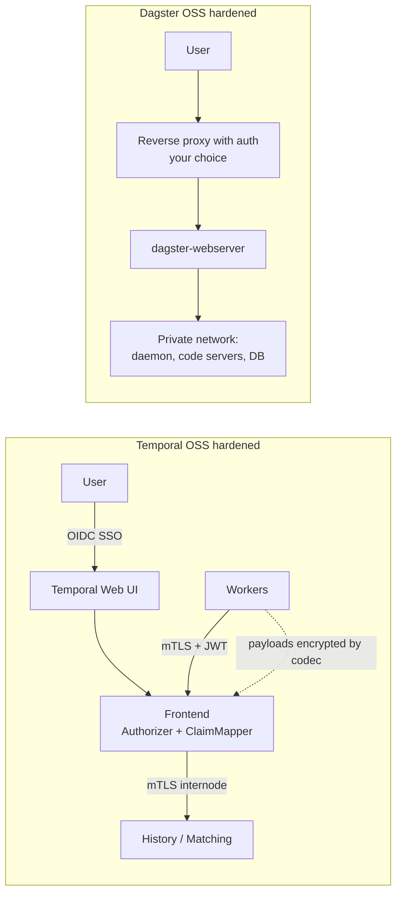

# 10 — Security (open source editions)

> **Key takeaways**
> - Both are **insecure by default**. Temporal's default Authorizer "allows **every** API request, with no authentication or access control" ([Temporal Platform security features](https://docs.temporal.io/self-hosted-guide/security)).
> - **Temporal OSS** provides opt-in, first-party controls: mTLS, a pluggable Authorizer and JWT ClaimMapper, Web UI SSO/OIDC, and client-side payload encryption via codecs ([Temporal Platform security features](https://docs.temporal.io/self-hosted-guide/security)).
> - **Dagster OSS** has no built-in user authentication or RBAC; a maintainer confirms these are Dagster+ only ([GitHub Discussion #23851 (maintainer answer)](https://github.com/dagster-io/dagster/discussions/23851)).
> - Community add-ons for Dagster OSS auth exist but are third-party and unevaluated ([maltzsama/dagster-authkit](https://github.com/maltzsama/dagster-authkit), [stianthaulow/dagster-auth](https://github.com/stianthaulow/dagster-auth)).

## 1. Control-by-control

| Control | Temporal OSS | Dagster OSS |
|---|---|---|
| Transport encryption | mTLS, separate `internode` and `frontend` certs; `requireClientAuth` ([Temporal Platform security features](https://docs.temporal.io/self-hosted-guide/security)) | **Not verified** in notes |
| API authentication | JWT via ClaimMapper (default reads `permissions` claims) ([Temporal Platform security features](https://docs.temporal.io/self-hosted-guide/security)) | None built in ([GitHub Discussion #23851 (maintainer answer)](https://github.com/dagster-io/dagster/discussions/23851)) |
| Authorization | `Authorizer` plugin, `Authorize` called per API call; roles read, write, worker, admin per namespace; `temporal-system` reserved ([Temporal Platform security features](https://docs.temporal.io/self-hosted-guide/security)) | None; RBAC is Dagster+ ([GitHub Discussion #23851 (maintainer answer)](https://github.com/dagster-io/dagster/discussions/23851), [Dagster+ RBAC user roles and permissions (docs source)](https://github.com/dagster-io/dagster/blob/master/docs/docs/deployment/dagster-plus/authentication-and-access-control/rbac/user-roles-permissions.md)) |
| UI login | `TEMPORAL_AUTH_ENABLED=true` + OAuth; examples Google, Auth0, Okta ([Temporal Platform security features](https://docs.temporal.io/self-hosted-guide/security)) | None built in; `dg dev` lacks auth ([Running Dagster locally](https://dagster.io/docs/deployment/oss/deployment-options/running-dagster-locally)) |
| Payload encryption | Custom Payload Codec in Data Converter; covers payloads, not metadata ([Temporal Platform security features](https://docs.temporal.io/self-hosted-guide/security)) | No equivalent found (*inference*) |
| Viewing encrypted data | Codec Server; "consider all security implications" ([Temporal Platform security features](https://docs.temporal.io/self-hosted-guide/security), [Codec Server](https://docs.temporal.io/codec-server)) | — |
| External Storage | Runs after the codec, so offloaded payloads are already encrypted ([External Storage](https://docs.temporal.io/external-storage)) | — |
| Network | Hosts must not be reachable from the public internet ([Deploying a Temporal Service](https://docs.temporal.io/self-hosted-guide/deployment)) | *Inference:* put webserver behind a reverse/OAuth2 proxy and network isolation; official guidance **Not verified** |
| Vendor telemetry | Not covered | Anonymized usage telemetry on by default, can be disabled ([Instance configuration](https://dagster.io/docs/deployment/oss/oss-instance-configuration)) |

## 2. Typical hardened layouts

*Inference from the notes, not vendor reference architectures.*

## 3. Ingestion-specific notes

- Source credentials live in your Worker (Temporal) or code-location/run environment (Dagster). Secrets management was **not covered** by the research for either tool.
- Temporal payload codecs also block replay tests on fetched histories unless you can decrypt them ([Safely deploying changes to Workflow code](https://docs.temporal.io/develop/safe-deployments)).
- PII in Temporal histories should be scrubbed before use in replay tests ([Safely deploying changes to Workflow code](https://docs.temporal.io/develop/safe-deployments)).

*Judgement:* if several teams share one OSS deployment and need per-team access control, Temporal OSS is materially stronger out of the box. Dagster OSS suits a single trusted team behind a network boundary.

## Sources

- [S14] [Deploying a Temporal Service](https://docs.temporal.io/self-hosted-guide/deployment)
- [S18] [External Storage](https://docs.temporal.io/external-storage)
- [S44] [Safely deploying changes to Workflow code](https://docs.temporal.io/develop/safe-deployments)
- [S45] [Temporal Platform security features](https://docs.temporal.io/self-hosted-guide/security)
- [S47] [Codec Server](https://docs.temporal.io/codec-server) — *not fetched*
- [S54] [Instance configuration](https://dagster.io/docs/deployment/oss/oss-instance-configuration)
- [S86] [Running Dagster locally](https://dagster.io/docs/deployment/oss/deployment-options/running-dagster-locally)
- [S89] [GitHub Discussion #23851 (maintainer answer)](https://github.com/dagster-io/dagster/discussions/23851)
- [S90] [Dagster+ RBAC user roles and permissions (docs source)](https://github.com/dagster-io/dagster/blob/master/docs/docs/deployment/dagster-plus/authentication-and-access-control/rbac/user-roles-permissions.md) — *not fetched*
- [S91] [maltzsama/dagster-authkit](https://github.com/maltzsama/dagster-authkit) — *third-party, not evaluated*
- [S92] [stianthaulow/dagster-auth](https://github.com/stianthaulow/dagster-auth) — *third-party, not evaluated*

Full numbered list: [references/sources.md](../references/sources.md)
