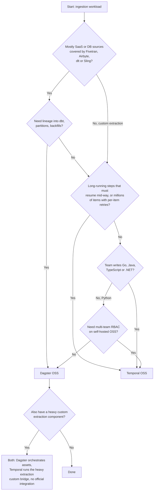
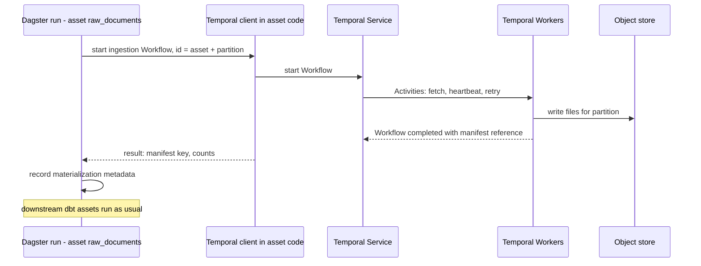

# 12 — Decision guide

> **Key takeaways**
> - *Judgement:* pick **Dagster OSS** when ingestion is mostly connector-based ELT feeding analytics, and lineage, partitions and backfills matter.
> - *Judgement:* pick **Temporal OSS** when ingestion is custom, long-running, high fan-out or rate-limited, or must be written in a non-Python language.
> - **No official Temporal–Dagster integration exists** ([Dagster integrations index](https://dagster.io/docs/integrations/libraries)); combining them is custom code.
> - Hard disqualifiers: need for OSS RBAC (against Dagster OSS, [GitHub Discussion #23851 (maintainer answer)](https://github.com/dagster-io/dagster/discussions/23851)); need for built-in connectors or lineage (against Temporal).

All recommendations in this document are **judgements** built on the cited facts in docs 01–11.

## 1. Decision flowchart

## 2. Scenario-by-scenario recommendation

| Scenario | Recommendation | Why (facts) | Watch out for |
|---|---|---|---|
| S1 API polling, simple daily pull | Dagster | dlt asset with state, concurrency pools ([dlt integration (Pythonic)](https://dagster.io/docs/integrations/libraries/dlt/dlt-pythonic), [Managing concurrency](https://dagster.io/docs/guides/operate/managing-concurrency)) | dlt partitions need concurrency limits ([dlt integration (Pythonic)](https://dagster.io/docs/integrations/libraries/dlt/dlt-pythonic)) |
| S1 API polling, millions of calls, strict API quota | Temporal | Queue-global rate limit; heartbeat checkpoints; sliding window ([Downstream Rate Limiting](https://docs.temporal.io/design-patterns/downstream-rate-limiting), [Long-Running Activity pattern](https://docs.temporal.io/design-patterns/long-running-activity), [Batch Processing Patterns](https://docs.temporal.io/design-patterns/batch-processing-patterns)) | Unlimited default retries ([Retry Policies](https://docs.temporal.io/encyclopedia/retry-policies)); 2 MB payloads ([Self-hosted defaults](https://docs.temporal.io/self-hosted-guide/defaults)) |
| S2 File arrival in S3 | Dagster (slight) | Sensor cursor + run key + dynamic partitions ([Sensors](https://dagster.io/docs/guides/automate/sensors), [Dynamic partitioning](https://dagster.io/blog/dynamic-partitioning)) | Sensor 60 s timeout; keep listing cheap ([Troubleshooting sensor timeouts](https://dagster.io/docs/deployment/troubleshooting/sensor-timeouts)) |
| S2 Very large files, multi-hour loads | Temporal | Resume from heartbeat offset ([Long-Running Activity pattern](https://docs.temporal.io/design-patterns/long-running-activity)) | Build your own per-file tracking |
| S3 DB incremental batch to warehouse | Dagster | Sling/dlt assets, time partitions ([Sling integration](https://dagster.io/docs/integrations/libraries/sling), [Backfilling data](https://dagster.io/docs/guides/build/partitions-and-backfills/backfilling-data)) | Sling defines incremental/backfill/change-capture modes, but Dagster pages only show `full-refresh` examples ([Sling replication modes](https://docs.slingdata.io/concepts/replication/modes), [Sling integration](https://dagster.io/docs/integrations/libraries/sling)) |
| S3 DB copy with custom merge logic and resumability | Temporal | Checkpointed Activities; idempotency keys ([Long-Running Activity pattern](https://docs.temporal.io/design-patterns/long-running-activity), [Activity Definition](https://docs.temporal.io/activity-definition)) | Write MERGE logic yourself |
| S4 Fivetran/Airbyte orchestration | Dagster | First-party components; observe-only mode for Fivetran ([Fivetran integration](https://dagster.io/docs/integrations/libraries/fivetran), [Airbyte component](https://dagster.io/docs/integrations/libraries/airbyte/airbyte-component)) | Airbyte component triggers syncs (no observe-only mode documented) ([dagster-airbyte library reference](https://dagster.io/docs/integrations/libraries/airbyte/dagster-airbyte)) |
| S5 Partitioned backfill of a year | Dagster | Backfill policies ([Partition backfill strategies](https://dagster.io/docs/examples/best-practices/partition-backfill-strategies)) | `single_run` failure retries all ([Partition backfill strategies](https://dagster.io/docs/examples/best-practices/partition-backfill-strategies)) |
| S5 Backfill of 1M documents/items | Temporal | Child Workflows + sliding window + Continue-As-New; 1M-doc case ([Batch Processing Patterns](https://docs.temporal.io/design-patterns/batch-processing-patterns), [How Rapidflare built a million+ document ingestion pipeline](https://temporal.io/blog/how-rapidflare-built-a-million-document-ingestion-pipeline-for-agents-on-temporal)) | History limits 51,200 events / 50 MB ([Workflow Execution limits](https://docs.temporal.io/workflow-execution/limits)) |
| Small team, minimal ops | Dagster | Fewer services ([OSS deployment architecture](https://dagster.io/docs/deployment/oss/oss-deployment-architecture)) | Single daemon, no replicas ([OSS deployment architecture](https://dagster.io/docs/deployment/oss/oss-deployment-architecture)) |
| Shared platform, many teams | Temporal | mTLS, Authorizer, SSO ([Temporal Platform security features](https://docs.temporal.io/self-hosted-guide/security)) | Fixed shard count chosen up front ([Temporal Server](https://docs.temporal.io/temporal-service/temporal-server)) |

## 3. Using both together

**Status: no official integration.** Dagster's integrations index lists no Temporal integration, and no first-party bridge was found on dagster.io or temporal.io ([Dagster integrations index](https://dagster.io/docs/integrations/libraries)). The pattern below is an *inference* built from documented building blocks:

- Dagster webserver "responds to GraphQL queries" ([OSS deployment architecture](https://dagster.io/docs/deployment/oss/oss-deployment-architecture)).
- Dagster Pipes runs external code that "can be triggered from Python" and reports logs and metadata back ([Dagster Pipes (guide)](https://dagster.io/docs/guides/build/external-pipelines)).
- Temporal clients start Workflows through the SDK ([Understanding Temporal](https://docs.temporal.io/evaluate/understanding-temporal)); exact client call names are not confirmed in the notes.

| Option | How | Trade-off (*judgement*) |
|---|---|---|
| A. Dagster outer, Temporal inner | Dagster asset starts a Temporal Workflow and waits; reports counts as metadata | Lineage stays in Dagster; Temporal handles the hard extraction. Two systems to run |
| B. Temporal outer, Dagster inner | Temporal Activity calls Dagster's GraphQL API to launch a materialization | Keeps Temporal as the main control plane; Dagster lineage sees only the triggered part |
| C. Separate, joined by storage | Temporal writes to a bucket; Dagster sensor detects new files | Loosest coupling; no cross-system status |

*Judgement:* adopt both only if one tool clearly fails a hard requirement; the operational cost of two control planes is real (see [doc 09](09-deployment-scaling-and-limits.md)).

## 4. Questions to ask before choosing

1. Are our sources covered by dlt, Sling, Airbyte or Fivetran? ([doc 06](06-data-ingestion.md))
2. Do we need resume-inside-a-step, or is re-running a step acceptable? ([doc 03](03-execution-model-and-durability.md))
3. Who needs to see lineage and freshness: engineers or data consumers? ([doc 05](05-data-awareness-lineage-partitions.md), [doc 07](07-observability-and-ui.md))
4. Do we need access control on self-hosted OSS? ([doc 10](10-security.md))
5. Are we comfortable with the Dagster ownership change? ([doc 11](11-licensing-and-community.md))
6. Can we run a 4-service cluster plus database, or do we want fewer moving parts? ([doc 02](02-architecture.md))

## Sources

- [S1] [Understanding Temporal](https://docs.temporal.io/evaluate/understanding-temporal)
- [S2] [Temporal Server](https://docs.temporal.io/temporal-service/temporal-server)
- [S6] [Activity Definition](https://docs.temporal.io/activity-definition)
- [S7] [Retry Policies](https://docs.temporal.io/encyclopedia/retry-policies)
- [S11] [Self-hosted defaults](https://docs.temporal.io/self-hosted-guide/defaults)
- [S12] [Workflow Execution limits](https://docs.temporal.io/workflow-execution/limits)
- [S20] [Long-Running Activity pattern](https://docs.temporal.io/design-patterns/long-running-activity)
- [S21] [Batch Processing Patterns](https://docs.temporal.io/design-patterns/batch-processing-patterns)
- [S24] [Downstream Rate Limiting](https://docs.temporal.io/design-patterns/downstream-rate-limiting)
- [S28] [How Rapidflare built a million+ document ingestion pipeline](https://temporal.io/blog/how-rapidflare-built-a-million-document-ingestion-pipeline-for-agents-on-temporal) — *vendor blog, customer guest post*
- [S45] [Temporal Platform security features](https://docs.temporal.io/self-hosted-guide/security)
- [S52] [OSS deployment architecture](https://dagster.io/docs/deployment/oss/oss-deployment-architecture)
- [S61] [Sensors](https://dagster.io/docs/guides/automate/sensors)
- [S62] [Troubleshooting sensor timeouts](https://dagster.io/docs/deployment/troubleshooting/sensor-timeouts)
- [S63] [Managing concurrency](https://dagster.io/docs/guides/operate/managing-concurrency)
- [S64] [Backfilling data](https://dagster.io/docs/guides/build/partitions-and-backfills/backfilling-data)
- [S65] [Partition backfill strategies](https://dagster.io/docs/examples/best-practices/partition-backfill-strategies)
- [S66] [Dagster Pipes (guide)](https://dagster.io/docs/guides/build/external-pipelines)
- [S68] [Dagster integrations index](https://dagster.io/docs/integrations/libraries)
- [S70] [dlt integration (Pythonic)](https://dagster.io/docs/integrations/libraries/dlt/dlt-pythonic)
- [S71] [Sling integration](https://dagster.io/docs/integrations/libraries/sling)
- [S74] [Airbyte component](https://dagster.io/docs/integrations/libraries/airbyte/airbyte-component)
- [S75] [Fivetran integration](https://dagster.io/docs/integrations/libraries/fivetran)
- [S89] [GitHub Discussion #23851 (maintainer answer)](https://github.com/dagster-io/dagster/discussions/23851)
- [S101] [Dynamic partitioning](https://dagster.io/blog/dynamic-partitioning) — *vendor blog*
- [S103] [dagster-airbyte library reference](https://dagster.io/docs/integrations/libraries/airbyte/dagster-airbyte)
- [S105] [Sling replication modes](https://docs.slingdata.io/concepts/replication/modes) — *Sling's official docs*

Full numbered list: [references/sources.md](../references/sources.md)
