# Dagster → Temporal migration plan

Plan to move ~50 ingestion jobs (Meltano or dlt → Snowflake `RAW`, then dbt → `CLEAN` → `SEMANTIC`) from self-hosted Dagster on Kubernetes to the company's **shared Temporal cluster**.

| | |
|---|---|
| As of | 2026-11-12. All team questions (Q1–Q25, F1–F11) answered |
| Status | Plan ready. **Next step:** platform PR that registers our non-prod Namespace (Step 0, POC-11a) |
| Top risk | Partitions and backfills (U11): > 75 % of jobs, every partition type down to 5-minute, backfills of ~2 years |
| Then | Per-job resource isolation (U01), shared API rate limits (U09), ELT state and duplicates under retries (U04, U05) |
| Builds on | [1-comparison.md](1-comparison.md). Citations `[S#]` link to [sources.md](sources.md) |
| Method | Separates what is **already verified** (Known, no POC) from what is **unknown**. Each unknown maps to one POC with pass/fail criteria |
| Effort | ~136 engineer-days with LLM-assisted coding (~170 without); ≈ 32 weeks for one person working alone, full-time ([§8](#8-effort-and-timeline-estimates)). All effort and timeline numbers are **estimates**, not facts. Risk ratings are **judgement** |

**Status labels used below**

| Label | Meaning |
|---|---|
| **Known** | Stated in official docs we fetched; cited. No POC |
| **Unknown** | Not in docs, or depends on our setup. Needs a POC |
| *Inference* | Our reasoning from docs, not a doc statement. Treated as Unknown when it carries risk |
| Q#, F# | Team answer that drives a decision ([§2.3](#23-team-answers)) |

## Contents

The plan reads top to bottom as one chain: **facts → design → mapping → unknowns → POCs → cutover → estimates**. Every section opens with an **In short** box.

1. [Big picture](#1-big-picture)
2. [Current state and target](#2-current-state-and-target)
3. [Target design](#3-target-design)
4. [Feature mapping](#4-feature-mapping)
5. [Unknowns register](#5-unknowns-register)
6. [POC plan](#6-poc-plan)
7. [Migration plan](#7-migration-plan)
8. [Effort and timeline estimates](#8-effort-and-timeline-estimates)

---

## 1. Big picture

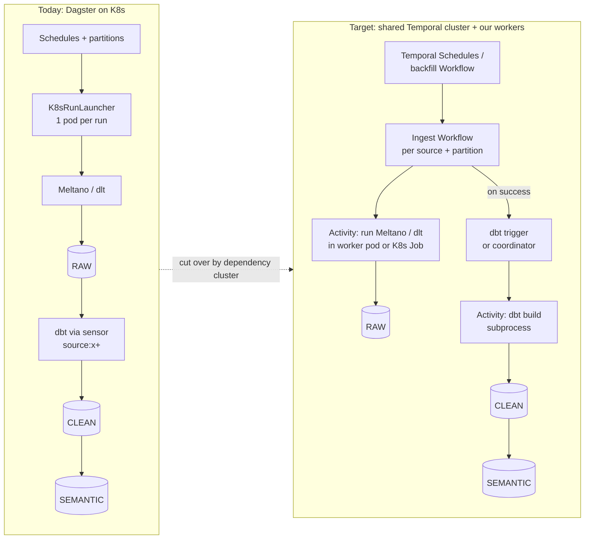

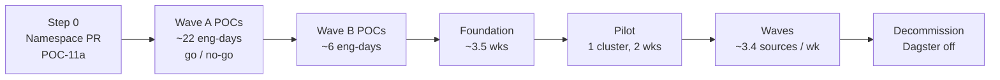

Durations: LLM-assisted, one person working alone, full-time, no contingency ([§8](#8-effort-and-timeline-estimates)).

---

## 2. Current state and target

> **In short**
> - 50+ Meltano/dlt jobs on Dagster with per-run pods, > 75 % partitioned, shared API tokens, dbt after every load.
> - Target is a tenant Namespace on a shared Temporal 1.32.2 cluster with durable MySQL; Namespace, dynamic config and Search Attributes need platform PRs.
> - Four answers shape the plan most: shared cluster (Q1, Q2); > 75 % partitioned (Q9); shared API tokens (Q18); dbt builds all downstream per source, no wait-for-all (Q20, Q21).

### 2.1 Today (Dagster)

| Area | Fact (from the team) |
|---|---|
| Scale | 50+ jobs, about one per source |
| Dagster | Latest version; **jobs, ops and assets**; `dagster-dbt`, `dagster-dlt`, `dagster-meltano` |
| Code layout | 1 code location, 1 image |
| Run launch | `K8sRunLauncher` (Helm chart); per-job resources via `dagster-k8s/config` tags |
| Triggers | Schedules; **one sensor**: starts dbt after an ingestion job finishes |
| Partitions | **> 75 % of jobs**; all types: daily, hourly, **5-minute**, static, dynamic, multi-dimensional |
| Partition input | Through **Launchpad run config**, with defaults |
| Backfills | **~2 years** of past data; usually **several partitions per run** (Launchpad date range); depends on the job |
| Concurrency | Run queue limit + "many" tag concurrency limits |
| Retries | Run retries |
| Quality | Freshness checks on **almost all assets** (Slack on failure) + dbt tests |
| Alerting | Slack and PagerDuty on failure |
| UI use | See failed jobs, re-run, backfill |
| Secrets | AWS Secrets Manager → Kubernetes Secrets → env vars in pods |
| Ingestion | Mostly Meltano; 10–15 of 50 use dlt or plain Python; dlt state in Snowflake (default) |
| Other jobs | Some non-ELT ops jobs |
| Sources | APIs, databases, CDC, files (S3/SFTP), SaaS |
| Rate limits | Many sources share API rate limits and tokens |
| dbt | dbt Core, latest Dagster-compatible version (same virtualenv) |
| dbt trigger rule | When a source finishes, **all its downstream models** build; no waiting for other sources; two sources finishing together **both** trigger dbt |
| Logs | Sumo Logic, run by another team; we must emit good logs |

`K8sRunLauncher` accepts `container_config`, `pod_spec_config`, `pod_template_spec_metadata`, `job_spec_config`, `job_metadata`; tag config on a `@job` "will only apply to the run level" [S125](sources.md#s125). Each run gets its own pod with its own requests/limits.

### 2.2 Target (shared Temporal cluster)

Cluster facts come from the team's review of the internal platform repository. They are the team's findings, not checked by us. Internal repo, team and tenant names are left out of this public repo.

| Area | Fact | Impact |
|---|---|---|
| Ownership | One company-wide Temporal on Kubernetes, meant to replace all orchestrators; another team operates it | We are a tenant. Platform POC is a readiness check (POC-11) |
| Version | Server **1.32.2**, Web UI 2.56.1, upstream Helm chart 1.8.0 (vendored) | Worker Versioning needs ≥ v1.29.1: met [S135](sources.md#s135) |
| Persistence | Default store **and** visibility on **managed durable MySQL** | Blocker closed. The default store holds tasks, mutable Workflow state, the event history and Namespace metadata; it is "the only required dependency for basic operation"; visibility only enables "show all running Workflow Executions" [S3](sources.md#s3) |
| Visibility | **SQL on MySQL 8**, own DB; no Elasticsearch/OpenSearch; S3 only for archival | 10 Keyword custom Search Attributes per Namespace [S38](sources.md#s38) |
| Auth | Server build patched with a **custom JWT authorizer**; it denies unregistered Namespaces | Our Workers need an allowed token issuer |
| Worker token | Managed by another team; each pod gets a working token at a fixed file path | POC-11a checks a long-lived Worker survives token rotation |
| Namespace | One per consumer service, added by a PR to the platform values files (namespace + token issuer); a namespace-manager job creates it and enables archival | Step 0 = Namespace PR |
| Dynamic config | **Not self-service**: one cluster-wide ConfigMap (empty today); changes by platform PR, cluster-wide unless scoped by Namespace | Fairness (`matching.enableFairness`) needs a platform PR |
| Search Attributes | Yes, per Namespace, registered by a Namespace admin with `temporal operator search-attribute create`; not declarative | Register once in POC-11b |
| Languages | Python now; maybe others later | 8 SDKs [S1](sources.md#s1) |
| Side by side | Allowed | Cutover by cluster with rollback ([§7](#7-migration-plan)) |
| UI auth | No SSO/RBAC needed for our use | Out of scope |
| Run history | Clean start is fine | No official Dagster → Temporal import (*absence*); optional export of the Dagster run table to Snowflake |
| Goal | "Fully planned; no surprises or blockers during implementation" | Every POC has pass/fail; Wave A covers every High risk |

### 2.3 Team answers

| ID | Answer | Drives |
|---|---|---|
| Q1 | Company standardises on one Temporal | Shared cluster |
| Q2 | Shared cluster on K8s (persistence confirmed in F9) | POC-11 |
| Q3 | Python (others possible) | SDK choice |
| Q4 | Side by side is OK | Cutover by cluster |
| Q5 | No surprises in implementation | Pass/fail per POC |
| Q6 | Latest Dagster; jobs + ops + assets; dbt, dlt, Meltano integrations | Scope |
| Q7 | `K8sRunLauncher`, per-job tags | POC-01 |
| Q8 | Schedules + one dbt-after-job sensor | U10 closed |
| Q9 | Partitions in > 75 % of jobs; backfills | POC-07 |
| Q10 | Run queue limit + tag limits | POC-06 |
| Q11 | Run retries | POC-02 |
| Q12 | Freshness checks + dbt tests | POC-08 |
| Q13 | Slack + PagerDuty | POC-08 |
| Q14 | UI used for failures, re-run, backfill | POC-09 |
| Q15 | 1 code location/image; AWS SM → K8s Secrets → env | U16 |
| Q16 | Mostly Meltano; 10–15 dlt/Python; dlt state in Snowflake | POC-02, POC-03 |
| Q17 | All source types | POC source mix |
| Q18 | Many shared rate limits/tokens | POC-06 |
| Q19 | dbt Core latest (Dagster-compatible) | POC-04 |
| Q20 | Build all downstream models of a source | `source:<x>+` |
| Q21 | No wait-for-all | U07 closed |
| Q22 | Both overlapping sources trigger dbt | POC-04 |
| Q23 | Logs to Sumo Logic (other team) | POC-08 |
| Q24 | No SSO/RBAC | Out of scope |
| Q25 | Clean start on run history | No history import |
| F1 | Server 1.32.2, chart 1.8.0, custom JWT authorizer, Namespace by PR | POC-10 version check passes; POC-11a |
| F2 | SQL visibility on MySQL 8; dynamic config by platform PR; Search Attributes by admin CLI | POC-06 option c, POC-11b |
| F3 | All partition types, down to 5-minute | POC-07 covers each type |
| F4 | Partition reaches the job via Launchpad run config + defaults | Typed Workflow input (POC-07, POC-09) |
| F5 | Backfills of ~2 years | Batching (POC-07) |
| F6 | "Many" tag concurrency limits | Export them as POC-06 input |
| F7 | Freshness on almost all assets; Slack on failure | POC-08 |
| F8 | Some non-ELT ops jobs | POC-02 includes one; inventory in P0 |
| F9 | Default persistence store is managed durable MySQL | U15 blocker closed |
| F10 | Worker token managed by another team, mounted at a file path | POC-11a token-rotation check |
| F11 | Backfill input depends on the job; usually a range per run | P0 inventory of range vs single-partition jobs; POC-07 batches |

**Partition scale (arithmetic):** 2 years ≈ 730 daily, 17,520 hourly, **210,240 five-minute** partitions. One child Workflow per partition does not fit: 2,000 pending children per Workflow, ≤ 500 recommended [S11](sources.md#s11). Partitions must be **batched**.

---

## 3. Target design

> **In short**
> - One ingest Workflow per source (and partition batch); ELT tool as a subprocess in an Activity.
> - After each load, dbt builds `source:<x>+`, either one dbt process per load or via one coordinator (POC-04 decides).

Proposed; validated by the POCs.

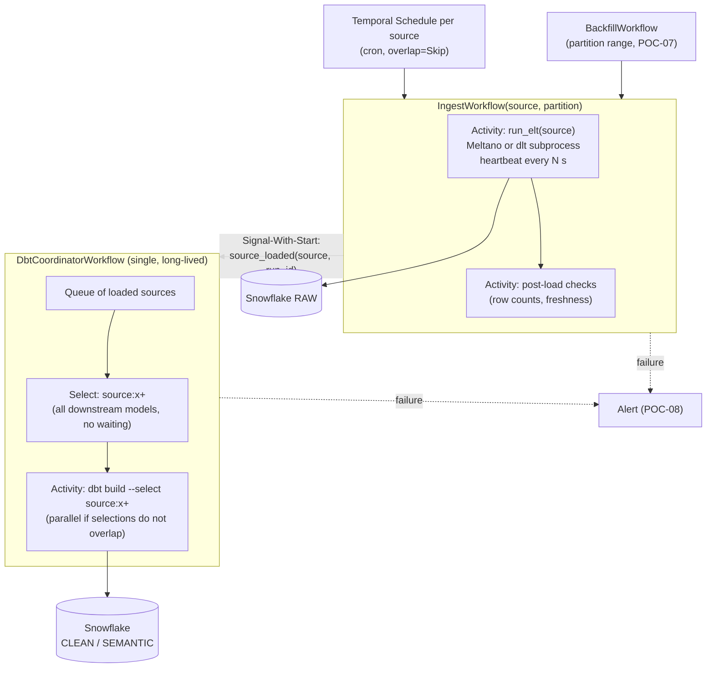

| Design point | Why (cited) |
|---|---|
| One `IngestWorkflow` per source (and partition batch); ELT tool runs as a subprocess in an Activity | Temporal runs code only in our Workers [S1](sources.md#s1); keep heavy imports in Activities, the sandbox reloads non-passthrough modules per run [S134](sources.md#s134) |
| dbt builds `source:<x>+` after each load | Selects models that read source `x` and their descendants [S140](sources.md#s140); no wait-for-all (Q21) |
| Maybe a coordinator | dbt does not support parallel invocations in one process; overlapping `dbt build` on the same models "could lead to unpredictable results" [S120](sources.md#s120). POC-04 compares the coordinator with today's parallel behaviour |
| Signal-With-Start | "starts a Workflow when Signaling it if it does not already exist. If already running, it receives the Signal directly", atomically [S129](sources.md#s129) |
| Coordinator housekeeping | Entity Workflow: needs Continue-As-New to stay under history limits (51,200 events or 10K Signals) and must de-duplicate Signals, which "can be delivered more than once" [S129](sources.md#s129) |

---

## 4. Feature mapping

> **In short**
> - 22 capabilities in use today: **11 Known** (documented, no POC; rows 15 and 17 closed by Q21 and Q8) and **11 Unknown** (POC needed).
> - Unknowns are where Temporal has no built-in equivalent (per-run pods, partitions, concurrency caps, alerting) or where behaviour depends on our tools (Meltano, dlt, dbt, Snowflake) or the shared cluster.
> - [§4.1](#41-native-support-check-re-verified-2026-11-12) re-checks what Temporal OSS has natively; [§4.2](#42-options-to-get-each-missing-feature) gives options and a pick for each missing feature (partitions, backfills, lineage, freshness, alerts, caps).

**Known** = documented, no POC. **Unknown** = POC needed (U-ID in [§5](#5-unknowns-register)).

| # | Dagster capability (today) | Temporal approach | Status | Evidence / gap |
|---|---|---|---|---|
| 1 | Cron schedule per job | Schedule (cron/calendar/interval), overlap policies, catch-up, pause | **Known** | [S10](sources.md#s10); CLI `create`, `toggle`, `trigger`, `backfill` [S131](sources.md#s131) |
| 2 | Don't start a second run of the same job | Scheduled runs: overlap `Skip`. Other start paths (manual, backfill): a source-wide lock every path takes, e.g. a fixed per-source lock Workflow ID with Conflict Policy `Fail` | **Known** (build) | "at most one Workflow Execution with a given ID running at any point in time" [S130](sources.md#s130); but a Schedule appends "the Action's timestamp … to the Workflow Id" [S10](sources.md#s10), so IDs alone do not exclude runs from different paths. Tested in POC-06. `Skip` drops an overlapping action, leaving a partition unloaded: a scheduled gap check reads the partition status table and backfills it (POC-07) |
| 3 | Op retry policy | Activity Retry Policy (default unlimited; set `maximum_attempts`) | **Known** | [S7](sources.md#s7) |
| 4 | Run timeouts / run monitoring | Start-To-Close caps one attempt; Heartbeat Timeout detects stalls; Schedule-To-Close caps the total across retries | **Known** | [S8](sources.md#s8) [S115](sources.md#s115) |
| 5 | Large data never passes through the orchestrator | Pass IDs only; payload limit 2 MB default | **Known** | [S11](sources.md#s11) [S17](sources.md#s17) |
| 6 | Unit tests | Activity env, time skipping, replay tests | **Known** | [S41](sources.md#s41) |
| 7 | Metrics endpoint | Server + SDK Prometheus metrics; community Grafana dashboards | **Known** | [S132](sources.md#s132) |
| 8 | Heavy imports in pipeline code | Keep Meltano/dlt/dbt imports in Activities | **Known** | [S134](sources.md#s134) |
| 9 | dbt test failure skips downstream | Same: inside `dbt build`, a failing upstream test makes downstream `SKIP` | **Known** | [S137](sources.md#s137) |
| 10 | **Per-job pod with own CPU/memory** | (a) Worker pools per resource class, one Task Queue each; or (b) Activity launches a K8s Job per run | **Unknown** | No Temporal doc covers per-run pods; Worker Controller scales per Worker Deployment Version, not per Workflow [S118](sources.md#s118) → U01, U02, U16 |
| 11 | Run ELT tool, stop it on cancel | Subprocess in an Activity; must heartbeat to receive cancel | **Unknown** | "If the Heartbeat is not invoked, the Activity cannot receive a cancellation request" [S128](sources.md#s128); child-process kill not documented → U03 |
| 12 | Retry after partial load | Activities "may be executed multiple times" | **Unknown** | [S6](sources.md#s6); effect on Meltano/dlt + Snowflake not documented → U04 |
| 13 | Incremental state (bookmarks) | Keep Meltano state backend / dlt destination state | **Unknown** | dlt restores state by pipeline name + destination + dataset [S127](sources.md#s127); Meltano backends and locks [S122](sources.md#s122); continuity from Dagster-era runs untested → U05 |
| 14 | dbt after each ingestion | Coordinator Workflow + dbt subprocess Activity | **Unknown** | dbt in-process parallelism unsupported [S120](sources.md#s120); behaviour under many near-simultaneous loads untested → U06, U08 |
| 15 | Build all downstream models of a loaded source | `dbt build --select source:<x>+` | **Known** | [S140](sources.md#s140); U07 closed |
| 16 | Run queue limit + tag concurrency limits | Worker slots, Task Queue rate limit, Fairness keys, or a semaphore Workflow | **Unknown** | Rate limit is per second, not a concurrency cap [S24](sources.md#s24); Fairness off by default on self-hosted (`matching.enableFairness`) [S124](sources.md#s124) → U09 |
| 17 | Sensor: start dbt after ingestion (the only sensor) | Ingest Workflow starts dbt (or signals the coordinator) on success | **Known** | [S129](sources.md#s129); U10 closed |
| 18 | Partitions + backfills | Partition library + Launchpad config as typed Workflow input; `BackfillWorkflow` runs **batches** as children; status in a Snowflake table | **Unknown (High)** | Schedule backfill only re-runs schedule times [S131](sources.md#s131); no partition status tracking (*inference*) → U11 |
| 19 | Slack + PagerDuty; freshness checks | Metrics alerts, failure-handler Activity, scheduled freshness check | **Unknown** | Server docs recommend no alerts; "configure Grafana Alerts" [S132](sources.md#s132) → U12, U17 |
| 20 | UI: see failures, re-run, backfill | Temporal UI, Search Attributes, Workflow Reset, Activity Reset; dbt docs for lineage | **Unknown** | SQL visibility: 10 Keyword Search Attributes per Namespace [S38](sources.md#s38); Reset only to Workflow Task events [S138](sources.md#s138) → U13 |
| 21 | Code deploys without breaking runs | Worker Versioning (Pinned) + Worker Controller | **Unknown** | Needs server ≥ v1.29.1 (cluster: 1.32.2), Python SDK ≥ 1.11 [S135](sources.md#s135); GA blog does not say OSS is covered [S136](sources.md#s136) → U14 |
| 22 | Platform (today: our Dagster Helm install) | Shared cluster, our own Namespace via platform PR, JWT token for Workers | **Unknown** | Persistence is "the only required dependency" [S3](sources.md#s3); durable MySQL confirmed (F9); HA, limits, paging open → U15 |

### 4.1 Native support check (re-verified 2026-11-12)

> **In short**
> - Re-checked against official Temporal docs on 2026-11-12. **Partitions, partition status, lineage, asset catalog, freshness checks and alerting are not in Temporal OSS.** The docs index has no page on partitions or lineage [S144](sources.md#s144).
> - **Backfill, Launchpad, run concurrency caps and bulk re-runs are partly native.** Temporal gives the building blocks, but not Dagster's data-aware version.
> - Schedules, retries, re-run from a point, run history and safe deploys are native.

| Dagster feature we use | In Temporal OSS? | What Temporal has | What is missing | Evidence |
|---|---|---|---|---|
| Cron schedules | **Yes** | Schedules: cron, overlap policy, catch-up window (default 1 year), pause | Nothing | [S10](sources.md#s10) |
| Sensor (dbt after a job) | **Not needed** | Plain code: the ingest Workflow starts dbt or signals the coordinator | Nothing | [S129](sources.md#s129) |
| Op retries / run retries | **Yes** | Activity Retry Policy; Workflow Retry Policy exists but is off by default and "not recommended" | Nothing | [S7](sources.md#s7) |
| Re-run a failed run (from failure) | **Yes** | Workflow Reset to a Workflow Task event; Activity reset; "Start Workflow Like This One" in the UI | Reset points are Workflow Task events, not Dagster steps | [S138](sources.md#s138) [S139](sources.md#s139) [S31](sources.md#s31) |
| Bulk actions on many runs | **Yes (CLI)** | `cancel`, `terminate`, `signal`, `delete` by a Visibility query (`--query`, `--rps`); batch reset only to `FirstWorkflowTask`, `LastWorkflowTask` or `BuildId`; batch jobs listed with `temporal batch` | Web UI batch actions not documented (TG26) | [S142](sources.md#s142) [S143](sources.md#s143) |
| Launchpad (run with edited config + defaults) | **Partly** | UI Start Workflow form takes "a single JSON value"; "Start Workflow Like This One" copies only the first argument; CLI `workflow start --input` / `--input-file` | Config schema, defaults and validation in the UI. Defaults live in our input dataclass (docs "strongly encourage a single dataclass parameter") | [S31](sources.md#s31) [S142](sources.md#s142) [S157](sources.md#s157) |
| Partitions (time, static, dynamic, multi-dimensional) | **No** | Schedules add `TemporalScheduledStartTime` (the action time) to each run; Workflow IDs can carry a partition key | Partition definitions, key generation, key validation | [S10](sources.md#s10) [S144](sources.md#s144) |
| Partition status (missing / failed / done) | **No** | Custom Search Attributes (e.g. `partition_key`) + List Filter while the run is kept | Closed runs are deleted after the Namespace Retention Period (CLI default 3 days; any value ≥ 1 day on server ≥ 1.18 if persistence has capacity). SQL visibility: 10 Keyword attributes per Namespace; updates can lag | [S2](sources.md#s2) [S38](sources.md#s38) |
| Backfill a partition range | **Partly** | `temporal schedule backfill` runs every action time in a range, in parallel (`AllowAll`) or in order (`BufferAll`) | Only cron-aligned time keys; one run per action time (no range per run); no static/dynamic/multi keys; no fill status | [S10](sources.md#s10) [S131](sources.md#s131) |
| Backfill policy (`single_run`, `multi_run`) | **No** | Child Workflows, Continue-As-New | Batching logic; per Workflow: 2,000 pending children (≤ 500 recommended), 51,200 events | [S11](sources.md#s11) |
| Run queue limit + tag concurrency limits | **Partly** | Worker slots; Task Queue rate limit; Fairness keys with a **per-key rate limit** (`fairness-key-rps-limit-default`, set with `temporal task-queue config set`) | A **concurrency** cap per key: Priority and Fairness set dispatch order, not concurrency. Fairness needs `matching.enableFairness` (platform PR) | [S24](sources.md#s24) [S124](sources.md#s124) |
| Per-job pod with own CPU/memory | **No** | Worker pools; Worker Controller scales per Worker Deployment Version | One pod per run | [S118](sources.md#s118) |
| Asset catalog | **No** | Workflows and Activities only | Datasets as first-class objects | [S5](sources.md#s5) [S144](sources.md#s144) |
| Lineage graph (RAW → CLEAN → SEMANTIC) | **No** | Nothing; no OpenLineage integration found | Dataset-level lineage | [S144](sources.md#s144); OpenLineage, Dagster and Temporal searched 2026-11-12 (*absence*) |
| Materialization metadata (row counts, last loaded) | **No** | Memo and Search Attributes describe runs, not datasets | Per-dataset history | [S38](sources.md#s38) |
| Freshness checks | **No** | Nothing built in | Checks and thresholds | [S132](sources.md#s132) (metrics only) |
| Slack / PagerDuty alerts | **No** | Prometheus metrics; docs recommend no specific alerts | Alert rules and per-run messages | [S132](sources.md#s132) |
| Asset checks / dbt tests | **Not needed** | dbt runs its own tests; `dbt build` skips downstream on failure | Nothing | [S137](sources.md#s137) |
| Run history and logs in a UI | **Yes** | Web UI with Event History; logs go to Sumo Logic | Retention-bound (see partition status) | [S31](sources.md#s31) [S2](sources.md#s2) |
| Deploy code while runs are in flight | **Yes** (to confirm) | Worker Versioning (Pinned), server ≥ v1.29.1 | OSS coverage to confirm (U14) | [S135](sources.md#s135) |
| `dagster-dbt`, `dagster-dlt`, `dagster-meltano` | **No** | Any code in an Activity | The integrations; we run the tools as subprocesses | [S1](sources.md#s1) |

### 4.2 Options to get each missing feature

> **In short**
> - Every gap has at least one workable option. Most are **our code plus Snowflake**, not new infrastructure.
> - **Recommended baseline** (*judgement*): partition library + Snowflake partition status table + `BackfillWorkflow` + dbt docs and Snowflake lineage + `dbt source freshness` + failure Activity and Grafana alerts.
> - **Only if we want a real cross-tool catalog:** OpenLineage events to Marquez or OpenMetadata (new optional POC-12). Keeping Dagster as a read-only catalog is possible but keeps Dagster running.

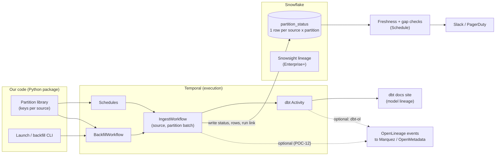

**Options per gap.** Effort is an *estimate*; recommendations are *judgement*.

| Gap | Option | How | Pros | Cons | Pick |
|---|---|---|---|---|---|
| **Partitions** (definitions, keys) | A. Own partition library | Python `PartitionDef` per type: time window (cron), static list, dynamic list in a Snowflake table, multi = product of two. Scheduled run turns its action time into a key | Full control; no extra service; same keys for Schedules, backfills and status | We own and test it (~3–5 days inside POC-07) | **Yes** |
| | B. Reuse Dagster's partition classes as a library only | Import `DailyPartitionsDefinition` etc.; `get_partition_keys(current_time=…)` returns keys | Same keys as today; less code | Named dynamic partitions need a `DagsterInstance` (`dynamic_partitions_store`); ties Workers to Dagster versions | Maybe, for time and static types only (POC-07 compares with A) |
| | C. Schedule action times only | One Schedule per source; key = `TemporalScheduledStartTime` | Zero code | Only cron-aligned time keys | For simple daily/hourly sources |
| **Partition status** (missing / failed view) | A. Snowflake `partition_status` table | Activity writes one row per source × partition: status, run ID, rows, `loaded_at`, error | Kept for years; SQL; feeds freshness, gap checks, dashboards | Our schema and writes; must be idempotent (U04) | **Yes** |
| | B. Temporal Visibility only | Search Attributes `partition_key`, `backfill_id` + List Filter | Native; links straight to runs | Gone after retention [S2](sources.md#s2); 10 Keyword attributes [S38](sources.md#s38); lag | Yes, for live on-call only, next to A |
| | C. Dagster as read-only catalog | Report each load with `POST /report_asset_materialization/` (`asset_key`, `partition`, `metadata`); assets defined as external assets (`AssetSpec`) [S152](sources.md#s152) [S153](sources.md#s153) | Keeps the familiar partition grid and catalog | Keeps Dagster webserver + DB running; "Dagster can't materialize external assets directly or put them in a schedule" [S153](sources.md#s153); partitioned external assets not documented | Only if the grid is a hard need |
| **Backfills** | A. `BackfillWorkflow` | Splits a range into batches, ≤ K children at a time, Continue-As-New every N batches; one range per child run, like Launchpad (POC-07) | Any partition type; range per run; status per partition | Our code; must respect per-Workflow limits [S11](sources.md#s11) | **Yes** |
| | B. `temporal schedule backfill` | Replays every action time in a range [S131](sources.md#s131) | Native, no code | One run per action time; cron-aligned keys only; no status | For missed schedule times after an outage or cutover |
| | C. Batch CLI | `temporal workflow cancel/terminate --query "backfill_id='…'"` [S142](sources.md#s142) | Stop a bad backfill in one command | Not a backfill tool itself | Use with A |
| **Launchpad** (config + defaults) | A. Typed input + UI/CLI | One input dataclass with defaults in code [S157](sources.md#s157); start from UI form (one JSON value) or `workflow start --input-file` [S31](sources.md#s31) [S142](sources.md#s142) | Native; versioned with code | No form per field; UI copies only the first argument | **Yes** |
| | B. Small launch CLI | `launch <source> --from … --to …` fills defaults, validates keys, starts `BackfillWorkflow` | Fast and safe for on-call | Our code (~1–2 days, POC-09) | **Yes**, with A |
| **Concurrency caps** (run queue, tag limits) | A. Task Queue per shared token, fixed replicas × slots | Cap = replicas × slots on **running Activities** | Native | Caps Tasks, not open Workflow runs: a run waiting between Activities or retries is not counted, so it cannot enforce the run-queue limit; breaks under autoscaling (*inference*) | Per-token API concurrency only, as a fallback |
| | B. Semaphore / mutex Workflow per key | Acquire/release by Signal or Update; official Go mutex sample [S145](sources.md#s145). A run holds its permit from start to end | Strict cap per key; also the only option here that caps open runs (global run-queue limit) | Our code; long-lived Workflow needs Continue-As-New | **Yes** (run-queue limit and strict caps) |
| | C. Fairness per-key rate limit | `fairness-key-rps-limit-default` per key [S124](sources.md#s124) | Native; fair across sources | Rate, not concurrency; needs platform PR | Add for API rate limits |
| **Per-job resources** | A. Worker pools per resource class | One Task Queue + Deployment per size (S/M/L) | Simple; warm pods | One OOM hits the whole pod (*inference*) | **Yes** (default) |
| | B. Activity launches a Kubernetes Job | Closest to `K8sRunLauncher`; a Job is a one-off task that "run[s] to completion and then stop[s]" [S156](sources.md#s156) | Same isolation as today | Our code: create, watch, cancel, clean up the Job | For the few heaviest jobs |
| **Lineage + catalog** | A. dbt docs | `dbt docs generate` exports a static site [S155](sources.md#s155) | Free; already have dbt | Models only; ingestion side not shown | **Yes** (baseline) |
| | B. Snowflake lineage | Object and column lineage for `COPY INTO`, CTAS, `INSERT … SELECT`, `MERGE`; kept 1 year; Enterprise Edition or higher [S151](sources.md#s151) | No code; covers RAW loads too | No run context; edition to confirm | **Yes**, if our edition allows |
| | C. OpenLineage + catalog server | Activities emit START/COMPLETE events with input/output datasets (`openlineage-python`) [S146](sources.md#s146); dbt via `dbt-ol`, a "1:1 drop-in replacement" for `dbt` with Snowflake support [S147](sources.md#s147); view in Marquez (reference implementation, lineage UI) [S148](sources.md#s148) or OpenMetadata / DataHub [S149](sources.md#s149) [S150](sources.md#s150) | Cross-tool lineage with run context; open standard | One more service to run; emit code per tool | Optional (POC-12) |
| | D. Dagster as read-only catalog | See partition status option C | Familiar UI | Keeps Dagster | Not recommended (*judgement*) |
| **Materialization metadata** | A. Columns in `partition_status` | Rows, bytes, `max(loaded_at)`, run link | Same table as status | Our code | **Yes** |
| | B. OpenLineage facets / Dagster REST `metadata` | Ride on lineage option C or D | Shown in a catalog UI | Needs that option | With C |
| **Freshness checks** | A. `dbt source freshness` on a Schedule | Exits non-zero when stale [S141](sources.md#s141); alert on failure | Thresholds next to models | dbt sources only | **Yes** |
| | B. SQL check on `partition_status` | Scheduled Activity: missing or late partitions per source | Covers non-dbt assets and partition gaps | Our code | **Yes**, with A |
| | C. Dagster freshness policies | Opt-in preview in OSS; alerts docs are marked Dagster+ [S154](sources.md#s154) | — | Needs Dagster; external-asset support not documented | No |
| **Alerts** | A. Failure Activity | Last step posts source, partition, error and UI link to Slack / PagerDuty | Rich context per run | Does not fire if Workers are down | **Yes** |
| | B. Grafana alerts on metrics | Server + SDK Prometheus metrics; "configure Grafana Alerts" [S132](sources.md#s132) | Catches Workers down, backlog, missed schedules | No per-run context | **Yes**, with A |
| **Run history** | Clean start | Optional export of the Dagster run table to Snowflake; Dagster DB read-only until retention passes | Simple | No history in the Temporal UI | **Yes** (Q25) |

**What this adds to the plan**

| Change | Where |
|---|---|
| POC-07 compares partition library option A with option B (Dagster classes) for time and static types | [POC-07](#poc-07--partitions-and-backfills-u11-u18) |
| POC-06 adds Fairness per-key rate limit (option C) to the semaphore test, if the platform enables Fairness | [POC-06](#poc-06--shared-api-rate-limits-and-run-queue-caps-u09) |
| Snowflake retention ≥ partition history; Namespace retention sized for on-call only (days, not years) | POC-11b, [§6.3](#63-shared-setup) |
| New **optional POC-12**: lineage and catalog (run only if dbt docs + Snowflake lineage are not enough) | [POC-12](#poc-12--lineage-and-catalog-optional) |

---

## 5. Unknowns register

> **In short**
> - 16 open unknowns, 4 closed. **Top risk: U11** (partitions and backfills; ≈ 210,240 five-minute partitions over 2 years, so batching is required).
> - High risks must pass before any cutover.

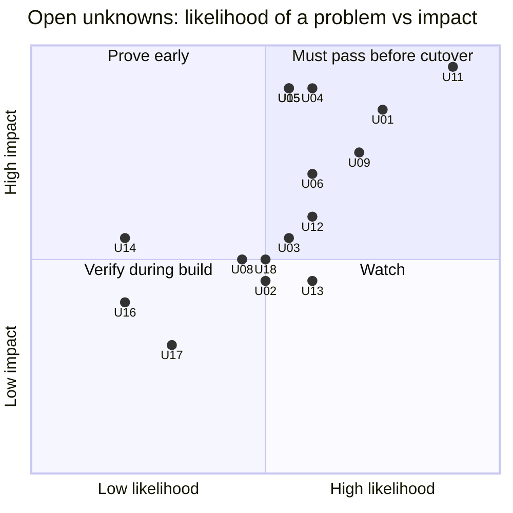

| Risk | Unknowns |
|---|---|
| **High** (must pass before any cutover) | U11, U15, U01, U09, U04, U05, U06 |
| Medium | U12, U03, U13, U02, U08, U18 |
| Low | U14, U16, U17 |
| Closed | U07, U10, SSO/RBAC |

### 5.1 Open unknowns

| ID | Question | What docs say | Gap | Risk | POC | Ref |
|---|---|---|---|---|---|---|
| **U11** | Can we run partitioned jobs and backfills without Dagster's partition model? | Dagster tracks partitions and backfill status; default one run per partition [S64](sources.md#s64) [S65](sources.md#s65). Temporal Schedule backfill only re-runs **schedule action times** [S131](sources.md#s131). Per Workflow: 2,000 pending children, ≤ 500 recommended; history error at 51,200 events or 50 MB [S11](sources.md#s11) | No partition concept, no missing/failed view, no range launcher; static, dynamic and multi-dimensional types (*inference*). ~210,240 five-minute partitions over 2 years, so batching is required. Some jobs may accept only one partition per run (F11) | **High (top)** | POC-07 | Q9, F3–F5, F11 |
| **U15** | Is the shared cluster fit for our production loads? | "only required dependency … is the Persistence database"; supported versions [S3](sources.md#s3). Shard count cannot change after creation [S2](sources.md#s2) | Persistence durable (F9); token provided (F10). **Open:** HA, backups, noisy-neighbour limits, who is paged | **High** | POC-11 | Q2, F1, F2, F9, F10 |
| **U01** | Can we keep per-job CPU/memory isolation without a per-run pod? | `K8sRunLauncher`: own pod and config per run [S125](sources.md#s125). Temporal runs code only in our Workers [S1](sources.md#s1). Worker Controller scales per Worker Deployment Version [S118](sources.md#s118). Resource-based tuner targets "can still be exceeded" [S121](sources.md#s121) | No documented "one pod per Activity". Shared pods: one OOM can kill every Activity in the pod (*inference*). Launching a K8s Job from an Activity is not documented | **High** | POC-01 | Q7 |
| **U09** | Can we enforce shared API token limits and run-queue limits, like tag concurrency limits? | Task Queue rate limit is per second, queue-wide; slots "are not throughput limits" [S24](sources.md#s24). Fairness needs `matching.enableFairness=true` on self-hosted [S124](sources.md#s124) | No built-in concurrency cap per key. Worker slots × replicas change with autoscaling (*inference*). Fairness needs a platform PR (F2). "Many" limits exist (F6) | **High** | POC-06 | Q10, Q18, F6 |
| **U04** | Does a retry after a partial load create duplicates or gaps in `RAW`? | Activities "may be executed multiple times"; make writes idempotent [S6](sources.md#s6) | Depends on each Meltano target / dlt write disposition and when state commits | **High** | POC-02 | Q11, Q16 |
| **U05** | Can Temporal-run jobs continue from Dagster-era state without a full re-sync? | dlt restores `_dlt_pipeline_state` when pipeline name, destination and dataset match [S127](sources.md#s127). Meltano backends: systemdb (default), local, S3, Azure, GCS, Snowflake; lock defaults 10 s / 1 s [S122](sources.md#s122) | Whether `dagster-meltano` state IDs (incl. per-partition) can be reproduced exactly (F4) | **High** | POC-03 | Q16, F4 |
| **U06** | Do overlapping dbt runs (two sources finishing together) stay correct? | No parallel invocations in one process; concurrent `run`/`build` on the same models "could lead to unpredictable results"; separate processes are the supported way to parallelise [S120](sources.md#s120) | Keep today's parallel behaviour, or serialise overlapping selections; freshness impact of each | **High** | POC-04 | Q20, Q22 |
| **U12** | Can we alert like today: Slack + PagerDuty on failure, plus freshness? | Prometheus metrics, no recommended alerts [S132](sources.md#s132). No freshness checks in Temporal (*inference*); `dbt source freshness` "exits with a nonzero exit code" when stale [S141](sources.md#s141) | Per-source alert with link; freshness on almost all assets with Slack (F7); stuck/missed runs; logs to Sumo Logic | Medium | POC-08 | Q12, Q13, F7 |
| **U03** | Do cancel, timeout and worker crash cleanly stop the Meltano/dlt subprocess? | Cancel needs Heartbeat + Heartbeat Timeout [S128](sources.md#s128). Sync Activities need an `activity_executor` [S123](sources.md#s123) | Killing the child process and its Snowflake session is our code | Medium | POC-02 | Q11 |
| **U13** | Can on-call see failures, re-run and backfill without the Dagster UI? | Temporal UI lists executions [S31](sources.md#s31); Reset from a Workflow Task event [S138](sources.md#s138); `temporal activity reset` [S139](sources.md#s139); 10 Keyword Search Attributes on SQL visibility [S38](sources.md#s38) | Speed and safety of today's three tasks, especially "backfill partitions X–Y for source S" and starting a run with edited Launchpad-style config | Medium | POC-09 | Q14 |
| **U02** | Do worker pools scale from backlog reliably, and may we install the scaler? | KEDA Temporal scaler: backlog-based, community-maintained, scale-to-zero activation "may not be reliable" [S119](sources.md#s119). Worker Controller supports HPA/KEDA [S118](sources.md#s118) | Scale latency; safe scale-down with hours-long Activities; cluster operators need platform approval | Medium | POC-01 | F1 |
| **U08** | Do dbt failures and retries behave well inside an Activity? | `dbt build` skips downstream on test failure [S137](sources.md#s137); `dbt retry` reads `run_results.json` [S133](sources.md#s133); exit codes 0/1/2 [S120](sources.md#s120) | `run_results.json` must survive pod changes; which exit codes to retry | Medium | POC-04 | Q12, Q19 |
| **U18** | Do non-ELT ops jobs and Launchpad run config port cleanly? | Activities run any code in our Workers [S1](sources.md#s1) | Inventory unknown; run config + defaults must become typed Workflow input | Medium | POC-02, POC-07 | F4, F8 |
| **U14** | Can we deploy while multi-hour loads run? | Pinned Workflows finish on one version; server ≥ v1.29.1, Python SDK ≥ 1.11 [S135](sources.md#s135); GA blog does not say OSS is covered [S136](sources.md#s136) | Version is fine (1.32.2). Open: Worker Controller approval (U02); whether the custom authorizer allows the versioning APIs | Low | POC-10 | F1 |
| **U16** | Do shared worker pods weaken secret isolation? | Today: one image, secrets as env vars (Q15). No Temporal doc on per-Activity secrets (*inference*) | Likely same exposure as today; confirm the POC-01 pattern does not widen it | Low | POC-01 | Q15 |
| **U17** | Do logs reach Sumo Logic with source and run IDs, without replay duplicates? | `workflow.logger` and SDK logging [S32](sources.md#s32); replay de-duplication not verified ([gaps TG23](3-evidence-and-gaps.md#3-temporal-gaps)) | Log fields and duplicates on replay | Low | POC-08 | Q23 |

### 5.2 Closed

| ID | Was | Closed by | Now |
|---|---|---|---|
| U07 | How to gate `SEMANTIC` models that join several sources | Q21: no wait-for-all | `dbt build --select source:<x>+` [S140](sources.md#s140); part of POC-04 |
| U10 | Replacing sensors | Q8: the only sensor starts dbt after a job | Ingest Workflow signals the dbt coordinator; part of POC-04 |
| — | SSO / RBAC on the UI | Q24: not needed | Out of scope |
| — | Durable persistence on the shared cluster | F9: managed durable MySQL | Kept as a POC-11a restart check |

---

## 6. POC plan

> **In short**
> - **Step 0:** POC-11a, our Namespace (platform PR) and a Worker reading its token from the provided path.
> - **Wave A (blocking, 27 engineer-days; ~22 with LLM help):** POC-11b, 01, 02, 03, 04, 06, 07. If any fails, revisit the decision to migrate.
> - **Wave B (hardening, 7.5 engineer-days; ~6 with LLM help; can overlap):** POC-08, 09, 10. POC-12 (lineage and catalog) is optional and not in the totals.
> - POC-07 (partitions) is the biggest risk.

Each POC answers **one** question from [§5](#5-unknowns-register) and nothing already documented. 10 POCs. POC-05 (multi-source gating) was dropped: no wait-for-all rule (Q21); covered by POC-04.

### 6.1 Order and dependencies

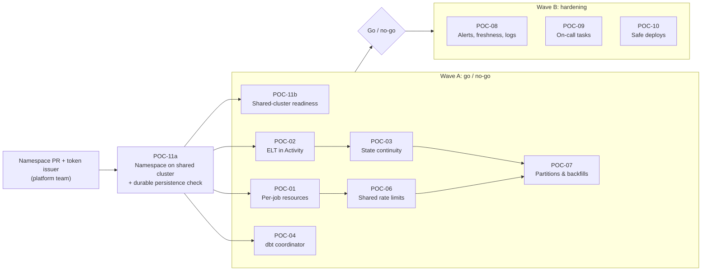

### 6.2 Summary

| POC | Question | Unknowns | Wave | Effort (days) | LLM-assisted (days, [§8](#8-effort-and-timeline-estimates)) |
|---|---|---|---|---|---|
| 11a | Our Namespace works on the shared cluster; Worker auth and persistence hold | U15 | Step 0 | 1 + platform lead time | 0.9 |
| 11b | Shared cluster is fit for production loads | U15 | A | 3 | 2.8 |
| 01 | Per-job resource and secret isolation | U01, U02, U16 | A | 4–5 | 3.8 |
| 02 | ELT in an Activity: cancel, crash, retry | U03, U04, U18 | A | 3–4 | 2.8 |
| 03 | State continuity from Dagster | U05 | A | 2 | 1.8 |
| 04 | dbt trigger/coordinator: overlap, failure, retry | U06, U08 | A | 4 | 3.2 |
| 06 | Shared API rate limits and run-queue caps | U09 | A | 3 | 2.4 |
| 07 | Partitions and backfills | U11, U18 | A | 7 | 5.6 |
| 08 | Alerting, freshness, logs | U12, U17 | B | 3 | 2.4 |
| 09 | On-call tasks without the Dagster UI | U13 | B | 2 | 1.6 |
| 10 | Safe deploys during long loads | U14 | B | 2–3 | 2.1 |
| 12 | *Optional:* lineage and catalog beyond dbt docs + Snowflake lineage | — | B (optional) | 3 (not in totals) | 2.5 (not in totals) |
| | **Totals** | | | Step 0 ≈ 1; A ≈ **27** (3 + 4.5 + 3.5 + 2 + 4 + 3 + 7); B ≈ **7.5** (3 + 2 + 2.5) | Step 0 ≈ 0.9; A ≈ **22.4**; B ≈ **6.1** |

### 6.3 Shared setup

| Item | Setup |
|---|---|
| Temporal | The shared cluster, our own non-prod Namespace (POC-11a). If the Namespace is late, a temporary dev install (official Helm chart [S126](sources.md#s126), same server version) unblocks Wave A **except** POC-11b |
| Search Attributes | Registered once by a Namespace admin (admin CLI). Budget: 10 Keyword on SQL visibility [S38](sources.md#s38). Proposed: `source`, `tool`, `resource_class`, `partition_key`, `backfill_id`, `status` |
| Sources | **S-big** (largest/longest Meltano job); **S-dlt** (dlt with `merge` or incremental); **S-part-5m** (5-minute partitions); **S-part-multi** (multi-dimensional or dynamic); **S-ops** (non-ELT ops job); **S-token-pair** (two sources sharing an API token) |
| Snowflake | POC database cloned from `RAW`/`CLEAN`/`SEMANTIC` (zero-copy clone, if allowed); tests never touch prod |
| Evidence | Logs, screenshots and a one-page result per POC in `docs/poc-results/POC-xx.md` |

### 6.4 POC cards

#### POC-11 — Shared cluster readiness (U15)

| Item | Detail |
|---|---|
| Question | Can the shared cluster run our production loads safely, and what must the platform team add first? |
| Not tested | That Temporal needs a persistence DB and which versions are supported [S3](sources.md#s3) |
| 11a steps | 1. PR to the platform values files registering our non-prod Namespace and token issuer. 2. Worker reads the token from the provided file path; check it keeps working after the token in the file changes. 3. Start a Workflow, restart every server pod, check the Workflow is still there |
| 11b steps | 1. Record shard count and Namespace retention. 2. Register our Search Attributes. 3. If POC-06 needs it: PR for `matching.enableFairness` scoped to our Namespace. 4. Kill each server service pod while 10 POC Workflows run; ask the platform team to fail over the DB. 5. Load test: 50 concurrent ingests + the POC-07 backfill burst; watch our latency while another tenant is busy, and theirs while ours runs. 6. Agree backup/restore, upgrade and paging |
| Pass | No Workflow lost or stuck after each failure · token refresh works for 24 h without restart · Search Attributes registered · Namespace rate limits do not throttle our peak · our backfill burst does not slow other tenants · written ownership of who is paged when the cluster is down |
| Fail → | List missing config/limits as platform asks with dates; Wave A continues on a dev install |
| Depends | Q2, F1, F2, F9, F10 |

#### POC-01 — Per-job resource isolation (U01, U02, U16)

| Item | Detail |
|---|---|
| Question | Which pattern keeps per-job CPU/memory (and secret) isolation: **(a)** worker pools per resource class, or **(b)** an Activity that launches one K8s Job per run? |
| Not tested | Temporal scheduling and retries (documented) |
| Setup | (a) 3 Worker Deployments (`small`, `medium`, `large`), one Task Queue each, autoscaled on backlog (KEDA or HPA via Worker Controller). (b) One light Worker whose Activity creates a K8s Job with per-source requests/limits and service account, then polls and heartbeats until it ends |
| Steps | 1. Run S-big + 5 small jobs at once on each pattern. 2. Force an OOM in S-big. 3. Scale 0 → N and back with a 2-hour Activity in flight. 4. From a `small` pod, try to read S-big's secret. 5. Ask whether KEDA / Worker Controller may be installed (U02) |
| Pass | OOM in one job fails no other job · each job's peak memory stays within its limit · no Activity killed by scale-down · scale-up starts work within an agreed time · a job cannot read another job's secrets, or exposure is no wider than today and accepted in writing |
| Fail → | If (a) fails isolation and (b) fails reliability (orphan Jobs, lost heartbeats), Temporal cannot match today's model; escalate |
| Depends | Q7, Q15, F1 |

#### POC-02 — ELT tool inside an Activity (U03, U04, U18)

| Item | Detail |
|---|---|
| Question | When the Activity is cancelled, times out, or its worker dies mid-load, does the Meltano/dlt process stop, and does the retry leave `RAW` without duplicates or gaps? |
| Not tested | That Activities retry and need heartbeats to see cancel (documented) |
| Setup | Activity runs `meltano run …` or the dlt pipeline as a **subprocess**, heartbeats every N s, kills the process group on cancel. Sync Activity with a thread-pool `activity_executor`, or async with a non-blocking subprocess API |
| Steps | For S-big, S-dlt and S-ops: 1. Cancel mid-load. 2. Kill the worker pod mid-load. 3. Let Start-To-Close expire. 4. Inject a Snowflake error after 50 % of rows. After each, let the Retry Policy finish |
| Pass | No orphan process or open Snowflake query · after retry, `RAW` matches a clean single run on row count, primary-key uniqueness, the set of primary keys and row values (hash per row) · bookmark advances exactly once · cancel seen within 2× heartbeat interval |
| Fail → | Change that source's write disposition (e.g. append → merge) before it migrates; record per source |
| Depends | Q11, Q16, F8 |

#### POC-03 — State continuity from Dagster (U05)

| Item | Detail |
|---|---|
| Question | Can a Temporal-run job continue exactly where the last Dagster run stopped, and is a run blocked if both orchestrators fire at once? |
| Not tested | dlt destination-state restore; Meltano backend list and lock defaults (documented) |
| Setup | **Isolated copy** of today's Meltano state backend with the **same** state IDs (incl. per-partition IDs), used by a POC Dagster and the POC Temporal; never the prod backend. dlt: same pipeline name + dataset, against the cloned Snowflake DB (dlt state lives in the destination, so the clone isolates it) |
| Steps | 1. Run S-big, S-dlt and one S-part-5m partition once in Dagster. 2. Run them once in Temporal. 3. Compare bookmarks and loaded row ranges. 4. Trigger Dagster and Temporal for one source within seconds |
| Pass | Step 2 loads only rows newer than step 1 · no gap or overlap · step 4 gives one load, or a clean lock error on the second, never two writers |
| Fail → | Cutover for that source includes a one-time state copy or controlled re-sync |
| Depends | Q16, F4 |

#### POC-04 — dbt trigger and coordinator (U06, U08)

| Item | Detail |
|---|---|
| Question | When many sources finish close together, does the dbt trigger keep runs correct and freshness at least as good as today? |
| Not tested | `source:<x>+` selection [S140](sources.md#s140) and skip-on-test-failure [S137](sources.md#s137) (documented) |
| Setup | Each ingest Workflow, on success, starts `dbt build --select source:<x>+` as a subprocess Activity. **(a) parallel:** one dbt subprocess per finished source (today's behaviour). **(b) coordinator:** one `DbtCoordinatorWorkflow` via Signal-With-Start runs non-overlapping selections in parallel and queues overlapping ones. Persist `target/` (at least `run_results.json`) to object storage after each run |
| Steps | 1. 50 "source loaded" events in 60 s. 2. Duplicates. 3. Two sources sharing a downstream model finish within 1 s. 4. Fail one model, fix it, `dbt retry` on another pod. 5. (b) only: force Continue-As-New mid-stream |
| Pass | No two dbt processes build the same model at once, or (a) shows no wrong results and the team accepts it in writing · each event builds its models exactly once · `dbt retry` on a new pod resumes from the failure · lag (load done → model built) ≤ today's · (b) no events lost across Continue-As-New |
| Fail → | (a) fails: use (b). (b) too slow: per-model lock instead of per-selection; re-test |
| Depends | Q19, Q20, Q22 |

#### POC-06 — Shared API rate limits and run-queue caps (U09)

| Item | Detail |
|---|---|
| Question | Can we enforce today's tag concurrency limits (e.g. "max N jobs per API token") and the global run-queue limit across all workers, even while autoscaling? |
| Not tested | Task Queue rate limit is per second and queue-wide (documented) |
| Setup | Input: export of the real `tag_concurrency_limits` and run-queue limit. Compare: (a) one Task Queue per shared token with fixed replicas × slots; (b) a semaphore Workflow per key (acquire/release via Update or Signal); (c) Fairness keys with `matching.enableFairness=true` (platform PR; only if granted), plus the per-key rate limit `fairness-key-rps-limit-default` for API rate limits [S124](sources.md#s124) |
| Steps | 1. Fire 30 jobs at once with cap N=5 on one token (S-token-pair + clones). 2. Scale workers 1 → 6 during the run. 3. Kill a worker holding a permit. 4. Start one source from a Schedule and manually at once (source-wide lock, [§4](#4-feature-mapping) row 2). 5. Backfill S-part-5m while its 5-minute schedule keeps firing |
| Pass | Concurrency per key never exceeds N · global running count never exceeds the run-queue limit · never two runs of one source at once · a killed holder's permit is released within heartbeat timeout · no source starves longer than the agreed time |
| Fail → | Pick the option that passes every criterion (lower throughput is fine if caps hold). If none passes, token-sharing sources stay on Dagster |
| Depends | Q10, Q18, F2, F6 |

#### POC-07 — Partitions and backfills (U11, U18)

| Item | Detail |
|---|---|
| Question | Can we run partitioned loads and backfills (all types, down to 5-minute, ~2-year ranges) on Temporal, track per-partition status, and keep them consistent with incremental state? |
| Not tested | Schedule backfill of schedule times [S131](sources.md#s131); per-Workflow limits [S11](sources.md#s11) (documented) |
| Setup | **Partition library** in Python ([§4.2](#42-options-to-get-each-missing-feature) option A; compare with reusing Dagster partition classes, option B, for time and static types): one `PartitionDef` per type (time window with cron, static list, dynamic list stored in Snowflake, multi-dimensional = product of two). `BackfillWorkflow(source, range, batch_size)` splits the range into **batches** (e.g. 1 day of 5-minute partitions = 288), runs at most K child `IngestWorkflow`s at a time (K under POC-06 caps, ≤ 500), and Continues-As-New every N batches. Child Workflow ID `ingest-<source>-<batch_start>-<batch_end>`. For a job that accepts only **one partition per run** (P0 inventory), the batch child runs its partitions one after another, one Activity each, so pending children stay ≤ K (*inference*). Backfill runs use **their own state ID**, never the live one. Run config: Launchpad config + defaults become one typed input dataclass, defaults in code. Status: one row per partition in a Snowflake table; Search Attributes `partition_key`/`backfill_id` per batch |
| Steps | 1. Scheduled run of each type (S-part-5m, S-part-multi, a daily, a static, a dynamic) creates today's partition key and run config. 2. Backfill the largest real range (2 years) for S-part-5m on the cloned DB, one range per child run as in Launchpad. 3. Repeat a shorter backfill for one single-partition-only job. 4. Fail 5 batches on purpose; re-run only failed partitions. 5. Start the same batch twice. 6. Add a dynamic partition key and backfill it. 7. After a backfill of old partitions, run a live load and compare it with a clean live run over the same window. 8. Compare runtime and Snowflake cost with Dagster's range-per-run backfills. 9. Two backfills with overlapping ranges, and a backfill over partitions the live schedule also loads. 10. Make one 5-minute run last over 5 minutes so `Skip` drops the next action; run the gap check. 11. Reconcile 1 hour of missed schedule times with `temporal schedule backfill` under `--overlap-policy BufferAll`, then `AllowAll`; pick the value for cutover step 6 |
| Pass | Every partition key loads once with correct rows (POC-02 checks) · on-call lists failed/missing partitions of a source in one query · re-run of only failed partitions works · duplicate start rejected · no Workflow exceeds 10,240 events (warn level) · 2-year backfill finishes in an agreed time without starving live schedules · after a backfill, the live bookmark equals the value from a clean live run over the same window, and the next live run loads the same rows as that clean run · overlapping ranges never load one partition concurrently; a re-load replaces rows and the status table shows the latest run · the partition skipped by `Skip` is found and loaded by the gap check · the chosen backfill overlap policy runs every missed schedule time, and the source lock still prevents two writers |
| Fail → | Partitioned sources stay on Dagster until the library passes; this blocks most of the migration |
| Depends | Q9, F3, F4, F5, F11 |

#### POC-08 — Alerting, freshness, logs (U12, U17)

| Item | Detail |
|---|---|
| Question | Can we alert to Slack and PagerDuty on the same events as today, replace Dagster freshness checks, and emit logs Sumo Logic can use? |
| Setup | Server + SDK metrics to Prometheus; alert rules to Slack and PagerDuty; a final "on failure" Activity posting source, run link and error; freshness for almost all assets: port each Dagster threshold to dbt source `freshness` config, run `dbt source freshness` on a Schedule [S141](sources.md#s141), plus `max(loaded_at)` checks for assets dbt does not cover; structured JSON logs with `source`, `workflow_id`, `run_id`, `partition` |
| Steps | Trigger: failed run, stuck run (no heartbeat), missed schedule (worker pool down), stale `RAW` table, failed dbt test. Replay one Workflow and check log lines |
| Pass | Each case alerts within agreed time with source and run link · PagerDuty only for cases that page today; freshness to Slack · no alert storm on a 10-source outage · every Dagster freshness check has an equivalent with the same threshold · logs have the fields above and no duplicate lines on replay (or duplicates are marked) |
| Depends | Q12, Q13, Q23, F7 |

#### POC-09 — On-call tasks without the Dagster UI (U13)

| Item | Detail |
|---|---|
| Question | Can on-call do today's tasks as fast and safely as in Dagster? |
| Tasks to time | 1. Find failed jobs in the last 24 h. 2. Re-run a failed job (whole run, or only the failed step). 3. Backfill partitions X–Y for source S (uses POC-07). 4. Start a run with edited config, like Launchpad |
| Tools | Temporal UI, `temporal` CLI (`workflow start --input`, `schedule trigger`, Workflow Reset, `activity reset`), Search Attributes, a small backfill/launch CLI that fills config defaults |
| Pass | Each task ≤ 2 min for someone not on the POC team, using a 1-page runbook |
| Depends | Q14, F4, POC-07 |

#### POC-10 — Safe deploys during long loads (U14)

| Item | Detail |
|---|---|
| Question | Does Worker Versioning (Pinned) + Worker Controller let us ship new code while a multi-hour load or backfill runs? |
| Steps | Start a 2-hour ingest and a backfill on v1; deploy v2 with a changed Workflow; start a new run |
| Pass | v1 runs finish on v1 pods with no non-determinism error · new run uses v2 · v1 pods removed after drain · replay test of v1 histories runs in CI |
| Fail → | Use Workflow patching (`patched()`) and replay tests instead |
| Depends | Server ≥ v1.29.1 (1.32.2), Python SDK ≥ 1.11; Worker Controller approval (U02) |

#### POC-12 — Lineage and catalog (optional)

| Item | Detail |
|---|---|
| Question | Do we need cross-tool lineage (source → `RAW` → `CLEAN` → `SEMANTIC`) with run context, beyond dbt docs and Snowflake lineage? |
| When | Only if the team finds [§4.2](#42-options-to-get-each-missing-feature) lineage options A + B not enough |
| Setup | Marquez (or OpenMetadata) in a dev namespace; `openlineage-python` START/COMPLETE events from the ingest Activity with input (source) and output (`RAW` table) datasets [S146](sources.md#s146); dbt through `dbt-ol` [S147](sources.md#s147) |
| Steps | 1. Load S-big and S-dlt. 2. Run dbt `source:<x>+`. 3. Fail one load. 4. Open lineage for one `SEMANTIC` model |
| Pass | Lineage shows source → `RAW` → `CLEAN` → `SEMANTIC` in one graph · failed run visible on its dataset · emit failure never fails the load · run cost of the extra service agreed |
| Fail → | Stay with dbt docs + Snowflake lineage |
| Depends | Snowflake edition (lineage option B) |

### 6.5 Go / no-go after Wave A

| Result | Decision |
|---|---|
| All Wave A POCs pass | Proceed to Wave B and build |
| POC-11b finds missing config/limits | Proceed only with dated platform commitments |
| POC-01 fails both patterns | **Stop**; per-job isolation is a hard requirement |
| POC-07 fails | **Stop** for partitioned jobs (> 75 %); migrating only the rest is not worth a second orchestrator |
| POC-06: no option passes every criterion | **Stop** for sources that share a token or need the run-queue limit; they stay on Dagster |
| POC-02/03 fail for some sources only | Proceed; fix write disposition / state per source before it migrates |
| POC-04 fails both options | Proceed only with an agreed simpler dbt schedule and a written freshness trade-off |

---

## 7. Migration plan

> **In short**
> - Six phases: prepare → POCs → foundation → pilot → waves → decommission. No source moves before Wave A passes.
> - Move sources in **dependency clusters**, so only one orchestrator ever runs dbt on a given model.
> - Each cutover is reversible: pause the Temporal Schedules, re-enable Dagster. State stays in the same backend, so no reload is needed (if POC-03 passes).

### 7.1 Phases

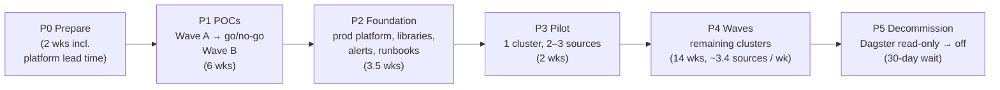

Durations: LLM-assisted, one person working alone, full-time, no contingency ([§8.6](#86-calendar)).

| Phase | Output | Exit criteria |
|---|---|---|
| P0 Prepare | Namespace PR merged; exports of Dagster tag concurrency limits, freshness checks, partition definitions and Launchpad defaults; list of non-ELT ops jobs; **backfill input per job** (accepts a partition range, or only one partition per run) | POC scope frozen; POC-11a Namespace available |
| P1 POCs | `docs/poc-results/POC-xx.md` per POC | Wave A all pass ([§6.5](#65-go--no-go-after-wave-a)); Wave B pass or risk accepted in writing |
| P2 Foundation | Prod Namespace (POC-11b agreements); worker images; shared library: `IngestWorkflow`, `BackfillWorkflow`, `run_elt` Activity, dbt trigger (POC-04 option); concurrency control (POC-06); Search Attributes; Slack/PagerDuty alerts and freshness checks; replay tests in CI; runbook | Failure drills pass; runbook reviewed by on-call |
| P3 Pilot | 1 dependency cluster on Temporal | 2 weeks with no duplicates, no missed runs, freshness ≤ today |
| P4 Waves | All clusters moved | Per-source checklist ([§7.3](#73-per-source-cutover-runbook)) done for every source |
| P5 Decommission | Dagster schedules removed; optional run-table export to Snowflake; Dagster DB read-only until retention passes | 30 days with no rollback; then shut down |

**Critical path starts outside our team:** the Namespace comes by platform PR, so start it in P0.

### 7.2 Cutover unit: dependency cluster

Each finished source builds all its downstream models (Q20, Q21). If source A (Dagster) and source B (Temporal) both feed `SEMANTIC.model_x`, both orchestrators would run dbt on it, and neither can stop the overlap. Overlapping dbt runs on the same models "could lead to unpredictable results" [S120](sources.md#s120). Moving the whole cluster keeps one owner per model. Sources that share an API token should also move together, or the token's cap must be split between Dagster and Temporal during the transition (*inference*).

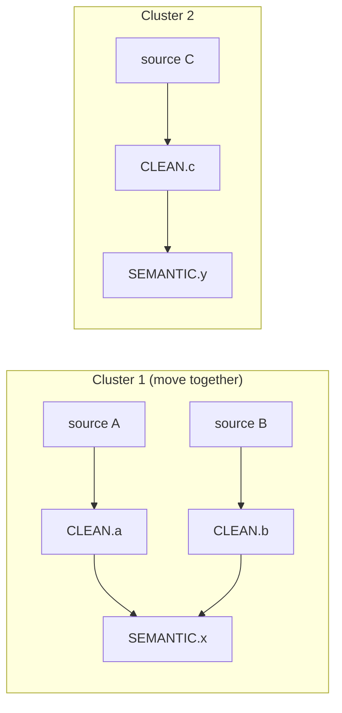

| Step | How to build clusters |
|---|---|
| 1 | Parse dbt `manifest.json`: for each model, list upstream sources |
| 2 | Union-find: sources that share any downstream model, or share an API token (F6), go in one cluster |
| 3 | Order: smallest and least critical first; the cluster with S-big after the pilot proves POC-01 in prod |
| 4 | Too-big cluster (e.g. a "core" model joins 30 sources): split it. During the transition the shared model and its descendants are built **only** by one scheduled dbt job, and both orchestrators' per-source builds exclude them (`dbt build --select source:<x>+ --exclude <shared_model>+`). State this in the wave plan. When the last source of the split moves: **pause the shared scheduled dbt job, wait until it has no run in flight**, remove the exclusion, then **build the shared model and its descendants once** (`dbt build --select <shared_model>+`) through the same dbt path live loads use, so loads that landed during the switch are not left out. Then retire the shared job |

### 7.3 Per-source cutover runbook

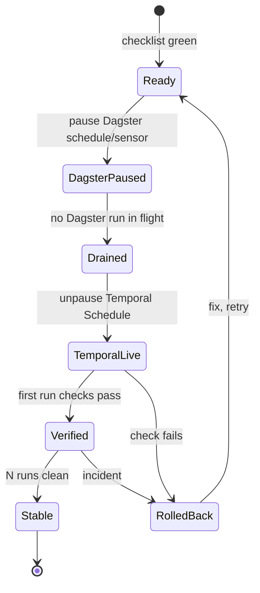

**Before (checklist per source)**

| Check | Proven by |
|---|---|
| Write disposition reviewed for retry safety | POC-02 |
| State backend / pipeline name identical to Dagster's | POC-03 |
| Resource class or K8s Job spec matches today's requests/limits | POC-01 |
| Partition definition and partition → Meltano/dlt mapping identical to Dagster's | POC-07 |
| Concurrency key (API token, run queue) assigned | POC-06 |
| No Dagster backfill in progress for the cluster: finish it in Dagster, or cancel and re-run later with `BackfillWorkflow` | — |
| Secrets mounted only where needed | U16 |
| Slack/PagerDuty alerts, freshness check and log fields cover this source | POC-08 |
| Temporal Schedule created **paused**, same cron and time zone as Dagster | — |

**Cutover (whole cluster at once)**

| # | Step |
|---|---|
| 1 | Pause the Dagster schedules/sensors for **every** source in the cluster, and stop the Dagster dbt trigger **for the cluster's sources only**. Dagster has one dbt sensor for all jobs (§2.1), so pausing it would also stop dbt for clusters still on Dagster. Before the first cutover, give the sensor a per-source gate (e.g. it skips sources whose owner in the §7.4 owner table is `temporal`) (*inference*) |
| 2 | Wait until no Dagster run is in flight **or queued** for any of them, **including dbt runs for the cluster's models** |
| 3 | Record each source's last completed schedule time, and list ingests that finished after the Dagster dbt trigger was stopped (their dbt work is pending) |
| 4 | **Option (a) only** (POC-04, no coordinator): run the pending dbt work from step 3 once now (`dbt build --select source:<x>+` per listed source, plus `--exclude <shared_model>+` while a split is active), and wait for it to finish. Nothing else builds these models yet, so it cannot overlap a live build |
| 5 | Hand the cluster's dbt trigger to Temporal, then unpause the cluster's Temporal Schedules |
| 6 | Reconcile missed work: every schedule time after the recorded last completed time up to the unpause (incl. times skipped while Dagster was paused and draining) runs with `temporal schedule backfill` (or `trigger` if only one). Backfill runs actions that "would have run during a specified time interval" [S131](sources.md#s131). Always pass `--overlap-policy`: the live Schedule's `Skip` would discard overlapping runs, and the CLI reference says "It's best to use the `BufferAll` or `AllowAll` policies to avoid conflicts and ensure no Workflow Executions are skipped" [S131](sources.md#s131). POC-07 picks the value. For partitioned sources, check that every partition Dagster marked missing or failed is backfilled or listed for the owner |
| 7 | **Option (b) only** (POC-04 coordinator): queue the pending dbt work from step 3 in the `DbtCoordinatorWorkflow`, same selection as step 4, so it runs through the same dbt path as live loads and cannot overlap them |
| 8 | Verify each source before marking the cluster done |

**Per-source checks:** row counts vs last Dagster run, primary-key uniqueness in `RAW`, bookmark advanced, no missed schedule times, dbt models built.

**Rollback (any time, whole cluster)**

| # | Step |
|---|---|
| 1 | Pause the Temporal Schedules for **every** source in the cluster; record the schedule time and partitions of every running ingest or backfill Workflow, then cancel them |
| 2 | Wait until all of them are closed and their ELT subprocesses or K8s Jobs and Snowflake queries have stopped. Cancellation is only a request the Workflow and Activity must handle [S128](sources.md#s128); if one does not close in time, terminate it and confirm the process is gone |
| 3 | Turn off the Temporal dbt trigger for the cluster's models. **Cancel any dbt selections queued in the `DbtCoordinatorWorkflow`** (option b). Wait for any running dbt build to finish. **If the cluster feeds a shared model of a split** (§7.2 step 4), settle its owner first: while the split is active it stays with the shared scheduled dbt job; if the split has ended, restore it (re-add the Temporal-side `--exclude <shared_model>+` and re-enable the shared scheduled dbt job) before step 4. Never let both orchestrators build it |
| 4 | Re-enable the Dagster schedules/sensors and the Dagster dbt trigger for the cluster. State is in the same backend, so runs continue from the last good bookmark (if POC-03 passed) |
| 5 | Reconcile in Dagster: the work recorded in step 1, plus schedule times missed during rollback (as in cutover step 6). Run dbt for any source whose load completed in Temporal but whose dbt build did not (this covers selections cancelled in step 3) |

### 7.4 Parallel-run guardrails

- Never let both orchestrators schedule the same source at once. One table records the owner of each source (`dagster` / `temporal`).
- dbt for a cluster is triggered only by the orchestrator that owns the cluster.
- Optional shadow run (if proof is needed before cutover): Temporal loads pilot sources into a separate `RAW_SHADOW` database for one week; compare row counts and checksums with `RAW`. Shadow runs use a **separate** Meltano state backend (or state IDs) and a separate dlt dataset, so they never move prod bookmarks. Cost: double source API load; check shared token limits first.

### 7.5 Main risks and mitigations

| Risk | Mitigation | Linked |
|---|---|---|
| Lost per-job isolation causes noisy-neighbour failures | Pattern chosen in POC-01; resource class per source in config | U01 |
| Duplicates after retries | Merge/upsert write dispositions; uniqueness checks after each load | U04 |
| dbt freshness worse than today | Coordinator batching tuned in POC-04; target lag in alerts | U06 |
| On-call slower without Dagster UI | Runbook + Search Attributes; dbt docs for lineage | U13 |
| Shared cluster down or degraded | Durable persistence (F9); failure drills, backups and on-call ownership agreed (POC-11) | U15 |
| Our 2-year backfills slow other tenants | Batched backfills with caps; joint load test (POC-07, POC-11b) | U11, U15 |
| Partitioned jobs cannot be tracked or backfilled | `BackfillWorkflow` + status table proven in POC-07 before any partitioned source moves | U11 |
| Backfill moves the live bookmark | Backfills use their own state ID; POC-07 compares the next live run with a clean run | U05, U11 |
| Shared API token over-used during transition | Move token-sharing sources together; split caps if not possible (POC-06) | U09 |

---

## 8. Effort and timeline estimates

> **In short** (all numbers are *estimates*; factors and contingency are *judgement*)
> - **Effort:** ~**136 engineer-days** (ED) with LLM-assisted coding, ~**163 ED** with 20 % contingency. Without LLM help: ~170 ED. LLM help saves **~20 %** overall (range 0–33 %, [§8.5](#85-totals-and-scenarios)).
> - **Calendar** (one person, working alone): ≈ **32 weeks** full-time (≈ 37 with contingency); ≈ 38 weeks at 80 % focus. The 2-week pilot soak and the 30-day wait before Dagster is shut down do not shrink.
> - Working alone, every item runs in sequence and there is no second reviewer: LLM review plus scripted checks stand in ([§8.6](#86-calendar)).
> - LLM help saves most on **repetitive porting** (50 sources) and **new code**; least on drills, verification, platform asks and soak periods, which make up much of this plan.
> - **Waves (porting and verifying 47 sources) are half the effort.** POC-07 is the largest POC.

### 8.1 Method

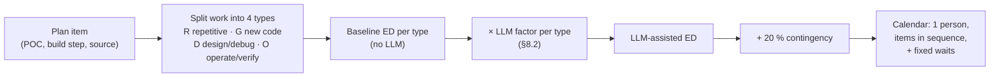

| Assumption | Value |
|---|---|
| Team | **One person, working alone** (confirmed by the team, 2026-11-13). Knows Dagster, Meltano, dlt, dbt, Snowflake, Kubernetes and Python; new to Temporal. Full-time unless stated; lower focus in [§8.6](#86-calendar) |
| LLM use | A coding agent with repo access writes code, tests and scripts; a human reviews every change and runs every check |
| Unit | 1 **ED** = one focused engineer-day; 5 ED per week. Meetings and support duty not included |
| Scope | 50 sources: 3 in the pilot, 47 in waves. > 75 % partitioned (Q9) → **36 partitioned, 11 not**. ~5 non-ELT ops jobs (F8 "some"). ~8 dependency clusters, 1 split (§7.2) |
| Platform | Platform PRs (Namespace, Fairness, prod Namespace) reviewed within 2 weeks; platform team joins POC-11b drills |
| POC outcomes | Simplest passing option: worker pools (POC-01 a), semaphore (POC-06 b), partition library A (POC-07). Other outcomes in [§8.7](#87-what-changes-the-estimate) |
| Baseline | Same person without LLM help. Matches the plan's earlier POC figures ([§8.8](#88-reconciliation-with-earlier-figures)) |
| Contingency | +20 % on effort, not on fixed waits (*judgement*; the goal is "no surprises", Q5) |

### 8.2 LLM factors and evidence

Each item's baseline is split across four work types. Each type gets one time factor (LLM-assisted time ÷ baseline time).

| Type | What | Examples in this plan | Factor | Basis |
|---|---|---|---|---|
| **R** Repetitive | Same pattern many times, spec exists | Port 50 source configs, freshness checks, config export | **×0.45** | Top of the measured range: 55.8 % faster on a well-specified greenfield task [S158](sources.md#s158) (*judgement*) |
| **G** New code | New code with a clear spec | Workflows, Activities, CLI, tests, Helm values, scripts | **×0.65** | Between the 21 % [S159](sources.md#s159) and 55.8 % [S158](sources.md#s158) measured gains |
| **D** Design / debug | New concurrency or failure logic; debugging in our setup | Semaphore, backfill batching, dbt overlap, state continuity | **×0.85** | Experienced developers on complex, familiar code were 19 % **slower** with early-2025 tools [S160](sources.md#s160); later data suggests more speed-up but is "only very weak evidence" [S161](sources.md#s161) |
| **O** Operate / verify | Run, observe, compare, coordinate, decide | Drills, load tests, soak, row checks, platform asks, cutovers | **×1.0** | Bound by wall clock and people. The LLM writes the check scripts (counted as G), not the run. AI adoption came with an estimated 7.2 % drop in delivery stability [S162](sources.md#s162), so human verification stays in full |

**Evidence used**

| Study | Setting | Result | Use here |
|---|---|---|---|
| [S158](sources.md#s158) GitHub Copilot experiment (2023) | Recruited developers build an HTTP server in JavaScript | AI group "completed the task 55.8% faster" | Upper bound; fits R and G work |
| [S159](sources.md#s159) Google enterprise RCT (2024) | 96 Google engineers, "complex, enterprise-grade task" | ~21 % faster; "our confidence interval is large" | Mid estimate for G |
| [S160](sources.md#s160) METR RCT (July 2025) | 16 experienced open-source developers, 246 real issues in their own large repos | 19 % slower with AI; they believed they were ~20 % faster | Caution for D; do not trust felt speed-up |
| [S161](sources.md#s161) METR update (Feb 2026) | Follow-up study on late-2025 tools | Selection effects make the data unreliable; METR believes developers "are more sped up from AI tools now" | D at ×0.85, not ×1.19 |
| [S162](sources.md#s162) DORA 2024 | Survey of software teams | AI adoption: est. −1.5 % delivery throughput, −7.2 % delivery stability | Keep O at ×1.0; review all LLM code |

None of these studies measured data-pipeline migrations; applying them here is *inference*.

### 8.3 Estimates per item

Mix = baseline ED per work type (R / G / D / O). LLM-assisted ED = R×0.45 + G×0.65 + D×0.85 + O×1.0.

**P0 Prepare**

| ID | Item | Plan ref | Baseline ED | Mix R / G / D / O | LLM-assisted ED | Wall clock / note |
|---|---|---|---|---|---|---|
| P0-1 | Namespace PR (values files + token issuer) | §2.2, POC-11a | 0.5 | – / 0.25 / – / 0.25 | 0.4 | + platform lead time (assumed ≤ 2 wks) |
| P0-2 | Temporal ramp-up | — | 3 | learning | 2.4 | Learning; LLM as tutor ×0.8 |
| P0-3 | Export Dagster config: tag limits, freshness checks, partition defs, Launchpad defaults, backfill input per job | §7.1 P0 | 3 | 1.5 / 0.5 / – / 1 | 2.0 | Script over Dagster code; review by hand |
| P0-4 | Inventory non-ELT ops jobs | F8, U18 | 1 | – / 0.5 / – / 0.5 | 0.8 |  |
| P0-5 | Dependency clusters: parse `manifest.json`, union-find with shared tokens, order, splits | §7.2 | 2.5 | – / 1.5 / 1 / – | 1.8 | Decides wave order |
| P0-6 | POC setup: Snowflake clone, POC sources, result template, fallback dev Temporal | §6.3 | 2 | – / 1 / – / 1 | 1.6 |  |
| | **Subtotal** | | **12.0** | | **9.1** (24 % less) | |

**P1 POCs**

| ID | Item | Plan ref | Baseline ED | Mix R / G / D / O | LLM-assisted ED | Wall clock / note |
|---|---|---|---|---|---|---|
| 11a | POC-11a Namespace, token rotation, restart check | §6.4 | 1 | – / 0.3 / – / 0.7 | 0.9 | + 24 h token test (wall clock) |
| 11b | POC-11b Shared-cluster readiness | §6.4 | 3 | – / 0.5 / – / 2.5 | 2.8 | Drills and load test with platform team |
| 01 | POC-01 Per-job resources (pools vs K8s Job) | §6.4 | 4.5 | – / 1.5 / 1.5 / 1.5 | 3.8 | + KEDA / Worker Controller approval |
| 02 | POC-02 ELT in an Activity (cancel, crash, retry) | §6.4 | 3.5 | – / 1.5 / 1 / 1 | 2.8 |  |
| 03 | POC-03 State continuity from Dagster | §6.4 | 2 | – / 0.5 / 0.5 / 1 | 1.8 |  |
| 04 | POC-04 dbt trigger / coordinator | §6.4 | 4 | – / 1.5 / 1.5 / 1 | 3.2 |  |
| 06 | POC-06 Rate limits and run-queue caps | §6.4 | 3 | – / 1 / 1.5 / 0.5 | 2.4 | + Fairness platform PR, if used |
| 07 | POC-07 Partitions and backfills (incl. partition library, §4.2 A vs B) | §6.4 | 7 | – / 3 / 2.5 / 1.5 | 5.6 | + 2-year backfill run time (wall clock) |
| 08 | POC-08 Alerts, freshness, logs | §6.4 | 3 | – / 1.5 / 0.5 / 1 | 2.4 |  |
| 09 | POC-09 On-call tasks (incl. launch CLI) | §6.4 | 2 | – / 1 / – / 1 | 1.6 |  |
| 10 | POC-10 Safe deploys | §6.4 | 2.5 | – / 1 / 0.5 / 1 | 2.1 | + 2-hour runs (wall clock) |
| 12 | POC-12 Lineage and catalog (*optional*) | §6.4 | 3 | – / 1.5 / – / 1.5 | 2.5 | Not in totals |
| | **Subtotal** | | **35.5** | | **29.4** (17 % less) | |

**P2 Foundation**

| ID | Item | Plan ref | Baseline ED | Mix R / G / D / O | LLM-assisted ED | Wall clock / note |
|---|---|---|---|---|---|---|
| F1 | Prod Namespace + platform asks (Search Attributes, Fairness, retention, paging) | POC-11b, §4.2 | 1.5 | – / 0.5 / – / 1 | 1.3 | + platform lead time |
| F2 | Worker images, S/M/L Deployments, autoscaling, CI/CD | POC-01, §4.2 | 3 | – / 1.5 / 0.5 / 1 | 2.4 |  |
| F3 | Shared library to prod quality: `IngestWorkflow`, `run_elt`, `BackfillWorkflow`, partition library, `partition_status` table | §4.2, POC-02/07 | 4 | – / 2.5 / 1 / 0.5 | 3.0 | Reuses POC code |
| F4 | dbt trigger (POC-04 option) + `target/` persistence | POC-04 | 1.5 | – / 0.75 / 0.5 / 0.25 | 1.2 |  |
| F5 | Concurrency control (semaphore Workflow) to prod | POC-06, §4.2 | 1.5 | – / 0.5 / 0.75 / 0.25 | 1.2 |  |
| F6 | Alerts (failure Activity, Grafana), port all freshness checks, gap check, log fields | POC-08, §4.2 | 3 | 1 / 1 / – / 1 | 2.1 | Freshness port is repetitive |
| F7 | Launch/backfill CLI hardening, runbook, on-call review | POC-09, §4.2 | 2 | – / 1 / – / 1 | 1.6 |  |
| F8 | Replay tests in CI + Worker Versioning deploy flow | POC-10 | 1.5 | – / 1 / 0.5 / – | 1.1 |  |
| F9 | Cutover tooling: owner table, per-source gate on Dagster dbt sensor, cutover/rollback/verify scripts | §7.3, §7.4 | 2 | – / 1 / 0.5 / 0.5 | 1.6 | Makes per-source checks cheap |
| F10 | dbt docs site + Snowflake lineage (edition check) | §4.2 lineage A, B | 0.75 | – / 0.5 / – / 0.25 | 0.6 |  |
| F11 | Failure and rollback drills (P2 exit) | §7.1 | 1.5 | – / – / – / 1.5 | 1.5 |  |
| | **Subtotal** | | **22.3** | | **17.6** (21 % less) | |

**P3 Pilot**

| ID | Item | Plan ref | Baseline ED | Mix R / G / D / O | LLM-assisted ED | Wall clock / note |
|---|---|---|---|---|---|---|
| PI-1 | Port 3 pilot sources (1 cluster) | §7.1 P3 | 3.75 | 1.5 / – / 0.75 / 1.5 | 2.8 | Same unit cost as P4 |
| PI-2 | Cutover, daily checks for 2 weeks, fixes | §7.3 | 5 | – / – / 1.5 / 3.5 | 4.8 | 2-week soak (wall clock) |
| | **Subtotal** | | **8.8** | | **7.6** (13 % less) | |

**P4 Waves**

| ID | Item | Plan ref | Baseline ED | Mix R / G / D / O | LLM-assisted ED | Wall clock / note |
|---|---|---|---|---|---|---|
| W-1 | 11 non-partitioned sources | §7.3 | 13.75 | 5.5 / – / 2.75 / 5.5 | 10.3 | 1.25 ED each |
| W-2 | 36 partitioned sources (> 75 %) | §7.3 | 63 | 18 / – / 18 / 27 | 50.4 | 1.75 ED each |
| W-3 | ~5 non-ELT ops jobs | F8 | 7.5 | 3.75 / – / 1.25 / 2.5 | 5.2 | 1.5 ED each |
| W-4 | Cluster cutovers (~8) + 1 split cluster | §7.2, §7.3 | 5 | – / – / 1 / 4 | 4.8 | 0.5 ED per cluster + 1 for the split |
| | **Subtotal** | | **89.3** | | **70.8** (21 % less) | |

**P5 Decommission**

| ID | Item | Plan ref | Baseline ED | Mix R / G / D / O | LLM-assisted ED | Wall clock / note |
|---|---|---|---|---|---|---|
| D-1 | Remove schedules, export run table, archive, uninstall after 30 days | §7.1 P5 | 2 | 0.5 / 0.5 / – / 1 | 1.6 | + 30-day wait (wall clock) |
| | **Subtotal** | | **2.0** | | **1.6** (22 % less) | |
169.75 136.0325

**Per-source unit cost (P3, P4)**, from the §7.3 checklist

| Step | Type | Non-partitioned | Partitioned | Ops job |
|---|---|---|---|---|
| Port config: ELT command, resource class, concurrency key, Schedule (paused), typed input with Launchpad defaults, alerts | R | 0.5 | 0.5 | 0.75 |
| Review write disposition and state ID (POC-02, POC-03 rules) | D | 0.25 | 0.25 | 0.25 |
| Map partition definition; list partitions Dagster marked missing or failed | D | – | 0.25 | – |
| Dry run on the cloned DB; compare rows with Dagster | O | 0.25 | 0.25 | 0.25 |
| Backfill or hand over missing partitions | O | – | 0.25 | – |
| Cutover, first-run checks (scripts from F9) | O | 0.25 | 0.25 | 0.25 |
| **Baseline ED** | | **1.25** | **1.75** | **1.5** |
| **LLM-assisted ED** | | **0.94** | **1.40** | **1.05** |

### 8.4 Where the §4.2 picks are costed

| §4.2 pick | Built in | Made production-ready in |
|---|---|---|
| Partition library (A; B compared) | POC-07 | F3 |
| `partition_status` table + materialization metadata | POC-07 | F3 |
| `BackfillWorkflow`; `temporal schedule backfill` for missed times; batch CLI to stop a backfill | POC-07 | F3, F7 |
| Typed input + launch CLI (Launchpad) | POC-07, POC-09 | F7 |
| Semaphore Workflow; Fairness per-key rate limit | POC-06 | F5, F1 (platform PR) |
| Worker pools S/M/L (K8s Job only for heaviest jobs) | POC-01 | F2 ([§8.7](#87-what-changes-the-estimate) if Jobs needed) |
| dbt docs; Snowflake lineage | — | F10 |
| OpenLineage + Marquez / OpenMetadata (optional) | POC-12 | Not estimated; see §8.7 |
| `dbt source freshness` + SQL gap check | POC-08 | F6 |
| Failure Activity + Grafana alerts | POC-08 | F6 |
| Run history: clean start, optional export | — | D-1 |

### 8.5 Totals and scenarios

| Phase | No LLM (ED) | LLM optimistic (ED) | **LLM expected (ED)** | Expected + 20 % |
|---|---|---|---|---|
| P0 Prepare | 12.0 | 7.6 | **9.1** | 10.9 |
| P1 POCs (Wave A 27 → 22.4; Wave B 7.5 → 6.1; 11a 1 → 0.9) | 35.5 | 24.7 | **29.4** | 35.3 |
| P2 Foundation | 22.3 | 14.6 | **17.6** | 21.1 |
| P3 Pilot | 8.8 | 6.5 | **7.6** | 9.1 |
| P4 Waves | 89.3 | 59.4 | **70.8** | 85.0 |
| P5 Decommission | 2.0 | 1.3 | **1.6** | 1.9 |
| **Total** | **170** | **114** | **136** | **163** |
| Saved vs no LLM | — | 33 % | **20 %** | — |
| POC-12 (optional, not in totals) | 3.0 | 2.1 | 2.5 | 3.0 |

Optimistic factors: R ×0.3, G ×0.5, D ×0.7, O ×0.9 (LLM also scripts some checks). Conservative: no gain (= No LLM column), as in the early-2025 METR result [S160](sources.md#s160).

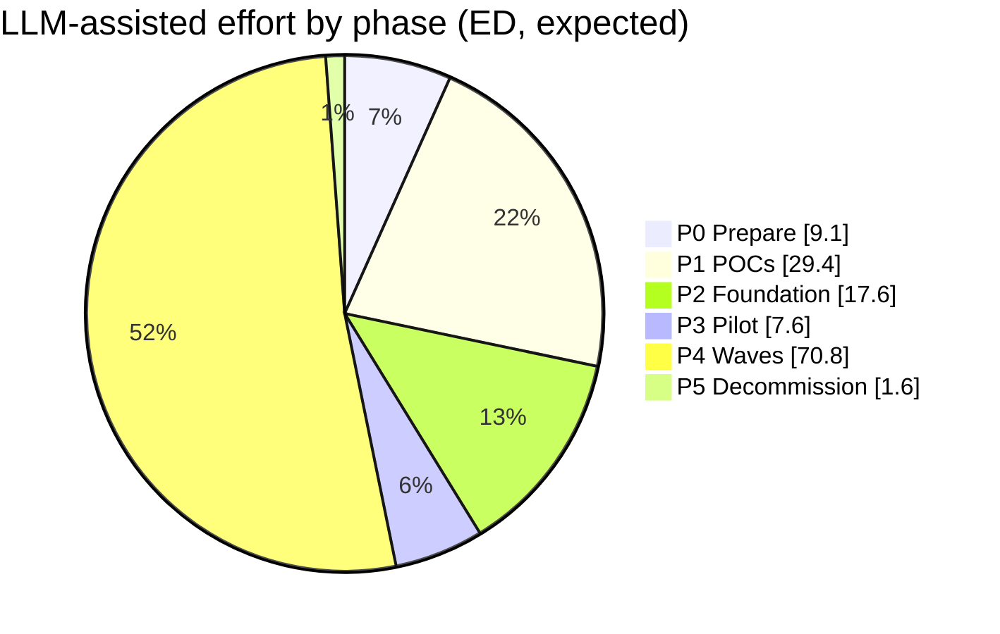

### 8.6 Calendar

One person, so items run one after another in the §6.1 order. Wall-clock waits are filled with the next item where possible (e.g. prepare POC sources while the Namespace PR is in review).

| Phase | Full-time | What sets the length |
|---|---|---|
| P0 Prepare | 2 wks | Platform lead time for the Namespace PR (assumed ≤ 2 wks); 9.1 ED fits inside |
| P1 POCs | 6 wks | Effort (29.4 ED); Wave A ≈ 4.5 wks, then go / no-go, then Wave B ≈ 1.5 wks |
| P2 Foundation | 3.5 wks | Effort; prod Namespace PR runs in parallel |
| P3 Pilot | 2 wks | **Fixed** 2-week soak (P3 exit criterion); 7.6 ED of work inside it |
| P4 Waves | 14 wks | Effort; ~3.4 sources/wk, about one cluster every 1.5–2 wks; each cluster stable before the next |
| P5 Decommission | 4.5 wks | **Fixed** 30-day wait with no rollback; ~1.6 ED of work |
| **Total** | **≈ 32 wks** | |
| With +20 % contingency | ≈ 37 wks | |
| Without LLM help | ≈ 38 wks | |

**Focus.** ED counts focused days only. If part of each week goes to running today's Dagster jobs, support or leave, effort phases stretch; fixed waits do not.

| Share of time on the migration | Calendar (LLM-assisted, no contingency) |
|---|---|
| 100 % | ≈ 32 wks |
| 80 % | ≈ 38 wks |
| 60 % | ≈ 49 wks |

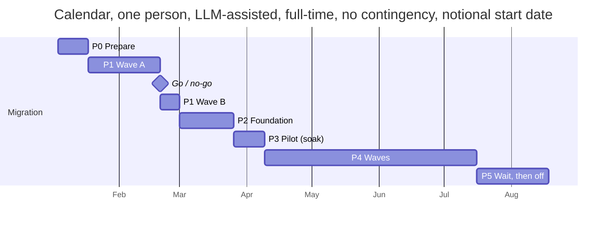

**Working alone: risks and mitigations** (*judgement*)

| Risk | Mitigation |
|---|---|
| No second human reviewer for code or cutovers | LLM review of every change, plus replay tests (F8) and scripted per-source checks (F9); the platform team reviews platform PRs |
| One person is the single point of knowledge | Runbook (F7) and POC result pages (§6.3) written as you go; on-call tasks proven by someone else in POC-09 ("someone not on the POC team") |
| Drills need someone to break things while someone watches | Script the faults (pod kill, OOM, Snowflake error) so one person can run and watch; platform team runs the DB failover (POC-11b) |
| Cutover and rollback need full attention | One cluster at a time, at a quiet hour; no cutover before leave |
| Migration slows when Dagster needs attention | Plan at 80 % focus (≈ 38 wks) if Dagster support stays with the same person |

**Wall-clock waits** (not effort, not shortened by LLM help)

| Wait | Where | Assumed |
|---|---|---|
| Platform PRs: non-prod Namespace, Fairness (if used), prod Namespace | P0, POC-06, F1 | ≤ 2 wks each, off the critical path except the first |
| KEDA / Worker Controller approval | POC-01, POC-10 | Within P1; if refused, fixed replicas |
| 24 h token-rotation test; 2-hour loads | POC-11a, POC-10 | Inside the POC days |
| 2-year backfill run for S-part-5m | POC-07 | Unknown; measured in POC-07 step 8 |
| Pilot soak | P3 | 2 wks |
| Each cluster "N runs clean" before the next | P4 | Inside the weekly pace |
| No-rollback period | P5 | 30 days |

### 8.7 What changes the estimate

| Change | Effect (baseline → LLM-assisted) |
|---|---|
| Each extra source beyond 50 | +1.25–1.75 ED → +0.9–1.4 ED |
| POC-01: heaviest jobs need a K8s Job launcher (§4.2 per-job resources B) | +2–3 ED → +1.7–2.5 ED in F2 |
| POC-04 picks the coordinator (option b) | +1.5 ED → +1.2 ED in F4 |
| POC-02 fails for a source: change write disposition | +0.5 ED per source → +0.4 ED |
| POC-03 fails for a source: one-time state copy or controlled re-sync | +0.5–1 ED per source, plus Snowflake and API cost |
| POC-07 picks Dagster partition classes (option B) for time/static types | −1 to −2 ED in F3 |
| POC-12 is run and passes: production lineage service | POC +3 → +2.5 ED; rollout not estimated (new service to run) |
| Optional shadow run (§7.4) | +1 wk calendar; ~1 ED per pilot source |
| Platform PR takes > 2 wks | Calendar only; Wave A except POC-11b runs on a dev install (§6.3) |
| A second person joins (not planned) | ≈ 21 wks full-time: POCs 3.5, foundation 2, waves 7 wks; +2.4 ED ramp-up |
| Wave A says stop (§6.5) | Wave B and P2–P5 not spent; sunk cost ≈ P0 + POC-11a + Wave A ≈ 32 ED (LLM) |

### 8.8 Reconciliation with earlier figures

| Figure | Before | Now | Why |
|---|---|---|---|
| Wave A | ~28 ED | 27 ED (22.4 with LLM) | POC-01 at the midpoint of 4–5 |
| Wave B | ~8 ED | 7.5 ED (6.1 with LLM) | POC-10 at the midpoint of 2–3 |
| P2 Foundation | 3–4 wks | 22.3 ED ≈ 4.5 wks (17.6 ED ≈ 3.5 wks with LLM) | Bottom-up list F1–F11 |
| P4 Waves | ~10 sources / wk | ~3.4 / wk (one person, LLM-assisted) | Bottom-up per-source checklist (§7.3) gives 1.25–1.75 ED per source; 10 / wk would need about 3 people |
| P5 | 2 wks | ~1.6 ED of work + 30-day wait | The 30-day exit criterion was already in §7.1 |
