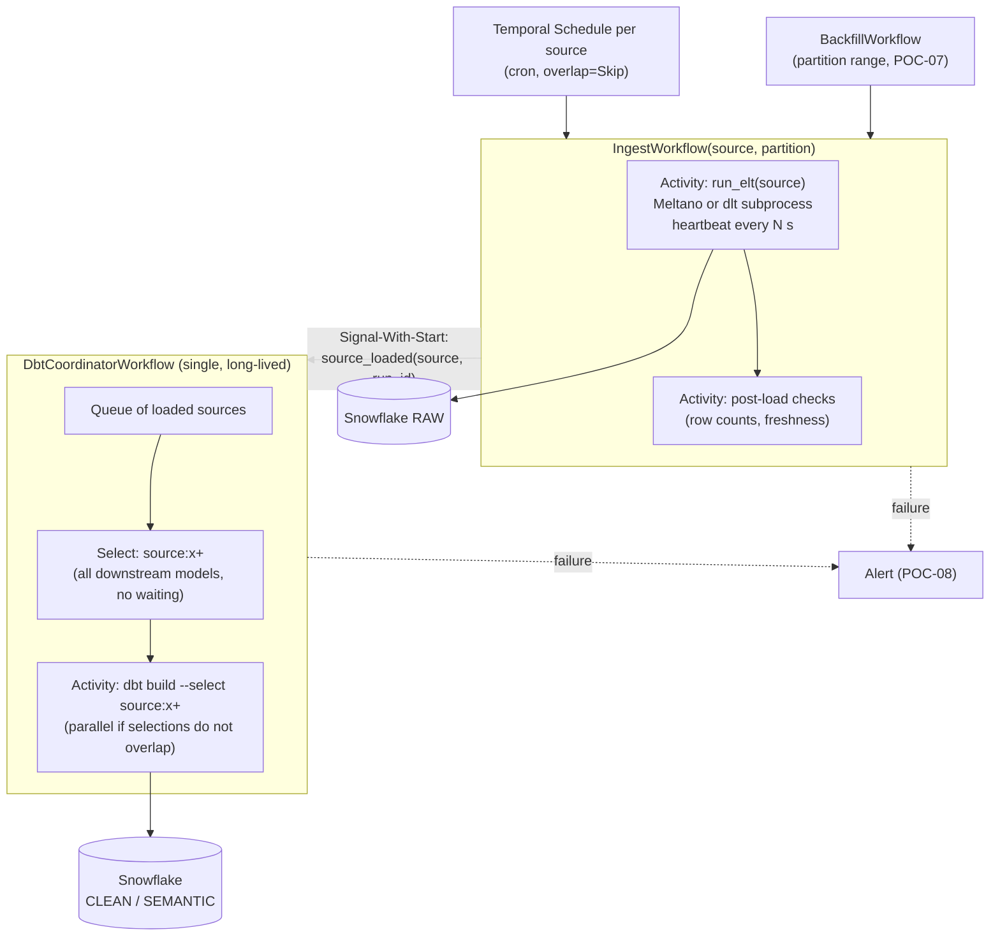

# 02 — Feature mapping: Dagster → Temporal

> **Key takeaways**
> - Updated 2026-11-12 with the team's answers. 11 of 22 capabilities map to documented features and need **no POC** (rows 15 and 17 closed by Q8 and Q21).
> - 11 need a POC, because Temporal has no built-in equivalent (per-run pods, partitions, concurrency caps, alerting) or because the behaviour depends on our tools (Meltano, dlt, dbt, Snowflake) or the shared cluster.
> - The target design is: **one ingest Workflow per source (and partition)**, **ELT in an Activity**, and a **dbt trigger** that builds `source:<x>+` after each load, either one dbt process per load or via one coordinator (POC-04 decides).

## 1. Target design (proposed, to be validated by POCs)

- **What dbt builds:** after source `x` loads, all its downstream models, with no wait for other sources (Q20, Q21). `source:x+` selects models that read source `x` and their descendants ([dbt node selection methods](https://docs.getdbt.com/reference/node-selection/methods)).
- **Why maybe a coordinator:** today two sources finishing together both trigger dbt (Q22). dbt does not support parallel invocations in one process ([dbt programmatic invocations](https://docs.getdbt.com/reference/programmatic-invocations)), and two overlapping `dbt build` runs on the same models "could lead to unpredictable results" (same page). A coordinator de-overlaps dbt work; POC-04 compares it with today's parallel behaviour.
- **Why Signal-With-Start:** it "starts a Workflow when Signaling it if it does not already exist. If already running, it receives the Signal directly", atomically ([Signal with Start pattern](https://docs.temporal.io/design-patterns/signal-with-start)).
- The coordinator is an *entity Workflow*; it needs Continue-As-New to stay under history limits (51,200 events or 10K Signals) and must de-duplicate Signals, which "can be delivered more than once" ([Signal with Start pattern](https://docs.temporal.io/design-patterns/signal-with-start)).

## 2. Mapping table

Status: **Known** = documented, no POC. **Unknown** = POC needed (ID in [03](03-unknowns-register.md)).

| # | Dagster capability (today) | Temporal approach | Status | Evidence / gap |
|---|---|---|---|---|
| 1 | Cron schedule per job | Temporal Schedule (cron/calendar/interval), overlap policies, catch-up, pause | **Known** | [Schedule](https://docs.temporal.io/schedule); CLI `create`, `toggle`, `trigger`, `backfill` ([CLI schedule](https://docs.temporal.io/cli/command-reference/schedule)) |
| 2 | "Don't start a second run of the same job" | Scheduled runs: overlap policy `Skip`. Any other start path (manual, sensor, backfill): a source-wide lock that every path takes, e.g. a fixed per-source lock Workflow ID with Conflict Policy `Fail` | **Known** (build) | "at most one Workflow Execution with a given ID running at any point in time" ([Workflow Id and Run Id](https://docs.temporal.io/workflow-execution/workflowid-runid)); but a Schedule appends "the Action's timestamp … to the Workflow Id" ([Schedule](https://docs.temporal.io/schedule)), so IDs alone do not exclude runs from different start paths. Tested in POC-06 |
| 3 | Op retry policy | Activity Retry Policy (default unlimited; we must set `maximum_attempts`) | **Known** | [Retry Policies](https://docs.temporal.io/encyclopedia/retry-policies) |
| 4 | Run timeouts / run monitoring | Start-To-Close caps one attempt; Heartbeat Timeout detects stalls; **Schedule-To-Close** caps the total across all retries (set it when a whole-run deadline is needed) | **Known** | [Detecting Activity failures](https://docs.temporal.io/encyclopedia/detecting-activity-failures.md), [Activity Timeouts - Python SDK](https://docs.temporal.io/develop/python/activities/timeouts) |
| 5 | Large data never passes through orchestrator | Pass IDs only; payload limit 2 MB default | **Known** | [Self-hosted defaults](https://docs.temporal.io/self-hosted-guide/defaults), [Troubleshoot payload size limit](https://docs.temporal.io/troubleshooting/blob-size-limit-error) |
| 6 | Unit tests | Activity env, time skipping, replay tests | **Known** | [Testing - Python SDK](https://docs.temporal.io/develop/python/testing-suite) |
| 7 | Metrics endpoint | Server + SDK Prometheus metrics; community Grafana dashboards | **Known** | [Monitor Temporal Platform metrics](https://docs.temporal.io/self-hosted-guide/monitoring) |
| 8 | Heavy imports in pipeline code | Keep Meltano/dlt/dbt imports in Activities; sandbox reloads non-passthrough modules per run | **Known** | [Python SDK sandbox](https://docs.temporal.io/develop/python/best-practices/python-sdk-sandbox) |
| 9 | dbt test failure skips downstream | Same: inside `dbt build`, a failing upstream test makes downstream `SKIP` | **Known** | [dbt build](https://docs.getdbt.com/reference/commands/build) |
| 10 | **Per-job pod with own CPU/memory** (`K8sRunLauncher`) | (a) Worker pools per resource class, one Task Queue each; or (b) Activity launches a K8s Job per run | **Unknown** | No Temporal doc covers per-run pods; Worker Controller scales per Worker Deployment Version, not per Workflow ([Worker Controller](https://docs.temporal.io/production-deployment/worker-deployments/kubernetes-controller)) → **U01, U02, U16** |
| 11 | Run ELT tool, stop it on cancel | Activity runs subprocess; must heartbeat to receive cancel | **Unknown** | "If the Heartbeat is not invoked, the Activity cannot receive a cancellation request" ([Cancellation - Python SDK](https://docs.temporal.io/develop/python/workflows/cancellation)); child-process kill not documented → **U03** |
| 12 | Retry after partial load | Activities "may be executed multiple times" | **Unknown** | [Activity Definition](https://docs.temporal.io/activity-definition); effect on Meltano/dlt + Snowflake not documented → **U04** |
| 13 | Incremental state (bookmarks) | Keep Meltano state backend / dlt destination state | **Unknown** | dlt restores state from destination by pipeline name + destination + dataset ([dlt state](https://dlthub.com/docs/general-usage/state)); Meltano state backends and locks ([Meltano state backends](https://discovery.meltano.com/concepts/state_backends)); continuity from Dagster-era runs untested → **U05** |
| 14 | dbt after each ingestion | Coordinator Workflow + dbt subprocess Activity | **Unknown** | dbt in-process parallelism unsupported ([dbt programmatic invocations](https://docs.getdbt.com/reference/programmatic-invocations)); behaviour under many near-simultaneous loads untested → **U06, U08** |
| 15 | Build all downstream models of a loaded source | `dbt build --select source:<x>+`; no wait-for-all rule (Q21) | **Known** | [dbt node selection methods](https://docs.getdbt.com/reference/node-selection/methods); U07 closed |
| 16 | Run queue limit + tag concurrency limits (shared API tokens, Q10, Q18) | Worker slots, Task Queue rate limit, Fairness keys, or a semaphore Workflow | **Unknown** | Rate limit is per-second, not a concurrency cap ([Downstream Rate Limiting](https://docs.temporal.io/design-patterns/downstream-rate-limiting)); Fairness off by default on self-hosted (`matching.enableFairness`) ([Priority and Fairness](https://docs.temporal.io/develop/task-queue-priority-fairness)) → **U09** |
| 17 | Sensor: start dbt after an ingestion job (the only sensor, Q8) | Ingest Workflow starts dbt (or signals the coordinator) on success | **Known** | Workflow code calls the next step; [Signal with Start pattern](https://docs.temporal.io/design-patterns/signal-with-start); U10 closed |
| 18 | Partitions + backfills (> 75 % of jobs; all types down to 5-minute; ~2-year backfills) | Partition library + Launchpad config as typed Workflow input; `BackfillWorkflow` runs **batches** of partitions as children; status in a Snowflake table | **Unknown (High)** | Schedule backfill only re-runs schedule times ([CLI schedule](https://docs.temporal.io/cli/command-reference/schedule)); no partition status tracking (*inference*) → **U11** |
| 19 | Slack + PagerDuty on failure; freshness checks (Q12, Q13) | Metrics alerts, failure-handler Activity, scheduled freshness Activity | **Unknown** | Server docs recommend no alerts; "configure Grafana Alerts" ([Monitor Temporal Platform metrics](https://docs.temporal.io/self-hosted-guide/monitoring)) → **U12, U17** |
| 20 | UI: see failures, re-run, backfill (Q14) | Temporal UI (executions), Search Attributes, Workflow Reset, Activity Reset; dbt docs for lineage | **Unknown** | SQL visibility allows only 10 Keyword custom Search Attributes per Namespace ([Search Attributes](https://docs.temporal.io/search-attribute)); Reset only to Workflow Task events ([Events and Event History](https://docs.temporal.io/workflow-execution/event)) → **U13** |
| 21 | Code deploys without breaking runs | Worker Versioning (Pinned) + Worker Controller | **Unknown** | Versioning needs self-hosted server ≥ v1.29.1 (shared cluster: 1.32.2), Python SDK ≥ 1.11 ([Worker Versioning](https://docs.temporal.io/production-deployment/worker-deployments/worker-versioning)); GA blog does not say OSS is covered ([GA blog](https://temporal.io/blog/ga-worker-versioning-public-preview-upgrade-on-continue-as-new)) → **U14** |
| 22 | Platform (today: our Dagster Helm install) | Shared company Temporal cluster (server 1.32.2, MySQL 8 SQL visibility), our own Namespace via platform PR, JWT token for Workers | **Unknown** | "only required dependency … is the Persistence database" ([Persistence](https://docs.temporal.io/temporal-service/persistence)); durability of the default store to confirm (F9); HA, limits, paging → **U15** |

## 3. Things Temporal will **not** give us (accept or build)

| Lost capability | Replacement | Decision owner |
|---|---|---|
| Asset catalog and cross-tool lineage | dbt docs/lineage for dbt models (team uses the UI only for failures, re-run, backfill, Q14) | Team |
| Partition status grid and Launchpad | Snowflake status table + small launch/backfill CLI (POC-07, POC-09) | Team |
| Freshness checks (almost all assets) | `dbt source freshness` on a Schedule + Slack alert (POC-08) | Team |
| Dagster run history | Clean start (Q25); optional export of the Dagster run table to Snowflake; keep Dagster DB read-only until retention passes | Team |

## Sources

- [S10] [Schedule](https://docs.temporal.io/schedule)
- [S130] [Workflow Id and Run Id](https://docs.temporal.io/workflow-execution/workflowid-runid)
- [S7] [Retry Policies](https://docs.temporal.io/encyclopedia/retry-policies)
- [S8] [Detecting Activity failures](https://docs.temporal.io/encyclopedia/detecting-activity-failures.md)
- [S115] [Activity Timeouts - Python SDK](https://docs.temporal.io/develop/python/activities/timeouts)
- [S11] [Self-hosted defaults](https://docs.temporal.io/self-hosted-guide/defaults)
- [S17] [Troubleshoot payload size limit](https://docs.temporal.io/troubleshooting/blob-size-limit-error)
- [S41] [Testing - Python SDK](https://docs.temporal.io/develop/python/testing-suite)
- [S132] [Monitor Temporal Platform metrics](https://docs.temporal.io/self-hosted-guide/monitoring)
- [S134] [Temporal Python SDK sandbox](https://docs.temporal.io/develop/python/best-practices/python-sdk-sandbox)
- [S137] [dbt build](https://docs.getdbt.com/reference/commands/build)
- [S118] [Temporal Worker Controller](https://docs.temporal.io/production-deployment/worker-deployments/kubernetes-controller)
- [S128] [Cancellation - Python SDK](https://docs.temporal.io/develop/python/workflows/cancellation)
- [S6] [Activity Definition](https://docs.temporal.io/activity-definition)
- [S127] [dlt state](https://dlthub.com/docs/general-usage/state)
- [S122] [Meltano state backends](https://discovery.meltano.com/concepts/state_backends)
- [S120] [dbt programmatic invocations](https://docs.getdbt.com/reference/programmatic-invocations)
- [S129] [Signal with Start pattern](https://docs.temporal.io/design-patterns/signal-with-start)
- [S24] [Downstream Rate Limiting](https://docs.temporal.io/design-patterns/downstream-rate-limiting)
- [S124] [Task Queue Priority and Fairness](https://docs.temporal.io/develop/task-queue-priority-fairness)
- [S38] [Search Attributes](https://docs.temporal.io/search-attribute)
- [S138] [Events and Event History](https://docs.temporal.io/workflow-execution/event)
- [S135] [Worker Versioning](https://docs.temporal.io/production-deployment/worker-deployments/worker-versioning)
- [S136] [Announcing GA for Worker Versioning](https://temporal.io/blog/ga-worker-versioning-public-preview-upgrade-on-continue-as-new) — *vendor blog*
- [S126] [temporalio/helm-charts](https://github.com/temporalio/helm-charts)
- [S3] [Persistence](https://docs.temporal.io/temporal-service/persistence)
- [S140] [dbt node selection methods](https://docs.getdbt.com/reference/node-selection/methods) — *dbt docs*
- [S2] [Temporal Server](https://docs.temporal.io/temporal-service/temporal-server)
- [S131] [Temporal CLI schedule command reference](https://docs.temporal.io/cli/command-reference/schedule)
- [S125] [dagster-k8s](https://dagster.io/docs/integrations/libraries/k8s/dagster-k8s)
