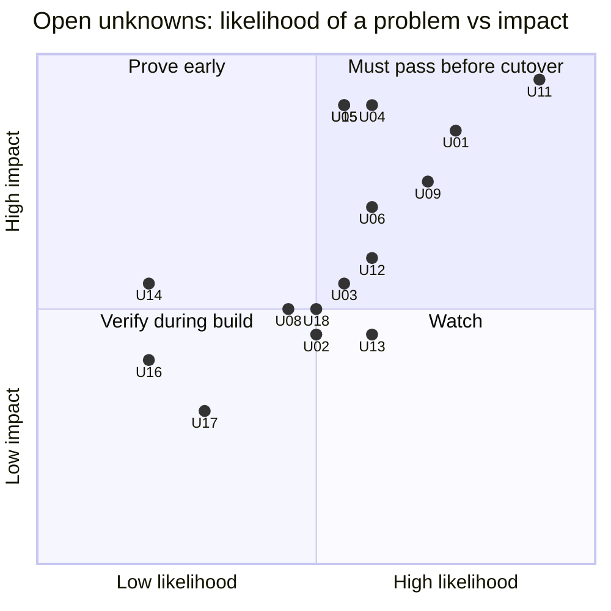

# 03 — Unknowns register (things that might not work)

> **Key takeaways**
> - Re-rated on 2026-11-12 with the team's answers and follow-ups F1–F8 ([01](01-current-state-and-questions.md) §5). 15 open unknowns, 3 closed.
> - **Top risk is now U11:** every partition type is used, down to 5-minute, with backfills of about 2 years (≈ 210,240 five-minute partitions). Partitions must be batched per Workflow.
> - **U15 is no longer a confirmed blocker:** the shared cluster runs server 1.32.2 with a managed MySQL 8 database; confirm the default persistence store (F9). Namespace, dynamic config and Search Attributes need platform PRs.
> - **High (must pass before any cutover):** U01 per-job isolation, U04 duplicates on retry, U05 state continuity, U06 dbt overlap, U09 shared rate limits, U11 partitions and backfills, U15 shared cluster.
> - **Medium:** U02, U03, U08, U12, U13, U18. **Low:** U14, U16, U17. **Closed:** U07 (no wait-for-all rule), U10 (only sensor is dbt-after-job), SSO/RBAC (not needed).
> - Risk ratings are **judgement**, not doc facts.

## Risk map

## 1. Open unknowns

| ID | Unknown (one question) | What docs say (cited) | Gap | Risk | POC | Ref |
|---|---|---|---|---|---|---|
| **U11** | Can we run partitioned jobs and backfills (> 75 % of jobs) without Dagster's partition model? | Dagster tracks partitions and backfill status; default one run per partition ([Backfilling data](https://dagster.io/docs/guides/build/partitions-and-backfills/backfilling-data), [Partition backfill strategies](https://dagster.io/docs/examples/best-practices/partition-backfill-strategies)). Temporal Schedule backfill only re-runs **schedule action times** ([CLI schedule](https://docs.temporal.io/cli/command-reference/schedule)). Per Workflow: 2,000 pending children max, ≤ 500 recommended; history error at 51,200 events or 50 MB ([Self-hosted defaults](https://docs.temporal.io/self-hosted-guide/defaults)) | No partition concept, no "which partitions are missing/failed" view, no launcher for ranges, static, dynamic or multi-dimensional partitions (*inference*). All types are used, down to **5-minute**; backfills span **~2 years** (≈ 210,240 five-minute partitions), so one child per partition does not fit and partitions must be batched. Partition reaches the job via Launchpad run config with defaults (F4) | **High (top)** | POC-07 | Q9, F3–F5, F11 |
| **U15** | Is the shared company Temporal cluster fit to run our production loads? | "A Temporal Service's only required dependency for basic operation is the Persistence database"; supported PostgreSQL 13.18/14.15/15.10/16.6, MySQL 5.7/8.0, Cassandra ([Persistence](https://docs.temporal.io/temporal-service/persistence)). Shard count cannot change after creation ([Temporal Server](https://docs.temporal.io/temporal-service/temporal-server)) | Team review of the platform repo (F1, F2): server 1.32.2, MySQL 8 visibility DB, custom JWT authorizer, Namespace by platform PR, dynamic config cluster-wide by PR, Search Attributes registered by Namespace admin. **Open:** default persistence store durable in every env (F9); Worker token issuer and rotation (F10); HA, backups, noisy-neighbour limits, who is paged | **High** | POC-11 | Q2, F1, F2, F9, F10 |
| **U01** | Can we keep per-job CPU/memory isolation without a per-run pod? | `K8sRunLauncher` gives each run its own pod and config ([dagster-k8s](https://dagster.io/docs/integrations/libraries/k8s/dagster-k8s)). Temporal runs code only in our Workers ([Understanding Temporal](https://docs.temporal.io/evaluate/understanding-temporal)). Worker Controller scales per Worker Deployment Version, not per Workflow/Activity ([Worker Controller](https://docs.temporal.io/production-deployment/worker-deployments/kubernetes-controller)). Resource-based tuner targets "can still be exceeded" ([Worker performance](https://docs.temporal.io/develop/worker-performance)) | No documented "one pod per Activity". Shared worker pods: one OOM can kill every Activity in the pod (*inference*). Launching a K8s Job from an Activity is not documented by Temporal | **High** | POC-01 | Q7 |
| **U09** | Can we enforce shared API rate limits/tokens and run-queue limits across many jobs, like Dagster tag concurrency limits? | Task Queue rate limit is per second, queue-wide; slots "are not throughput limits" ([Downstream Rate Limiting](https://docs.temporal.io/design-patterns/downstream-rate-limiting)). Fairness keys need `matching.enableFairness=true` on self-hosted ([Priority and Fairness](https://docs.temporal.io/develop/task-queue-priority-fairness)) | No built-in global **concurrency** cap per key (token, API, warehouse). Worker slots × replicas change with autoscaling (*inference*). Dynamic config is cluster-wide and changed only by platform PR (F2), so Fairness is not a quick option. "Many" tag limits exist (F6) | **High** | POC-06 | Q10, Q18, F6 |
| **U04** | Does an Activity retry after a partial load create duplicates or gaps in `RAW`? | Activities "may be executed multiple times"; make writes idempotent ([Activity Definition](https://docs.temporal.io/activity-definition)) | Depends on each Meltano target / dlt write disposition and when state is committed | **High** | POC-02 | Q11, Q16 |
| **U05** | Can Temporal-run jobs continue from Dagster-era state with no full re-sync? | dlt restores `_dlt_pipeline_state` when pipeline name, destination and dataset match ([dlt state](https://dlthub.com/docs/general-usage/state)). Meltano backends: systemdb (default), local, S3, Azure, GCS, Snowflake; lock defaults 10 s / 1 s ([Meltano state backends](https://discovery.meltano.com/concepts/state_backends)) | Whether `dagster-meltano` sets state IDs we can reproduce exactly, including per-partition state (F4) | **High** | POC-03 | Q16, F4 |
| **U06** | Do overlapping dbt runs (two sources finishing together) stay correct? | Today both trigger dbt (Q22). dbt: no parallel invocations in one process; concurrent `run`/`build` on the same models "could lead to unpredictable results"; separate processes are the supported way to parallelise ([dbt programmatic invocations](https://docs.getdbt.com/reference/programmatic-invocations)) | Whether to keep today's parallel behaviour (one subprocess per trigger) or serialise overlapping selections; freshness impact of each | **High** | POC-04 | Q20, Q22 |
| **U12** | Can we alert like today: Slack + PagerDuty on failure, plus freshness? | Server and SDK expose Prometheus metrics; no recommended alerts ([Monitor Temporal Platform metrics](https://docs.temporal.io/self-hosted-guide/monitoring)). Temporal has no freshness checks (*inference*); `dbt source freshness` reports stale sources and "exits with a nonzero exit code" ([dbt source command](https://docs.getdbt.com/reference/commands/source)) | Per-source failure alert with link; freshness checks on **almost all assets** with Slack on failure (F7); stuck/missed runs; logs reach Sumo Logic | Medium | POC-08 | Q12, Q13, F7 |
| **U03** | Do cancel, timeout and worker crash cleanly stop the Meltano/dlt subprocess? | Cancel needs Heartbeat + Heartbeat Timeout ([Cancellation - Python SDK](https://docs.temporal.io/develop/python/workflows/cancellation)). Sync Activities need an `activity_executor` ([Python sync vs async](https://docs.temporal.io/develop/python/best-practices/python-sdk-sync-vs-async)) | Killing the child process and its Snowflake session is our code | Medium | POC-02 | Q11 |
| **U13** | Can on-call see failures, re-run, and backfill without the Dagster UI? | Temporal UI lists executions ([Temporal Web UI](https://docs.temporal.io/web-ui)); Reset re-creates from a Workflow Task event ([Events and Event History](https://docs.temporal.io/workflow-execution/event)); `temporal activity reset` ([Reset an Activity](https://docs.temporal.io/activity-operations/reset)); 10 Keyword Search Attributes on SQL visibility ([Search Attributes](https://docs.temporal.io/search-attribute)) | Speed and safety of the three tasks the team uses today (Q14), especially "backfill partitions X–Y for source S" and starting a run with edited Launchpad-style config (F4) | Medium | POC-09 | Q14 |
| **U02** | Do worker pools scale from backlog reliably, and may we install the scaler on the shared platform? | KEDA Temporal scaler: backlog-based, community-maintained, scale-to-zero activation "may not be reliable" ([KEDA Temporal scaler](https://keda.sh/docs/2.21/scalers/temporal/)). Worker Controller supports HPA/KEDA ([Worker Controller](https://docs.temporal.io/production-deployment/worker-deployments/kubernetes-controller)) | Scale latency and safe scale-down with hours-long Activities; cluster-level operators need platform approval | Medium | POC-01 | F1 |
| **U08** | Do dbt failures and retries behave well inside an Activity? | `dbt build` skips downstream on test failure ([dbt build](https://docs.getdbt.com/reference/commands/build)); `dbt retry` reads `run_results.json` ([dbt retry](https://docs.getdbt.com/reference/commands/retry)); exit codes 0/1/2 ([dbt programmatic invocations](https://docs.getdbt.com/reference/programmatic-invocations)) | `run_results.json` must survive pod changes; which exit codes to retry | Medium | POC-04 | Q12, Q19 |
| **U14** | Can we deploy while multi-hour loads run? | Pinned Workflows finish on one version; needs server ≥ v1.29.1, Python SDK ≥ 1.11 ([Worker Versioning](https://docs.temporal.io/production-deployment/worker-deployments/worker-versioning)). GA blog does not say OSS is covered ([GA blog](https://temporal.io/blog/ga-worker-versioning-public-preview-upgrade-on-continue-as-new)) | Shared cluster is on 1.32.2 (F1), so the version is fine. Open: Worker Controller install approval (U02) and whether the custom authorizer allows the versioning APIs | Low | POC-10 | F1 |
| **U16** | Do shared worker pods weaken secret isolation? | Today: one image, secrets as env vars in pods (Q15). No Temporal doc on per-Activity secrets (*inference*) | Likely same exposure as today; confirm the chosen POC-01 pattern does not widen it | Low | POC-01 | Q15 |
| **U18** | Do non-ELT ops jobs (F8) and Launchpad run config (F4) port cleanly? | Activities run any code in our Workers ([Understanding Temporal](https://docs.temporal.io/evaluate/understanding-temporal)) | Inventory unknown; Dagster run config + defaults must become typed Workflow input | Medium | POC-02, POC-07 | F4, F8 |
| **U17** | Do our logs reach Sumo Logic with source and run IDs, without replay duplicates? | `workflow.logger` and SDK logging ([Observability - Python SDK](https://docs.temporal.io/develop/python/platform/observability)); replay de-duplication not verified ([doc 13](../docs/13-unverified-and-open-questions.md) T23) | Log fields and duplicates on replay | Low | POC-08 | Q23 |

## 2. Closed by the team's answers

| ID | Was | Closed because | Now |
|---|---|---|---|
| U07 | How to gate `SEMANTIC` models that join several sources | Q21: no wait-for-all; each source builds **all its downstream** models | Build: `dbt build --select source:<x>+` selects models reading source `x` and their descendants ([dbt node selection methods](https://docs.getdbt.com/reference/node-selection/methods)). Part of POC-04 |
| U10 | Replacing sensors | Q8: the only sensor starts dbt after a job finishes | By design: the ingest Workflow signals the dbt coordinator; no sensor needed. Part of POC-04 |
| — | SSO / RBAC on the UI | Q24: not needed | Removed from POC-11 |

## 3. Not unknown (no POC)

See [02](02-feature-mapping.md) rows marked **Known**: schedules, retry/timeout config, payload limits, testing tools, dbt subprocess model, dbt source selection.

## Sources

- [S3] [Persistence](https://docs.temporal.io/temporal-service/persistence)
- [S2] [Temporal Server](https://docs.temporal.io/temporal-service/temporal-server)
- [S64] [Backfilling data](https://dagster.io/docs/guides/build/partitions-and-backfills/backfilling-data)
- [S65] [Partition backfill strategies](https://dagster.io/docs/examples/best-practices/partition-backfill-strategies)
- [S131] [Temporal CLI schedule command reference](https://docs.temporal.io/cli/command-reference/schedule)
- [S11] [Self-hosted defaults](https://docs.temporal.io/self-hosted-guide/defaults)
- [S125] [dagster-k8s](https://dagster.io/docs/integrations/libraries/k8s/dagster-k8s)
- [S1] [Understanding Temporal](https://docs.temporal.io/evaluate/understanding-temporal)
- [S118] [Temporal Worker Controller](https://docs.temporal.io/production-deployment/worker-deployments/kubernetes-controller)
- [S121] [Worker performance](https://docs.temporal.io/develop/worker-performance)
- [S24] [Downstream Rate Limiting](https://docs.temporal.io/design-patterns/downstream-rate-limiting)
- [S124] [Task Queue Priority and Fairness](https://docs.temporal.io/develop/task-queue-priority-fairness)
- [S6] [Activity Definition](https://docs.temporal.io/activity-definition)
- [S127] [dlt state](https://dlthub.com/docs/general-usage/state)
- [S122] [Meltano state backends](https://discovery.meltano.com/concepts/state_backends)
- [S120] [dbt programmatic invocations](https://docs.getdbt.com/reference/programmatic-invocations)
- [S132] [Monitor Temporal Platform metrics](https://docs.temporal.io/self-hosted-guide/monitoring)
- [S128] [Cancellation - Python SDK](https://docs.temporal.io/develop/python/workflows/cancellation)
- [S123] [Python SDK sync vs async Activities](https://docs.temporal.io/develop/python/best-practices/python-sdk-sync-vs-async)
- [S31] [Temporal Web UI](https://docs.temporal.io/web-ui)
- [S138] [Events and Event History](https://docs.temporal.io/workflow-execution/event)
- [S139] [Reset an Activity](https://docs.temporal.io/activity-operations/reset)
- [S38] [Search Attributes](https://docs.temporal.io/search-attribute)
- [S119] [KEDA Temporal scaler](https://keda.sh/docs/2.21/scalers/temporal/) — *KEDA project docs*
- [S137] [dbt build](https://docs.getdbt.com/reference/commands/build)
- [S133] [dbt retry](https://docs.getdbt.com/reference/commands/retry)
- [S135] [Worker Versioning](https://docs.temporal.io/production-deployment/worker-deployments/worker-versioning)
- [S136] [Announcing GA for Worker Versioning](https://temporal.io/blog/ga-worker-versioning-public-preview-upgrade-on-continue-as-new) — *vendor blog*
- [S32] [Observability - Python SDK](https://docs.temporal.io/develop/python/platform/observability)
- [S141] [dbt source command](https://docs.getdbt.com/reference/commands/source) — *dbt docs*
- [S140] [dbt node selection methods](https://docs.getdbt.com/reference/node-selection/methods) — *dbt docs*
