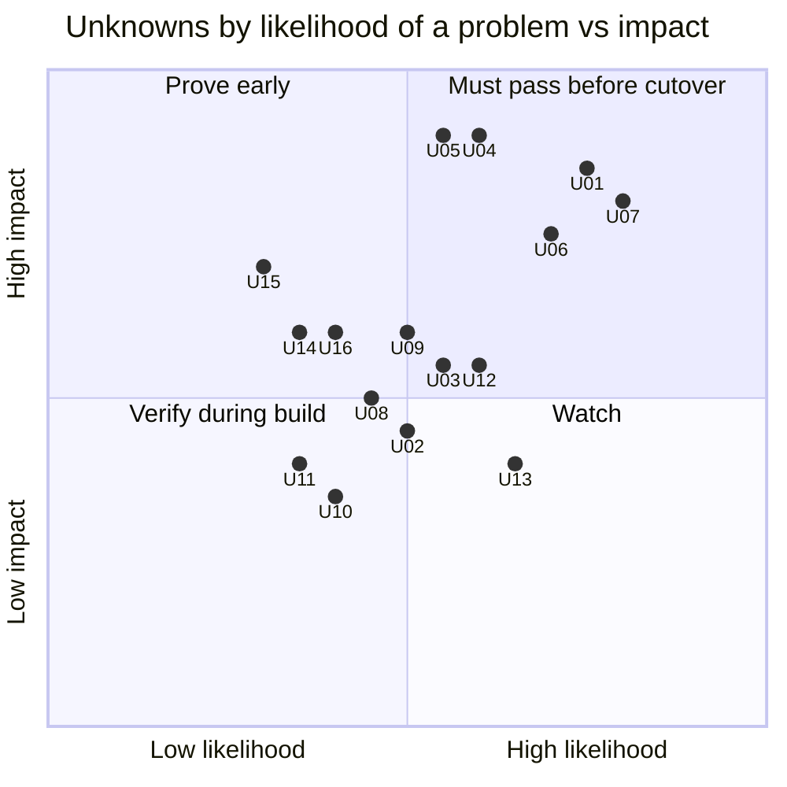

# 03 — Unknowns register (things that might not work)

> **Key takeaways**
> - 16 unknowns, U01–U16. Each lists what the docs **do** say (cited) and the exact gap a POC must close.
> - **High risk (must pass before any cutover):** U01 per-job resource isolation, U04 duplicates on retry, U05 state continuity, U06 dbt concurrency, U07 multi-source `SEMANTIC` gating.
> - **Medium:** U02, U03, U08, U09, U12, U13, U14, U15, U16. **Conditional:** U10 sensors, U11 partitions (only if Q8/Q9 say we use them).
> - Risk ratings are **judgement**, not doc facts.

## Risk map

## Register

| ID | Unknown (one question) | What docs say (cited) | Gap | Risk | POC | Q |
|---|---|---|---|---|---|---|
| **U01** | Can we keep per-job CPU/memory isolation without a per-run pod? | Dagster gives each run its own pod via `K8sRunLauncher` ([dagster-k8s](https://dagster.io/docs/integrations/libraries/k8s/dagster-k8s)). Temporal runs code only in our Workers ([Understanding Temporal](https://docs.temporal.io/evaluate/understanding-temporal)). Worker Controller scales per Worker Deployment Version, not per Workflow/Activity ([Worker Controller](https://docs.temporal.io/production-deployment/worker-deployments/kubernetes-controller)). Resource-based tuner hands out slots from CPU/memory use, but targets "can still be exceeded" ([Worker performance](https://docs.temporal.io/develop/worker-performance)) | No doc pattern for "one pod per Activity". Shared worker pods mean one OOM can kill all Activities in that pod (*inference*). Launching a K8s Job from an Activity is not documented by Temporal | High | POC-01 | Q7, Q17 |
| **U02** | Do worker pools scale up/down from backlog reliably on self-hosted? | KEDA Temporal scaler uses Task Queue backlog; "Maintainer: Community"; v2.17+; "Activation based on backlog may not be reliable when scaling to zero" ([KEDA Temporal scaler](https://keda.sh/docs/2.21/scalers/temporal/)). Worker Controller supports HPA or KEDA; HPA + Prometheus Adapter is "the recommended default" ([Worker Controller](https://docs.temporal.io/production-deployment/worker-deployments/kubernetes-controller)) | Scale-up latency and scale-down safety for long (hours) Activities on our cluster | Medium | POC-01 | Q17 |
| **U03** | Does cancel / timeout / worker crash cleanly stop the Meltano or dlt subprocess? | Cancel needs Heartbeat + Heartbeat Timeout ([Cancellation - Python SDK](https://docs.temporal.io/develop/python/workflows/cancellation)). Sync Activities need an `activity_executor`; blocking calls in async Activities can freeze the event loop ([Python sync vs async](https://docs.temporal.io/develop/python/best-practices/python-sdk-sync-vs-async)) | Killing the child process (and its Snowflake session) is our code; no doc covers it. Orphaned loads possible | Medium | POC-02 | Q11 |
| **U04** | Does an Activity retry after a partial load create duplicates in `RAW`? | Activities "may be executed multiple times"; make writes idempotent ([Activity Definition](https://docs.temporal.io/activity-definition)) | Depends on each tap/target or dlt write disposition (append vs merge) and on when state is committed. Not covered by Temporal docs | High | POC-02 | Q11, Q16 |
| **U05** | Can Temporal-run jobs continue from Dagster-era incremental state with no full re-sync? | dlt restores state from `_dlt_pipeline_state` when pipeline name, destination and dataset match ([dlt state](https://dlthub.com/docs/general-usage/state)). Meltano state backends: systemdb (default), local, S3, Azure, GCS, Snowflake; non-DB backends use a lock with default `lock_timeout_seconds` 10 and `lock_retry_seconds` 1 ([Meltano state backends](https://discovery.meltano.com/concepts/state_backends)) | Whether our Dagster wrappers set state IDs / pipeline names we can reproduce exactly. dlt docs do not cover concurrent runs of one pipeline | High | POC-03 | Q16 |
| **U06** | What happens when many sources finish together and each triggers dbt? | dbt "doesn't support safe parallel execution for multiple invocations in the same process"; concurrent `run`/`build` on the same models "could lead to unpredictable results" ([dbt programmatic invocations](https://docs.getdbt.com/reference/programmatic-invocations)) | Throughput and correctness of a single serialising coordinator vs parallel non-overlapping selections. Freshness impact with 50 sources | High | POC-04 | Q19, Q20, Q22 |
| **U07** | How do we decide when a `SEMANTIC` model that joins several sources should run? | Dagster offers upstream-aware conditions such as `eager` ([Declarative Automation](https://dagster.io/docs/guides/automate/declarative-automation)) and links dbt sources to upstream asset keys ([dbt integration](https://dagster.io/docs/integrations/libraries/dbt)). Temporal has no lineage or upstream-aware triggers (*inference*, [matrix](../comparison-matrix.md) D4/D5) | We must re-implement the rule. Exact Dagster behaviour today unknown (Q21) | High | POC-05 | Q6, Q20, Q21 |
| **U08** | Do dbt failures and retries behave the same when dbt runs in an Activity? | `dbt build` skips downstream on upstream test failure ([dbt build](https://docs.getdbt.com/reference/commands/build)). `dbt retry` "references run_results.json to determine where to start" ([dbt retry](https://docs.getdbt.com/reference/commands/retry)). Exit codes 0/1/2 map to success/handled error/unhandled error ([dbt programmatic invocations](https://docs.getdbt.com/reference/programmatic-invocations)) | `run_results.json` lives in the pod's target path; a retry on another pod will not see it unless persisted. Which exit codes should be retried vs fail fast | Medium | POC-04 | Q12, Q19 |
| **U09** | Can we cap concurrent loads (e.g. Snowflake, shared APIs) cluster-wide like Dagster pools? | Task Queue rate limit is per second and queue-wide; slots "are not throughput limits" ([Downstream Rate Limiting](https://docs.temporal.io/design-patterns/downstream-rate-limiting)). Fairness keys round-robin virtual queues; self-hosted needs `matching.enableFairness=true`; release status not stated on the page ([Priority and Fairness](https://docs.temporal.io/develop/task-queue-priority-fairness)) | No built-in global concurrency cap; worker slots × replicas changes with autoscaling (*inference*) | Medium | POC-06 | Q10, Q18 |
| **U10** | Can sensors be replaced without missed or double runs? *(only if Q8 says sensors are used)* | Dagster sensors dedupe with run keys ([Sensors](https://dagster.io/docs/guides/automate/sensors)). Temporal: Workflow ID Reuse Policy `Reject Duplicate` blocks a reused ID within retention ([Workflow Id and Run Id](https://docs.temporal.io/workflow-execution/workflowid-runid)) | Cursor storage and dedupe across retention window; polling cost | Low | POC-07 | Q8 |
| **U11** | Can partitioned backfills be run and tracked? *(only if Q9 says partitions are used)* | Schedule backfill with `BufferAll`/`AllowAll` ([CLI schedule](https://docs.temporal.io/cli/command-reference/schedule)); history limit 51,200 events ([Self-hosted defaults](https://docs.temporal.io/self-hosted-guide/defaults)) | Partition status tracking and large fan-out within history limits | Low | POC-07 | Q9 |
| **U12** | Can we alert on the same events as today (failure, stuck, missed schedule, stale data)? | Server and SDK expose Prometheus metrics; no recommended alerts; "configure Grafana Alerts" ([Monitor Temporal Platform metrics](https://docs.temporal.io/self-hosted-guide/monitoring)) | Which metrics/labels identify the failing source; how to detect a missed or stuck run | Medium | POC-08 | Q13, Q23 |
| **U13** | Can operators do daily tasks without the Dagster UI? | Temporal UI shows executions and Event History ([Temporal Web UI](https://docs.temporal.io/web-ui)). SQL visibility: 10 Keyword custom Search Attributes per Namespace ([Search Attributes](https://docs.temporal.io/search-attribute)). Reset terminates and re-creates from a Workflow Task event ([Events and Event History](https://docs.temporal.io/workflow-execution/event)); `temporal activity reset` re-runs an Activity with fresh attempts ([Reset an Activity](https://docs.temporal.io/activity-operations/reset)) | Equivalent of "re-execute from failure", "materialize this source now", "find last run per source" — speed and safety for on-call | Medium | POC-09 | Q14 |
| **U14** | Can we deploy new worker code while multi-hour loads are running? | Pinned Workflows "complete on a single Worker Deployment Version"; needs self-hosted ≥ v1.29.1 and Python SDK ≥ 1.11 ([Worker Versioning](https://docs.temporal.io/production-deployment/worker-deployments/worker-versioning)). Worker Controller is GA, self-hosted ≥ v1.29.1 ([Worker Controller](https://docs.temporal.io/production-deployment/worker-deployments/kubernetes-controller)) | GA announcement says "across all Temporal SDKs" but not whether self-hosted OSS is covered ([GA blog](https://temporal.io/blog/ga-worker-versioning-public-preview-upgrade-on-continue-as-new)); see [doc 13](../docs/13-unverified-and-open-questions.md) T25 | Medium | POC-10 | Q23 |
| **U15** | Can we run Temporal OSS reliably on our cluster (install, upgrade, failover, auth)? | Chart needs external DB; schema jobs run as Helm hooks; not stated as production-ready ([helm-charts](https://github.com/temporalio/helm-charts)). Shard count cannot change ([Temporal Server](https://docs.temporal.io/temporal-service/temporal-server)). Default authorizer "allows every API request"; UI supports OAuth SSO ([Security](https://docs.temporal.io/self-hosted-guide/security)) | Our DB, network, upgrade path and auth setup | Medium | POC-11 | Q2, Q24 |
| **U16** | Do shared worker pods weaken per-job secret isolation? | Dagster can set service accounts/secrets per run via `pod_spec_config` ([dagster-k8s](https://dagster.io/docs/integrations/libraries/k8s/dagster-k8s)). No Temporal doc on per-Activity secrets (*inference*) | A shared worker pod can read every source's secrets unless pools or per-run pods split them | Medium | POC-01 | Q7, Q15 |

## What is **not** unknown (no POC)

These are documented and are only *build* work. See [02](02-feature-mapping.md) rows 1–9.

- Cron schedules, overlap, pause, trigger, backfill ([Schedule](https://docs.temporal.io/schedule), [CLI schedule](https://docs.temporal.io/cli/command-reference/schedule)).
- One-run-per-source guarantee via Workflow ID ([Workflow Id and Run Id](https://docs.temporal.io/workflow-execution/workflowid-runid)).
- Retry and timeout configuration ([Retry Policies](https://docs.temporal.io/encyclopedia/retry-policies), [Detecting Activity failures](https://docs.temporal.io/encyclopedia/detecting-activity-failures.md)).
- Payload limits and "pass IDs, not data" ([Self-hosted defaults](https://docs.temporal.io/self-hosted-guide/defaults)).
- Testing tools ([Testing - Python SDK](https://docs.temporal.io/develop/python/testing-suite)).
- dbt in-process parallelism is unsupported → run dbt as a subprocess ([dbt programmatic invocations](https://docs.getdbt.com/reference/programmatic-invocations)).

## Sources

- [S125] [dagster-k8s](https://dagster.io/docs/integrations/libraries/k8s/dagster-k8s)
- [S1] [Understanding Temporal](https://docs.temporal.io/evaluate/understanding-temporal)
- [S118] [Temporal Worker Controller](https://docs.temporal.io/production-deployment/worker-deployments/kubernetes-controller)
- [S121] [Worker performance](https://docs.temporal.io/develop/worker-performance)
- [S119] [KEDA Temporal scaler](https://keda.sh/docs/2.21/scalers/temporal/) — *KEDA project docs; scaler is community-maintained*
- [S128] [Cancellation - Python SDK](https://docs.temporal.io/develop/python/workflows/cancellation)
- [S123] [Python SDK sync vs async Activities](https://docs.temporal.io/develop/python/best-practices/python-sdk-sync-vs-async)
- [S6] [Activity Definition](https://docs.temporal.io/activity-definition)
- [S127] [dlt state](https://dlthub.com/docs/general-usage/state)
- [S122] [Meltano state backends](https://discovery.meltano.com/concepts/state_backends)
- [S120] [dbt programmatic invocations](https://docs.getdbt.com/reference/programmatic-invocations)
- [S60] [Declarative Automation](https://dagster.io/docs/guides/automate/declarative-automation)
- [S77] [dbt integration](https://dagster.io/docs/integrations/libraries/dbt)
- [S137] [dbt build](https://docs.getdbt.com/reference/commands/build)
- [S133] [dbt retry](https://docs.getdbt.com/reference/commands/retry)
- [S24] [Downstream Rate Limiting](https://docs.temporal.io/design-patterns/downstream-rate-limiting)
- [S124] [Task Queue Priority and Fairness](https://docs.temporal.io/develop/task-queue-priority-fairness)
- [S61] [Sensors](https://dagster.io/docs/guides/automate/sensors)
- [S130] [Workflow Id and Run Id](https://docs.temporal.io/workflow-execution/workflowid-runid)
- [S131] [Temporal CLI schedule command reference](https://docs.temporal.io/cli/command-reference/schedule)
- [S11] [Self-hosted defaults](https://docs.temporal.io/self-hosted-guide/defaults)
- [S132] [Monitor Temporal Platform metrics](https://docs.temporal.io/self-hosted-guide/monitoring)
- [S31] [Temporal Web UI](https://docs.temporal.io/web-ui)
- [S38] [Search Attributes](https://docs.temporal.io/search-attribute)
- [S138] [Events and Event History](https://docs.temporal.io/workflow-execution/event)
- [S139] [Reset an Activity](https://docs.temporal.io/activity-operations/reset)
- [S135] [Worker Versioning](https://docs.temporal.io/production-deployment/worker-deployments/worker-versioning)
- [S136] [Announcing GA for Worker Versioning](https://temporal.io/blog/ga-worker-versioning-public-preview-upgrade-on-continue-as-new) — *vendor blog*
- [S126] [temporalio/helm-charts](https://github.com/temporalio/helm-charts)
- [S2] [Temporal Server](https://docs.temporal.io/temporal-service/temporal-server)
- [S45] [Temporal Platform security features](https://docs.temporal.io/self-hosted-guide/security)
- [S10] [Schedule](https://docs.temporal.io/schedule)
- [S7] [Retry Policies](https://docs.temporal.io/encyclopedia/retry-policies)
- [S8] [Detecting Activity failures](https://docs.temporal.io/encyclopedia/detecting-activity-failures.md)
- [S41] [Testing - Python SDK](https://docs.temporal.io/develop/python/testing-suite)
