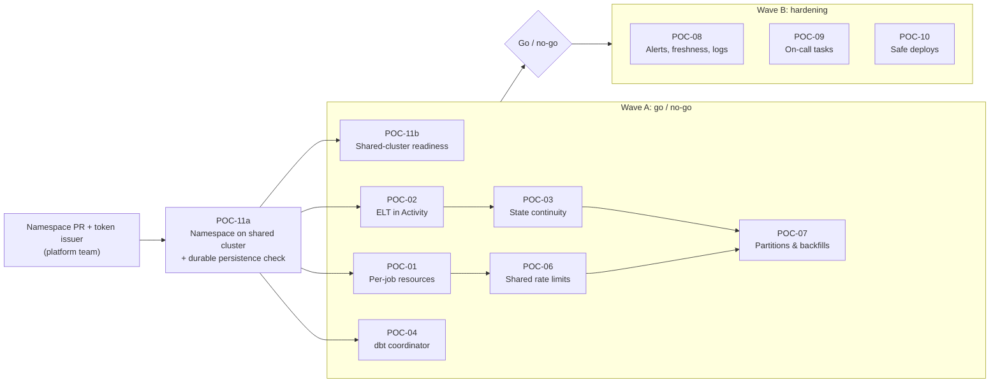

# 04 — POC plan

> **Key takeaways**
> - Re-scoped on 2026-11-12 with the team's answers and follow-ups F1–F8 ([01](01-current-state-and-questions.md) §5). 10 POCs. Each answers **one** question from the [unknowns register](03-unknowns-register.md) and nothing already documented.
> - **Step 0 (prerequisite):** POC-11a, our own Namespace on the shared cluster (platform PR) and a Worker reading its token from the provided path. Persistence is confirmed durable (F9).
> - **POC-07 (partitions) is the biggest risk:** 5-minute partitions and ~2-year backfills mean partitions must be **batched** per Workflow.
> - **Wave A (blocking, ~6 engineer-weeks):** POC-01 resources, POC-02 ELT in an Activity, POC-03 state continuity, POC-04 dbt coordinator, POC-06 shared rate limits, POC-07 partitions & backfills, POC-11b shared-cluster readiness. If any fails, revisit the decision to migrate.
> - **Wave B (hardening, ~1.5 engineer-weeks, can overlap):** POC-08 alerting + freshness + logs, POC-09 on-call tasks, POC-10 safe deploys.
> - **Dropped:** POC-05 (multi-source gating). The team has no wait-for-all rule (Q21), so each source simply builds `source:<x>+`; covered by POC-04.
> - Effort numbers are **estimates** for one engineer, not facts.

## 1. Order and dependencies

## 2. Shared POC setup

- **Temporal:** the **shared company cluster** (server 1.32.2, SQL visibility on MySQL 8), our own non-prod Namespace (POC-11a). We do not install our own server. If the Namespace is late, a temporary dev install (official Helm chart, same server version) unblocks Wave A **except** POC-11b, which must run on the shared cluster.
- **Search Attributes:** registered once per Namespace by a Namespace admin with `temporal operator search-attribute create` (not declarative, F2). Budget: 10 Keyword on SQL visibility ([Search Attributes](https://docs.temporal.io/search-attribute)). Proposed: `source`, `tool`, `resource_class`, `partition_key`, `backfill_id`, `status`.
- **Sources:** pick 4 real sources that cover the mix:
  - **S-big:** the largest/longest Meltano job.
  - **S-dlt:** a dlt job using `merge` or incremental loading.
  - **S-part-5m:** a 5-minute partitioned job; **S-part-multi:** a multi-dimensional or dynamic partitioned job (F3).
  - **S-ops:** one non-ELT ops job (F8).
  - **S-token-pair:** two sources that share one API token or rate limit (F6).
- **Snowflake:** a POC database cloned from `RAW`/`CLEAN`/`SEMANTIC` (zero-copy clone, if allowed) so tests never touch prod.
- **Evidence:** every POC stores logs, screenshots and a one-page result in `migration/poc-results/POC-xx.md` (to be created per POC).

## 3. POC cards

### POC-11 — Shared Temporal cluster readiness (U15)

| Item | Detail |
|---|---|
| Question | Can the company's shared Temporal cluster run our production loads safely, and what must the platform team add first? |
| Not tested | That Temporal needs a persistence DB and which versions are supported (documented, [Persistence](https://docs.temporal.io/temporal-service/persistence)) |
| 11a (prerequisite) | 1. PR to the platform values files that registers our non-prod Namespace and token issuer (F1). 2. Worker reads the token from the file path provided by the managing team (F10); check it keeps working after the token in the file changes. 3. Persistence: default store is managed durable MySQL (F9, confirmed). Check: start a Workflow, restart every server pod, the Workflow is still there |
| 11b steps | 1. Record shard count and Namespace retention. 2. Register our Search Attributes (admin CLI). 3. If POC-06 needs it: PR for `matching.enableFairness` scoped to our Namespace (dynamic config is cluster-wide by default, F2). 4. Kill each server service pod while 10 POC Workflows run; ask the platform team to fail over the DB. 5. Load test: 50 concurrent ingests + the POC-07 backfill burst; watch our latency while another tenant is busy (noisy neighbour), and theirs while ours runs. 6. Agree backup/restore, upgrade and paging with the platform team |
| Pass | No Workflow lost or stuck after each failure · Worker token refresh works for 24 h without restart · our Search Attributes are registered · Namespace rate limits do not throttle our peak load · our backfill burst does not slow other tenants · written ownership: who is paged when the cluster is down |
| Fail → | Config or limits missing: list them as platform asks with dates; Wave A continues on a dev install |
| Effort | 1 day (11a) + 3 days (11b) |
| Depends | Q2, F1, F2, F9, F10 |

### POC-01 — Per-job resource isolation (U01, U02, U16)

| Item | Detail |
|---|---|
| Question | Which pattern keeps today's per-job CPU/memory (and secret) isolation: **(a)** worker pools per resource class, or **(b)** an Activity that launches one K8s Job per run? |
| Not tested | Temporal scheduling and retries (documented) |
| Setup | (a) 3 Worker Deployments (`small`, `medium`, `large`), one Task Queue each, autoscaled on backlog (KEDA or HPA via Worker Controller). (b) One light Worker whose Activity creates a K8s Job with per-source requests/limits and service account, then polls and heartbeats until the Job ends |
| Steps | 1. Run S-big + 5 small jobs at once on each pattern. 2. Force an OOM in S-big. 3. Scale from 0 → N and back with a 2-hour Activity in flight. 4. From a `small` pod, try to read S-big's secret. 5. Ask the platform team whether KEDA / Worker Controller may be installed (U02) |
| Pass | OOM in one job does **not** fail any other job · peak memory of each job stays within its configured limit · no Activity is killed by scale-down · scale-up starts work within an agreed time · a job cannot read another job's secrets, or the exposure is no wider than today (one image, env vars) and accepted in writing |
| Fail → | If (a) fails isolation and (b) fails reliability (orphan Jobs, lost heartbeats), Temporal cannot match today's model; escalate |
| Effort | 4–5 days |
| Depends | Q7, Q15, F1 |

### POC-02 — ELT tool inside an Activity: cancel, crash, retry (U03, U04)

| Item | Detail |
|---|---|
| Question | When the Activity is cancelled, times out, or its worker dies mid-load, does the Meltano/dlt process stop, and does the retry leave `RAW` without duplicates or gaps? |
| Not tested | That Activities retry and need heartbeats to see cancel (documented) |
| Setup | Activity runs `meltano run …` or the dlt pipeline as a **subprocess**, heartbeats every N s, kills the process group on cancel. Sync Activity with a thread pool `activity_executor`, or async with non-blocking subprocess API |
| Steps | For S-big, S-dlt and S-ops: 1. Cancel mid-load. 2. Kill the worker pod mid-load. 3. Let Start-To-Close expire. 4. Inject a Snowflake error after 50 % of rows. After each, let the Retry Policy run to completion |
| Pass | No orphan process or open Snowflake query after cancel/kill · after retry, `RAW` matches a clean single run on row count, primary-key uniqueness (no duplicates), the set of primary keys, and row values (hash per row) · incremental bookmark advances exactly once · cancel is seen within 2× heartbeat interval |
| Fail → | Per-source write disposition must change (e.g. append → merge) before that source migrates; record per source |
| Effort | 3–4 days |
| Depends | Q11, Q16, F8 |

### POC-03 — Incremental state continuity from Dagster (U05)

| Item | Detail |
|---|---|
| Question | Can a Temporal-run job pick up exactly where the last Dagster run stopped, without a full re-sync, and is a run blocked if both orchestrators fire at once? |
| Not tested | That dlt restores state from the destination, and Meltano's backend list and lock defaults (documented) |
| Setup | **Isolated copy** of today's Meltano state backend, with the **same** state IDs (including per-partition IDs, if any, F4), used by both a POC Dagster and the POC Temporal (never the prod backend, so prod bookmarks cannot move). dlt: **same** pipeline name + dataset as today, against the cloned Snowflake DB (dlt state lives in the destination, so the clone isolates it) |
| Steps | 1. Run S-big, S-dlt and one partition of S-part-5m once in Dagster. 2. Run them once in Temporal. 3. Compare bookmarks and loaded row ranges. 4. Trigger Dagster and Temporal for the same source within seconds |
| Pass | Step 2 loads only rows newer than step 1 · no gap or overlap in loaded ranges · step 4 results in one load, or a clean lock error on the second, never two writers |
| Fail → | Cutover must include a one-time state copy or controlled re-sync for that source |
| Effort | 2 days |
| Depends | Q16, F4 |

### POC-04 — dbt coordinator: overlap, failure, retry (U06, U08; closes U07, U10)

| Item | Detail |
|---|---|
| Question | When many sources finish close together, does the dbt trigger keep runs correct and freshness at least as good as today? |
| Not tested | `source:<x>+` selection and dbt's skip-on-test-failure (documented, [node selection](https://docs.getdbt.com/reference/node-selection/methods), [dbt build](https://docs.getdbt.com/reference/commands/build)) |
| Setup | Each ingest Workflow, on success, starts dbt for `dbt build --select source:<x>+` as a subprocess Activity. Two options: **(a) parallel**, one dbt subprocess per finished source (today's behaviour, Q22); **(b) coordinator**, one `DbtCoordinatorWorkflow` via Signal-With-Start that runs non-overlapping selections in parallel and queues overlapping ones. Persist `target/` (at least `run_results.json`) to object storage after each run |
| Steps | 1. Send 50 "source loaded" events in 60 s (simulated). 2. Send duplicates. 3. Two sources sharing a downstream model finish within 1 s. 4. Fail one model, fix it, re-run with `dbt retry` on a different pod. 5. (b) only: force Continue-As-New mid-stream |
| Pass | No two dbt processes build the same model at the same time, or (a) shows no wrong results and the team accepts it in writing · each event builds its models exactly once · `dbt retry` on a new pod resumes from the failure · lag (load done → model built) ≤ today's Dagster lag for the same sources · (b) no events lost across Continue-As-New |
| Fail → | (a) fails: use (b). (b) too slow: per-model lock instead of per-selection; re-test |
| Effort | 4 days |
| Depends | Q19, Q20, Q22 |

### POC-06 — Shared API rate limits and run-queue caps (U09)

| Item | Detail |
|---|---|
| Question | Can we enforce today's tag concurrency limits (e.g. "max N jobs per API token") and the global run-queue limit across all workers, even while autoscaling? |
| Not tested | Task Queue rate limit is per second and queue-wide (documented) |
| Setup | Input: export of the real `tag_concurrency_limits` and run-queue limit from the Dagster instance config ("many", F6). Compare: (a) one Task Queue per shared token with fixed replicas × slots; (b) a semaphore Workflow per key (acquire/release via Update or Signal); (c) Fairness keys with `matching.enableFairness=true` (needs a platform PR, F2; test only if granted) |
| Steps | 1. Fire 30 jobs at once with cap N=5 on one token (S-token-pair + clones). 2. Scale workers 1 → 6 during the run. 3. Kill a worker holding a permit. 4. Start the same source from a Schedule and manually at the same time (source-wide lock, [02](02-feature-mapping.md) row 2). 5. Run a backfill of S-part-5m while its 5-minute schedule keeps firing; check the cap still holds and live runs are not starved |
| Pass | Concurrent count per key never exceeds N · global running count never exceeds the run-queue limit · never two runs of one source at once · a killed holder's permit is released within heartbeat timeout · no source starves for longer than the agreed time |
| Fail → | Choose the option that passes every criterion (lower throughput is acceptable only if the caps still hold). If no option passes, sources that share a token stay on Dagster |
| Effort | 3 days |
| Depends | Q10, Q18, F2, F6 (export) |

### POC-07 — Partitions and backfills (U11)

| Item | Detail |
|---|---|
| Question | Can we run partitioned loads and backfills (> 75 % of jobs, all partition types, down to 5-minute, ~2-year ranges) on Temporal, track per-partition status, and keep them consistent with incremental state? |
| Not tested | Schedule backfill of **schedule times** (documented, [CLI schedule](https://docs.temporal.io/cli/command-reference/schedule)); per-Workflow limits: 2,000 pending children (≤ 500 recommended), history error at 51,200 events or 50 MB (documented, [Self-hosted defaults](https://docs.temporal.io/self-hosted-guide/defaults)) |
| Scale | 2 years ≈ 730 daily, 17,520 hourly, **210,240 five-minute** partitions (arithmetic). One child per partition would need hundreds of Continue-As-New cycles and a status row per partition |
| Setup | **Partition library** in Python: one `PartitionDef` per type (time window with cron, static list, dynamic list stored in Snowflake, multi-dimensional = product of two). `BackfillWorkflow(source, range, batch_size)` splits the range into **batches** (e.g. 1 day of 5-minute partitions = 288 per batch), starts at most K child `IngestWorkflow`s at a time (K under POC-06 caps, ≤ 500), and Continues-As-New every N batches. Child Workflow ID `ingest-<source>-<batch_start>-<batch_end>`. Run config: Dagster Launchpad config + defaults become one typed input dataclass, defaults in code (F4). Status: one row per partition in a Snowflake status table; Search Attributes `partition_key`/`backfill_id` per batch |
| Steps | 1. Scheduled run of each type (S-part-5m, S-part-multi, a daily, a static, a dynamic) creates exactly today's partition key and run config. 2. Backfill the largest real range (2 years) for S-part-5m on the cloned DB, one range per child run as in Launchpad (F11). 3. Fail 5 batches on purpose; re-run only failed partitions. 4. Start the same batch twice. 5. Add a dynamic partition key and backfill it. 6. Check the incremental bookmark after a backfill of old partitions. 7. Compare total runtime and Snowflake cost with Dagster's range-per-run backfills (F11). 8. Run two backfills with overlapping ranges, and a backfill over partitions the live schedule also loads. 9. Make one 5-minute run last longer than 5 minutes so `Skip` drops the next action; run the gap check |
| Pass | Every partition key loads once with correct rows (POC-02 checks) · on-call lists failed/missing partitions of a source in one query · re-run of only failed partitions works · a duplicate start is rejected · no Workflow exceeds 10,240 events (warn level) · 2-year backfill finishes within an agreed time and does not starve live schedules · backfill does not move the live incremental bookmark backwards · overlapping ranges never load one partition concurrently; a re-load replaces rows (no duplicates) and the status table shows the latest run · the partition skipped by `Skip` is detected and loaded by the gap check once capacity is free |
| Fail → | Keep partitioned sources on Dagster until the partition library passes; this blocks most of the migration |
| Effort | 7 days |
| Depends | Q9, F3, F4, F5, F11 |

### POC-08 — Alerting, freshness and logs (U12, U17)

| Item | Detail |
|---|---|
| Question | Can we alert to Slack and PagerDuty on the same events as today, replace Dagster freshness checks, and emit logs Sumo Logic can use? |
| Setup | Server + SDK metrics to Prometheus; alert rules routed to Slack and PagerDuty; a final "on failure" Activity that posts source, run link and error; freshness for **almost all assets** (F7): port each Dagster freshness threshold to dbt source `freshness` config and run `dbt source freshness` on a Schedule (non-zero exit on stale, [dbt source command](https://docs.getdbt.com/reference/commands/source)), plus a `max(loaded_at)` check for any asset dbt does not cover; structured JSON logs with `source`, `workflow_id`, `run_id`, `partition` |
| Steps | Trigger: failed run, stuck run (no heartbeat), missed schedule (worker pool down), stale `RAW` table, failed dbt test. Replay one Workflow and check log lines |
| Pass | Each case alerts within agreed time with source name and run link · PagerDuty only for the cases that page today; freshness failures go to Slack · no alert storm on a 10-source outage · every Dagster freshness check has a Temporal/dbt equivalent with the same threshold · logs have the fields above and no duplicate lines on replay (or duplicates are marked) |
| Effort | 3 days |
| Depends | Q12, Q13, Q23, F7 |

### POC-09 — On-call tasks without the Dagster UI (U13)

| Item | Detail |
|---|---|
| Question | Can on-call do today's three tasks (Q14) as fast and safely as in Dagster? |
| Tasks to time | 1. Find which jobs failed in the last 24 h. 2. Re-run a failed job (whole run, or only the failed step). 3. Backfill partitions X–Y for source S (uses POC-07). 4. Start a run with edited config, like Dagster Launchpad (F4) |
| Tools | Temporal UI, `temporal` CLI (`workflow start --input`, `schedule trigger`, Workflow Reset, `activity reset`), Search Attributes, a small backfill/launch CLI that fills config defaults |
| Pass | Each task doable in ≤ 2 min by someone not on the POC team, using a 1-page runbook |
| Effort | 2 days |
| Depends | Q14, F4, POC-07 |

### POC-10 — Safe deploys during long loads (U14)

| Item | Detail |
|---|---|
| Question | On the shared cluster, does Worker Versioning (Pinned) + Worker Controller let us ship new code while a multi-hour load or backfill runs? |
| Steps | Start a 2-hour ingest and a backfill on v1; deploy v2 with a changed Workflow; start a new run |
| Pass | v1 runs finish on v1 pods with no non-determinism error · new run uses v2 · v1 pods are removed after drain · replay test of v1 histories runs in CI |
| Fail → | Use Workflow patching (`patched()`) and replay tests instead of Worker Versioning |
| Effort | 2–3 days |
| Depends | Server ≥ v1.29.1 (shared cluster is 1.32.2, F1), Python SDK ≥ 1.11; Worker Controller install approval (U02) |

## 4. Go / no-go after Wave A

| Result | Decision |
|---|---|
| All Wave A POCs pass | Proceed to Wave B and build ([05](05-migration-plan.md)) |
| POC-11b finds missing version/config/limits | Proceed only with dated platform commitments |
| POC-01 fails both patterns | Stop; per-job isolation is a hard requirement |
| POC-07 fails | Stop for partitioned jobs (> 75 %); migrating only the rest is not worth a second orchestrator |
| POC-06: no option passes every criterion | **Stop** for sources that share a token or need the run-queue limit; they stay on Dagster until a passing design exists |
| POC-02/03 fail for some sources only | Proceed; fix write disposition / state per source before it migrates |
| POC-04 fails both options | Proceed only with an agreed simpler dbt schedule and written freshness trade-off |

## 5. Effort summary (estimates)

| Wave | POCs | Engineer-days |
|---|---|---|
| Step 0 | 11a | 1 + Namespace PR lead time (platform team) |
| A | 11b, 01, 02, 03, 04, 06, 07 | 3 + 5 + 4 + 2 + 4 + 3 + 7 ≈ **28** |
| B | 08, 09, 10 | 3 + 2 + 3 ≈ **8** |

## Sources

Facts used in "Not tested" rows and setups are cited in [02](02-feature-mapping.md) and [03](03-unknowns-register.md). Key pages:

- [S3] [Persistence](https://docs.temporal.io/temporal-service/persistence)
- [S118] [Temporal Worker Controller](https://docs.temporal.io/production-deployment/worker-deployments/kubernetes-controller)
- [S119] [KEDA Temporal scaler](https://keda.sh/docs/2.21/scalers/temporal/) — *KEDA project docs*
- [S123] [Python SDK sync vs async Activities](https://docs.temporal.io/develop/python/best-practices/python-sdk-sync-vs-async)
- [S128] [Cancellation - Python SDK](https://docs.temporal.io/develop/python/workflows/cancellation)
- [S127] [dlt state](https://dlthub.com/docs/general-usage/state)
- [S122] [Meltano state backends](https://discovery.meltano.com/concepts/state_backends)
- [S141] [dbt source command](https://docs.getdbt.com/reference/commands/source)
- [S120] [dbt programmatic invocations](https://docs.getdbt.com/reference/programmatic-invocations)
- [S137] [dbt build](https://docs.getdbt.com/reference/commands/build)
- [S140] [dbt node selection methods](https://docs.getdbt.com/reference/node-selection/methods)
- [S133] [dbt retry](https://docs.getdbt.com/reference/commands/retry)
- [S129] [Signal with Start pattern](https://docs.temporal.io/design-patterns/signal-with-start)
- [S124] [Task Queue Priority and Fairness](https://docs.temporal.io/develop/task-queue-priority-fairness)
- [S130] [Workflow Id and Run Id](https://docs.temporal.io/workflow-execution/workflowid-runid)
- [S131] [Temporal CLI schedule command reference](https://docs.temporal.io/cli/command-reference/schedule)
- [S11] [Self-hosted defaults](https://docs.temporal.io/self-hosted-guide/defaults)
- [S38] [Search Attributes](https://docs.temporal.io/search-attribute)
- [S139] [Reset an Activity](https://docs.temporal.io/activity-operations/reset)
- [S135] [Worker Versioning](https://docs.temporal.io/production-deployment/worker-deployments/worker-versioning)
- [S126] [temporalio/helm-charts](https://github.com/temporalio/helm-charts)
- [S132] [Monitor Temporal Platform metrics](https://docs.temporal.io/self-hosted-guide/monitoring)
