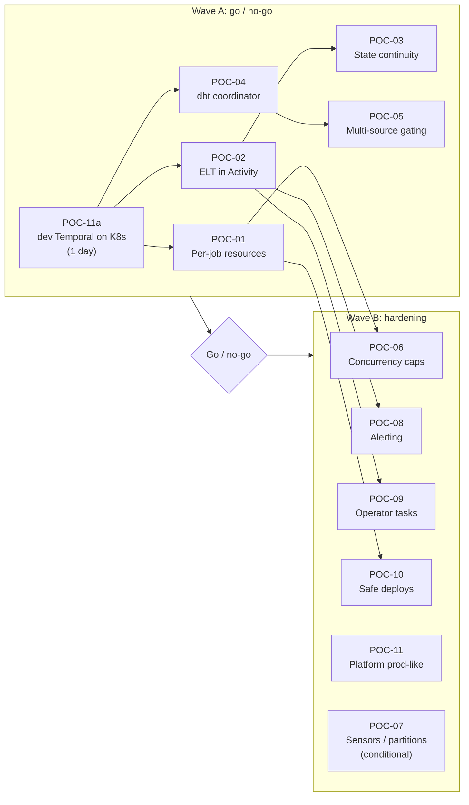

# 04 — POC plan

> **Key takeaways**
> - 11 POCs. Each answers **one** question from the [unknowns register](03-unknowns-register.md) and nothing already documented.
> - **Wave A (blocking, ~4 engineer-weeks):** POC-01 resources, POC-02 ELT in an Activity, POC-03 state continuity, POC-04 dbt coordinator, POC-05 multi-source gating. If any fails, revisit the decision to migrate.
> - **Wave B (hardening, ~3 engineer-weeks, can overlap):** POC-06 concurrency caps, POC-08 alerting, POC-09 operator tasks, POC-10 safe deploys, POC-11 platform. POC-07 runs only if we use sensors or partitions.
> - Effort numbers are **estimates** for one engineer, not facts.

## 1. Order and dependencies

## 2. Shared POC setup

- **Temporal:** self-hosted via the official Helm chart in a non-prod namespace, PostgreSQL persistence (A1). For Wave A, a single-replica install is enough (POC-11a).
- **Sources:** pick 3 real sources that cover the mix (assumption until Q16/Q17 answered):
  - **S-big:** the largest/longest Meltano job.
  - **S-dlt:** a dlt job using `merge` or incremental loading.
  - **S-join-pair:** two sources that feed the same `SEMANTIC` model.
- **Snowflake:** a POC database cloned from `RAW`/`CLEAN`/`SEMANTIC` (zero-copy clone, if allowed) so tests never touch prod.
- **Evidence:** every POC stores logs, screenshots and a one-page result in `migration/poc-results/POC-xx.md` (to be created per POC).

## 3. POC cards

### POC-01 — Per-job resource isolation (U01, U02, U16)

| Item | Detail |
|---|---|
| Question | Which pattern keeps today's per-job CPU/memory (and secret) isolation: **(a)** worker pools per resource class, or **(b)** an Activity that launches one K8s Job per run? |
| Not tested | Temporal scheduling and retries (documented) |
| Setup | (a) 3 Worker Deployments (`small`, `medium`, `large`), one Task Queue each, autoscaled on backlog (KEDA or HPA via Worker Controller). (b) One light Worker whose Activity creates a K8s Job with per-source requests/limits and service account, then polls and heartbeats until the Job ends |
| Steps | 1. Run S-big + 5 small jobs at once on each pattern. 2. Force an OOM in S-big. 3. Scale from 0 → N and back with a 2-hour Activity in flight. 4. From a `small` pod, try to read S-big's secret |
| Pass | OOM in one job does **not** fail any other job · peak memory of each job stays within its configured limit · no Activity is killed by scale-down · scale-up starts work within an agreed time (Q5) · a job cannot read another job's secrets (or the risk is accepted in writing) |
| Fail → | If (a) fails isolation and (b) fails reliability (orphan Jobs, lost heartbeats), Temporal cannot match today's model; escalate |
| Effort | 4–5 days |
| Depends | Q7, Q15, Q17 |

### POC-02 — ELT tool inside an Activity: cancel, crash, retry (U03, U04)

| Item | Detail |
|---|---|
| Question | When the Activity is cancelled, times out, or its worker dies mid-load, does the Meltano/dlt process stop, and does the retry leave `RAW` without duplicates or gaps? |
| Not tested | That Activities retry and need heartbeats to see cancel (documented) |
| Setup | Activity runs `meltano run …` or the dlt pipeline as a **subprocess**, heartbeats every N s, kills the process group on cancel. Sync Activity with a thread pool `activity_executor`, or async with non-blocking subprocess API |
| Steps | For S-big and S-dlt: 1. Cancel mid-load. 2. Kill the worker pod mid-load. 3. Let Start-To-Close expire. 4. Inject a Snowflake error after 50 % of rows. After each, let the Retry Policy run to completion |
| Pass | No orphan process or open Snowflake query after cancel/kill · after retry, row count and primary-key uniqueness in `RAW` match a clean single run · incremental bookmark advances exactly once · cancel is seen within 2× heartbeat interval |
| Fail → | Per-source write disposition must change (e.g. append → merge) before that source migrates; record per source |
| Effort | 3–4 days |
| Depends | Q11, Q16 |

### POC-03 — Incremental state continuity from Dagster (U05)

| Item | Detail |
|---|---|
| Question | Can a Temporal-run job pick up exactly where the last Dagster run stopped, without a full re-sync, and is a run blocked if both orchestrators fire at once? |
| Not tested | That dlt restores state from the destination, and Meltano's backend list and lock defaults (documented) |
| Setup | Use the **same** Meltano state backend/state ID and the **same** dlt pipeline name + dataset + destination as Dagster uses today |
| Steps | 1. Run S-big and S-dlt once in Dagster. 2. Run them once in Temporal. 3. Compare bookmarks and loaded row ranges. 4. Trigger Dagster and Temporal for the same source within seconds |
| Pass | Step 2 loads only rows newer than step 1 · no gap or overlap in loaded ranges · step 4 results in one load, or a clean lock error on the second, never two writers |
| Fail → | Cutover must include a one-time state copy or controlled re-sync for that source |
| Effort | 2 days |
| Depends | Q16 |

### POC-04 — dbt coordinator: concurrency, failure, retry (U06, U08)

| Item | Detail |
|---|---|
| Question | With 50 sources finishing at random times, does one coordinator Workflow keep dbt runs correct and freshness acceptable? |
| Not tested | dbt's own skip-on-test-failure behaviour (documented) |
| Setup | `DbtCoordinatorWorkflow` started via Signal-With-Start; each ingest sends `source_loaded`. Coordinator batches pending sources and runs `dbt build --select source:<a>+ source:<b>+ …` as a subprocess Activity. Persist `target/` (at least `run_results.json`) to object storage after each run |
| Steps | 1. Send 50 `source_loaded` Signals in 60 s (simulated). 2. Send duplicate Signals. 3. Fail one model, fix it, re-run with `dbt retry` on a different pod. 4. Force Continue-As-New mid-stream. 5. Compare to running dbt in parallel per source (control) |
| Pass | No two dbt invocations touch the same model at once · each Signal processed exactly once · `dbt retry` on a new pod resumes from the failure · end-to-end lag (load done → model built) within target (Q5) · no Signals lost across Continue-As-New |
| Fail → | Use parallel workers with non-overlapping selections, or a per-model lock; re-test |
| Effort | 4 days |
| Depends | Q19, Q20, Q22 |

### POC-05 — Gating for `SEMANTIC` models that join several sources (U07)

| Item | Detail |
|---|---|
| Question | Can the coordinator reproduce today's rule for "when to build a model with several upstream sources", using only dbt's `manifest.json`? |
| Not tested | Building the source → model map from the manifest (standard dbt artifact) |
| Setup | Rule options (pick after Q21): **R1** build when *any* upstream source loads (eager); **R2** build when *all* upstream sources loaded since the model's last build; **R3** R2 plus max-wait timeout |
| Steps | 1. Record 1 week of Dagster run times for S-join-pair and their `SEMANTIC` model. 2. Replay the same load times into the coordinator. 3. Compare which builds happen and when |
| Pass | Same set of builds (± agreed tolerance) as Dagster for the replayed week · no build runs on partly-loaded inputs under R2/R3 · rule config lives in one file, not in Workflow code |
| Fail → | Keep a simpler rule (e.g. scheduled `SEMANTIC` build) and accept freshness change in writing |
| Effort | 3 days |
| Depends | Q6, Q20, Q21 |

### POC-06 — Cluster-wide concurrency caps (U09)

| Item | Detail |
|---|---|
| Question | Can we cap "max N concurrent loads to Snowflake / shared API X" across all workers, even while autoscaling? |
| Not tested | Rate limit per second (documented) |
| Setup | Compare: (a) dedicated Task Queue with fixed replicas × slots; (b) semaphore Workflow (acquire/release via Update or Signal); (c) Fairness keys with `matching.enableFairness=true` for fair sharing |
| Steps | Fire 30 jobs at once with cap N=5; scale workers 1 → 6 during the run; kill a worker holding a permit |
| Pass | Concurrent count never exceeds N · a killed holder's permit is released within heartbeat timeout · no source starves for longer than the agreed time |
| Effort | 2–3 days |
| Depends | Q10, Q18 |

### POC-07 — Sensors and partitions *(run only if Q8/Q9 say we use them)* (U10, U11)

| Item | Detail |
|---|---|
| Question | Can each sensor be replaced by a scheduled poller without missed or double runs; can partition backfills be run and tracked? |
| Steps | Sensor: poller on a Schedule stores cursor, starts ingest with Workflow ID = event key and Reuse Policy `Reject Duplicate`; replay the same events twice. Partitions: backfill 365 daily partitions with concurrency cap, track status per partition |
| Pass | Zero missed and zero duplicate runs · backfill stays under history limits (child Workflows / Continue-As-New) · operator can list failed partitions in one query |
| Effort | 2–3 days |
| Depends | Q8, Q9 |

### POC-08 — Alerting parity (U12)

| Item | Detail |
|---|---|
| Question | Can we alert, per source, on the same events as today? |
| Setup | Server + SDK metrics to Prometheus; Grafana alerts; plus a final "on failure" Activity that posts to the alert channel |
| Steps | Trigger: failed run, stuck run (no heartbeat), missed schedule (worker pool down), stale `RAW` table, failed dbt model |
| Pass | Each case alerts within agreed time with source name and a link to the run · no alert storm on a 10-source outage (grouping works) |
| Effort | 2 days |
| Depends | Q13, Q23 |

### POC-09 — Operator tasks without the Dagster UI (U13)

| Item | Detail |
|---|---|
| Question | Can on-call do daily tasks as fast and safely as today? |
| Tasks to time | Run source X now · re-run only the failed step · re-run dbt only · pause/resume a source · find the last 10 runs of source X and their row counts · see what is running now |
| Tools | Temporal UI, `temporal` CLI (`schedule trigger/toggle`, Workflow Reset, `activity reset`), Search Attributes (`source`, `tool`, `resource_class`; ≤ 10 Keyword on SQL visibility) |
| Pass | Each task doable in ≤ 2 min by someone not on the POC team, using a 1-page runbook · team signs off on loss of asset catalog/lineage (or picks dbt docs as replacement) |
| Effort | 2 days |
| Depends | Q14 |

### POC-10 — Safe deploys during long loads (U14)

| Item | Detail |
|---|---|
| Question | On our self-hosted server, does Worker Versioning (Pinned) + Worker Controller let us ship new code while a multi-hour load runs? |
| Steps | Start a 2-hour ingest on v1; deploy v2 with a changed Workflow; start a new run |
| Pass | v1 run finishes on v1 pods with no non-determinism error · new run uses v2 · v1 pods are removed after drain · replay test of v1 histories runs in CI |
| Effort | 2–3 days |
| Depends | Q23; server ≥ v1.29.1, Python SDK ≥ 1.11 |

### POC-11 — Platform, prod-like (U15)

| Item | Detail |
|---|---|
| Question | Can we run Temporal OSS on our cluster with the reliability and access control we need? |
| Steps | (11a, Wave A) minimal install for other POCs. (11b) Choose History shard count (cannot change later); HA replicas; upgrade one minor version with Helm schema jobs; kill each service pod; fail over PostgreSQL; back up and restore; enable UI SSO and a JWT Authorizer/ClaimMapper |
| Pass | No Workflow lost or stuck after each failure · upgrade completes with running Workflows · unauthenticated API call is denied · UI login via our IdP |
| Effort | 1 day (11a) + 4 days (11b) |
| Depends | Q2, Q24 |

## 4. Go / no-go after Wave A

| Result | Decision |
|---|---|
| POC-01 to POC-05 pass | Proceed to Wave B and build ([05](05-migration-plan.md)) |
| POC-01 fails both patterns | Stop; per-job isolation is a hard requirement (A5) |
| POC-02/03 fail for some sources only | Proceed; fix write disposition / state per source before it migrates |
| POC-04/05 fail | Proceed only with an agreed simpler dbt schedule and written freshness trade-off |

## Sources

Facts used in "Not tested" rows and setups are cited in [02](02-feature-mapping.md) and [03](03-unknowns-register.md). Key pages:

- [S118] [Temporal Worker Controller](https://docs.temporal.io/production-deployment/worker-deployments/kubernetes-controller)
- [S119] [KEDA Temporal scaler](https://keda.sh/docs/2.21/scalers/temporal/) — *KEDA project docs*
- [S123] [Python SDK sync vs async Activities](https://docs.temporal.io/develop/python/best-practices/python-sdk-sync-vs-async)
- [S128] [Cancellation - Python SDK](https://docs.temporal.io/develop/python/workflows/cancellation)
- [S127] [dlt state](https://dlthub.com/docs/general-usage/state)
- [S122] [Meltano state backends](https://discovery.meltano.com/concepts/state_backends)
- [S120] [dbt programmatic invocations](https://docs.getdbt.com/reference/programmatic-invocations)
- [S133] [dbt retry](https://docs.getdbt.com/reference/commands/retry)
- [S129] [Signal with Start pattern](https://docs.temporal.io/design-patterns/signal-with-start)
- [S124] [Task Queue Priority and Fairness](https://docs.temporal.io/develop/task-queue-priority-fairness)
- [S130] [Workflow Id and Run Id](https://docs.temporal.io/workflow-execution/workflowid-runid)
- [S38] [Search Attributes](https://docs.temporal.io/search-attribute)
- [S139] [Reset an Activity](https://docs.temporal.io/activity-operations/reset)
- [S135] [Worker Versioning](https://docs.temporal.io/production-deployment/worker-deployments/worker-versioning)
- [S126] [temporalio/helm-charts](https://github.com/temporalio/helm-charts)
- [S45] [Temporal Platform security features](https://docs.temporal.io/self-hosted-guide/security)
- [S132] [Monitor Temporal Platform metrics](https://docs.temporal.io/self-hosted-guide/monitoring)
