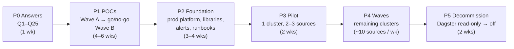
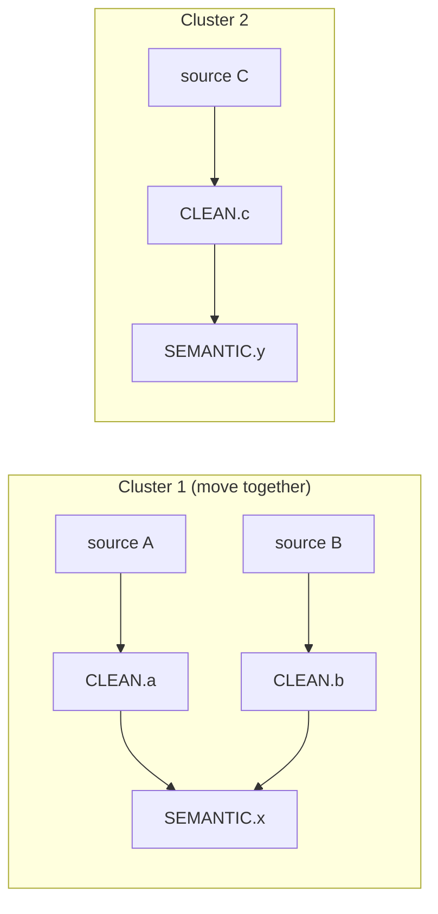
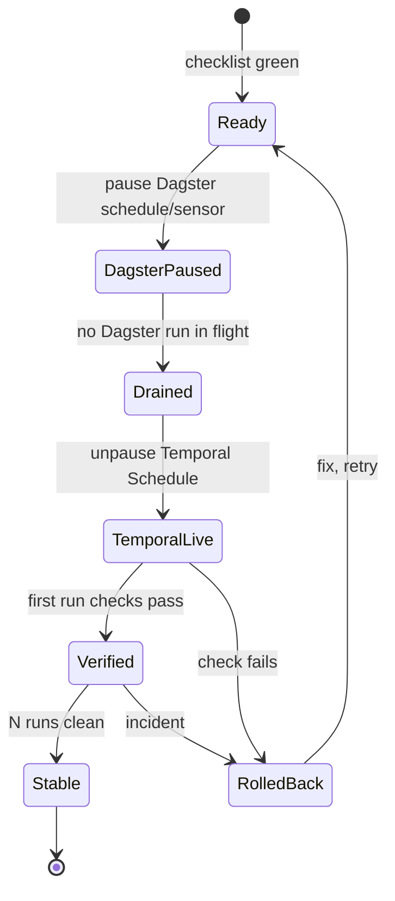

# 05 — Migration plan

> **Key takeaways**
> - Six phases: answers → POCs → foundation → pilot → waves → decommission. No source moves before Wave A POCs pass.
> - Move sources in **dependency clusters**: all sources that feed the same `SEMANTIC` model move together, so one orchestrator owns each model's dbt trigger.
> - Each source cutover is reversible: pause the Temporal Schedule, re-enable the Dagster schedule. Incremental state stays in the same backend, so no reload is needed (if POC-03 passes).
> - Timeline numbers are **estimates** pending Q4.

## 1. Phases

| Phase | Output | Exit criteria |
|---|---|---|
| P0 Answers | Q1–Q25 answered; assumptions A1–A12 confirmed or replaced | POC scope frozen; POC-07 in or out |
| P1 POCs | `migration/poc-results/POC-xx.md` per POC | Wave A all pass (see go/no-go in [04](04-poc-plan.md)); Wave B pass or risk accepted in writing |
| P2 Foundation | Prod Temporal (POC-11b design); worker images; shared library: `IngestWorkflow`, `run_elt` Activity, `DbtCoordinatorWorkflow`; Search Attributes; dashboards + alerts; replay tests in CI; runbook | Platform failure drills pass; runbook reviewed by on-call |
| P3 Pilot | 1 dependency cluster on Temporal | 2 weeks with no duplicates, no missed runs, freshness ≤ today |
| P4 Waves | All clusters moved | Per-source checklist (§3) done for every source |
| P5 Decommission | Dagster schedules removed; DB kept read-only for audit (A12) | 30 days with no rollback; then shut down |

## 2. Cutover unit: dependency cluster

Why: if source A (Dagster) and source B (Temporal) both feed `SEMANTIC.model_x`, neither orchestrator sees both loads, so the gating rule from POC-05 breaks (*inference*).

How to build clusters:
1. Parse dbt `manifest.json`: for each `SEMANTIC` model, list upstream sources.
2. Union-find: sources that share any `SEMANTIC` model go in one cluster.
3. Order clusters: smallest and least critical first; the cluster with S-big after the pilot proves POC-01 in prod.
4. If one cluster is too big (e.g. a "core" model joins 30 sources), split by moving that model's dbt trigger to a schedule during the transition, and say so in the wave plan.

## 3. Per-source cutover runbook

**Before (checklist):**
- Write disposition reviewed for retry safety (POC-02 result for this tool/pattern).
- State backend / pipeline name identical to Dagster's (POC-03).
- Resource class or K8s Job spec matches today's per-job requests/limits (POC-01).
- Secrets mounted only where needed (U16).
- Alerts and dashboards show this source (POC-08).
- Schedule created **paused**, same cron and time zone as Dagster.

**Cutover (whole cluster at once, see §2):**
1. Pause the Dagster schedules/sensors for **every** source in the cluster, and the Dagster dbt trigger for the cluster's models.
2. Wait until no Dagster run is in flight for any of them.
3. Record each source's last completed schedule time.
4. Hand the cluster's dbt trigger to the Temporal coordinator, then unpause the cluster's Temporal Schedules.
5. Reconcile missed work: for each source, every schedule time after its recorded last completed time (step 3) up to the Temporal unpause (step 4), including times skipped while Dagster was paused and draining, is run with `temporal schedule backfill` (or `trigger` if only one). Backfill runs actions that "would have run during a specified time interval" ([CLI schedule](https://docs.temporal.io/cli/command-reference/schedule)).
6. Verify each source (per-source checks below) before marking the cluster done.

**Per-source checks:** row counts vs last Dagster run, primary-key uniqueness in `RAW`, bookmark advanced, no missed schedule times, dbt models built.

**Rollback (any time):**
1. Pause the Temporal Schedule; cancel any running Workflow for the source.
2. Wait until that Workflow is closed (cancelled, failed or terminated) and its ELT subprocess or K8s Job and Snowflake queries have stopped. Cancellation is only a request the Workflow and Activity must handle ([Cancellation - Python SDK](https://docs.temporal.io/develop/python/workflows/cancellation)); if it does not close in time, terminate it and confirm the process is gone.
3. Re-enable the Dagster schedule (for a cluster: all of its sources and its dbt trigger). State is in the same backend, so the next run continues from the last good bookmark (if POC-03 passed).

## 4. Parallel-run guardrails

- Never let both orchestrators schedule the same source at the same time. Owner of each source is tracked in one table (source → `dagster` / `temporal`).
- dbt for a cluster is triggered only by the orchestrator that owns the cluster.
- Optional shadow run (if Q5 needs proof before cutover): Temporal loads the pilot sources into a separate `RAW_SHADOW` database for one week; compare row counts and checksums with `RAW`. Shadow runs must use a **separate** Meltano state backend (or separate state IDs) and a separate dlt dataset, so they never move production bookmarks. *(Cost: double source API load; check Q18 first.)*

## 5. Main risks and mitigations

| Risk | Mitigation | Linked |
|---|---|---|
| Lost per-job isolation causes noisy-neighbour failures | Pattern chosen in POC-01; resource class per source in config | U01 |
| Duplicates after retries | Merge/upsert write dispositions; uniqueness checks after each load | U04 |
| dbt freshness worse than today | Coordinator batching tuned in POC-04; target lag in alerts | U06, U07 |
| On-call slower without Dagster UI | Runbook + Search Attributes; dbt docs for lineage | U13 |
| Platform outage stops all ingestion | HA install, failure drills, backups (POC-11b) | U15 |

## Sources

This plan uses facts already cited in [02](02-feature-mapping.md), [03](03-unknowns-register.md) and [04](04-poc-plan.md). Additional page used:

- [S131] [Temporal CLI schedule command reference](https://docs.temporal.io/cli/command-reference/schedule) — `toggle` pauses/unpauses, `trigger` runs immediately
- [S128] [Cancellation - Python SDK](https://docs.temporal.io/develop/python/workflows/cancellation)
