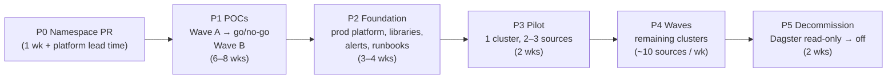
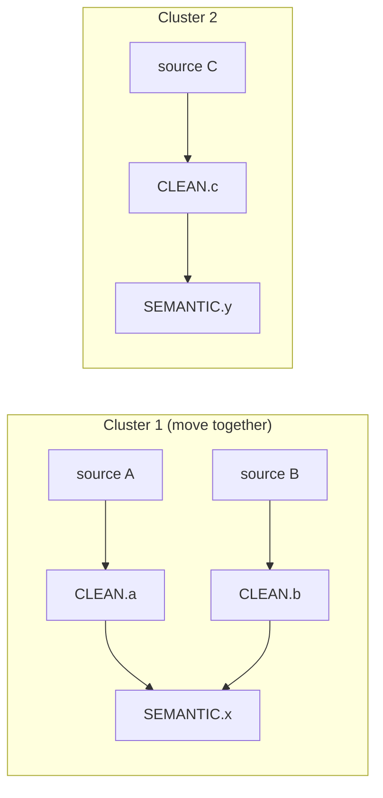
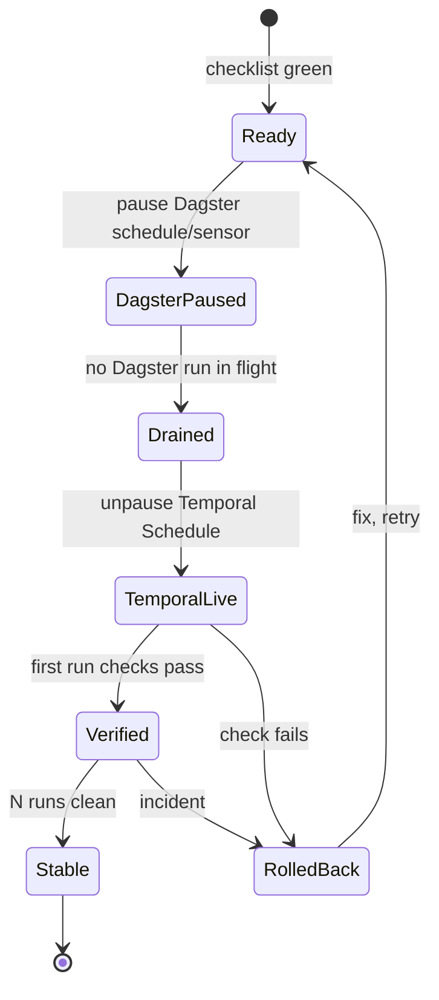

# 05 — Migration plan

> **Key takeaways**
> - Six phases: answers → POCs → foundation → pilot → waves → decommission. No source moves before Wave A POCs pass.
> - **Critical path starts outside our team:** our Namespace and Worker token on the shared cluster come by platform PR. Durable persistence is confirmed (F9). Start both in P0.
> - Move sources in **dependency clusters**: all sources that feed the same dbt model move together, so only one orchestrator ever runs dbt on a given model.
> - Each source cutover is reversible: pause the Temporal Schedule, re-enable the Dagster schedule. Incremental state stays in the same backend, so no reload is needed (if POC-03 passes).
> - Timeline numbers are **estimates**, not facts.

## 1. Phases

| Phase | Output | Exit criteria |
|---|---|---|
| P0 Answers | Q1–Q25 and F1–F8 answered (done 2026-11-12); F1–F11 answered; Namespace PR merged; export of Dagster tag concurrency limits, freshness checks, partition definitions and Launchpad defaults; list of non-ELT ops jobs | POC scope frozen; POC-11a Namespace available |
| P1 POCs | `migration/poc-results/POC-xx.md` per POC | Wave A all pass (see go/no-go in [04](04-poc-plan.md)); Wave B pass or risk accepted in writing |
| P2 Foundation | Prod Namespace on the shared cluster (POC-11b agreements); worker images; shared library: `IngestWorkflow`, `BackfillWorkflow`, `run_elt` Activity, dbt trigger (POC-04 option); concurrency control (POC-06); Search Attributes; Slack/PagerDuty alerts and freshness checks; replay tests in CI; runbook | Failure drills pass; runbook reviewed by on-call |
| P3 Pilot | 1 dependency cluster on Temporal | 2 weeks with no duplicates, no missed runs, freshness ≤ today |
| P4 Waves | All clusters moved | Per-source checklist (§3) done for every source |
| P5 Decommission | Dagster schedules removed; optional export of the Dagster run table to Snowflake (Q25: clean start is fine); Dagster DB kept read-only until retention passes | 30 days with no rollback; then shut down |

## 2. Cutover unit: dependency cluster

Why: each finished source builds all its downstream models (Q20, Q21). If source A (Dagster) and source B (Temporal) both feed `SEMANTIC.model_x`, both orchestrators would run dbt on `model_x`, and neither can stop them overlapping. Overlapping dbt runs on the same models "could lead to unpredictable results" ([dbt programmatic invocations](https://docs.getdbt.com/reference/programmatic-invocations)). Moving the whole cluster keeps one owner per model.

Shared API tokens (Q18) add a second rule: sources that share a token should move together too, or the token's concurrency cap must be split between Dagster and Temporal during the transition (*inference*).

How to build clusters:
1. Parse dbt `manifest.json`: for each model, list upstream sources.
2. Union-find: sources that share any downstream model, or share an API token (F6), go in one cluster.
3. Order clusters: smallest and least critical first; the cluster with S-big after the pilot proves POC-01 in prod.
4. If one cluster is too big (e.g. a "core" model joins 30 sources), split it: during the transition the shared model and its descendants are built **only** by one scheduled dbt job, and both orchestrators' per-source builds exclude them (`dbt build --select source:<x>+ --exclude <shared_model>+`). Say so in the wave plan; remove the exclusion when the last source of the split moves.

## 3. Per-source cutover runbook

**Before (checklist):**
- Write disposition reviewed for retry safety (POC-02 result for this tool/pattern).
- State backend / pipeline name identical to Dagster's (POC-03).
- Resource class or K8s Job spec matches today's per-job requests/limits (POC-01).
- Partition definition and partition → Meltano/dlt mapping identical to Dagster's (POC-07).
- Concurrency key (API token, run-queue) assigned (POC-06).
- No Dagster backfill in progress for the cluster's sources: finish it in Dagster first, or cancel it and re-run it later with `BackfillWorkflow`.
- Secrets mounted only where needed (U16).
- Slack/PagerDuty alerts, freshness check and log fields cover this source (POC-08).
- Schedule created **paused**, same cron and time zone as Dagster.

**Cutover (whole cluster at once, see §2):**
1. Pause the Dagster schedules/sensors for **every** source in the cluster, and the Dagster dbt trigger for the cluster's models.
2. Wait until no Dagster run is in flight for any of them.
3. Record each source's last completed schedule time, and list ingests that finished after the Dagster dbt trigger was paused (their dbt work is still pending).
4. Hand the cluster's dbt trigger to Temporal, then unpause the cluster's Temporal Schedules.
5. Reconcile missed work: for each source, every schedule time after its recorded last completed time (step 3) up to the Temporal unpause (step 4), including times skipped while Dagster was paused and draining, is run with `temporal schedule backfill` (or `trigger` if only one). Backfill runs actions that "would have run during a specified time interval" ([CLI schedule](https://docs.temporal.io/cli/command-reference/schedule)). For partitioned sources, also check that every partition Dagster marked missing or failed is either backfilled or listed for the owner.
6. Run the pending dbt work from step 3 once in Temporal (`dbt build --select source:<x>+` per listed source, plus `--exclude <shared_model>+` while a split from §2 step 4 is active).
7. Verify each source (per-source checks below) before marking the cluster done.

**Per-source checks:** row counts vs last Dagster run, primary-key uniqueness in `RAW`, bookmark advanced, no missed schedule times, dbt models built.

**Rollback (any time, whole cluster):**
1. Pause the Temporal Schedules for **every** source in the cluster; record the schedule time and partitions of every running ingest or backfill Workflow, then cancel them.
2. Wait until all of those Workflows are closed (cancelled, failed or terminated) and their ELT subprocesses or K8s Jobs and Snowflake queries have stopped. Cancellation is only a request the Workflow and Activity must handle ([Cancellation - Python SDK](https://docs.temporal.io/develop/python/workflows/cancellation)); if one does not close in time, terminate it and confirm the process is gone.
3. Turn off the Temporal dbt trigger for the cluster's models and wait for any running dbt build to finish.
4. Re-enable the Dagster schedules/sensors for all of the cluster's sources and its Dagster dbt trigger. State is in the same backend, so the next runs continue from the last good bookmark (if POC-03 passed).
5. Reconcile, in Dagster: the schedule times and partitions recorded in step 1 (cancelled work), plus schedule times missed during the rollback, as in cutover step 5. Also run dbt for any source whose load completed in Temporal but whose dbt build did not.

## 4. Parallel-run guardrails

- Never let both orchestrators schedule the same source at the same time. Owner of each source is tracked in one table (source → `dagster` / `temporal`).
- dbt for a cluster is triggered only by the orchestrator that owns the cluster.
- Optional shadow run (if Q5 needs proof before cutover): Temporal loads the pilot sources into a separate `RAW_SHADOW` database for one week; compare row counts and checksums with `RAW`. Shadow runs must use a **separate** Meltano state backend (or separate state IDs) and a separate dlt dataset, so they never move production bookmarks. *(Cost: double source API load; check Q18 first.)*

## 5. Main risks and mitigations

| Risk | Mitigation | Linked |
|---|---|---|
| Lost per-job isolation causes noisy-neighbour failures | Pattern chosen in POC-01; resource class per source in config | U01 |
| Duplicates after retries | Merge/upsert write dispositions; uniqueness checks after each load | U04 |
| dbt freshness worse than today | Coordinator batching tuned in POC-04; target lag in alerts | U06, U07 |
| On-call slower without Dagster UI | Runbook + Search Attributes; dbt docs for lineage | U13 |
| Shared cluster down or degraded | Persistence confirmed durable (F9); failure drills, backups and on-call ownership agreed with the platform team (POC-11) | U15 |
| Our 2-year backfills slow other tenants on the shared cluster | Batched backfills with caps; load test with the platform team (POC-07, POC-11b) | U11, U15 |
| Partitioned jobs (> 75 %) cannot be tracked or backfilled | `BackfillWorkflow` + status table proven in POC-07 before any partitioned source moves | U11 |
| Shared API token over-used during transition | Move token-sharing sources together; split caps if not possible (POC-06) | U09 |

## Sources

This plan uses facts already cited in [02](02-feature-mapping.md), [03](03-unknowns-register.md) and [04](04-poc-plan.md). Additional page used:

- [S131] [Temporal CLI schedule command reference](https://docs.temporal.io/cli/command-reference/schedule) — `toggle` pauses/unpauses, `trigger` runs immediately
- [S128] [Cancellation - Python SDK](https://docs.temporal.io/develop/python/workflows/cancellation)
- [S120] [dbt programmatic invocations](https://docs.getdbt.com/reference/programmatic-invocations)
