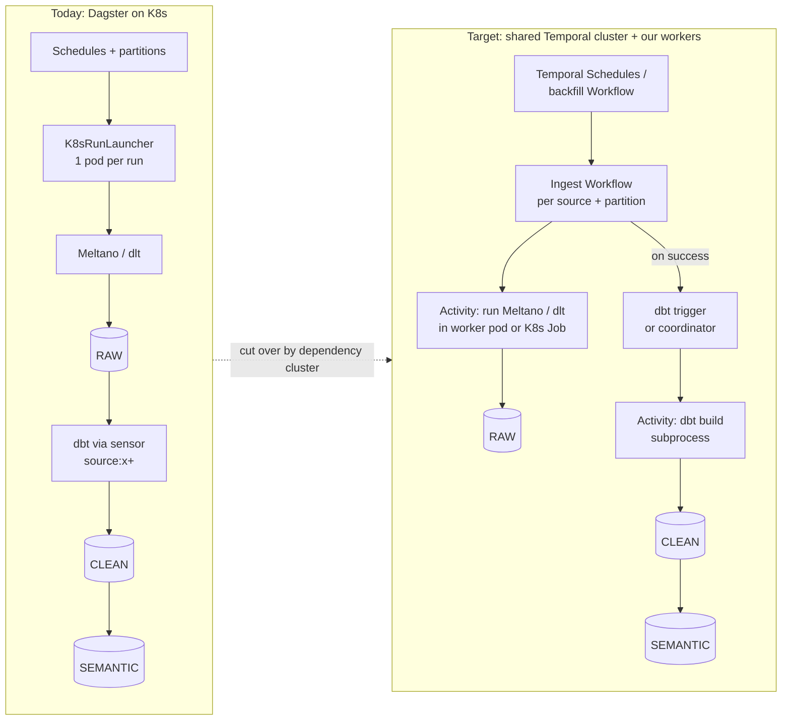

# Dagster → Temporal migration plan

> **Key takeaways**
> - This folder plans the move of ~50 ingestion jobs (Meltano or dlt → Snowflake `RAW`, then dbt → `CLEAN` → `SEMANTIC`) from self-hosted Dagster on Kubernetes to the **company's shared Temporal cluster**.
> - It separates what is **already verified** (no POC needed) from what is **unknown** (POC needed). Each unknown maps to one POC with pass/fail criteria.
> - **Blocker:** the shared Temporal cluster has **no persistent DB** yet; Temporal needs one (RDS PostgreSQL or MySQL). Request it first.
> - Highest risks after that: partitions and backfills (> 75 % of jobs), per-job resource isolation, shared API rate limits, and ELT state/duplicates under Temporal's retry model.
> - The team answered Q1–Q25 on 2026-11-12. Follow-up questions **F1–F8** are in [01](01-current-state-and-questions.md).

As of 2026-11-12. Builds on the comparison in [`docs/`](../docs/) and [`comparison-matrix.md`](../comparison-matrix.md). Sources use the same numbering as [`references/sources.md`](../references/sources.md) (S118 onward were added for this plan).

## Reading order

| # | Doc | What it answers |
|---|---|---|
| 01 | [Current state and questions](01-current-state-and-questions.md) | Today's setup and target, from the team's answers; follow-up questions |
| 02 | [Feature mapping](02-feature-mapping.md) | Each Dagster feature in use → Temporal equivalent → **Known** or **Unknown** |
| 03 | [Unknowns register](03-unknowns-register.md) | Every unknown or "might not work" item, with risk and the POC that closes it |
| 04 | [POC plan](04-poc-plan.md) | One card per POC: question, scope, steps, pass/fail, effort |
| 05 | [Migration plan](05-migration-plan.md) | Phases, cutover by dependency cluster, per-source runbook, rollback |

## Big picture

## Status legend used in this folder

| Label | Meaning |
|---|---|
| **Known** | Stated in official docs we fetched; cited inline. No POC. |
| **Unknown** | Not stated in docs, or depends on how our setup behaves. Needs a POC. |
| **Inference** | Our reasoning from docs, not a doc statement. Treated as unknown when it carries risk. |
| **Q#** | Needs an answer from the team (see [01](01-current-state-and-questions.md)). |
